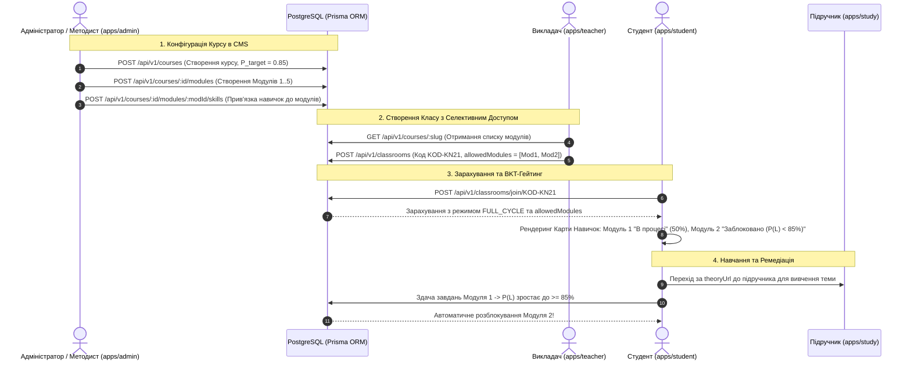

# ⚙️ Документація Застосунка «Панель Адміністратора та Методиста» (`apps/admin`)

Цей документ визначає повну технічну та методичну архітектуру веб-застосунка **«Панель Адміністратора та Методиста» (`apps/admin`)**, що функціонує на порту `3004` у складі платформи **Smart-BKT-Chain**.

---

## 🎯 1. Призначення та Роль Методичного Центру

Застосунок `apps/admin` призначений для:
1. **Проєктування навчальних курсів:** створення структури дисциплін, описів та прив'язки авторів.
2. **Конструювання графу компетенцій (Skill DAG):** формування орієнтованого ациклічного графу знань, встановлення пререквізитів та залежностей між темами.
3. **Калібрування параметрів моделі BKT:** налаштування апріорних ймовірностей $P(L_0)$, транзицій $P(T)$, ймовірностей помилки $P(S)$ та вгадування $P(G)$ для кожної навички.
4. **Керування банком завдань:** наповнення завдань коду, тест-кейсів, квізів та оман (Misconceptions).
5. **Експорт ШІ-датасетів та аудит подій:** фільтрація та вивантаження дій студентів у форматах JSONL та CSV для навчання моделей глибокого відстеження знань (DKT, SAKT, PyTorch).
6. **Автономний математичний аудит BKT:** прямий запуск перевірочного скрипта `scripts/verify_bkt_math.py`, контроль 10 еталонних математичних інваріантів, аудит потоку подій `logs/event_stream.jsonl` та інтерактивний BKT Sandbox.

---

## 🏛️ 2. Архітектура Інтерфейсу (Minimalist Borderless UI — AppShellLayout v2.0)

Інтерфейс застосунка реалізовано на базі канонічного компонента **`AppShellLayout`** (`@sbc/ui`) за принципом **Minimalist Borderless Design** із суворою ізоляцією скролінгу:
- **Кореневий контейнер (`h-screen w-screen overflow-hidden`):** вікно зафіксоване, браузерний глобальний скрол вимкнено.
- **Дворівнева шапка (`h-[56px]` — Minimalist Two-Tier Header):** брендинг `Smart-BKT-Chain` із моноширинним підписом `Admin`, назва `Методичний центр`, другий поверх хлібних крихт `Breadcrumbs` з текстовим лічильником `({N} навичок)`, плоска кнопка переходу до Кабінету Викладача та безрамковий тригер спільного **`UserProfileDrawer`**.
- **Вертикальна рейка Minimalist Borderless Icon Rail (`w-12`):** швидкі безрамкові вкладки (`w-9 h-9 rounded-lg`):
  - `dag` (Network): конструювання графу компетенцій (Skill DAG Editor);
  - `courses` (BookOpen): реєстр навчальних дисциплін та управління курсами;
  - `users` (Users): центр керування користувачами, ролями RBAC, тумблером тестового режиму та індивідуальним зарахуванням на курси;
  - `datasets` (Database): експорт датасетів для ШІ та аудит-логи дій учнів;
  - `verifier` (Activity): математичний аудит BKT, запуск еталонних тестів та live-калькулятор;
  - *Нижній стек екосистеми:* автоматичні безрамкові посилання через `@sbc/routes` на Підручник (`apps/study`), Студентський кабінет (`apps/student`), Кабінет Викладача (`apps/teacher`), Документацію (`apps/docs`) та системні налаштування (`system`).
- **Висувний Drawer (`sm:w-[300px] lg:w-[320px]`) та `UserProfileDrawer`:** структуровані на базі безрамкових секцій `<DrawerSection>` (Правило 7) з текстовими лічильниками `({badge})` та розділювачами `divide-y divide-slate-800/50`.
- **Центральне полотно (`<main className="flex-1 overflow-y-auto">` — Clean Borderless Canvas):** редактори графу `SkillDagEditor`, менеджер курсів `CourseManager` та системні консолі без зайвої зовнішньої картки-обгортки, розділені тонкими лініями `border-b border-slate-800/80`.

---

## 🛠️ 3. Технічний Стек та Запуск
- **Стек:** Next.js 16 (Webpack mode), React 19, Tailwind CSS v4, Lucide React, `@sbc/types`, `@sbc/ui`.
- **Запуск у режимі розробки:**
  ```bash
  npm run dev:admin
  ```
  *(Доступно за адресою: [http://localhost:3004](http://localhost:3004))*.
- **Production-збірка:**
  ```bash
  npm run build:admin
  ```

---

## 🔬 4. Центр Математичного Аудиту BKT (`BktAuditVerifierCenter`)

Вкладка **«Математичний Аудит BKT & Верифікатор»** (`verifier`) реалізує графічну панель запуску та візуалізації верифікаційного скрипта `scripts/verify_bkt_math.py`:

1. **Керування перевіркою в один клік:**
   - Кнопка **«10 Еталонних Тестів»**: викликає `POST /api/v1/bkt/audit/verify?mode=test-only`, отримує результати 10 інваріантів BKT за $\sim 300\text{ мс}$ та рендерить статус.
   - Кнопка **«Аудит Журналу Подій»**: викликає `POST /api/v1/bkt/audit/verify?mode=full`, перевіряє живий файл `logs/event_stream.jsonl` та порівнює апостеріорні ймовірності з базою даних.
2. **Верхнє табло індикаторів:**
   - Статус математичного ядра: `100% ТОЧНІСТЬ` (зелений індикатор).
   - Лічильник тестів: `10 / 10 PASSED`.
   - Журнал подій: кількість зафіксованих подій у файлі.
   - Швидкодія: час виконання процесу в мілісекундах.
3. **Чотири інтерактивні підрозділи:**
   - **10 Інваріантних Тестів:** детальний перелік формул спостереження, чисельників, знаменників, параметрів $S/G$ та статусу проходження.
   - **Аудит Журналу Подій:** розгортка відповідей студентів з перевіркою відхилення $\Delta \le 0.0002$.
   - **Live Калькулятор BKT (Sandbox):** інтерактивна пісочниця з повзунками $P(L_{t-1})$, $P(T)$, $P(S)$, $P(G)$, вибором результату та штрафу підказок Сократа для симуляції оцінювання в реальному часі.
   - **Термінальний Вивід:** оригінальний вивід STDOUT з консолі з кнопкою копіювання.

---

## 👥 5. Центр Керування Користувачами та Доступом (`UserManagementCenter`)

Вкладка **«Керування Користувачами & Доступом»** (`users`) забезпечує адміністрування облікових записів, моніторинг входу через Google OAuth 2.0 та конфігурацію навчальних режимів:

1. **Керування Тестовим Режимом (Test Mode Bypass):**
   - Інтерактивний тумблер `SYSTEM_AUTH_TEST_MODE`: дозволяє миттєвий тестовий вхід (студент, викладач, адмін) без необхідності підключення Google API під час презентацій або офлайн-тестування.
2. **Метрики Користувачів:**
   - Чотири показники у верхній смужці: загальна кількість акаунтів, студенти, викладачі та користувачі, авторизовані через Google.
3. **Фільтри та Пошук:**
   - Пошуковий рядок за ім'ям або email.
   - Швидкі кнопки фільтрації ролей: `Всі`, `Студенти`, `Викладачі`, `Адміни`.
4. **Управління Профілями та Правами:**
   - Модальне вікно `UserModal`: створення нового облікового запису або зміна ролі (`STUDENT`, `TEACHER`, `ADMIN`, `RECRUITER`) та статусу (`ACTIVE`, `SUSPENDED`).
   - Модальне вікно `EnrollCourseModal`: підключення будь-якого курсу учню з вибором дидактичного режиму:
     - `FULL_CYCLE`: конспект теорії + адаптивний тренажер BKT;
     - `TESTING_ONLY`: чистий зріз знань / діагностика без обов'язкового читання;
     - `MODULAR`: доступ до обраних модулів.
   - Блокування та розблокування акаунтів в 1 клік.

---

## 📚 6. Динамічний Конструктор Курсів, Модульний CMS та Пороги BKT (`CourseManager`)

Вкладка **«Керування Курсами & Завданнями»** (`courses`) забезпечує повний життєвий цикл дисциплін та їх модульної структури відповідно до 4-рівневої дидактичної моделі:

$$\text{Курс} \longrightarrow \text{Модулі} \longrightarrow \text{Компетенції (Skill DAG)} \longrightarrow \text{Завдання & Теорія}$$

### 6.1 Головний Реєстр Дисциплін (`CourseManager.tsx`)
1. **Інформаційне табло та пошук:**
   - Живий рядок пошуку курсів за назвою або слагом (`js-dev`, `web-foundations`, `english-b2`, `ukraine-law`).
   - Кнопка швидкого створення нової дисципліни `+ Створити Новий Курс`.
2. **Картки курсів за стандартом Minimalist Borderless UI:**
   - Відображення ідентифікатора слага, назви, опису та цільової аудиторії (`targetAudience`: *10–11 класи / Студенти ВНЗ*).
   - **Бейдж порогу BKT Target:** `BKT P(L): 0.85` — цільова ймовірність знання, необхідна для зарахування модуля та переходу далі.
   - **Бейдж статусу видимості:** `Опубліковано` (зелений індикатор) або `Чернетка` (сірий індикатор).
   - **Аналітичні лічильники:** кількість створених модулів `[Модулі (N)]`, прив'язаних компетенцій графу, навчальних груп та зареєстрованих учнів.
3. **Швидкі дії над курсом:**
   - `[Модулі (N)]` — відкриття модульного конструктора `ModuleManagerModal`.
   - `[Редагувати]` — виклик модального вікна налаштувань `CourseEditModal`.
   - `[Видалити]` — безпечне видалення дисципліни з підтвердженням.

### 6.2 Редактор Параметрів Курсу (`CourseEditModal.tsx`)
Дозволяє налаштовувати глобальні дидактичні параметри дисципліни:
- **Назва курсу (`title`) та Слаг (`slug`):** унікальний ідентифікатор для URL (наприклад, `/practice/js-dev` або `/lesson/js-dev`).
- **Опис дисципліни (`description`):** анотація для студентського порталу та кабінету вчителя.
- **Цільова аудиторія (`targetAudience`):** категорія здобувачів освіти.
- **Нормативний поріг майстерності BKT (`defaultMasteryThreshold`):** десятковий дріб від $0.50$ до $0.99$ (за замовчуванням $0.85$). Цей поріг наслідується всіма створюваними модулями курсу.
- **Тумблер публікації (`isPublished`):** перемикач видимості в каталозі курсів для студентів та викладачів.

### 6.3 Модульний Конструктор Курсу (`ModuleManagerModal.tsx`)
Забезпечує декомпозицію курсу на тематичні розділи (модулі):
1. **Ієрархія та впорядкування:**
   - Кожен модуль має порядковий індекс `orderIndex` (1, 2, 3...), що визначає строгу хронологію вивчення.
   - Назва розділу (наприклад, *«Модуль 1: Змінні, Типи та Оператори»*).
2. **Прив'язка теоретичного конспекту (`theoryUrl`):**
   - Прямий лінк на лекційний матеріал у підручнику `apps/study` (наприклад, `/lesson/syntax-and-variables`).
3. **Індивідуальний поріг BKT (`minMasteryThreshold`):**
   - Можливість перевизначення порогу для складних модулів (наприклад, підвищити до $0.90$ для теми «Асинхронність JS»).
4. **Масове призначення компетенцій графу навичок:**
   - Кнопка `[Прив'язати навички]` відкриває модальний селектор усіх наявних у курсі вузлів Skill DAG.
   - Методист відмічає чекбоксами навички, що належать до цього модуля (наприклад, `variables-declaration`, `primitives-vs-objects`), і вони записуються через `POST /api/v1/courses/:courseId/modules/:moduleId/skills`.

---

## 🔄 7. Наскрізний Потік Даних між Застосунками Екосистеми (Ecosystem Data Flow)

Впроваджений механізм курсів та модулів зв'язує всі 5 застосунків платформи в єдиний дидактичний контур:



1. **Адміністратор (`apps/admin`, порт 3004):**
   - Створює курс `js-dev`, задає поріг $P_{\text{target}} = 0.85$.
   - Створює модулі 1..5, пов'язує їх із посиланнями на лекції в `apps/study` (`theoryUrl`) та прив'язує відповідні вузли Skill DAG.
2. **Викладач (`apps/teacher`, порт 3003):**
   - Створює навчальну групу (наприклад, «11-А») із промокодом `KOD-KN21`.
   - Обирає дидактичний режим (`FULL_CYCLE`, `TESTING_ONLY`, `MODULAR`) та, за потреби, обмежує перелік дозволених модулів (`allowedModules: [mod1, mod2]`).
3. **Студент (`apps/student`, порт 3002):**
   - Вводить код або переходить за посиланням `/join/KOD-KN21`.
   - Бачить Карту Навичок із чітким модульним розбиттям: Модуль 1 відкритий, а Модулі 2–5 заблоковані із замком `Lock` та зрозумілим педагогічним правилом: *«Опануйте попередній модуль з P(L) ≥ 85%»*.
   - Після досягнення $\overline{P}(L_{\text{module } 1}) \ge 0.85$ система без затримок автоматично відкриває Модуль 2.
4. **Підручник (`apps/study`, порт 3006):**
   - Надає повнотекстовий теоретичний лонгрід у режимі фокусування Zen Focus Reading Engine за адресою `theoryUrl` для первинного опанування чи усунення прогалин (Remediation).


