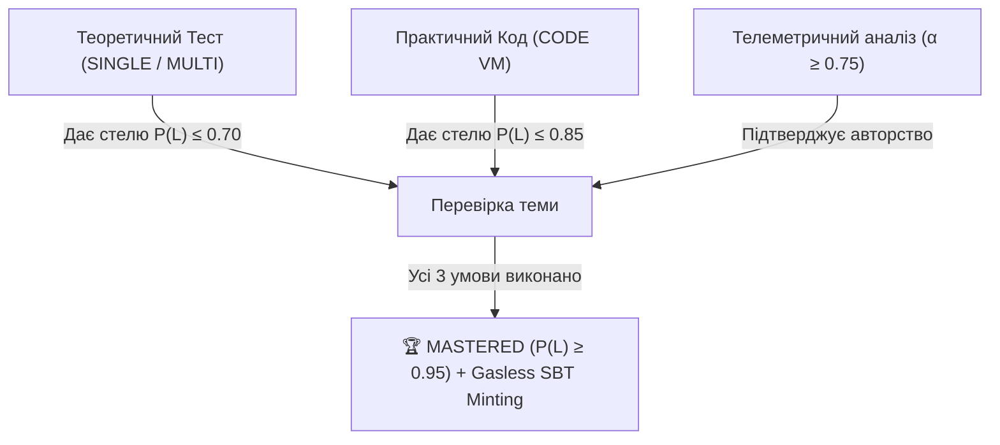

# 🧠 Сесія 01: Максимально точне оцінювання засвоєння теми студентом на основі різнотипних завдань та телеметрії

- **Дата:** 12 жовтня 2026
- **Учасники:** Користувач & AI Архітектор (Antigravity)
- **Статус:** Концептуальний дизайн (Brainstorm)
- **Проблематика:** Класичний алгоритм Bayesian Knowledge Tracing (BKT) оперує бінарними значеннями (`Correct` або `Incorrect`) із фіксованими апріорними ймовірностями вгадування $P(G)$ та випадкової помилки $P(S)$. У реальній системі завдання мають різну когнітивну вагу, а за кожною дією стоїть поведінкова телеметрія (WPM, вставки, паузи). Як об'єктивно виміряти реальне знання і відсіяти списування чи випадковий успіх?

---

## 1. 🎯 Когнітивний Профіль Типів Завдань

Кожен тип завдання активує різні рівні за таксономією Блума і має специфічні «сліпі зони»:

| Тип завдання | Рівень Блума | Ризик хибного успіху (False Positive) | Ризик випадкової помилки (False Negative) |
| :--- | :--- | :--- | :--- |
| **`SINGLE_CHOICE`** (1 з 4) | Впізнавання / Знання | **Критичний** (25% чистий рандом, підглядання) | Мінімальний (випадковий клік) |
| **`MULTIPLE_CHOICE`** (N з M) | Аналіз / Класифікація | Помірний (часткове комбінаторне вгадування) | Середній (не догледів 1 з 4 пунктів) |
| **`CODE` (VM Test Runner)** | Застосування / Синтез | **Високий через ChatGPT / буфер обміну** (Copy-Paste) | Високий (синтаксична дрібниця при правильній логіці) |
| **`TEXT_ESSAY`** (Розгорнута відповідь) | Оцінка / Розуміння | Списування шаблонів тексту | Суб'єктивність NLP перевірки |

---

## 2. ⚡ Концепція 1: Динамічні $P(G)$ та $P(S)$ (Dynamic BKT Parameters)

У класичній байєсівській формулі перерахунку знання:
$$P(L_t \mid \text{Correct}) = \frac{P(L_{t-1}) \cdot (1 - P(S))}{P(L_{t-1}) \cdot (1 - P(S)) + (1 - P(L_{t-1})) \cdot P(G)}$$

Замість констант $P(G) = 0.2$ та $P(S) = 0.1$, ми розраховуємо їх **динамічно в момент здачі відповіді**:

### 2.1. Для тестів `SINGLE_CHOICE`:
- Базове $P(G) = \frac{1}{K}$ ($0.25$ для 4 варіантів).
- **Часовий штраф (Time Penalty):** Якщо час відповіді $T_{\text{submit}} < 3.0\text{ с}$ (фізично неможливо прочитати умову та подумати):
  $$P(G) \longrightarrow 0.85$$
  *Результат:* знання студента $P(L_t)$ практично не зростає, навіть якщо відповідь виявилася правильною!
- Якщо $T_{\text{submit}} \in [15\text{ с}, 60\text{ с}]$ — $P(G) = 0.25$.

### 2.2. Для тестів `MULTIPLE_CHOICE` (Partial Credit):
- Використовуємо коефіцієнт подібності Жаккара (Jaccard Index) між множиною обраних відповідей $A$ та правильних $C$:
  $$J(A, C) = \frac{|A \cap C|}{|A \cup C|}$$
- Якщо студент обрав 3 правильні відповіді з 4 і не вибрав жодної хибної ($J = 0.75$), це розглядається не як повний провал, а як частковий перерахунок знання з масштабованою вагою.

### 2.3. Для кодових задач `CODE`:
- **Коефіцієнт успішності тест-кейсів:**
  $$\text{PassRate} = \frac{\text{Passed Tests}}{\text{Total Tests}}$$
- **Ітераційний коефіцієнт дебагу:**
  - Здав з 1-ї спроби за 4 секунди $\rightarrow$ висока підозра на Paste $\rightarrow P(G) \uparrow 0.75$.
  - Здав після 3-4 ітерацій запуску тестів і виправлення помилок $\rightarrow$ студент навчався у процесі $\rightarrow$ збільшується коефіцієнт переходу $P(T) \uparrow$.

---

## 3. 🛡️ Концепція 2: Індекс Когнітивної Достовірності ($\alpha$-Score)

У Monaco Editor телеметрія збирає:
- **$WPM$** — швидкість введення символів.
- **$CopyPasteRatio \in [0, 1]$** — частка вставленого коду з буфера обміну.
- **$FatigueIndex$** — паузи роздумів та видалення блоків тексту.

Обчислюємо **Коефіцієнт Достовірності (Authenticity Score $\alpha \in [0.1, 1.0]$)**:
$$\alpha = \max\Big(0.1, \; (1 - CopyPasteRatio) \cdot \text{CadencePenalty}(WPM)\Big)$$

- **Якщо $\alpha \ge 0.8$ (Природний набір, низький копіпаст):**
  Оновлення BKT застосовується на 100%. Модуль реально опановується.
- **Якщо $\alpha < 0.3$ (Вставив готовий код за 2 секунди, $CopyPasteRatio \ge 0.70$):**
  - **Захисний механізм:** Незважаючи на 100% проходження тестів, система розглядає це як $P(G) \ge 0.85$.
  - Знання зростає мінімально.
  - Студенту пропонується обов'язковий **бліц-контроль (Verification Quiz)**: 2 короткі питання щодо використаного алгоритму без доступу до буфера обміну.

---

## 4. 📐 Концепція 3: Метод Триангуляції Опанування Теми

Тема (навичка) не може отримати фінальний статус **`MASTERED` ($P(L) \ge 0.95$)** за виконання лише одного типу завдань:

1. **Комбінований мінімум модуля:**
   - Щоб відкрити статус `MASTERED`, модуль повинен містити щонайменше:
     - 1 концептуальний тест (розуміння термінів і логіки).
     - 1 практичну кодову задачу (застосування знання).
2. **Захист від застарівання знань (Memory Decay):**
   - Для запобігання втрати знань із часом, $P(L)$ попередніх модулів може плавно зменшуватися за кривою Еббінгауза:
     $$P(L_t) = P(L_0) \cdot e^{-\lambda \Delta t}$$
   - Це стимулює повторення матеріалу перед проходженням фінальних квестів.

---

## 5. 📋 Підсумок та Наступні Кроки

| Крок | Завдання | Очікуваний результат |
| :---: | :--- | :--- |
| **Крок 1** | Реалізація динамічного $P(G)$ на основі часу відповіді та типу тесту в бекенді NestJS | Захист від рандомного клікання в тестах |
| **Крок 2** | Інтеграція $\alpha$-Score (телеметрія WPM + CopyPaste) в перерахунок BKT | Захист від недоброчесного вставляння коду |
| **Крок 3** | Правило мульти-критеріального Mastered статусу в Skill DAG | Об'єктивна оцінка реального опанування теми |
