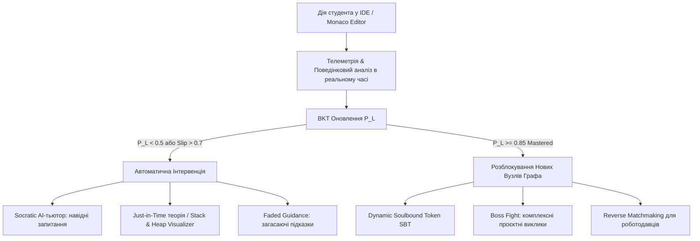

# 🚀 Brainstorm 02: Smart-BKT-Chain — Це Не Лише Тестування, а Повноцінна Освітня EdTech-Екосистема

**Дата:** 13 жовтня 2026  
**Статус:** Концептуальний дизайн / Brainstorm  
**Фундаментальне питання сесії:** Наша система — це не лише тестування, а повноцінна освітня система edTech. Які будуть ідеї?

---

## 🌟 1. Головна Парадигма: Від «Пасивного Екзаменатора» до «Живого Освітнього Навігатора»

Традиційні тестові платформи страждають від синдрому «пасивного екзаменатора»: вони чекають на помилку учня, карають його оцінкою і ставлять крапку.

Якщо розглядати **Smart-BKT-Chain** не просто як «тестер знань / оцінювач», а як **повноцінну адаптивну EdTech-екосистему нового покоління**, у нас відкривається колосальний простір.

З огляду на закладені стовпи системи:
* **Динамічний граф знань (DAG)** передумов та зв'язків
* **Математика BKT (Bayesian Knowledge Tracing)** з латентною оцінкою $P(L)$
* **Телеметрія в реальному часі** (Monaco Editor, швидкість друку WPM, паузи, детекція копіпасту)
* **WebSockets та реактивний зворотний зв'язок**
* **Блокчейн-верифікація**

Система стає живим циклом:
$$\text{Діагностика на льоту} \longrightarrow \text{Своєчасна Інтервенція (Just-in-Time)} \longrightarrow \text{AI-Scaffolding} \longrightarrow \text{Proof of Competence}$$



---

## 💡 2. Шість Проривних Напрямків EdTech-Екосистеми

### 1. 🧭 Dynamic Adaptive Learning Pathways (Персоналізована навчальна траєкторія)
Замість лінійного підручника система стає **живим навігатором (Learning GPS)**:
* **Micro-Remediation & Just-in-Time Theory:**
  - Коли BKT детектує падіння $P(L_n)$ або високий коефіцієнт $Slip$ / застрягання на телеметрії, система не просто ставить «двійку», а генерує **інтерактивну інтервенцію**: інтерактивний слайд, 45-секундну анімацію, або mini-sandbox для відпрацювання одного вузького правила.
* **Багатоваріантне пояснення (Multi-Modal Explanations):**
  - Якщо учень не засвоює знання через чистий код, система перемикається на візуальну діаграму пам'яті (*Call Stack / Heap visualizer*), текстову аналогію або інтерактивний покроковий дебагер.
* **Spaced Repetition на основі графа (Забування за Еббінгаузом + BKT):**
  - Автоматичний розрахунок латентного розпаду знання: якщо концепція $K_i$ не практикувалася 2 тижні, алгоритм акуратно підмішує 1 мікро-завдання у наступну сесію:
    $$P(L_{t+\Delta t}) = P(L_t) \cdot e^{-\lambda \cdot \Delta t}$$

---

### 2. 🤖 AI-Scaffolding & Співпраця з AI-тьютором (Зона найближчого розвитку за Виготським)
Замість того, щоб учень гуглив відповіді або копіював у ChatGPT:
* **Контекстний Socratic AI-Тьютор:**
  - AI «бачить» поточний стан графа навичок і телеметрію (частоту видалень, зупинки).
  - AI **ніколи не дає готовий код**, а ставить навідні запитання (*«Поглянь на умову виходу з рекурсії на рядку 12: що станеться, коли `n === 0`?»*).
* **Faded Guidance (Загасаючі підказки):**
  - **Рівень 1 ($P(L) < 0.3$):** шаблон коду з детальними `TODO` та типами.
  - **Рівень 2 ($P(L) \approx 0.6$):** лише сигнатура та граничні випадки.
  - **Рівень 3 ($P(L) > 0.85$ Mastered):** чистий аркуш та відкрита інженерна задача.

---

### 3. 🎮 Гейміфікація та RPG-метафора (Engagement Engine)
Спираючись на реалізований `GameSkillTreeWidget`:
* **Дерево талантів розробника (Tech Tree):**
  - Студент буквально прокачує гілки: *Backend Architect*, *Concurrency Wizard*, *Algorithm Grandmaster*.
  - Кожен розблокований вузол BKT відкриває візуальні артефакти, кастомні теми IDE, доступ до "бос-файтів".
* **Boss Fights (Комплексні проєктні виклики):**
  - Це не просто тест, а завдання з високим ступенем ентропії (наприклад, оптимізувати чужий повільний код, знайти memory leak або пофіксити зламаний REST API під навантаженням).
* **Спільні рейди (Pair-Programming & Code Review Quests):**
  - Студенти з взаємодоповнюючими знаннями (один майстер у $Skill_A$, інший у $Skill_B$) об'єднуються в тандеми для парного розв'язання та взаємного рев'ю коду.

---

### 4. 🔗 Trust & Credentialing: Від оцінок до "Proof of Competence" (Blockchain & On-Chain)
Перехід від фіктивних дипломів до незаперечного портфоліо знань:
* **Dynamic Soulbound Skill Badges (SBT):**
  - NFT або verifiable credentials, прив'язані до адреси студента, метадані яких відображають актуальний стан графа навичок.
* **Proof-of-Original-Code (Криптографічний доказ автентичності):**
  - Завдяки телеметрії друку (частота натискань клавіш, послідовність виправлень) система створює математичний доказ того, що код написаний людиною в процесі розумової діяльності, а не вставлений з буфера за секунду.
  - Роботодавці та рекрутери отримують верифікований звіт реальної компетентності та швидкості мислення (вирішення проблеми списування через ChatGPT).

---

### 5. 🧑‍🏫 Teacher Co-Pilot & Аналітика аудиторії (Classroom Nervous System)
Для викладачів, менторів та навчальних центрів:
* **Теплова карта когнітивного навантаження групи (Live Classroom Heatmap):**
  - Викладач під час лекції/практикуму в реальному часі бачить: 40% аудиторії зараз «застрягли» на концепції «Замикання (Closures)».
* **Automated Intervention Alerts:**
  - AI сигналізує ментору: *«Учень Андрій уже 15 хвилин має $P(Slip) > 0.8$ і 12 невдалих компіляцій. Рекомендовано підійти / призначити 5-хвилинний 1-on-1»*.
* **Генератор контенту за дефіцитом навичок:**
  - Викладач натискає кнопку: *«Згенерувати 3 варіанти домашнього завдання на тему Асинхронність для тих, у кого $P(L) < 0.5$»*.

---

### 6. 💼 Екосистема переходів: "Learn-to-Work" Pipeline
* **Симуляція реального робочого середовища (Virtual Engineering Workplace):**
  - Студент працює не з абстрактними задачками, а з симульованими PR (Pull Requests), читає багрепорти від "QA ботів", проводить Code Review віртуальних колег.
* **Reverse Matchmaking:**
  - Роботодавці шукають не «Junior без досвіду», а кандидата з верифікованим mastery $P(L) \ge 0.9$ у конкретних графах (*SQL Indexing*, *WebSocket streaming*, *NestJS Architecture*).

---

## 📊 3. Порівняльна матриця: Тестувальник vs Повноцінний EdTech

| Критерій | Традиційна система тестування | Smart-BKT-Chain EdTech Ecosystem |
| :--- | :--- | :--- |
| **Головна мета** | Зафіксувати оцінку (Summative Assessment) | Довести студента до гарантованого освоєння знань (Mastery Learning) |
| **Реакція на помилку** | Зниження балу / покарання | Автоматична діагностика, Socratic-підказка, Just-in-Time мікро-теорія |
| **Освітній маршрут** | Фіксований лінійний список завдань | Динамічний графовий навігатор (*Learning GPS*) з заповненням прогалин |
| **Робота з ШІ** | ШІ як загроза (студенти копіюють відповіді) | Socratic AI-Тьютор з Faded Guidance, який вчить думати самостійно |
| **Мотивація** | Страх отримати низький бал | RPG Skill Tree, прокачування дерева талантів, бос-файти, парні рейди |
| **Роль викладача** | Рутинна перевірка та оцінювання робіт | Фасилітатор, озброєний реальною тепловою картою когнітивного пульсу групи |
| **Фінальний результат** | Формальна оцінка або паперовий диплом | On-chain Soulbound токен (SBT), верифіковане портфоліо мислення та Reverse Matchmaking |

---

## 🛠️ 4. Еволюційна Дорожня Карта (Roadmap)

```mermaid
timeline
    title Еволюція Smart-BKT-Chain в EdTech-Екосистему
    section Фаза 1: Тьюторинг та Інтервенції
        Just-in-Time Theory Tabs : Мікро-слайди та візуалізатори Call Stack / Heap
        Socratic AI-Scaffolding : Навідні запитання без прямої видачі коду
    section Фаза 2: Пульс Аудиторії
        Live Classroom Heatmap : Живий WebSocket-моніторинг викладача
        Intervention Alerts : Сповіщення про застрягання студентів
    section Фаза 3: Інженерний RPG-Світ
        Game Skill Tree Progression : Прокачування гілок Архітектури та Алгоритмів
        Boss Fights & Pair Quests : Комплексні виклики та парні рейди
    section Фаза 4: Індустріальний Міст
        Proof-of-Original-Code : Аналіз телеметрії проти списування
        Soulbound SBT & Reverse Matchmaking : Криптографічні бейджі та прямий найм талантів
```
