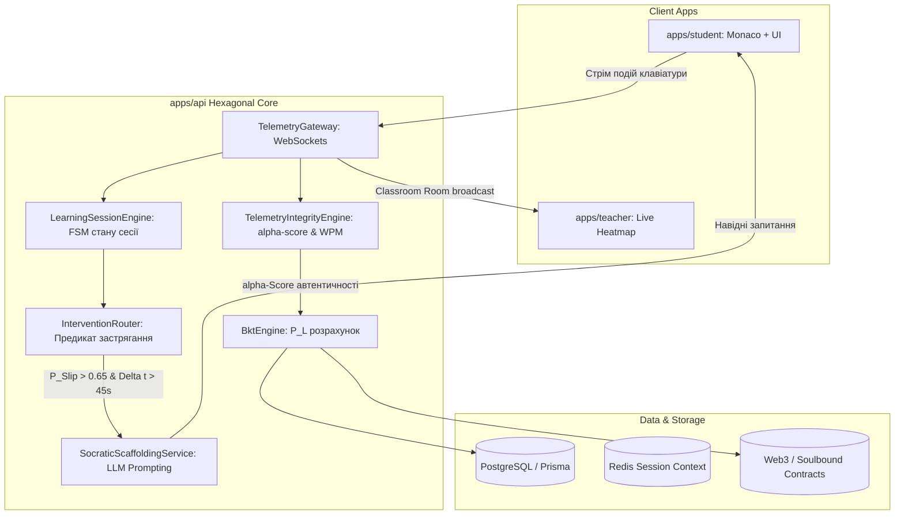

# ⚙️ Brainstorm 03: Суто Технічна Архітектура EdTech-Платформи Smart-BKT-Chain

**Дата:** 13 жовтня 2026  
**Статус:** Концептуальний дизайн / Архітектурний Brainstorm  
**Фокус:** Як концепція повноцінної EdTech-екосистеми фізично реалізується в межах нашого монорепозиторію та існуючого технологічного стеку.

---

## 🏗️ 1. Технологічний Стек та Компоненти Монорепозиторію

Реалізація спирається на діючу структуру проєкту:
* **`apps/api`**: NestJS (Гексагональна архітектура Ports & Adapters, WebSockets Gateway, Node.js VM Sandbox, REST OpenAPI).
* **`apps/student`**: Next.js 16 (React 19, Monaco Editor, Tailwind CSS 4, WebSocket-клієнт).
* **`apps/teacher`**: Next.js 16 (React 19, Cytoscape DAG граф курсів, Recharts аналітика).
* **`apps/admin`**: Next.js 16 (Керування курсами, графом залежностей, сидування даних).
* **`packages/database`**: Prisma ORM, PostgreSQL, міграції та схеми даних.
* **`packages/contracts`**: Web3 смарт-контракти (Soulbound Tokens SBT, верифікація доказів).

---

## 🧩 2. Архітектура Доменів та Модулів у `apps/api` (Backend Hexagonal Core)

Зараз у ядрі бекенду діють модулі: `bkt`, `task`, `telemetry`, `course`, `submission`.  
Для трансформації у повноцінну навчальну систему Hexagonal Core розширюється такими підсистемами:



### 2.1. `LearningSessionEngine` (Оркестратор Сесії Навчання)
Це скінченний автомат (FSM — Finite State Machine) когнітивної сесії студента:
$$\text{STATE: } \text{DIAGNOSTIC} \longrightarrow \text{PRACTICE} \longrightarrow \text{INTERVENTION\_TRIGGERED} \longrightarrow \text{SCAFFOLDED\_PRACTICE} \longrightarrow \text{MASTERY\_VERIFIED}$$
* Зберігає стан активної сесії у Redis / оперативній пам'яті: поточна відкрита задача, кількість спроб запуску тестів, накопичена телеметрія, активні підказки, тривалість фокусу.

### 2.2. `InterventionRouter` (Роутер Навчальних Інтервенцій)
Слухає потік подій від `TelemetryGateway` та `BktEngine`.
* **Предикат спрацьовування інтервенції (Trigger Predicate):**
  $$\Delta t_{\text{idle}} > 45\text{ с} \quad \text{AND} \quad P(Slip) > 0.65 \quad \text{AND} \quad \text{failedRuns} \ge 2$$
* Роутер **не чекає фінального сабміту**, а миттєво пушить через WebSocket подію `INTERVENTION_SUGGESTED` із типом:
  - `MICRO_THEORY`: посилання на 45-секундний концептуальний слайд.
  - `VISUAL_SIMULATION`: запуск пісочниці візуалізації пам'яті (Call Stack / Heap / Event Loop).
  - `SOCRATIC_HINT`: запуск сократівського навідного запитання.

### 2.3. `SocraticScaffoldingService` (AI-Тьютор на базі LLM)
Працює через жорсткий System Prompt та ін'єкцію контексту (Context Injection):
* **Вхідні дані:** AST-аналіз коду студента, помилка компілятора / тестів, поточний $P(L_t)$, історія телеметрії (що саме учень видаляв тричі).
* **Правила генерації:** Temperature = 0.2, нульова толерантність до видачі готового робочого коду, генерація запитань у форматі:
  $$\text{Спостереження за кодом} \longrightarrow \text{Виявлена аномалія} \longrightarrow \text{Навідне запитання}$$

### 2.4. `TelemetryIntegrityEngine` (Оцінка Автентичності та Анти-Чит)
Аналізує потік подій Monaco Editor (`keystroke_timing`, `paste_event`, `selection_change`):
* **$WPM_{\text{instant}}$ (Миттєва швидкість набору):** якщо вставлено 300 символів за 10 мс без послідовного друку — фіксується подія `CLIPBOARD_INJECTION`.
* **$\text{Burstiness}$ (Коефіцієнт варіації інтервалів між натисканнями):** жива людина має високу варіативність, бо обдумує кожен вираз; боти або скрипти емулюють набір монотонно.
* Формує підсумковий $\alpha$-Score ($0.0 \dots 1.0$) для підписання верифікованого досягнення в блокчейн.

---

## 🗄️ 3. Еволюція Моделі Даних (`packages/database/prisma/schema.prisma`)

Для підтримки інтерактивного навчання схема бази розширюється новими сутностями:

```prisma
// 1. Інтерактивні теоретичні мікро-модулі
model TheorySnippet {
  id            String      @id @default(uuid())
  skillId       String
  skill         SkillNode   @relation(fields: [skillId], references: [id])
  title         String
  contentMd     String      // Markdown теорії
  mediaType     String      // "MARKDOWN" | "STACK_VISUALIZER" | "EVENT_LOOP_SIM" | "VIDEO_SHORT"
  mediaPayload  Json?       // конфігурація для інтерактивних віджетів
  readingTimeSec Int        @default(45)
  createdAt     DateTime    @default(now())
}

// 2. Лог та стан AI-тьюторингу (Scaffolding History)
model SocraticDialogue {
  id            String      @id @default(uuid())
  userId        String
  taskId        String
  skillId       String
  promptContext Json        // знімок помилки, коду, телеметрії
  aiQuestion    String      // поставлене навідне запитання
  studentReply  String?     // відповідь студента
  tierLevel     Int         @default(1) // 1 = Hint, 2 = Pseudocode, 3 = Edge-case
  createdAt     DateTime    @default(now())
}

// 3. Докази автентичності та Soulbound Badges
model CompetenceCredential {
  id            String      @id @default(uuid())
  userId        String
  courseId      String
  skillId       String
  masteryScore  Float       // фінальний P(L) >= 0.95
  integrityScore Float      // альфа-скор автентичності телеметрії (WPM, Burstiness)
  blockchainTx  String?     // Хеш транзакції в мережі / Soulbound Token ID
  issuedAt      DateTime    @default(now())
}
```

---

## 💻 4. Студентський Клієнт (`apps/student`): Мультимодальна Навчальна Станція

Трансформація `apps/student` з простого редактора завдань у повноцінне інтерактивне середовище:

1. **Split-Screen Workspace (Робоча область із живими вкладками):**
   - **Вкладка 1: Code / IDE** (Monaco Editor із запуском тестів у VM).
   - **Вкладка 2: Micro-Theory & Visualizer** (Just-in-Time теорія, яка пульсує підсвіткою при спрацьовуванні інтервенції).
   - **Вкладка 3: Memory & Execution Visualizer** (покроковий стан стеку викликів і пам'яті Call Stack & Heap на базі AST-інструментарію).
2. **Socratic Drawer (Контекстний ШІ-наставник):**
   - Бічна висувна панель праворуч, яка цитує точний рядок коду з помилкою та веде діалог без прямої видачі розв'язку.
3. **Interactive RPG Skill Tree:**
   - На базі `GameSkillTreeWidget.tsx`: неонові вузли, гілки спеціалізацій, статус розблокування Boss Fights та кнопка переходу до наступного кроку.

---

## 🧑‍🏫 5. Викладацький Клієнт (`apps/teacher`): Real-Time Classroom Monitoring

Трансформація `apps/teacher` у центр керування аудиторією в реальному часі:

1. **Classroom WebSocket Subscription:**
   - Кабінет підключається до окремої кімнати: `ws://api/telemetry/classroom/:courseId`.
2. **Live Cognitive Heatmap:**
   - Живий граф / сітка студентів із кольоровою індикацією:
     - 🟢 **Зелений:** Студент у стані Flow State (стабільний набір WPM, проходження тестів).
     - 🟡 **Жовтий:** Тривала пауза / обдумування.
     - 🔴 **Червоний:** Когнітивний глухий кут ($P(Slip) > 0.75$, 5+ невдалих запусків, застрягання понад 10 хв).
3. **Actionable Alerts Panel:**
   - Швидкі дії викладача в один клік: «Підійти до студента X», «Показати слайд-підказку на аудиторію».

---

## 🔗 6. Блокчейн-Шар (`packages/contracts` / Web3 Adapter)

1. **Soulbound Token (ERC-5192 / Minimal Non-Transferable ERC-721):**
   - Токен назавжди прив'язаний до адреси студента без можливості передачі.
   - Метадані формуються через динамічний URI нашого API:  
     `https://api.smart-bkt.edu/credentials/{tokenId}/metadata.json`
   - Метадані містять:
     - Перелік підтверджених навичок з графа знань із рівнем $P(L) \ge 0.95$.
     - $\alpha$-Score автентичності телеметрії (Proof-of-Original-Code).
     - Хеші фінальних сабмітів рішень.
