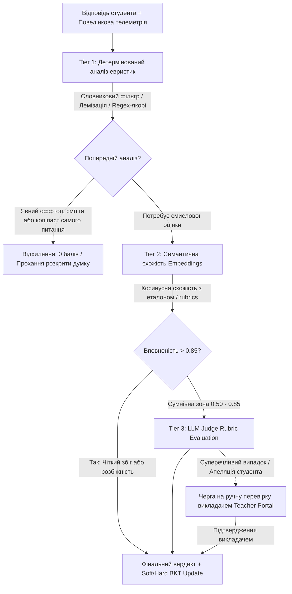

# 🧠 Семантична Перевірка Відкритих Текстових Відповідей та Інтеграція з BKT (Open-Ended Assessment Pipeline)

> **Дата формування:** 14 жовтня 2026 року  
> **Статус:** Концепція затверджена до впровадження (Architecture & Domain Specification)  
> **Авторство:** Brainstorm & Architecture Council Smart-BKT-Chain  

---

## 📌 1. Проблематика та Контекст

У базовому прототипі (MVP-1) відкриті текстові відповіді студента (`OPEN_TEXT` / `FREE_TEXT`) валідувалися виключно за **кількістю слів** (наприклад, `wordCount >= minWords`).  
Такий підхід несе критичні ризики для адаптивного моделювання знань на базі **Bayesian Knowledge Tracing (BKT)**:
1. **Хибне вгадування ($P(G)$ inflation / false positive):** Студент може ввести «воду», випадковий набір слів або копіпаст стороннього тексту/запитання, подолавши поріг слів, і отримати незаслужене зарахування знання теми.
2. **Хибний промах ($P(S)$ inflation / false negative):** Студент надає чітке, лаконічне й фактологічно бездоганне визначення (1-2 речення), але не набирає встановлений ліміт слів і отримує штраф у ланцюжку BKT.
3. **Відсутність якісного фідбеку:** Система не може вказати, яку саме частину концепції студент упустив або де припустився хибного судження (misconception).

Для розв'язання цієї проблеми розроблено **багаторівневий гібридний пайплайн семантичного оцінювання (Multi-Tier Assessment Pipeline)** з урахуванням поведінкової телеметрії друку та участю викладача (Human-in-the-Loop).

---

## 🔄 2. Архітектурний Пайплайн Оцінки (Tier 1 → Tier 3)

Система не викликає «важку» генеративну модель на кожен запит. Це мінімізує витрати (Tokens Cost) та затримку відповіді (Latency), розділяючи процес на 3 послідовні рівні:



---

## 🧩 3. Деталізація Рівнів Оцінювання

### 🔹 Рівень 1: Семантичні ключові сутності (Key Concepts & Heuristics)
* **Характеристика:** Миттєве детерміноване виконання (0 мс затримки, 0 токенів витрат) безпосередньо у NestJS API.
* **Функції:**
  * **Виявлення обов'язкових термінів:** Перевірка наявності лем/коренів ключових слів-якорів навички з урахуванням української та англійської морфології (наприклад, для теми *«Декоратори TypeScript»*: `обгортка|декоратор|wrapping`, `функція|target`, `метадані|reflect`).
  * **Анти-спам та оффтоп фільтр:** Перевірка коефіцієнта унікальності слів (Type-Token Ratio) — відсікання тексту на кшталт `бла бла бла` або одного повторюваного символу.
  * **Детекція копіювання питання:** Перевірка перекриття n-грам тексту студента з текстом самого запитання. Якщо збіг > 80%, система автоматично просить: *«Будь ласка, сформулюйте відповідь власними словами, а не цитуйте завдання»*.

### 🔹 Рівень 2: Векторна семантична схожість (Embedding-based Semantic Similarity)
* **Характеристика:** Швидкий розрахунок за допомогою легкої векторної моделі (`text-embedding-3-small` або локального ONNX Sentence-Transformers на кшталт `all-MiniLM-L6-v2` / `paraphrase-multilingual`).
* **Математична основа:**
  Для кожного запитання у базі зберігаються вектори:
  * $\vec{v}_{ref}$ — вектор еталонної відповіді (Reference Answer).
  * $\{\vec{v}_{misc}^{(k)}\}$ — вектори типових поширених місконцепцій (Misconceptions).
  
  Косинусна схожість відповіді студента $\vec{v}_{stu}$:
  $$\text{CosineSimilarity}(\vec{v}_{stu}, \vec{v}_{ref}) = \frac{\vec{v}_{stu} \cdot \vec{v}_{ref}}{\|\vec{v}_{stu}\| \|\vec{v}_{ref}\|}$$
  
* **Прийняття рішення:**
  * Якщо $\text{Similarity} \ge 0.85$ $\implies$ Відповідь зараховано ($\text{Correct} = 1$).
  * Якщо $\text{Similarity} \le 0.45$ $\implies$ Відповідь незараховано ($\text{Correct} = 0$).
  * Якщо вектор ближчий до $\vec{v}_{misc}^{(k)}$, ніж до еталону $\implies$ Фіксується конкретний тип когнітивної помилки для викладача.
  * Якщо значення потрапляє у «сіру зону» ($0.45 < \text{Similarity} < 0.85$) $\implies$ Перехід до Tier 3.

### 🔹 Рівень 3: Рубрикова оцінка через LLM-асистента (LLM-as-a-Judge)
* **Характеристика:** Глибокий смисловий аналіз через структурований виклик моделі (Gemini 2.5 / OpenAI GPT-4o-mini).
* **Схема вихідного JSON (Structured JSON Output Schema):**
```json
{
  "correctness": 0.85,
  "completeness": 0.90,
  "misconceptions": [],
  "keyConceptsCovered": ["декоратор як функція вищого порядку", "модифікація прототипу"],
  "missingConcepts": ["повернення нового дескриптора властивості"],
  "suggestedVerdict": true,
  "studentFeedback": "Чудове визначення! Ви правильно вказали роль функції вищого порядку, але не згадали про можливість модифікації дескриптора властивості.",
  "confidenceScore": 0.92
}
```

---

## ⚡ 4. Інтеграція з Поведінковою Телеметрією та BKT

Головна наукова цінність комплексу полягає в тому, що результат семантичної перевірки **не розглядається ізольовано**, а коригується телеметрією друку в модулі `BehavioralAdjuster`:

### 1. Детекція копіпасту (Anti-Cheat / High Guess Penalty):
* Якщо обсяг тексту $> 300$ символів, але час набору $< 3$ секунд або зафіксовано подію вставки:
  $$\text{pasteEvents} > 0 \land \text{timeToAnswer} < 3000\text{ms} \implies P(Guess) \to 0.90$$
* Така відповідь не дає суттєвого приросту $P(L)$ у BKT, а в історії позначається як *«Підозра на сторонній копіпаст»*.

### 2. Аналіз динаміки друку (Hesitation / Hesitant Knowledge vs Slip):
* Студент друкував текст самостійно, робив багато виправлень (`deletionRatio > 0.35`), робив довгі когнітивні паузи (`pauseCount > 4` тривалістю $> 5\text{ с}$):
  * **Випадок А (Відповідь правильна, але часткова):** Підвищується $P(Slip)$ — студент знає тему, але вагався або неідеально сформулював думку. Знання $P(L)$ не обнуляється.
  * **Випадок Б (Швидкий сміттєвий набір):** Студент друкував без пауз і видалень випадковий текст, щоб пройти форму $\implies$ фіксується $P(Guess) \to 0.5$, відповідь відхиляється.

### 3. Дробовий кредит (Partial Credit) та Soft-BKT:
Замість грубого перетворення балу у бінарне $0$ або $1$:
* **Варіант А (Поріг):** $\text{Correct} = 1 \iff \text{correctness} \ge 0.70$.
* **Варіант Б (Soft Evidence):** Використання модифікованого оновлення BKT із вагою свідчення:
  $$P(L_{t} \mid \text{Obs}) = \text{Score} \cdot P(L_{t} \mid \text{Correct}) + (1 - \text{Score}) \cdot P(L_{t} \mid \text{Incorrect})$$

---

## 👨‍🏫 5. Роль Викладача: «Human-in-the-Loop» та Апеляції

ШІ та семантичні моделі виступають **ко-пілотом**, а не остаточним незворотним суддею:

1. **Teacher Dashboard (`apps/teacher`):**
   * Окрема вкладка: **«Відкриті відповіді: Потребують перевірки»**.
   * Туди потрапляють:
     * Відповіді з «сірої зони» ($0.45 \le \text{Score} \le 0.70$).
     * Випадки з низькою впевненістю моделі (`confidenceScore < 0.75`).
     * Відповіді, за якими студент натиснув кнопку **«Подати апеляцію / Не згоден з оцінкою»**.
2. **Інструмент викладача в 1 клік:**
   * Викладач бачить текст студента, телеметрію (WPM, час, вставки), підсвічені ключові слова та чернетку оцінки від LLM.
   * Кнопки: `[ Зарахувати повністю ]`, `[ Зарахувати частково ]`, `[ Відхилити з коментарем ]`.
   * При зміні вердикту NestJS автоматично викликає перерахунок ланцюжка BKT за цією навичкою.

---

## 🛠️ 6. Технічний План Реалізації (Implementation Roadmap)

### Крок 1: Базовий евристичний шар у `apps/api`
* Створення доменного модуля `OpenTextHeuristicValidator`:
  * Перевірка лем, регулярних виразів та відсікання копіпасту питання.
  * Розрахунок метрики `conceptCoverageRatio`.

### Крок 2: Інтеграція сервісу семантичної оцінки (`OpenAnswerEvaluatorService`)
* Підключення клієнта LLM/Embedding (Gemini API з кешуванням запитів та structured output).
* Формування чітких системних промптів із передачею рубрик оцінки (Rubrics).

### Крок 3: Розширення схеми бази даних Prisma
* Додавання до таблиць завдань полів `referenceAnswer`, `rubricsJson`, `misconceptionsJson`.
* Додавання до таблиці відповідей полів `aiEvaluationJson`, `teacherOverrideStatus`, `disputeReason`.

### Крок 4: Інтерфейси Студента та Викладача
* **Студент (`apps/student`):** Відображення конструктивного фідбеку за рубриками (без стресових математичних коефіцієнтів) та кнопка апеляції.
* **Викладач (`apps/teacher`):** Спеціальний екран верифікації сумнівних текстових відповідей та журнал апеляцій.
