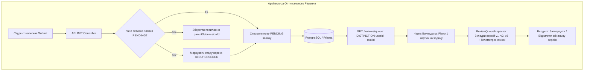

# 🧠 Brainstorm 05: Дедуплікація, Історія Версій та Еволюція Спроб у Черзі Перевірки Викладача (Teacher Review Queue Lifecycle)

- **Дата:** 15 жовтня 2026 року
- **Статус:** Концептуалізовано / Готово до імплементації
- **Контекст обговорення:** У процесі тестування відкритого запитання (есе по Event Loop) виявлено, що багаторазове надсилання відповідей одним студентом на те саме завдання призводить до накопичення в черзі викладача десятків однотипних карток (`PENDING_REVIEW`). Це створює інформаційний шум, захаращує інтерфейс та загрожує конфліктами рішень викладача.

---

## 🎯 1. Проблематика та Архітектурний Конфлікт

### 1.1 Анатомія виникнення проблеми
1. **Поведінка студента:** Студент формулює думку ітеративно або виправляє помилки (наприклад, написав кілька слів → натиснув перевірити → отримав підказку евристики/штраф за paste або обсяг → додав речення → знову натиснув кнопку).
2. **Поточна логіка бекенду:** Кожен клік `POST /api/v1/bkt/evaluate` генерує окремий запис у таблиці `Submission` з унікальним `id`, фіксуючи статус `teacherReviewStatus: PENDING_REVIEW`.
3. **Результат на фронтенді викладача (`apps/teacher`):**
   - У черзі з'являється $N$ окремих карток на одну й ту саму пару `(Student, Task)`.
   - Викладач бачить фрагментарні "чернетки", де кожна картка виглядає як самостійна невирішена задача.
   - Виникає **конфлікт цілісності вердиктів:** якщо викладач підтвердить 2-гу спробу, а 4-ту відхилить — стан BKT розсинхронізується, а студент отримає суперечливі сповіщення.

```mermaid
graph TD
    subgraph Поточний стан (Захаращення черги)
        S[Студент] -->|Спроба 1 (чернетка)| Q1[Картка 1: PENDING_REVIEW]
        S -->|Спроба 2 (вставка тексту)| Q2[Картка 2: PENDING_REVIEW]
        S -->|Спроба 3 (фінальна відповідь)| Q3[Картка 3: PENDING_REVIEW]
        Q1 --> T[Викладач: 3 окремі картки одного завдання]
        Q2 --> T
        Q3 --> T
    end
```

---

## 💡 2. Розглянуті Стратегії та Концепції Розв'язання

### 🔹 Варіант 1: «Одна активна заявка на пару (Студент, Завдання)» (Superseding / Авто-заміщення)
- **Суть:** У черзі `PENDING_REVIEW` для кожної комбінації `(userId, taskId)` дозволяється лише **1 актуальний запис**.
- **Механізм роботи:**
  - При надходженні нової спроби всі попередні спроби студента за цим завданням, які мали статус `PENDING_REVIEW`, автоматично переводяться у статус `SUPERSEDED` (або `ARCHIVED`).
  - У черзі викладача залишається виключно остання версія.
- **Плюси:**
  - Черга скорочується в рази і залишається чистою.
  - Виключаються подвійні вердикти.
- **Мінуси:**
  - Викладач втрачає контекст того, як відповідь еволюціонувала (чи не було це раптовим переходом від 0 знань до копіпасту зі штучного інтелекту).

---

### 🔹 Варіант 2: «Групування з історією еволюції (Diff / Timeline View)»
- **Суть:** Черга на рівні API агрегується за сутністю `(userId, taskId)`. У списку викладача відображається 1 картка завдання, але всередині інспектора доступна повна хронологія спроб.
- **Функціонал інспектора ([`ReviewQueueInspector`](file:///apps/teacher/src/features/reviews/ui/ReviewQueueInspector.tsx)):**
  - **Версійний селектор:** перемикач спроб `[v1 (22:15)] [v2 (22:18)] [v3 • Поточна (22:20)]`.
  - **Динаміка телеметрії:** викладач бачить зміну швидкості друку (WPM), сплески вставки (`pasteEvents`), зміни видалення (`deletionRatio`).
  - **Семантичний Diff (Різниця):** візуальне виділення кольором (червоний/зелений) доданих або змінених блоків тексту між спробами.
- **Плюси:**
  - Неймовірна педагогічна та аналітична цінність для розслідування списування (видно точний момент, коли в текст потрапив готовий абзац).
  - Збереження прозорості черги без дублювання карток.

---

### 🔹 Варіант 3: «Блокування повторної відправки (Locked while Pending)»
- **Суть:** Як тільки відповідь надіслана на верифікацію викладачу, редактор студента блокується до отримання остаточного вердикту (`APPROVED` або `REJECTED`).
- **Студентський інтерфейс:**
  - Текстове поле переходить у стан `read-only`.
  - Кнопка замінюється банером: *«⏳ Ваша відповідь знаходиться на перевірці у викладача. Очікуйте вердикту перед наступною спробою»*.
- **Плюси:**
  - Фізична неможливість спаму або випадкових повторних кліків.
  - Чітка дисципліна здачі робіт.
- **Мінуси:**
  - Зменшує динамічність навчання (якщо студент за 10 секунд усвідомив свою помилку або хотів дописати важливий висновок, він змушений чекати викладача).

---

## 🏆 3. Затверджене Комплексне Рішення (Best-Practice Hybrid)

Рекомендована архітектура поєднує **Варіант 1 (на рівні списку черги)**, **Варіант 2 (на рівні детального перегляду версій)** та **частково Варіант 3 (м'який захист від випадкового флуду)**.



### 3.1 Ключові зміни за шарами системи:

#### 1. Рівень Бази Даних (`packages/database/prisma/schema.prisma`):
- Розширення `enum TeacherReviewStatus`:
  ```prisma
  enum TeacherReviewStatus {
    NONE
    PENDING_REVIEW
    APPROVED
    REJECTED
    SUPERSEDED    // Замінено новішою версією відповіді студента
  }
  ```
- Додавання поля зв'язку версій у `Submission`:
  - `attemptNumber Int @default(1)` — порядковий номер спроби студента за цією задачею.
  - `previousSubmissionId String?` — посилання на попередню чернетку.

#### 2. Рівень Бекенду (`apps/api`):
- **При оцінюванні (`bkt.controller.ts:evaluateSubmission`):**
  - Перед збереженням нової спроби виконується перевірка наявних `PENDING_REVIEW` записів для `(userId, taskId)`.
  - Якщо такі є, їхній статус переводиться в `SUPERSEDED`, а нова спроба отримує інкрементований `attemptNumber`.
- **При вибірці черги (`bkt.controller.ts:getTeacherReviewQueue`):**
  - Вибираються виключно записи зі статусом `PENDING_REVIEW`.
  - Запит додатково підтягує попередні версії студента (`history: { where: { taskId }, orderBy: { createdAt: 'asc' } }`), щоб передати викладачу повний таймлайн.

#### 3. Рівень Кабінету Викладача (`apps/teacher`):
- **Сайдбар черги:** Список завжди містить рівно 1 елемент на студента та задачу, але з міткою: `В черзі • Спроба 3`.
- **Центральний інспектор ([`ReviewQueueInspector`](file:///apps/teacher/src/features/reviews/ui/ReviewQueueInspector.tsx)):**
  - Додається горизонтальний селектор версій (`Спроба 1 (22:10)`, `Спроба 2 (22:15)`, `Спроба 3 • Поточна (22:20)`).
  - При кліку на версію викладач бачить, як змінювався текст і як коливалися показники античиту (WPM, Paste, Latency).

#### 4. Рівень Студента (`apps/student`):
- Додати м'який троттлінг/індикатор: якщо завдання вже у статусі `PENDING_REVIEW`, при введенні нового тексту кнопка показує: *«Оновити відповідь для викладача (Спроба 2)»*, попереджаючи, що стара версія буде оновлена.

---

## 📋 4. План Реалізації за Мікро-кроками (Action Plan)

| Крок | Компонент | Задача | Очікуваний результат |
| :---: | :--- | :--- | :--- |
| **Крок 1** | `packages/database` | Додати `SUPERSEDED` у `TeacherReviewStatus` та `attemptNumber` у `Submission` | Міграція схеми бази даних |
| **Крок 2** | `apps/api` | Логіка авто-заміщення (supersede) у `evaluateSubmission` та зв'язування спроб | В черзі тільки 1 актуальна submission на пару `(user, task)` |
| **Крок 3** | `apps/api` | Додати повернення історії попередніх спроб у `GET /reviews/queue` | Ендпоінт повертає масив `attemptsHistory` для обраної задачі |
| **Крок 4** | `apps/teacher` | Інтерфейс вибору версій та таймлайну спроб у `ReviewQueueInspector` | Викладач бачить хронологію змін та різницю у тексті |
| **Крок 5** | `apps/student` | Повідомлення в інтерфейсі студента про оновлення активної спроби в черзі | Прозорий UX без випадкового дублювання |
