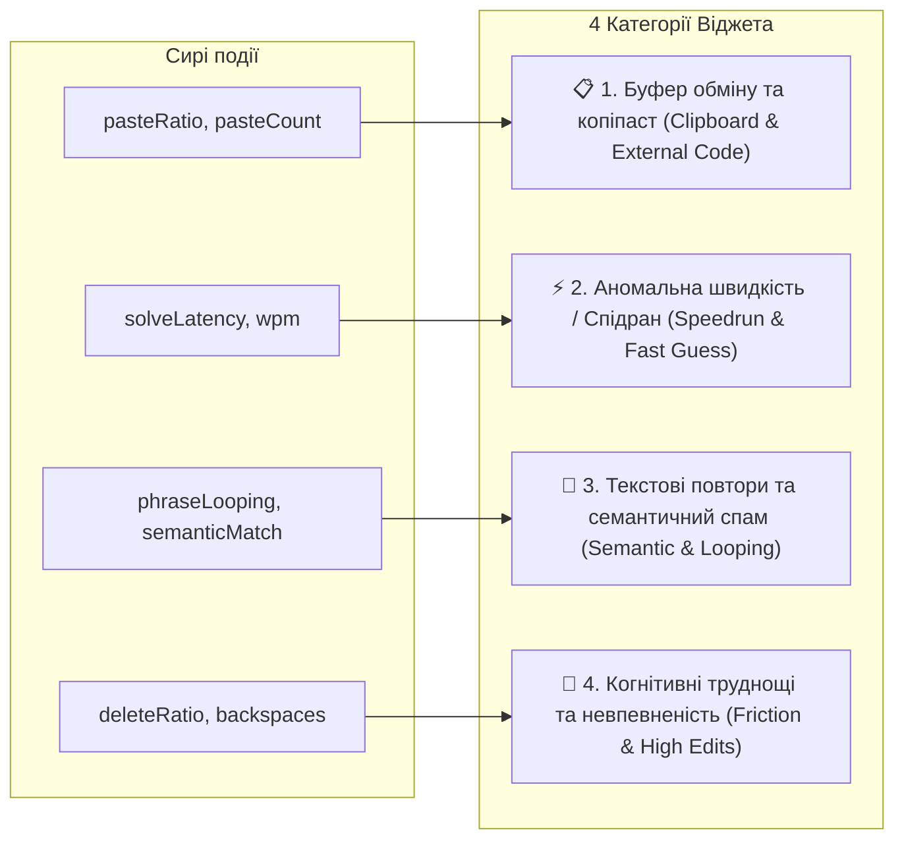

# 🧠 Brainstorm 06: Рефакторинг та Спрощення Віджета Аномалій — Єдиний Конфігурований Віджет за Категоріями для Студента та Викладача

- **Дата:** 19 жовтня 2026 року
- **Статус:** Концептуалізовано / Узгоджено до реалізації
- **Контекст обговорення:** Аналіз поточного екрана «Дерево Аномалій» (Anomaly Tree View) показав значне когнітивне перевантаження користувача через нашарування підвкладок («Дерево Модулів», «За Категоріями», «Топологічний Граф DAG», «RPG Матриця Рун»), багаторівневі вкладені акордеони та надто сирий математичний синтаксис формул. Ухвалено рішення радикально спростити інструментарій, залишивши вкладку аномалій, але сфокусувавши її виключно на категоризації інцидентів у вигляді єдиного конфігурованого компонента для обох ролей (Student & Teacher).

---

## 🎯 1. Проблематика поточного стану екрана «Дерево Аномалій»

На основі детального візуального та функціонального аудиту виділено 4 ключові дефекти UX:

1. **Конфлікт 4 паралельних підрежимів:**
   - Користувачеві пропонувалося 4 різні вкладки для перегляду тих самих 2–3 інцидентів (`Дерево Модулів`, `За Категоріями`, `Топологічний Граф DAG`, `RPG Матриця Рун`).
   - Присутність топологічного графа DAG та RPG-матриці всередині аналітики аномалій розмиває фокус: коли користувач перемикається на аномалії, його цікавить **що саме пішло не так і де сталася проблема**, а не повторний перегляд топології курсу.
2. **Надмірна вкладеність («матрьошка» акордеонів):**
   - Щоб дістатися до інциденту, потрібно було розкривати 3 рівні:
     $\text{Гілка аномалії} \longrightarrow \text{Модуль курсу} \longrightarrow \text{Завдання} \longrightarrow \text{Рядок з кодом/помилкою}$.
3. **Дублювання карток без агрегації:**
   - Кілька спроб за одним і тим самим завданням генерували ідентичні картки інцидентів одна під одною (наприклад, двічі картка «Event Loop та асинхронність G=0.9»), засмічуючи екран.
4. **Сухий синтаксис системних логів замість інтерфейсу:**
   - Рядки на зразок `Гілка: Аномалії Вгадування (Швидка відповідь < 3.5c, P(Guess)=0.85)` та `Gt 0.9: підозра на сторонній копіпаст тексту (paste: 1, wpm: 0)` відображають внутрішні змінні бекенду, а не людиноорієнтований інтерфейс.

```mermaid
graph TD
    subgraph Current_Overloaded["Поточний стан (Перевантажено)"]
        Tab["Вкладка: Дерево Аномалій"] --> SubTabs["4 підвкладки: Модулі | Категорії | DAG | RPG Матриця"]
        SubTabs --> Level1["Рівень 1: Гілка аномалії (формули BKT)"]
        Level1 --> Level2["Рівень 2: Папка Модуля курсу"]
        Level2 --> Level3["Рівень 3: Дублі карток завдань"]
    end

    subgraph Proposed_Clean["Цільовий стан (Чітко і Сфокусовано)"]
        TargetTab["Вкладка: Дерево Аномалій"] --> UnifiedWidget["Єдиний AnomalyCategoriesWidget"]
        UnifiedWidget --> CleanCat["Чисті Смислові Категорії (1 рівень акордеона)"]
        CleanCat --> RoleView["Адаптація під роль: Student (підказки) | Teacher (інспектор)"]
    end
```



---

## 💡 2. Концептуальне рішення: Уніфікований та Конфігурований Віджет (`AnomalyCategoriesWidget`)

### 2.1 Стратегічний вибір архітектури
- **Збереження вкладки «Дерево Аномалій»:** Окрема вкладка аномалій залишається у верхній навігації для розділення контексту: *«Освоєння знань»* (`Дерево Знань`) vs *«Аналіз складнощів та інцидентів»* (`Дерево Аномалій`).
- **Повна ліквідація другорядних підвкладок:** Всі 4 старі підвкладки прибираються. Залишається **лише структуроване подання за категоріями аномалій**.
- **Єдиний компонент із конфігурацією ролі (DRY):**
  Створюється єдиний віджет (наприклад, у shared UI пакеті або виділеному модулі), який приймає режим `role: 'student' | 'teacher'` та гнучкі налаштування відображення.

---

## 🗂️ 3. Таксономія Категорій Аномалій

Замість розрізнених технічних прапорців уся поведінкова телеметрія та семантичні інциденти групуються у **4 прозорі смислові категорії**:



### 📋 Категорія 1: Буфер обміну та сторонній код (`PASTE_ANOMALY`)
- **Тригер:** Разова вставка блоку $>50$ символів або частка вставленого тексту перевищує $70\%$ від загального обсягу (`pasteRatio > 0.70`).
- **Математичний вплив на BKT:** Підвищення ймовірності випадкового або нечесного успіху $P(G) \uparrow [0.60 \dots 0.90]$. Внаслідок цього знання $P(L_{t+1})$ майже не зростає, запобігаючи нечесному відкриттю наступних тем DAG.
- **Повідомлення для Студента:**
  > *«💡 Виявлено копіювання коду. Рекомендуємо набирати алгоритми власноруч — це допомагає швидше сформувати практичну навичку та закрити тему в дереві знань.»*
- **Повідомлення для Викладача:**
  > *«📋 Вставка коду одним блоком: 142 символи (paste: 1, wpm: 0). Можливе використання генеративного ШІ або стороннього розв'язку. $P(Guess)$ скориговано до 0.90.»*

### ⚡ Категорія 2: Аномальна швидкість / Спідран (`SPEEDRUN_ANOMALY`)
- **Тригер:** Час розв'язання завдання суттєво менший за базовий поріг когнітивного читання умови ($\text{latency} < 3.5\text{ с}$ для комплексних задач або $< 5\text{ с}$ для есе).
- **Математичний вплив на BKT:** Коригування $P(G) \uparrow 0.85$ (сліпе вгадування).
- **Повідомлення для Студента:**
  > *«⚡ Завдання надіслано занадто швидко. Система вважає відповідь випадковим вгадуванням, тому навичка потребує додаткового підтвердження.»*
- **Повідомлення для Викладача:**
  > *«⚡ Аномально низький час відповіді: $2.1\text{ с} < 5.0\text{ с}$. Підозра на сліпий підбір або скриптинг. $P(Guess) = 0.85$.»*

### 🔄 Категорія 3: Текстові повтори та семантичний спам (`SEMANTIC_LOOPING_ANOMALY`)
- **Тригер:** Детекція циклічного дублювання фраз (фразовий лупінг у відкритих есе) або наднизький семантичний скор відповідності рубриці оцінювання.
- **Математичний вплив на BKT:** Відхилення автоматичного зарахування, ескалація в чергу перевірки викладача (`PENDING_REVIEW`).
- **Повідомлення для Студента:**
  > *«🔄 У відповіді виявлено повторювані фрази або недостатню повноту аргументації. Спробуйте описати думку ширше.»*
- **Повідомлення для Викладача:**
  > *«🔄 Спрацював спам-фільтр: виявлено зациклення фрази 'Event Loop' (4 повтори). Відповідь потребує ручної модерації.»*

### 🤔 Категорія 4: Когнітивні труднощі та невпевненість (`COGNITIVE_FRICTION_ANOMALY`)
- **Тригер:** Висока частка видалень символів (`deletesRatio > 0.40`), тривалі паузи між введенням синтаксичних блоків.
- **Математичний вплив на BKT:** Коригування ймовірності прикрої помилки $P(S) \uparrow [0.25 \dots 0.40]$. У разі неправильної відповіді система не карає студента максимальним скиданням навички, враховуючи активну боротьбу.
- **Повідомлення для Студента:**
  > *«🤔 Ви витратили багато зусиль на виправлення синтаксису. Помилки — це частина навчання! Спробуйте спочатку спроєктувати структуру розв'язку.»*
- **Повідомлення для Викладача:**
  > *«🤔 Когнітивне тертя: висока частка редагувань (видалень: 42%). Студент зазнавав труднощів із реалізацією. $P(Slip)$ скориговано до 0.35.»*

---

## 🎛️ 4. Технічний дизайн та інтерфейс компонента (`AnomalyCategoriesWidget`)

### 4.1 Пропси компонента (TypeScript Interface)

```typescript
export interface AnomalyIncident {
  id: string;
  taskId: string;
  taskTitle: string;
  moduleSlug: string;
  moduleName: string;
  category: 'PASTE' | 'SPEEDRUN' | 'SEMANTIC_LOOPING' | 'COGNITIVE_FRICTION';
  timestamp: string;
  attemptNumber: number;
  snippet?: string;
  metrics: {
    pasteRatio?: number;
    pasteCount?: number;
    solveLatency?: number;
    wpm?: number;
    deleteRatio?: number;
    bktAdjustment?: {
      guessMod?: number;
      slipMod?: number;
    };
  };
}

export interface AnomalyCategoriesWidgetProps {
  role: 'student' | 'teacher';
  courseSlug: string;
  courseTitle: string;
  incidents: AnomalyIncident[];
  onInspectSubmission?: (taskId: string, incidentId: string) => void;
  onRetryTask?: (taskId: string) => void;
  compactMode?: boolean;
}
```

### 4.2 Специфікація відображення за ролями

| Функціональний елемент | 🎓 Режим Студента (`role="student"`) | 👨‍🏫 Режим Викладача (`role="teacher"`) |
| :--- | :--- | :--- |
| **Заголовок екрана** | «Аналіз складнощів та рекомендації» | «Аномалії та біометричні інциденти курсу» |
| **Бейдж інциденту** | 🟡 *«Потребує уваги»*, 🔵 *«Рекомендація»* | 🔴 *«Копіпаст»*, 🟠 *«Спідран»*, 🟣 *«Спам-лупінг»* |
| **Формули BKT** | Приховані; відображається зрозумілий вплив: *«Коефіцієнт самостійності знижено»* | Явні змінні: $P(G)=0.90$, $\Delta P(L)=-0.14$, $P(S)=0.35$ |
| **Деталі коду/тексту** | Показує фрагмент коду студента з підсвіткою вставленого рядка | Повний інспектор із похвилинним таймлайном натискань та WPM |
| **Цільові дії (CTA)** | `[ 🔄 Спробувати набрати власноруч ]` | `[ 🔍 Відкрити в черзі перевірок ]` / `[ ⚖️ Переоцінити ]` |

---

## 🎨 5. Візуальна структура інтерфейсу (Wireframe)

```
┌────────────────────────────────────────────────────────────────────────────────────────┐
│ ⚡ Аномалії курсу: JavaScript & Web Engineering      [ 3 інциденти ]                  │
│ Повний зріз поведінкових особливостей, вставок та швидких відповідей за категоріями    │
│                                                                                        │
│ 🔍 [ Пошук за завданням або модулем...                                            ]    │
├────────────────────────────────────────────────────────────────────────────────────────┤
│                                                                                        │
│ ▼ 📋 1. Буфер обміну та сторонній код (2 інциденти)                        [Розгорнуто]│
│   ┌──────────────────────────────────────────────────────────────────────────────────┐ │
│   │ [JS-BASICS] Аналіз концепції: Event Loop та асинхронність  • Спроба #1  13:07:12 │ │
│   │                                                                                  │ │
│   │ ⚠️ Вставка 140 символів без ручного друку (wpm: 0, pasteCount: 1)                │ │
│   │ Вплив: Шанс випадкового вгадування підвищено до P(G)=0.90                        │ │
│   │ [ Показати фрагмент тексту ]  [ 🔍 Відкрити в черзі / Перевірити ]                │ │
│   └──────────────────────────────────────────────────────────────────────────────────┘ │
│                                                                                        │
│ ► ⚡ 2. Аномальна швидкість / Спідран (1 інцидент)                           [Згорнуто]│
│                                                                                        │
│ ► 🔄 3. Текстові повтори та семантичний спам (0 інцидентів)                  [Згорнуто]│
│                                                                                        │
│ ► 🤔 4. Когнітивні труднощі та невпевненість (0 інцидентів)                  [Згорнуто]│
└────────────────────────────────────────────────────────────────────────────────────────┘
```

---

## 🚀 6. Очікувані переваги для проєкту
1. **Зниження когнітивного навантаження на 75%:** Прибрано заплутані вкладені вкладки DAG/Рун та 3-рівневу ієрархію папок.
2. **Абсолютна прозорість для студента:** Студент розуміє, чому тема не зарахувалася, не відчуваючи себе звинуваченим у читерстві.
3. **Ефективний інструмент аудиту для викладача:** Викладач за 2 секунди бачить зріз по всій групі/курсу, згрупований за характером проблеми.
4. **100% повторне використання коду (DRY):** Один віджет обслуговує і студентський портал (`apps/student`), і викладацький CRM (`apps/teacher`).
