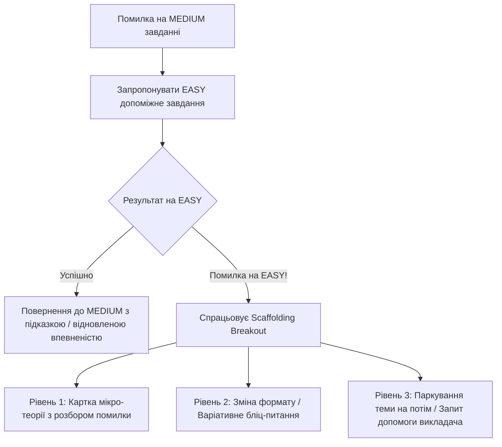

# 🧠 Сесія Брейншторму 07: Порушення «Адаптивного Тупика» (Breaking the Adaptive Deadlock & Remediation Scaffolding)

**Дата:** 22 жовтня 2026 року  
**Статус:** 💡 В обговоренні (Active Ideation)  
**Учасники:** Команда розробки Smart-BKT-Chain (AI + Lead Architect)  
**Пов'язані епіки та задачі:** `SBC-EP-BKT`, `SBC-EP-ST`, `SBC-EP-TC`, `SBC-245`, `SBC-247`, `SBC-248`

---

## 🎯 1. Формулювання Проблеми: «Петля Фрустрації» (The Frustration Loop)

### 1.1 Сценарій виникнення
Студент проходить адаптивний курс:
1. Завдання рівня `MEDIUM` (практика) виявляється заскладним — студент робить помилку.
2. Система пропонує допоміжне полегшене завдання рівня `EASY` (*Graceful Degradation*).
3. Студент починає виконувати полегшене завдання, але **знову робить помилки** (наприклад, через брак розуміння фундаментальної теорії чи когнітивну втому).
4. Система знову намагається адаптуватися і видає назад попередній тест чи завдання — виникає **замкнене коло полегшених варіантів**.
5. Відбувається багаторазове товчення на одних і тих самих питаннях без прогресу.

### 1.2 Негативні наслідки
- **Втрата відчуття адаптивності:** Система виглядає не "розумною", а зацикленим автоматом.
- **Втрата індивідуального підходу:** Студент не отримує допомоги там, де вона дійсно потрібна.
- **Когнітивна втома (Frustration & Fatigue):** Студент починає хаотично вгадувати варіанти (*Rapid Guessing*), щоб просто "пробити" бар'єр, або кидає навчання.

---

## 🧭 2. П'ять Векторів Рішення (Архітектурні Напрямки)

---

### Напрямок 1. Перехід від «Контролю» до «Навчання» (Scaffolding / Допоміжні підказки)
* **Концепція:** Система має припинити діяти виключно як строгий екзаменатор. Якщо студент помиляється навіть на `EASY`, йому потрібна не чергова перевірка, а **навчання прямо на місці**.
* **Механіки:**
  1. **Картка мікро-теорії (Micro-Theory Card):**
     - Замість наступного тесту відкривається лаконічний блок на 2–3 речення з виділеним правилом та контрастним прикладом («Правильно vs Неправильно»).
     - Повідомлення: *«Схоже, тут виникло непорозуміння. Давай розберемо це правило за 30 секунд»*.
  2. **Режим Socratic Hint (Сократівська підказка):**
     - Навідне запитання чи акцент на ключовому слові без прямої видачі відповіді.
  3. **Аналіз типових помилок (Distractor Feedback):**
     - Якщо обрано хибний варіант B, система пояснює саме його природу: *«Ти обрав варіант B. Це дуже поширена помилка: багато хто плутає let і const, оскільки...»*.

---

### Напрямок 2. Ескалація до викладача / AI-тьютора (Human-in-the-Loop)
* **Концепція:** Подолання відчуття безвиході («я сам на сам зі стіною автоматики»).
* **Механіки:**
  1. **Кнопка «Потрібна допомога викладача» (Teacher Review Escalation):**
     - Після 2–3 невдалих спроб стає доступною дія відправки питання у вже реалізовану чергу `Teacher Review Queue`.
     - Викладач отримує контекст спроб, бачить історію телеметрії і залишає текстову або голосову пораду.
  2. **Інтерактивний AI-наставник (Socratic Dialog):**
     - Міні-чат із вбудованою моделлю (або підготовленими евристиками), яка веде діалог навідними кроками.

---

### Напрямок 3. «Тактичний відступ» за Графом Знань (DAG Backtracking)
* **Концепція:** Якщо студент не може опанувати навіть базовий рівень теми, корінь проблеми лежить у **незасвоєній передумові (Prerequisite)**.
* **Механіки:**
  - Алгоритм секвенсора звертається до графа передумов:
    $$Skill_{current} \leftarrow Parent(Skill_{current})$$
  - Система дружньо пропонує:
    *«Давай на хвилинку відкладемо цю тему і повернемося на крок назад, щоб освіжити базове правило. Це займе лише 1 хвилину»*.
  - Студент проходить простий успішний крок із попередньої теми, отримує «Quick Win», відновлює дофамін та впевненість, після чого повертається до поточної теми.

---

### Напрямок 4. Cognitive Cool-Down & Зміна Формату Діяльності
* **Концепція:** Коли студент втомлений або роздратований, когнітивний фокус звужується (*tunnel vision*).
* **Механіки:**
  1. **Зміна інтерактивного формату:**
     - Якщо студент втомився від коду чи тестів $\to$ запропонувати сортування карток, інтерактивне з'єднання блоків або бліц «Правда / Неправда».
  2. **Когнітивна пауза (Cool-Down Break):**
     - Повідомлення турботи: *«Ти зробив 5 інтенсивних спроб поспіль. Зроби ковток води ☕ або перемкнися на сусідній розблокований модуль»*.
  3. **Паркування завдання («Відкласти на потім»):**
     - Право студента сказати: *«Я повернуся до цього пізніше»*.
     - Завдання поміщається в чергу ревізії, студент продовжує навчання за іншими гілками, а система делікатно нагадає про нього на наступній навчальній сесії.

---

### Напрямок 5. Глибина Банку Завдань (Task Bank Depth & Isomorphic Tasks)
* **Концепція:** Зараз на тему передбачено по одній задачі на рівень (`EASY`, `MEDIUM`, `HARD`), тому вибір обмежений лише двома альтернативами.
* **Механіки:**
  - Наявність пулу з 3–4 ізоморфних (варіативних) завдань на рівень `EASY`.
  - Чергування формулювань: якщо сухе академічне питання не допомогло, наступне подається через живу практичну метафору чи інший сценарій.

---

## 🧩 3. Синтез: Багаторівнева Система Захисту від Тупика (Multi-Tier Breakout)

---

## 📌 4. Подальші Кроки для Обговорення:
1. Визначити, яку послідовність кроків вважати ідеальною (наприклад: 1 помилка $\to$ підказка; 2 помилки $\to$ мікро-теорія; 3 помилки $\to$ вибір: відкласти на потім чи запитати викладача).
2. Вирішити, як оформлювати картку мікро-теорії в UI (модальне вікно, що виринає, чи блок над редактором).
3. Обговорити збереження прогресу BKT при «паркуванні» завдання.
