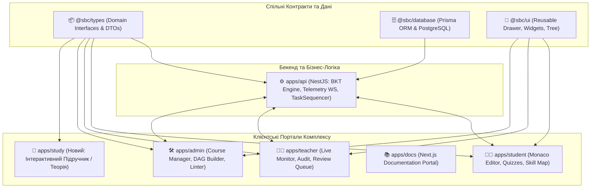

# 🧠 Brainstorm 08: Від Системи Оцінювання до Системи Адаптивного Навчання (Adaptive Learning Paradigm & Cross-App Contracts)

- **Дата:** 26 жовтня 2026 року
- **Статус:** Концептуалізовано / Прийнято до впровадження
- **Контекст:** Порівняльний аналіз поточної системи із паспортом магістерської роботи («Децентралізована система адаптивного навчання на основі BKT та блокчейну», спец. 122 Комп'ютерні науки).

---

## 🎯 1. Головне Прозріння: Діагностика проти Навчання

### Проблема «Розумного Термометра»
У ході попередніх ітерацій у проєкті Smart-BKT-Chain було збудовано високоефективну систему математичного оцінювання та поведінкової телеметрії:
- BKT-рушій динамічно оновлює $P(L_t)$ за формулою Баєса.
- `BehavioralAdjuster` калібрує $P(G)$ та $P(S)$ на основі часу реакції, пауз, копіювання з буфера та видалень.
- Секвенсор `TaskSequencer` підбирає наступні завдання за графом передумов та когнітивною тріадою.

Проте за своєю суттю це **комп'ютеризоване адаптивне тестування (Computerized Adaptive Testing, CAT)**, а **НЕ повноцінна система адаптивного навчання (Intelligent Tutoring System, ITS)**:
> *Система чудово вміє ставити «діагноз» (вимірювати рівень володіння навичкою та фіксувати спроби читерства), але учень при цьому залишається сам-на-сам із практикою без «розумних ліків» — без персоналізованого навчання прямо в системі.*

---

## 🏛️ 2. Що вимагає Паспорт Магістерської Роботи

Згідно з паспортом дослідження (Google Doc: *«Децентралізована система адаптивного навчання на основі BKT та блокчейну»*):
1. **Зміна парадигми:** відхід від «чорної скриньки» та паперових дипломів до публічного доказу компетенцій (**Proof of Skill / Competence**).
2. **Адаптація до програм освіти:** «Граф знань» узгоджує лінійні держстандарти з адаптивним навчанням, де система не просто оцінює, а спрямовує та закриває когнітивні прогалини.
3. **Захист від штучного інтелекту та списування:** поведінкова телеметрія та античит у поєднанні з економічною моделлю застави (Staking) та штрафів (Burn).
4. **Портативність знань («Portable Knowledge State»):** стан компетенцій студента є динамічним активом, який фіксується у вигляді цифрових сертифікатів (SBT / dNFT) при досягненні майстерності Блума ($P(L) \ge 0.90$).

---

## 🏗️ 3. Стратегічний Принцип: «Не ламаємо, а добудовуємо через Монорепозиторій»

Оскільки проєкт спроєктовано за принципами сучасного монорепозиторію (npm workspaces), ми **не ламаємо та не змінюємо наявний стабільний функціонал**, а нарощуємо нові рівні взаємодії.

### Архітектура наскрізного зв'язку (Cross-App Ecosystem):

---

## 📋 4. Попередній План Дій (Phase 1: Наскрізна Типізація)

Перед впровадженням нових дидактичних модулів необхідно ліквідувати «вузьке місце» монорепозиторію — порожній пакет **`packages/types`**:

### Крок 1.1. Оживлення пакета `@sbc/types` (Shared Domain Contracts)
Створити структуровані чисті TypeScript DTO та інтерфейси без сторонніх залежностей:
1. **`tasks.types.ts`:**
   - `TaskType` (`CODE`, `SINGLE_CHOICE`, `MULTIPLE_CHOICE`, `TEXT_ESSAY`, `OPEN_TEXT`).
   - `TaskDto`, `QuizOptionDto`, `TestCaseDto`, `SocraticHintDto`, `MisconceptionDto`.
2. **`bkt.types.ts`:**
   - `BktStateDto`, `BktUpdateResultDto`, `BktAuditParamsDto` ($P(L_0), P(T), P(G), P(S)$).
3. **`sequencing.types.ts`:**
   - `SkillNodeDomainDto`, `SequencingRecommendationDto`, `DegradationRuleDto`.
4. **`telemetry.types.ts`:**
   - `TelemetryEventDto`, `BehavioralMetricsDto` (WPM, latency, pasteRatio, deleteRatio).
5. **`learning.types.ts`:**
   - `ConceptCapsuleDto` (картка мікро-теорії), `ScaffoldingStepDto` (кроки розбиття складних завдань).

### Крок 1.2. Підключення `@sbc/types` до застосунків
- Додати `"@sbc/types": "*"` у `dependencies` застосунків `apps/api`, `apps/student`, `apps/teacher`, `apps/admin`.
- Викорінити дублювання інтерфейсів та небезпечні типи `any` у контролерах та клієнтських запитах.

---

## 🚀 5. Подальший План Розвитку (Phase 2 & Phase 3: Адаптивне Навчання та Web3)

### Етап 2. Інтелектуальний Шар Адаптивного Навчання (Intelligent Tutoring Layer)
1. **Вбудований або окремий модуль Теорії (`apps/study` або `ConceptCapsule`):**
   - Замість «битого» зовнішнього посилання `studyUnitUrl` — повноцінне відображення структурованого теоретичного конспекту з інтерактивними схемами.
   - Показ теорії перед першою спробою нового концепту або примусово після 2 послідовних помилок.
2. **Розбір когнітивних помилок (Misconception-Driven Formative Feedback):**
   - Використання наявного у базі поля `misconceptions`.
   - Якщо код або відповідь учня містить типову помилку (наприклад, переприсвоєння `const`, вихід за межі масиву `arr[length]`, помилка виклику події), система замість сухого `FAILED` видає дидактичне роз'яснення причини і логіки виправлення.
3. **Адаптивне Риштування (Scaffolding / Step-by-Step Breakdown):**
   - Для складних задач (MEDIUM/HARD) при труднощах пропонувати розбиття на 2–3 мікро-кроки або інтерактивне відновлення алгоритму (формат Parsons Problems).

### Етап 3. Web3 & Сертифікація (Proof of Competence)
1. **Випуск сертифікатів майстерності (SBT / ERC-5192):**
   - Автоматична генерація або симуляція випуску Soulbound токена при досягненні порогу Блума ($P(L) \ge 0.90$).
2. **Публічний профіль досягнень:**
   - Можливість для студента експортувати підписаний криптографічний доказ набутих компетенцій (Proof of Skill) для портфоліо чи роботодавця.

---

## 📌 Підсумок мозкового штурму
- Ми чітко розмежували: **BKT-оцінювання — це надійний діагностичний фундамент**, а **Адаптивне навчання — це надбудова персоналізованого дидактичного супроводу учня**.
- Послідовність робіт: **Спільні типи `@sbc/types` $\to$ Дидактичний фідбек та теорія $\to$ Web3 Proof-of-Competence**.
