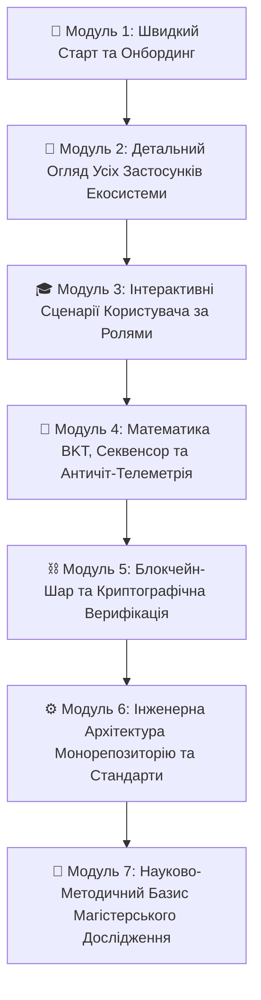
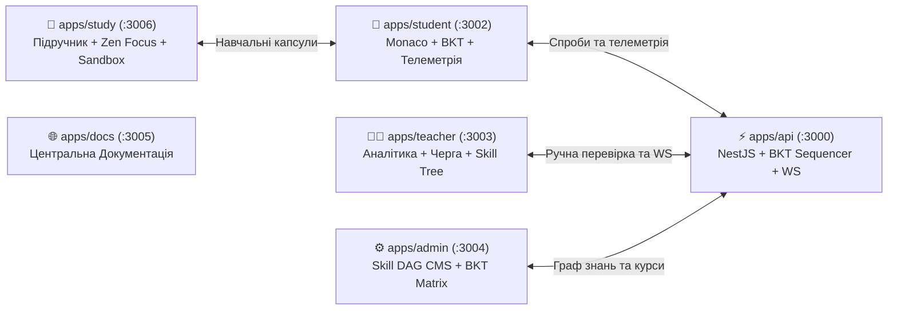

# 🧠 Мозковий Штурм 09: Концепція Повного Гайду Платформи та Каталогу Застосунків (Master Guide & Ecosystem Apps Handbook)

**Дата:** 28 жовтня 2026 року  
**Статус:** Схвалено та узгоджено  
**Призначення:** Проєктування єдиного наскрізного посібника системи Smart-BKT-Chain з детальним розділом-каталогом кожного застосунку платформи.

---

## 🎯 1. Загальне Бачення та Філософія Гайду

Система **Smart-BKT-Chain** складається з мультипортального комплексу 5 спеціалізованих веб-застосунків та ядра бекенду. Для цілісного сприйняття проєкту комісією магістерського захисту, розробниками, викладачами та учнями створюється **Централізований Інтерактивний Гайд (Master Guide)**.

Він поєднує:
1. **Інженерну досконалість:** архітектура, API, типи, стандарти компонентів.
2. **Педагогічну глибину:** математична модель BKT, Just-in-Time навчання, деконструкція оман, Сократівське риштування.
3. **Вичерпний опис кожного застосунку:** окремі деталізовані розділи для всіх 5 сервісів із зазначенням портів, завдань, скріншотів, UI Shell та інтерактивних можливостей.

---

## 🏛️ 2. Структура Гайду: 7 Логічних Модулів



---

### 🚀 МОДУЛЬ 1. Швидкий старт та Онбординг (Getting Started)
- **Сутність платформи:** Децентралізована екосистема адаптивного навчання, що синтезує байєсівське моделювання знань (BKT), поведінкову телеметрію та блокчейн-сертифікати.
- **Вимоги до оточення:** Node.js 20+, Docker (PostgreSQL 16), Python 3.10+, npm workspaces.
- **Розгортання однією командою:**
  ```bash
  # 1. Запуск БД та сидинг початкових курсів і завдань
  npm run db:seed
  # 2. Запуск бекенду та мікросервісів
  npm run dev:api     # Backend API & WebSockets (Port 3000)
  npm run dev:docs    # Портал документації (Port 3005)
  npm run dev:study   # Інтерактивний підручник (Port 3006)
  npm run dev:student # Практичний тренажер (Port 3002)
  npm run dev:teacher # Кабінет викладача (Port 3003)
  npm run dev:admin   # Адмін-центр & DAG (Port 3004)
  ```

---

### 📱 МОДУЛЬ 2. Детальний Огляд Усіх Застосунків Екосистеми (Ecosystem Applications)
*Окремий фундаментальний блок з вичерпним аналізом кожного сервісу:*



#### 1. `apps/study` — Інтерактивний Навчальний Простір (Порт `3006`)
* **Місія:** Формування концептуального розуміння алгоритмізації для учнів 10–11 класів без стресу оцінювання.
* **Ключові компоненти:**
  * **Режим Зручного Читання (Zen Focus Reading Engine):** плаваючий тулбар `ReaderFloatingToolbar`, активація клавішею `F`, приховування сайдбарів, автоскидання стилів при виході.
  * **Триптих фізіологічних тем:** «Тепла Сепія» (за замовчуванням для захисту очей від синього спектра), «Ніч» (Slate-950), «OLED» (абсолютний чорний).
  * **Автономна кодова пісочниця (`CodePlayground`):** локальне виконання JavaScript із перехопленням `console.log()` безпосередньо в тексті уроку.
  * **Блоки подолання когнітивних оман (`Misconception Alerts`):** деконструкція типових концептуальних помилок школярів.

#### 2. `apps/student` — Адаптивний Практичний Тренажер Студента (Порт `3002`)
* **Місія:** Формативне оцінювання, діагностика когнітивного прогресу та тренування навичок.
* **Ключові компоненти:**
  * **Monaco Editor інтеграція:** темна тема, синтаксичний аналіз, інтерактивні тест-кейси з аргументами.
  * **5 модальностей оцінювання:** `CODE` (інженерні задачі), `SINGLE_CHOICE` (бліц-тести), `MULTIPLE_CHOICE` (множинний вибір), `TEXT_ESSAY` (теоретичні роздуми), `OPEN_TEXT` (короткі відповіді).
  * **Сократівські підказки (Socratic Scaffolding):** 3-рівневе інтерактивне риштування (метафора → натяк на структуру → псевдокод) без зниження $P(L_t)$.
  * **Кристал Знань (Visual Skill Node):** візуальний стан засвоєння навички з колірною градацією ($P(L_t) \ge 0.95$ — Майстерність).

#### 3. `apps/teacher` — Кабінет та Аналітика Викладача (Порт `3003`)
* **Місія:** Когортний моніторинг, виявлення зон ризику та оперативна верифікація академічної доброчесності.
* **Ключові компоненти:**
  * **Інспектор черги перевірки (`ReviewQueueInspector`):** дедуплікація завдань, аналіз спроб учня в хронології, перегляд коду, вердикт (Схвалено / Відхилено) з миттєвою синхронізацією по WebSockets.
  * **Граф курсу `CourseGraphViewer`:** дерево навичок у візуальному стилі RPG з когнітивною тріадою (Синтаксис, Алгоритміка, Архітектура).
  * **Дерево аномалій `AnomalyTreeWidget`:** автоматичне групування студентів за ризиками доброчесності (підозрілий темп WPM, надмірний копіпаст, аномально короткі паузи осмислення).
  * **Аудиторський BKT пісочник (`MetricsAuditInspector`):** покроковий тренажер розрахунку формул Баєса для вчителя.

#### 4. `apps/admin` — Методичний Центр та DAG Builder (Порт `3004`)
* **Місія:** Управління навчальними курсами, структурою компетенцій та системними параметрами.
* **Ключові компоненти:**
  * **Редактор графу навичок (Skill DAG Editor):** створення вузлів компетенцій, візуальне налаштування зв'язків передумов (prerequisites).
  * **Матриця BKT конфігурації:** індивідуальне або групове коригування апріорних знань $P(L_0)$, ймовірності навчання $P(T)$, випадкової помилки $P(S)$ та вгадування $P(G)$.
  * **Керування безпекою та скиданням:** ізольоване скидання станів BKT учнів за курсом або глобально із захисним діалогом підтвердження.

#### 5. `apps/api` — Ядро Бекенду на NestJS (Порт `3000`)
* **Місія:** Бізнес-логіка, математика адаптивності, шина даних та збереження станів.
* **Ключові компоненти:**
  * **Гексагональна архітектура (Ports & Adapters):** ізольоване доменне ядро BKT, незалежне від фреймворку БД чи протоколу зв'язку.
  * **TaskSequencer:** алгоритм вибору оптимального наступного завдання учневі на основі актуального вектора майстерності.
  * **WebSockets Gateway:** двосторонній канал реального часу для телеметрії та миттєвого фідбеку від викладача.
  * **Swagger OpenAPI:** автоматично генерована документація ендпоінтів за адресою `/api/v1/docs`.

---

### 🎓 МОДУЛЬ 3. Інтерактивні Сценарії Користувача за Ролями (User Journeys)
- **Сценарій Учня:** Відкриття теми в `apps/study` ➔ комфортне читання в сепії ➔ перехід до вправи в `apps/student` ➔ підказка Сократа при труднощах ➔ успішна здача ➔ перерахунок майстерності.
- **Сценарій Викладача:** Сповіщення про здачу есе ➔ відкриття черги в `apps/teacher` ➔ перегляд індексу копіпасту ➔ рецензування та коментар ➔ надсилання фідбеку.
- **Сценарій Методиста:** Створення нового модуля в `apps/admin` ➔ зв'язування залежностей у графі DAG ➔ калібрування $P(S)$ та $P(G)$.

---

### 🧠 МОДУЛЬ 4. Математика BKT, Секвенсор та Античіт-Телеметрія
- **Математичний базис BKT:** Формули Баєса, параметри $P(L_0), P(T), P(S), P(G)$.
- **Нижня асимптота BKT (~22.86%):** Доведення неможливості падіння знань нижче бар'єру $P(T) = 0.20$ при постійних помилках.
- **Поведінкова телеметрія:** Темп друку WPM, квантилі пауз (Thinking Latency), патерни вставки коду.
- **Каскадна верифікація:** AST-парсинг ➔ Юніт-тести ➔ LLM Judge.

---

### ⛓️ МОДУЛЬ 5. Блокчейн-Шар та Криптографічна Верифікація
- **Архітектура смартконтрактів:** ERC-721 (динамічні dNFT дипломи) та ERC-5192 (Soulbound-токени).
- **Криптографічний ланцюг:** Формування та підпис хешу аудиту `BktAuditRecordDto`.

---

### ⚙️ МОДУЛЬ 6. Інженерна Архітектура Монорепозиторію та Стандарти
- **FSD (Feature-Sliced Design) + Ports & Adapters.**
- **Спільні бібліотеки:** `@sbc/types` (єдині DTO) та `@sbc/ui` (дизайн-система).
- **Регламентні правила розробки (`.agents/AGENTS.md`):**
  - Rule 7: Стандарт бокових панелей (Панель як контейнер, вміст як акордеонні секції `DrawerSection` з `Plus`/`Minus`).
  - Rule 8: Дворівневий стандарт документації (Ядро + Доменні файли додатків).
  - Git Flow: Конвенційні Jira-повідомлення `[SBC-XXX][EP-YYY]`.

---

### 🔬 МОДУЛЬ 7. Науково-Методичний Базис Магістерського Дослідження
- Відповідність Державному стандарту профільної середньої освіти (10–11 класи, «Вебтехнології та алгоритмізація»).
- Педагогічний ефект інтерактивного подолання когнітивних оман та адаптивного супроводу.
- Наукова новизна інтеграції CAT-тестування з відкритим підручником та Web3-верифікацією.

---

## 🚀 3. План Реалізації та Публікації Гайду

1. **Документ-джерело:** Зберегти повний текст гайду в [`docs/guide/master_guide.md`](file:///docs/guide/master_guide.md).
2. **Компіляція:** Додати `docs/guide/master_guide.md` до [`scripts/compile_docs.py`](file:///scripts/compile_docs.py) для трансляції в `master_guide.json`.
3. **Веб-розділ:** Створити сторінку `/guide` на порталі `apps/docs` з повною деревовидною навігацією по всіх 7 модулях.
