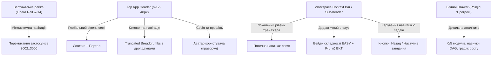

# 🧠 Brainstorm: Оптимізація та Декомпозиція Хедера Платформи (Header De-cluttering & Scope Architecture)

**Дата:** 4 листопада 2026  
**Статус:** Схвалено до концептуального впровадження  
**Контекст:** Інформаційне перевантаження верхньої навігаційної смуги (Header) у клієнтських інтерфейсах платформи (зокрема `apps/student` та споріднених застосунках).

---

## 1. 📌 Проблема: Інформаційне перевантаження хедера

На певному етапі розвитку інтерфейсу у верхню горизонтальну навігаційну смугу (`Header`) було виведено занадто багато різнорідних системних, контекстних та аналітичних елементів:

```
[Logo + Smart-BKT-Chain] [Student Portal v2.0 ▾] | [Дмитро Стиценко] | [JS & Web Eng > Mod 1: Змінні > Теорія: const EASY] | [🏆 Прогрес курсу: 0% (0/5)] | [🌐 Модуль 1: 0% P(L)] | [📚 JavaScript & Web Engineering ▾]
```

### 🔍 Детальна анатомія виявлених дефектів:
1. **Змішування глобального та локального контекстів (Scope Bleed):**
   - В один горизонтальний рядок вміщено:
     - Глобальний рівень (логотип, перемикач порталів `apps/*`, профіль користувача);
     - Рівень курсу (назва курсу, загальний прогрес `0/5 модулів`);
     - Рівень поточної задачі/навички (повний шлях хлібних крихт, назва поточної одиниці знань, бейдж складності `[EASY]`, BKT-метрика модуля).
2. **Пряме дублювання інформації (Information Redundancy):**
   - Назва курсу *«JavaScript & Web Engineering»* зустрічається одночасно в двох місцях: у хлібних крихтах зліва та у правому дропдауні курсу.
   - Ідентифікатор «Модуль 1» продубльовано у ланцюжку крихт і в блоці прогресу модуля.
3. **Порушення візуальної ієрархії та F-патерну сприйняття:**
   - Кнопка профілю учня (`Дмитро Стиценко`) опинилася між брендингом порталу та хлібними крихтами навігації, хоча стандарт патернів веб-інтерфейсів закріплює ідентифікацію сесії/профілю у крайньому правому кутку.
4. **Горизонтальне стиснення (Horizontal Crowding):**
   - На екранах з роздільною здатністю 1366×768 або при масштабуванні інтерфейсу довгі назви тем призводять до злипання елементів, зникнення важливих кнопок або виникнення горизонтального скролу хедера.

---

## 2. 💡 Архітектурна декомпозиція рівнів відповідальності (Scope Separation)

Для усунення хаосу пропонується чітке розмежування за вертикальними та смисловими рівнями:



---

## 3. 🎨 Три Концептуальні Варіанти Реорганізації

### 🔹 Варіант А: «Дворівневий контекст» (Global Header + Workspace Sub-Header)
* **Верхній Header (48px):**
  - **Ліворуч:** Брендинг `Smart-BKT-Chain` + `Student Portal`.
  - **По центру:** Компактні хлібні крихти з автоскороченням довгих назв (`JavaScript... > Модуль 1 > const...`).
  - **Праворуч:** Аватар студента з ініціалами та меню профілю / виходу.
* **Підшапка робочого простору (над кодовим редактором Monaco / теорією):**
  - Виноситься поточний дидактичний статус:
    `[Теорія: Незмінність посилання const] [EASY] | P(L): 0.85 (Майстерність) | [Попередня] [Наступна]`
  - Хедер звільняється від дидактичних деталей, а зона задачі отримує свій власний чіткий контекст.

### 🔹 Варіант Б: «Мікро-віджети та Інформаційні Поповери» (Pill-Popovers)
* Збереження ультратонкого 1-рядкового хедера з заміною довгих текстових плашок на компактні інтерактивні «пігулки»:
  - Замість двох громіздких віджетів прогресу курсу та модуля створюється єдиний компактний індикатор:
    `[ 🏆 20% | BKT: 78% ▾ ]`
  - При кліку на пігулку відкривається акуратне спливаюче вікно (Popover):
    - Скільки модулів опановано ($0/5$);
    - Поточний стан когнітивної моделі студента;
    - Список тем, що потребують повторення.
* Профіль користувача скорочується до мінімалістичного аватара з бейджем ролі та переміщується у правий кут.

### 🔹 Варіант В: «Делегування бічній панелі (Opera Shell Alignment)»
* Оскільки згідно з правилом №7 агентських інструкцій платформа базується на **AppShellLayout (Opera Shell v2.0)** з вертикальною лівою рейкою та бічним Drawer:
  - Глобальний прогрес курсу, список модулів та перемикач мов/курсів повністю переносяться у секцію `<DrawerSection>` бічної панелі («Навчальний план / Прогрес»).
  - Хедер залишається чистим, спокійним і фокусуючим: лише назва поточної теми, рівень володіння навичкою та кнопка профілю.

---

## 4. 🧭 Питання для прийняття інженерного рішення

1. **Баланс між аналітикою та фокусом:** Чи повинен студент бачити глобальний прогрес курсу щомиті під час написання коду, чи це фоновий шум, який доцільніше сховати у випадаючий поповер/сайдбар?
2. **Стандартизація профілю:** Перенесення блоку користувача `[Аватар + Ім'я]` у правий край як єдиний стандарт для всіх 4 застосунків (`apps/study`, `apps/student`, `apps/teacher`, `apps/admin`).
3. **Обрізання та дропдауни хлібних крихт:** Застосування `max-w-[200px] truncate` для ланок шляху з можливістю кліку на стрілочку `▾` для швидкої навігації без переходу на головну.

