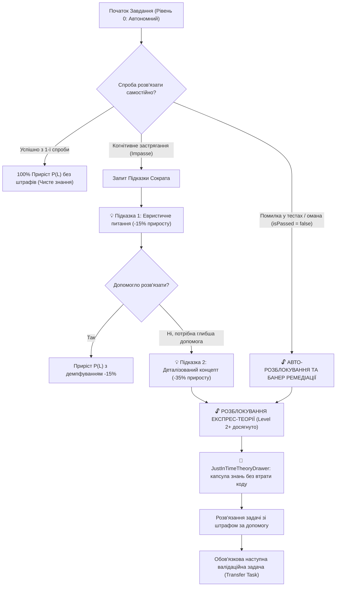

# 🧠 Брейншторм: Дидактична Модель Експрес-Теорії та Протокол Прогресивної Ескалації Когнітивного Риштування (Just-in-Time Theory & Progressive Scaffolding Escalation)

> **Дата фіксації:** 7 листопада 2026 року  
> **Статус:** Концептуально узгоджено та інженерно впроваджено (`SBC-348`, `EP-ST`)  
> **Область застосування:** Студентський кабінет та інтерактивний тренажер (`apps/student`), ядро оцінювання знань BKT (`apps/api`), інтерактивний підручник (`apps/study`).  
> **Педагогічний базис:** Теорія зон найближчого розвитку (Л. С. Виготський), принципи продуктивної боротьби (Productive Struggle / Desirable Difficulties, R. Bjork), моделі пошуку допомоги в ITS (Help Seeking & Help Avoidance, V. Aleven & K. Koedinger).

---

## 🎯 1. Контекст та Педагогічна Проблема (Problem Statement)

У студентському порталі-тренажері (`apps/student`) ключовою цінністю є поєднання **адаптивної діагностики за моделлю BKT** із **розвивальною когнітивною підтримкою (Scaffolding)**. Для цього розроблено висувну шторку експрес-теорії `JustInTimeTheoryDrawer`, яка містить стислу мікро-капсулу знань (~2 хв читання, розбір помилкової ментальної моделі, практичний зразок коду та чек-лист) без перезавантаження сторінки та без втрати введеного коду (Zero State Loss).

Під час проєктування поведінки кнопки виклику теорії в інтерфейсі виникла фундаментальна дидактична дилема між двома крайнощами, добре відомими в теорії інтелектуальних навчальних систем:

```
          ┌────────────────────────────────────────────────────────┐
          │      ДИЛЕМА КОГНІТИВНОЇ ПІДТРИМКИ В ТРЕНАЖЕРІ          │
          └────────────────────────────────────────────────────────┘
                       ▲                                ▲
                       │                                │
    [КРАЙНОЩІ №1: ШТРАФ ЗА ТЕОРІЮ]          [КРАЙНОЩІ №2: БЕЗКОШТОВНИЙ ДОСТУП]
     «Уникнення допомоги» (Help Avoidance)   «Арбітраж допомоги» (Help Arbitrage)
     • Студент боїться відкрити підручник.   • Студент відкриває теорію одразу.
     • Гадає навмання (trial-and-error).     • Списує код зі зразка без роздумів.
     • Штучний бар'єр до довідки/специфікацій.• Ігнорує платні підказки Сократа.
     • Зростає когнітивне застрягання.       • Отримує 100% незаслуженого P(L).
```

### 1.1. Ризик №1: «Уникнення допомоги» (Help Avoidance)
Якщо система накладає штраф (знижує приріст майстерності $\Delta P(L_t)$ або відбирає бали) за сам факт відкриття теоретичної довідки, учень починає уникати навчального матеріалу. Він впадає в стан когнітивного застрягання (*wheel-spinning*) або вдається до хаотичного перебору відповідей. Це суперечить культурі сучасної інженерної праці, де звернення до офіційної документації (MDN, стандарти, специфікації) є професійною нормою, а не приводом для покарання.

### 1.2. Ризик №2: «Арбітраж допомоги» (Help Arbitrage / Gaming the System)
Якщо ж відкриття експрес-теорії зробити абсолютно вільним і необмеженим із першої секунди знаходження на завданні:
- У теоретичній капсулі присутній блок *«Практичний зразок»* (`codeExamples`).
- Студент може відкрити теорію до будь-якої самостійної спроби, скопіювати або механічно передрукувати структуру розв'язку.
- Одночасно в системі діють багаторівневі **Сократівські підказки**, які демпфують приріст майстерності на величину штрафу (`-15%...-60%`).
- **Виникає викривлена мотивація:** навіщо учневі читати навідні запитання Сократа й втрачати частину рейтингу, якщо можна безкоштовно відкрити теорію, списати зразок і отримати 100% максимального приросту знання $P(L_t)$?

---

## ⚖️ 2. Концептуальне Розмежування: «Підказка Сократа» vs «Експрес-Теорія»

Для побудови гармонійної архітектури підтримки необхідно чітко розмежовувати дидактичну сутність обох інструментів:

| Дидактичний критерій | 💡 Підказка Сократа (`socraticHints`) | 📘 Експрес-теорія (`JustInTimeTheoryDrawer`) |
| :--- | :--- | :--- |
| **Рівень контексту** | **Task-Specific (Локальний):** прив'язаний до *конкретної поточної задачі*, аналізує поточний рядок коду учня, вхідні аргументи та непройдений тест-кейс. | **Domain-Level (Концептуальний):** розкриває *загальну закономірність предметної області*, правила синтаксису, поведінку структур пам'яті (Stack/Heap) або юридичну норму. |
| **Епістемологічна мета** | Спонукати до метапізнання: самостійно знайти логічну або синтаксичну суперечність у поточному коді. | Відновити цілісність ментальної моделі (Mental Model Repair), ліквідувати прогалину в теоретичній базі. |
| **Місце в математиці BKT** | Модифікує **рівняння спостереження** $P(L_t \mid O_t)$: розв'язок отримано не суто автономно, тому демонстрація майстерності є частковою. | Моделює **ймовірність переходу / навчання** $P(T)$: студент отримав нову концептуальну інформацію, що активує перехід у стан знання. |
| **Вплив на оцінку** | **Демпфування приросту:** $\Delta P(L)_{\text{penalized}} = \Delta P(L) \cdot (1 - \text{penaltyPct}/100)$. | **Нейтральний довідник**, але доступний лише на певному рівні когнітивної ескалації. |

---

## 💡 3. Аналіз Варіантів Інтеграції з BKT

Було проаналізовано три взаємодоповнюючі інженерні моделі збереження валідності BKT:

### Варіант А: «Принцип перенесення знань (Transfer Task)»
- Відкриття теорії не штрафується у балах.
- Проте якщо в ході виконання задачі відкривалася капсула, спроба маркується прапорцем `isScaffolded: true`.
- **Правило секвенсора:** навичка не може перейти в термінальний статус `MASTERED` ($P(L_n) \ge 0.90$) на задачі, де використовувалася підказка/теорія. Адаптивний секвенсор зобов'язує учня розв'язати наступну ізоморфну задачу автономно для доведення довготривалого засвоєння.

### Варіант Б: «Аналогійні зразки замість прямих шаблонів»
- Зміст практичного зразка в теоретичній капсулі будується на **іншому сюжетному контексті**, ніж задача тренажера.
- Наприклад: завдання тренажера — обчислити пеню за прострочену бібліотечну книгу; приклад у капсулі — конвертер температур за шкалою Фаренгейта.
- Прямий copy-paste стає неможливим; учень змушений здійснити **когнітивний перенос аналогії (Analogical Cognitive Transfer)**, що сам по собі є повноцінним актом навчання.

### Варіант В: «Поведінковий таймінг через Behavioral Adjuster»
- Якщо учень закриває шторку теорії й менш ніж за 15–20 секунд надсилає правильний розв'язок, це свідчить про швидку репродукцію з робочої пам'яті.
- Модуль `BehavioralAdjuster` тимчасово підвищує $P(G) \uparrow 0.40...0.50$ (імовірність репродукції зі зразка), що природно зменшує приріст апостеріорного $P(L_t)$ без каральних повідомлень.

---

## 🚀 4. Стратегічний Прорив: Протокол Прогресивної Ескалації (Progressive Scaffolding Escalation)

У ході дискусії сформульовано ключове системне правило:
> **«Експрес-теорія стає доступною лише після того, як учень задіяв сократівські підказки 2-го рівня (або припустився фактичної помилки у спробі розв'язання).»**

Це правило повністю усуває арбітраж допомоги та вибудовує бездоганну дидактичну драбину:



### 4.1. Три правила протоколу, узгоджені в діалозі:
1. **Поріг розблокування підказками:** `revealedHintLevel >= 2`.
   - *Чому не Level 1?* Перший рівень підказки є легким евристичним поштовхом (метапізнання). Якщо розблокувати теорію одразу після нього, спокуса уникнути другого рівня й відкрити готовий довідник залишиться завеликою. Досягнення другого рівня означає, що студент дійсно потребує нормативного пояснення і вже погодився на демпфування рейтингу (-30%...-40%).
2. **Візуальний стан кнопки до розблокування:**
   - Кнопка не приховується, щоб учень знав про наявність інструменту в системі.
   - Вона має напівпрозорий вигляд (`opacity-75 bg-slate-800/40 border-slate-700/40`), іконку замка `Lock`, моноширинний бейдж `2+` та стан `disabled`.
   - При наведенні курсору з'являється плавний тултіп `data-testid="jit-theory-locked-tooltip"`:
     > *«Експрес-теорія обмежена: Спробуйте розв'язати самостійно. Теорія розблокується після 2-ї підказки Сократа або при першій невдалій спробі.»*
3. **Автоматичне розблокування при невдалій спробі (Failed Submission):**
   - Якщо студент надіслав варіант відповіді, і вона виявилася хибною (`evalResult.isPassed === false`), або система діагностувала когнітивну оману (`detectedMisconception`), або в історії є `REJECTED`-спроби:
   - Кнопка **миттєво розблоковується безумовно**, перетворюючись на активний синій елемент `[📘 Теорія]`. На цьому етапі студент уже підтвердив наявність труднощів, $P(L)$ знизився за формулою хибного кроку, тому блокування довідника втрачає сенс і перетворюється на перешкоду навчанню.

### 4.2. Механізм Строгої Відмови від Завдання заради Повного Підручника (Strict Task Abandonment & Remediation)
Окремим критичним аспектом дидактичної безпеки є перехід із тренажера до **повного інтерактивного підручника (`apps/study`)** за кнопками «Zen-урок» (у Секції 6 сайдбара) та «Повний урок» (у нижній панелі шторки `JustInTimeTheoryDrawer`):
- **Проблема несанкціонованого перегляду підручника під час тесту:** Якщо дозволити студенту вільно переходити у новій вкладці до повного підручника посеред активного розв'язання вправи, виникає лазівка для списування (тест-евазія), коли учень шукає точну відповідь і повертається скласти тест.
- **Строгий варіант (Strict Abandonment):** Будь-яка спроба відкрити повний урок блокується модальним вікном підтвердження [`AbandonTaskModal`](file:///d:/PROJECTS/MAGISTERS/SMART-BKT-CHAIN/apps/student/src/components/AbandonTaskModal.tsx).
- **Наслідки підтвердження переходу:**
  1. *Фіксація в BKT:* спроба зараховується бекендом як нездана ($O_t = 0$, `isAbandoned: true`), внаслідок чого апостеріорна ймовірність знання $P(L_t)$ знижується за байєсівською формулою хибного кроку.
  2. *Очищення робочого стану:* незбережений код у Monaco Editor або обрані варіанти тесту анулюються без збереження драфта.
  3. *Режим ремедіації:* учень перенаправляється до повного Zen-уроку `apps/study`, де опрацьовує матеріал від початку.
  4. *Новий старт:* після повернення в тренажер учень розпочинає виконання цієї навички з чистого аркуша.

---

## 🛠️ 5. Математична та Інтерфейсна Специфікація

### 5.1. Математична формула активації
Стан доступності кнопки експрес-теорії в клієнтському коді:
$$\text{isTheoryUnlocked} = (\text{revealedHintLevel} \ge 2) \;\lor\; \text{hasFailedAttemptOnCurrentTask}$$
де:
- $\text{revealedHintLevel} \in \{0, 1, 2, 3\}$ — поточний рівень розкритої підказки Сократа;
- $\text{hasFailedAttemptOnCurrentTask} = (\text{evalResult} \land \neg \text{isPassed}) \lor (\text{submissions}_{\text{failed}} > 0) \lor \text{isDegraded}$.

### 5.2. Демпфування приросту майстерності в BKT (`bkt.controller.ts`)
При успішному проходженні завдання після задіяння підказок:
$$\Delta P(L)_{\text{raw}} = P(L_t \mid \text{correct}) - P(L_{t-1})$$
$$\Delta P(L)_{\text{eff}} = \Delta P(L)_{\text{raw}} \cdot \left(1 - \frac{\text{penaltyPct}}{100}\right)$$
$$P(L_t)_{\text{final}} = P(L_{t-1}) + \Delta P(L)_{\text{eff}}$$
Завдяки цьому BKT залишається математично суворим: учень отримує знання, але його розрахункова ймовірність володіння навичкою зростає повільніше, захищаючи граф від фіктивного просування.

---

## 🏛️ 6. Інженерна Реалізація в Монорепозиторії

Зміни зафіксовано в межах задачі **`SBC-348` (`EP-ST`)**:

1. **Компонент тренажера [`apps/student/src/components/StudentPortalApp.tsx`](file:///d:/PROJECTS/MAGISTERS/SMART-BKT-CHAIN/apps/student/src/components/StudentPortalApp.tsx):**
   - Додано імпорти іконок `Lock` та `Unlock` з бібліотеки `lucide-react`.
   - Обчислено стан `isTheoryUnlocked` на базі `revealedHintLevel >= 2` та `hasFailedAttemptOnCurrentTask`.
   - Оновлено кнопку тулбара над редактором (`data-testid="open-jit-theory-btn"`): додано динамічний стан `disabled`, бейдж `2+`, іконку замка та тултіп `jit-theory-locked-tooltip`.
   - Оновлено Секцію 6 сайдбара («Матеріал для повторення»): кнопка `data-testid="drawer-jit-theory-btn"` синхронно блокується із підписом `Потрібна підказка Сократа 2+ або помилка`.
   - Оновлено Секцію 5 сайдбара («Підказки Сократа»): при розкритті підказки 2-го рівня поруч виводиться індикатор `🔓 Теорію розблоковано!`.

2. **Наскрізне E2E тестування [`e2e/full-flow.spec.ts`](file:///d:/PROJECTS/MAGISTERS/SMART-BKT-CHAIN/e2e/full-flow.spec.ts):**
   - Тест перевіряє стан `toBeDisabled()` для кнопки теорії при старті нового завдання.
   - Тест підтверджує наявність тултіпа обмеження доступу `jit-theory-locked-tooltip`.
   - Тест надсилає помилковий варіант (когнітивну оману), після чого перевіряє стан `toBeEnabled()` та успішне відкриття шторки `JustInTimeTheoryDrawer`.
   - Тест перевіряє відкриття та скасування захисного модального вікна `abandon-task-modal` при спробі виходу до повного підручника.

3. **Захисне модальне вікно відмови від завдання [`AbandonTaskModal.tsx`](file:///d:/PROJECTS/MAGISTERS/SMART-BKT-CHAIN/apps/student/src/components/AbandonTaskModal.tsx) (`SBC-350`):**
   - Перехоплення переходів за посиланнями «Zen-урок» та «Повний урок».
   - Відправка прапорця `isAbandoned: true` на ендпоінт `POST /api/v1/bkt/evaluate` із фіксацією неуспішної спроби ($O_t = 0$) та падінням $P(L_t)$.
   - Очищення введеного тексту та відкриття уроку ремедіації в `apps/study`.

4. **Верифікація:**
   - Повна збірка `npm run build:student` успішно пройшла (Next.js 16.2.9 Turbopack, 0 помилок).
   - Всі 44 unit-тести бекенду `npm run test:api` (8/8 тест-сьютів) успішно пройдено.

---

## 🎓 7. Значення для Магістерської Дисертації

Цей брейншторм та його реалізація формують вагому наукову та методичну новизну роботи:

1. **Для спеціальності 122 «Комп'ютерні науки»:**
   - Алгоритмічна формалізація протоколу багаторівневого риштування (Multi-Tier Scaffolding Protocol) на основі злиття сенсорної телеметрії дій користувача та байєсівського оновлення прихованих станів знань (HMM/BKT).
   - Захист інтелектуальної системи від зловмисної маніпуляції критеріями майстерності (Gaming the System Resistance).

2. **Для спеціальності 014 «Середня освіта (Інформатика)»:**
   - Реалізація дидактичного принципу «продуктивної боротьби» (Productive Struggle) в середовищі дистанційного навчання учнів 10–11 класів.
   - Баланс між розвитком навичок самостійного пошуку рішень та психологічно безпечною підтримкою учня без страху перед оцінкою чи довідником.
