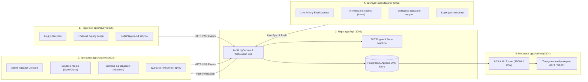
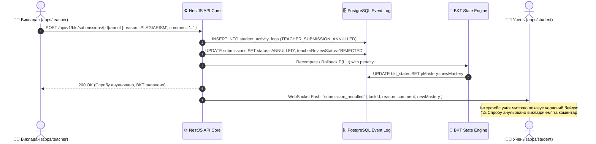

# 🧠 Brainstorm #16: Наскрізна Архітектура Event Stream — Таксономія Подій Екосистеми, Педагогічні Інтервенції Викладача (Анулювання / Скидання) та Підготовка Навчальних Датасетів для ШІ

**Дата:** 9 листопада 2026  
**Статус:** Схвалено до реалізації  
**Ініціатор / Робоча група:** Дмитро Стеценко, Antigravity AI  
**Пов'язані модулі монорепозиторію:** `apps/study`, `apps/student`, `apps/teacher`, `apps/admin`, `apps/api`, `packages/types`, `packages/database`  
**Наукова прив'язка:** Спеціальність 122 «Комп'ютерні науки» (Розділ 2 — моделі DKT/HMM; Розділ 3 — архітектура шини подій) та Спеціальність 014 «Середня освіта (Інформатика)» (Розділ 2 — педагогічна діагностика та академічна доброчесність).

---

## 1. Концепція «Наскрізності» (The End-to-End Imperative)

У традиційних системах управління навчанням (LMS) логування часто зводиться до відокремленого технічного запису в текстовий файл серверних помилок або простої таблиці спроб `attempts`. 

У мультимодальному інтелектуальному комплексі **Smart-BKT-Chain** система логування проєктується як **наскрізна шина даних (End-to-End Learning Event Stream)**.



### Фундаментальні виміри наскрізності:
1. **Міжпортальна наскрізність (Cross-App Omnipresence):**
   * Дії в підручнику `apps/study` безпосередньо впливають на розрахунок імовірності вгадування $P(G)$ та ковзання $P(S)$ у тренажері `apps/student`.
   * Кожен крок студента миттєво долітає через WebSockets у кабінет викладача `apps/teacher`.
   * Педагогічна інтервенція викладача (анулювання) миттєво відкочує розрахунки в бекенді та оновлює екран студента без перезавантаження сторінки.
2. **Концепція Append-Only (Незмінність історії):**
   * **Повна відмова від деструктивних `DELETE`:** Раніше виклик скидання прогресу видаляв записи спроб `submission.deleteMany()`. Тепер будь-яке скидання (учнем чи викладачем) є **подією в кінці ланцюжка подій**, зберігаючи повну прозорість для аудиту.
3. **Супервізорний контур для ШІ (Human-in-the-Loop Ground Truth):**
   * Рішення викладача щодо анулювання чи схвалення є **жорсткою еталонною міткою (Ground Truth Supervisor Label)**, яка перетворює звичайний лог на високоякісний датасет для навчання нейромереж.

---

## 2. Повна 5-Рівнева Таксономія Подій (Event Taxonomy Matrix)

Усі події екосистеми класифікуються за єдиним строго типізованим переліком `EventType`, мають автора (`actorRole`: `STUDENT`, `TEACHER`, `SYSTEM`, `ADMIN`) та стандартизований JSON-пейлоад:

| Рівень / Домен | `eventType` | Ініціатор | Призначення та ключовий Payload |
| :--- | :--- | :---: | :--- |
| **Рівень 1: Підручник (`apps/study`)** | `THEORY_UNIT_ENTERED` | `STUDENT` | Фіксація початку вивчення теми (`courseSlug`, `moduleSlug`, `unitSlug`). |
| | `THEORY_SCROLL_PROGRESS` | `STUDENT` | Глибина ознайомлення з матеріалом (`scrollDepthPct: 25 | 50 | 75 | 100`). |
| | `THEORY_PLAYGROUND_RUN` | `STUDENT` | Інтерактивний запуск коду в пісочниці підручника (`codeSnippet`, `executionMs`). |
| | `THEORY_UNIT_EXITED` | `STUDENT` | Загальний час активного читання (`activeDwellTimeSeconds`). |
| **Рівень 2: Тренажер (`apps/student`)** | `TASK_VIEWED` | `STUDENT` | Початок розв'язання конкретної задачі (`taskId`, `difficulty`, `taskType`). |
| | `HINT_REQUESTED` | `STUDENT` | Відкриття підказки Сократа (`level: 1 | 2`, `penaltyPct: 15 | 30`, `latencyMs`). |
| | `THEORY_DRAWER_OPENED` | `STUDENT` | Відкриття шторки експрес-теорії (`isUnlocked: boolean`, `trigger: 'drawer_btn'`). |
| | `THEORY_DRAWER_CLOSED` | `STUDENT` | Закриття експрес-теорії (`dwellTimeSeconds`). |
| | `CODE_EXECUTION_TEST` | `STUDENT` | Проміжний запуск тест-кейсів перед фінальною здачею (`passedCount`, `totalCount`). |
| | `MISCONCEPTION_TRIGGERED`| `SYSTEM` | Детекція типової дидактичної омани (`misconceptionId`, `misconceptionTitle`). |
| **Рівень 3: Академічні рішення** | `TASK_ABANDON_PROMPTED` | `STUDENT` | Відкриття діалогу переривання завдання (`AbandonTaskModal`). |
| | `TASK_ABANDON_CONFIRMED` | `STUDENT` | Підтвердження відмови від завдання заради ремедіації в теорії (`destinationUrl`). |
| | `STUDENT_SKILL_RESET` | `STUDENT` | Добровільне скидання навички студентом для повторного вивчення з нуля. |
| **Рівень 4: Результат та Телеметрія** | `TASK_SUBMITTED` | `STUDENT` | Фінальна відправка відповіді (`isCorrect`, `score`, $P(L)_{\text{prior}}$, $P(L)_{\text{post}}$, $\Delta P(L)$). |
| | `TELEMETRY_ANOMALY` | `SYSTEM` | Сигнал високого ризику списування (`wpm > 120`, `pasteEvents >= 3`, `burstiness`). |
| **Рівень 5: Педагогічні інтервенції** | `TEACHER_REVIEW_APPROVED` | `TEACHER` | Успішне підтвердження відкритої відповіді викладачем (`submissionId`, `comment`). |
| | `TEACHER_REVIEW_REJECTED` | `TEACHER` | Відхилення відповіді у черзі перевірки (`submissionId`, `comment`). |
| | **`TEACHER_SUBMISSION_ANNULLED`**| `TEACHER` | **Анулювання зарахованої спроби** (`submissionId`, `reason`, `comment`, $\Delta P(L)$). |
| | **`TEACHER_MODULE_REVOKED`** | `TEACHER` | **Примусовий скид опанування теми** за системне порушення доброчесності. |
| | **`TEACHER_SCORE_OVERRIDDEN`** | `TEACHER` | Ручна зміна балу чи оцінки завдання викладачем (`oldScore`, `newScore`). |

---

## 3. Механіка Анулювання Викладачем (Teacher Annulment Protocol)

Коли викладач виявляє невідповідність (плагіат, пряму генерацію коду сторонніми мовними моделями або спідран із вгадуванням), він ініціює анулювання безпосередньо з інтерфейсу `apps/teacher`.



### Математичні наслідки анулювання для моделі BKT:
1. **Відкат приросту знання ($\Delta P(L)$ Rollback):**
   Якщо завдання раніше було зараховано як правильне ($O_t = 1$) і додало учневі $\Delta P(L) = +0.18$, анулювання не просто віднімає цей приріст, а застосовує коригувальний коефіцієнт педагогічного штрафу $\gamma_{\text{penalty}} = 1.25$:
   $$\Delta P(L)_{\text{annul}} = - \left( \Delta P(L)_{\text{gained}} \cdot \gamma_{\text{penalty}} \right)$$
   $$P(L_{\text{new}}) = \max(P_{\min}, P(L_{\text{current}}) + \Delta P(L)_{\text{annul}})$$
   де $P_{\min} = 0.05$ (нижня асимптота знань).
2. **Адаптивна реакція графу (DAG Auto-Adjustment):**
   При анулюванні ключової навички-передумови залежні дочірні навички у дереві знань блокуються для проходження, доки учень не підтвердить компетентність самостійно.

---

## 4. Підготовка Датасетів для ШІ та Машинного Навчання (Deep Knowledge Tracing & Integrity ML)

Наскрізний потік подій безпосередньо розв'язує проблему підготовки датасетів для наукових досліджень:

### 1. Формат експорту для моделей Deep Knowledge Tracing (DKT / SAKT)
Для тренування рекурентних мереж (LSTM) та трансформерів знань формується послідовність кортежів:
$$X_i = \left( t_k, q_k, a_k, \tau_k, h_k, d_k \right)$$
де:
* $t_k$ — часова мітка кроку;
* $q_k$ — ідентифікатор навички / завдання;
* $a_k \in \{0, 1\}$ — успішність спроби (з урахуванням анулювання $a_k = 0$ при `ANNULLED`);
* $\tau_k$ — час розв'язання (latency);
* $h_k$ — кількість використаних підказок Сократа ($0, 1, 2$);
* $d_k$ — звернення до експрес-теорії ($0$ або $1$).

### 2. Формат JSONL для моделей класифікації Академічної Доброчесності
```json
{
  "sessionId": "sess_8f3a92",
  "userId": "usr_student_01",
  "taskId": "task_var_const_01",
  "skillSlug": "variables-and-types",
  "features": {
    "wpm": 142.5,
    "pasteRatio": 0.82,
    "pauseDurationMs": 420,
    "reactionLatencyMs": 1850,
    "socraticHintsUsed": 0,
    "theoryOpenedBeforeSubmit": false
  },
  "labels": {
    "autoSystemPassed": true,
    "teacherSupervisedAnnulled": true,
    "teacherAnnulReason": "PLAGIARISM_SUSPECTED",
    "finalGroundTruth": "ACADEMIC_DISHONESTY"
  },
  "timestamp": "2026-11-09T11:58:12.450Z"
}
```

> **Наукова новизна:** Завдяки обов'язковому логуванню дій викладача система формує перший в Україні верифікований корпус мультимодальної телеметрії програмування для старшокласників із супервізорною розміткою експертів-педагогів.

---

## 5. Архітектурна реалізація в монорепозиторії

1. **База даних (`packages/database/prisma/schema.prisma`):**
   * Створення моделі `StudentActivityLog`:
     ```prisma
     model StudentActivityLog {
       id         String      @id @default(uuid())
       userId     String
       user       User        @relation(fields: [userId], references: [id], onDelete: Cascade)
       actorId    String      // ID користувача, що виконав дію (студент або викладач)
       actorRole  UserRole    // STUDENT, TEACHER, ADMIN, SYSTEM
       courseId   String?
       skillId    String?
       taskId     String?
       eventType  String      // HINT_REQUESTED, TEACHER_SUBMISSION_ANNULLED тощо
       payload    Json        // Детальні атрибути події
       createdAt  DateTime    @default(now())

       @@index([userId, createdAt])
       @@index([eventType])
       @@map("student_activity_logs")
     }
     ```
2. **Бекенд-сервіс (`apps/api`):**
   * Модуль `AuditLogService` із методом `logEvent(dto)` та інтеграцією з `TelemetryGateway` для миттєвої розсилки оновлень.
   * Контролер експорту: `GET /api/v1/admin/export/activity-stream?format=jsonl|csv`.
   * Ендпоінт анулювання: `POST /api/v1/bkt/submissions/:id/annul`.
3. **Фронтенд-інтерфейси:**
   * `apps/student`: Відправка кліків підказок, відкриття експрес-теорії, підтвердження здачі та реактивний показ сповіщень про вчительські анулювання.
   * `apps/teacher`: Віджет **«Хроніка дій (Audit Activity Feed)»** та кнопка «Анулювати спробу» з модальним вікном вибору причини та коментаря.
   * `apps/admin`: Кнопка вивантаження датасету у форматі JSONL.

---

## 6. Висновки

1. Запропонована наскрізна система логування об'єднує всі 5 застосунків екосистеми в єдиний інформаційний простір.
2. Врахування інтервенцій викладача (анулювання, примусовий скид) закриває критичну прогалину зворотного зв'язку і робить платформу повноцінною системою Human-in-the-Loop.
3. Отримані незмінні хронологічні логи слугуватимуть науково-практичним фундаментом для підготовки та тренування власних моделей штучного інтелекту.
