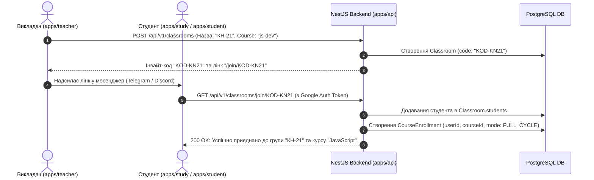

# 🧠 Сесія 18: Повноцінна Авторизація через Google, Інвайт-Коди Класів, Гнучкий Енролмент Курсів та Адмін-Керування Користувачами

Цей документ фіксує результати 18-ї сесії архітектурного брейншторму платформи **Smart-BKT-Chain**, присвяченої переходу системи від локального однокористувацького демо-стенду до повноцінної багатокористувацької навчальної платформи (Multi-User LMS & Adaptive ITS) для впровадження у коледжі та комп'ютерній академії.

---

## 🎯 1. Концепція та Дидактичний Виклик

При переході платформи до реальної експлуатації зі студентами коледжу та комп'ютерної академії ШАГ постає три головні виклики:
1. **Бар'єр реєстрації (Registration Friction):** Учні та студенти часто забувають паролі, плутають пошти або витрачають третину пари на відновлення доступу. Реєстрація має бути максимально безшовною — в один клік через Google (Google Workspace for Education або особистий `@gmail.com`).
2. **Рутина адміністрування викладача (Enrollment Burden):** Якщо в академічній групі 25–30 студентів, вбивати вручну кожен email у систему — надзвичайно неефективно. Викладач повинен мати змогу згенерувати **Інвайт-код класу** (наприклад, `KOD-KN21`) або пряме посилання (`/join/KOD-KN21`), поділитися ним у месенджері, після чого студенти автоматично зараховуються до групи. При цьому викладач зберігає можливість **індивідуального підключення** окремих студентів.
3. **Гнучкість освітнього процесу (Multi-Modal Curriculum Modes):** Для різних сценаріїв (повне семестрове навчання, вхідний зріз знань чи вибіркові теми) потрібні різні режими: повний цикл «Теорія $\rightarrow$ Тренажер BKT», «Чисте тестування» без обов'язкового читання конспекту, або вибір окремих модулів.
4. **Управління в Адмінці та Тестовий Режим:** Адміністратор повинен мати повноцінну панель управління користувачами (CRUD), а також **системний тумблер перемикання авторизації**: режим повноцінного Google OAuth 2.0 проти швидкого тестового входу (Test Mode Bypass) для офлайн-сесій чи презентацій.

---

## 🔐 2. Архітектура Автентифікації: Google OAuth 2.0 та Режим Bypass

### 2.1. Повноцінна Авторизація Google OAuth 2.0 (Google One-Tap / Sign-In)
- **Фронтенд:** Використовує офіційну бібліотеку `@react-oauth/google` або нативний Google Identity Services API (GSI).
- **Кнопка входу:** Елегантна плоска кнопка `Продовжити з Google` у стилі Minimalist Borderless UI та автоматичне спливаюче вікно Google One Tap.
- **Бекенд пайплайн (`apps/api`):**
  1. Клієнт передає Google ID Token на ендпоінт `POST /api/v1/auth/google`.
  2. Бекенд верифікує підпис токена через бібліотеку `google-auth-library` (`OAuth2Client.verifyIdToken`).
  3. Якщо користувач з таким email не існує в базі даних PostgreSQL:
     - Створюється новий запис `User`:
       - `email`: з перевіреного токена Google;
       - `name`: реальне ім'я та прізвище (`payload.name`);
       - `avatarUrl`: фото профілю (`payload.picture`);
       - `role`: за замовчуванням `STUDENT`;
       - `authProvider`: `GOOGLE`;
  4. Формується внутрішній сесійний JWT-токен (`accessToken`, термін дії 7 діб), підписаний секретним ключем сервера.
  5. Токен зберігається у безпечних HTTP-Only Cookie або синхронізується через пакет `@sbc/routes` між усіма доменами платформи.

---

### 2.2. Системний Перемикач «Тестовий Режим Авторизації» (Test Mode Auth Bypass)
Для зручності локальної розробки, відсутності Інтернету, проведення демонстрацій на кафедрах та компіляції дисертаційних експериментів в Адмін-панелі передбачено системний конфіг:
- **Параметр:** `SYSTEM_AUTH_TEST_MODE` (`true` / `false`), що зберігається в таблиці `SystemConfig` бази даних.
- **Коли режим УВІМКНЕНО:**
  - На сторінці входу, окрім кнопки Google, з'являється блок швидкого вибору тестових ролей:
    - *«Увійти як Студент (demo-student)»*;
    - *«Увійти як Студент 2 (Олександр Мельник)»*;
    - *«Увійти як Викладач (Олена Ковальчук)»*;
    - *«Увійти як Адміністратор CMS (admin)»*.
  - Вхід відбувається миттєво в один клік без звернення до серверів Google.
- **Коли режим ВИМКНЕНО (Production Mode):**
  - Доступ дозволено виключно через верифіковані облікові записи Google OAuth 2.0.

---

## 🏫 3. Інвайт-Коди Класів та Індивідуальне Зарахування (Enrollment Engine)

### 3.1. Механізм Інвайт-Кодів (Classroom Invitation Flow)



1. **Створення класу викладачем:**
   - Викладач у своєму кабінеті (`apps/teacher`) у розділі «Мої Класи / Групи» вказує назву (наприклад, *«10-А Клас»* або *«ШАГ-Frontend-2026»*) та закріплений курс.
   - Система генерує унікальний 6-8 знаковий інвайт-код (наприклад, `KOD-10A`) та прямий лінк:
     `http://localhost:3006/join/KOD-10A`
2. **Активація студентом:**
   - Студент відкриває посилання. Якщо він ще не авторизований, спершу з'являється кнопка Google One-Tap.
   - Одразу після підтвердження особи студент автоматично додається у групу викладача і на його екран завантажується актуальна програма курсу.

---

### 3.2. Індивідуальне Підключення (Individual Direct Enrollment)
Викладач або адміністратор може відкрити профіль будь-якого студента і вручну призначити йому:
- додатковий курс;
- перевести в іншу академічну групу;
- перевизначити індивідуальний режим проходження.

---

## 🎓 4. Три Дидактичні Режими Проходження Курсу (Enrollment Modes)

Кожне зарахування на курс (`CourseEnrollment`) має атрибут `mode`:

| Режим | Дидактична мета | Сценарій проходження |
| :--- | :--- | :--- |
| **`FULL_CYCLE` (Канонічний ITS)** | Систематичне семестрове навчання у коледжі чи школі. | Студент читає тему в `apps/study` (Zen Focus). Лише після прочитання розблоковується перехід до тренажера `apps/student`. Наступна тема курсу заблокована (`Locked`), поки $P(L_t) < 0.75 / 0.95$. |
| **`TESTING_ONLY` (Зріз знань / Екзамен)** | Проведення контрольних робіт, олімпіад, заліків чи вхідного скринінгу знань у ШАГу. | Теоретичний підручник вимкнено або необов'язковий. Студент одразу розв'язує завдання у тренажері `apps/student`. |
| **`MODULAR` (Вибіркова траєкторія)** | Адаптація програми під обмежену кількість академічних годин. | Викладач явно визначає масив `allowedModules: ["mod-1-vars", "mod-3-arrays"]`. Усі інші модулі графу приховані або заблоковані. |

---

## 👥 5. Панель Керування Користувачами в Адмінці (`apps/admin`)

На лівій вертикальній рейці Minimalist Borderless Icon Rail додається вкладка:
- **`users` (`Users` / `Shield` / `UserCheck`)** — «Користувачі та Ролі».

### Функціонал вкладки:
1. **Зведена статистика користувачів:**
   - Загальна кількість користувачів, активні студенти, викладачі, адміністратори.
   - Індикатор поточного статусу авторизації: `GOOGLE OAUTH 2.0 (LIVE)` або `TEST MODE (BYPASS)`.
2. **Таблиця Користувачів (User Table):**
   - Стовпці: Аватар, ПІБ, Email, Роль (`STUDENT` / `TEACHER` / `ADMIN`), Академічна група / Клас, Кількість активних курсів, Дата створення, Статус.
   - Швидкий пошук та мульти-фільтри за роллю та класом.
3. **Модальне вікно створення користувача вручну:**
   - Поля: Ім'я, Email, Роль, вибір Групи.
4. **Редагування користувача:**
   - Зміна ролі (наприклад, призначення студента асистентом викладача чи навпаки).
   - Зміна закріпленої групи.
5. **Безпечне керування статусом:**
   - Деактивація / Блокування (користувач не може ввійти, але його розв'язки, BKT-історія та аудит-логи повністю зберігаються для наукового аналізу).
   - Повне видалення із захисним модальним вікном підтвердження.
6. **Тумблер Системних Налаштувань Авторизації:**
   - Перемикач режиму `Дозволити тестовий вхід без Google`.

---

## 🗄️ 6. Модель Даних Prisma ORM

```prisma
// Модель користувача платформи
model User {
  id            String             @id @default(cuid())
  email         String             @unique
  name          String
  avatarUrl     String?
  role          UserRole           @default(STUDENT)
  authProvider  AuthProvider       @default(GOOGLE)
  isActive      Boolean            @default(true)
  
  // Зв'язки з групами
  classroomId   String?
  classroom     Classroom?         @relation("ClassStudents", fields: [classroomId], references: [id])
  taughtClasses Classroom[]        @relation("TeacherClasses")
  
  // Зарахування на курси
  enrollments   CourseEnrollment[]
  
  // Існуючі зв'язки BKT та активності
  bktStates     BktState[]
  submissions   Submission[]
  activityLogs  StudentActivityLog[]
  createdAt     DateTime           @default(now())
  updatedAt     DateTime           @updatedAt
}

enum UserRole {
  STUDENT
  TEACHER
  ADMIN
}

enum AuthProvider {
  GOOGLE
  LOCAL_MOCK
}

// Навчальна академічна група / клас
model Classroom {
  id          String             @id @default(cuid())
  name        String             // "КН-21", "10-А"
  code        String             @unique // інвайт-код, наприклад "KOD-KN21"
  teacherId   String
  teacher     User               @relation("TeacherClasses", fields: [teacherId], references: [id])
  students    User[]             @relation("ClassStudents")
  courseId    String?
  course      Course?            @relation(fields: [courseId], references: [id])
  createdAt   DateTime           @default(now())
  updatedAt   DateTime           @updatedAt
}

// Зарахування на курс та дидактичний режим
model CourseEnrollment {
  id             String         @id @default(cuid())
  userId         String
  courseId       String
  user           User           @relation(fields: [userId], references: [id], onDelete: Cascade)
  course         Course         @relation(fields: [courseId], references: [id], onDelete: Cascade)
  mode           EnrollmentMode @default(FULL_CYCLE)
  allowedModules String[]       @default([])
  enrolledAt     DateTime       @default(now())

  @@unique([userId, courseId])
}

enum EnrollmentMode {
  FULL_CYCLE    // Теорія -> Практика -> Mastery Gate
  TESTING_ONLY  // Тільки тренажер BKT (екзамени/зрізи)
  MODULAR       // Тільки вибірково відкриті модулі
}

// Системні налаштування платформи
model SystemConfig {
  key         String   @id
  value       String
  description String?
  updatedAt   DateTime @updatedAt
}
```

---

## 🗺️ 7. Дорожня Карта Реалізації (Micro-Steps Road Map)

| Мікро-крок | Область | Опис інженерної задачі |
| :---: | :---: | :--- |
| **Крок 1** | `packages/database` | Оновлення схеми `schema.prisma` (`User`, `Classroom`, `CourseEnrollment`, `SystemConfig`), створення міграцій та оновлення сидингу. |
| **Крок 2** | `apps/api` | Модуль автентифікації `AuthModule` (Google OAuth 2.0 верифікація токенів, JWT сесії, сервіс перемикання Test Mode Bypass). |
| **Крок 3** | `apps/api` | Модулі `ClassroomModule` та `EnrollmentModule` (генерація інвайт-кодів, ендпоінти приєднання `/join/:code`, індивідуальне призначення курсів). |
| **Крок 4** | `apps/admin` | Вкладка `users` на навігаційній рейці: UI-компонент `UserManagementCenter` (таблиця користувачів, створення, редагування, фільтрація, видалення, тумблер Test Mode). |
| **Крок 5** | `apps/teacher` | Додавання секції «Керування класами та інвайт-кодами» у кабінеті викладача, генерація посилань та призначення курсів учням. |
| **Крок 6** | `apps/study` / `apps/student` | Сторінка швидкого входу через Google / One Tap, підтримка роуту `/join/[inviteCode]` та дидактична фільтрація завдань за режимом (`FULL_CYCLE` vs `TESTING_ONLY`). |
| **Крок 7** | E2E & Docs | Наскрізне тестування в Playwright, оновлення `docs/apps/*.md`, щоденного прогресу та комміти за Jira-стандартом. |

---

## 🏁 Підсумок

Запропонована архітектура повністю задовольняє всі вимоги впровадження у навчальних закладах:
1. **Нульовий поріг входу** для учнів через Google.
2. **Нульова рутина** для вчителя завдяки інвайт-кодам груп.
3. **Гнучкість сценаріїв** від поглибленого семестрового курсу до швидких діагностичних зрізів.
4. **Повний контроль** адміністратора з можливістю тестування в один клік без сторонніх сервісів.
