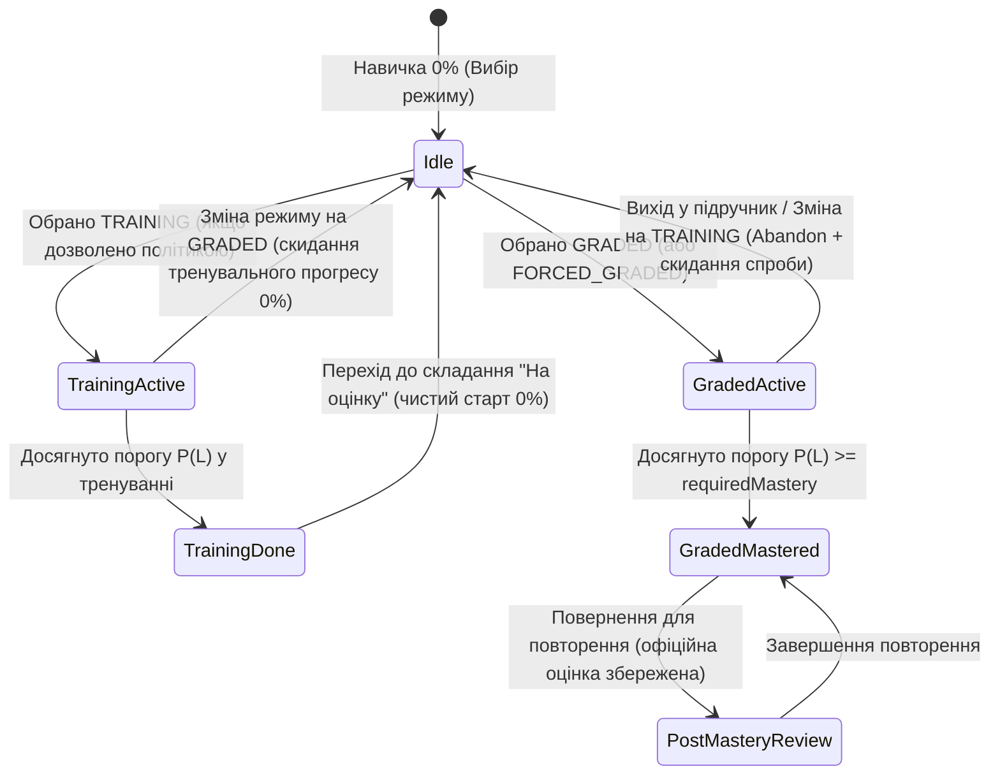
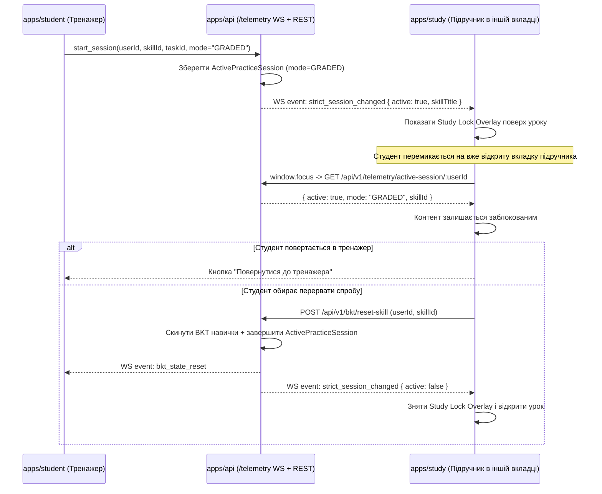

# 🧠 Брейншторм: Режими Проходження (Тренувальний vs Суворий «На Оцінку»), Серверне Блокування Підручника та Політики Викладача

> **Дата фіксації:** 26 листопада 2026 року  
> **Статус:** Концептуально узгоджено (готово до декомпозиції на мікро-кроки реалізації)  
> **Область застосування:** Тренажер студента (`apps/student`), інтерактивний підручник (`apps/study`), кабінет викладача (`apps/teacher`), ядро BKT та телеметрії (`apps/api`), схема БД (`packages/database`).  
> **Зв'язок із попередніми концепціями:** Продовжує [15. Протокол прогресивної ескалації когнітивного риштування](file:///d:/PROJECTS/MAGISTERS/SMART-BKT-CHAIN/docs/brainstorm/15_just_in_time_theory_and_progressive_scaffolding.md) та [18. Гнучкий енролмент курсів і класи](file:///d:/PROJECTS/MAGISTERS/SMART-BKT-CHAIN/docs/brainstorm/18_user_onboarding_google_auth_course_enrollment_and_admin_rbac.md).

---

## 🎯 1. Виявлена Архітектурна Проблема (Problem Statement)

У поточній реалізації платформи виникла **асиметрія контролю доступу до підручника** між порталом тренажера (`apps/student`) та порталом підручника (`apps/study`):

1. **Через офіційну кнопку в тренажері** (`StudentPortalApp.tsx` → `AbandonTaskModal.tsx`):
   - Спроба перейти до повного підручника запускає `POST /api/v1/bkt/reset-skill` і жорстко скидає прогрес поточної навички на `0%`.
2. **Через уже відкриту вкладку підручника** (`apps/study/src/components/StudyAppClient.tsx`):
   - Портал `apps/study` не знає про активну сесію студента в `apps/student`.
   - Студент, який заздалегідь відкрив підручник у другій вкладці (або перейшов туди через іконку в лівій рейці), може вільно читати теорію під час проходження без жодних обмежень, скидань чи позначок у телеметрії.
   - У модулі `useTelemetry.ts` відстежуються лише клавіатурні метрики (`wpm`, паузи, `deleteCount`, `pasteEvents`), але відсутній трекінг перемикання вкладок (`visibilitychange` / `blur`) та серверна синхронізація активної сесії.

**Наслідок:** виникає викривлена мотивація (*«покарання за чесність»*): сумлінний студент, який натискає кнопку в інтерфейсі, втрачає весь прогрес, а відкрита паралельна вкладка ніяк не регулюється.

---

## 🧩 2. Ключова Ідея: Двоконтурна Архітектура «Режим × Політика»

Для чесного, прозорого й педагогічно виправданого розв'язання проблеми розділяємо два ортогональні шари:

### Шар 1. Режим проходження навички/модуля (`IntegrityMode`)
Визначає, **як саме працюють тренажер, підручник і BKT** під час виконання завдань:
- 📘 **`TRAINING` (Тренувальний / М'який режим):**
  - Призначений саме для **тренування, вивчення та відпрацювання матеріалу** без стресу втрати оцінки.
  - Підручник (`apps/study`) повністю відкритий — як у сусідній вкладці, так і при переході з тренажера **без скидання прогресу**.
  - Експрес-теорія (`JustInTimeTheoryDrawer`) та Сократівські підказки працюють у навчальному режимі.
  - Прогрес фіксується як **🔵 «Натреновано» (Training Readiness)** і не підміняє офіційну оцінку.
- 🛡️ **`GRADED` (Суворий режим / Проходження «На оцінку»):**
  - Призначений для **чесного оцінювання, підтвердження майстерності BKT ($P(L_n)$), заліку та видачі верифікованих досягнень / SBT**.
  - Під час активної спроби вмикається **серверне блокування підручника (`Study Lock`)** в усіх відкритих вкладках `apps/study` цього користувача.
  - Вихід у підручник із тренажера (або розблокування шторки в `apps/study`) можливий лише через підтвердження відмови (`AbandonTaskModal`) зі скиданням поточної оцінювальної спроби навички.
  - У телеметрії активується відстеження втрати фокусу вкладки (`TAB_SWITCH_OUT`: кількість виходів і тривалість).
  - Успішне опанування надає статус **🟢 «Оцінено / Верифіковано»**.

### Шар 2. Політика керування викладача (`IntegrityPolicy`)
Визначає, **хто має право обирати режим**:
- 🔓 **`STUDENT_CHOICE` *(за замовчуванням)*** — студент сам обирає режим на старті проходження навички (наприклад, спочатку тренується у `TRAINING`, а коли готовий — перемикається на `GRADED` і складає на оцінку).
- 🔒 **`FORCED_GRADED` (Жорсткий режим на оцінку)** — викладач примусово вмикає суворий режим (наприклад, на контрольній роботі або іспиті). Студент **не може** перемкнути режим на тренувальний; у UI відображається заблокований перемикач `🔒 Зафіксовано викладачем`.
- 🔒 **`FORCED_TRAINING` (Примусове тренування)** — викладач може зафіксувати м'який навчальний режим (наприклад, на вступній практичній роботі з нової теми).

---

## ⚖️ 3. Базові Правила Перемикання Режимів (Zero-Mix Integrity Rules)

У ході обговорення узгоджено 4 інваріанти, які повністю виключають маніпуляції без ускладнення UX:

1. **Правило чистого старту (Zero-Mix Rule):**
   - Студент обирає режим **на етапі початку проходження** навички/модуля.
   - Поки прогрес навички дорівнює `0%` (немає активних спроб), перемикання `TRAINING` ↔ `GRADED` відбувається миттєво.
   - Щойно студент розпочав проходження (`progress > 0%` або є спроби в поточному сеансі), **перемкнути режим без скидання прогресу цієї навички неможливо**:
     - `TRAINING` → `GRADED`: *«Перехід у режим "На оцінку" скине поточний тренувальний прогрес цієї навички на 0%, щоб оцінювання відбувалося з чистого аркуша»*. Це унеможливлює сценарій накрутки `80%` із підручником і «дотискання» останньої задачі в суворому режимі.
     - `GRADED` → `TRAINING`: *«Перехід у Тренувальний режим анулює поточну спробу на оцінку для цієї навички та негайно розблокує доступ до підручника»*.

2. **Масштаб (Scope) — на рівні окремої навички / модуля:**
   - Вибір режиму та скидання при перемиканні діють **локально в межах обраної навички/модуля**, а не всього курсу.
   - *Педагогічна перевага:* студент може вже мати **🟢 Оцінений Модуль 1**, потім спокійно тренувати **Модуль 2** у `📘 TRAINING` із підручником, і коли відчує впевненість — скинути **лише Модуль 2** і скласти його у `🛡️ GRADED`, не втрачаючи попередніх результатів.

3. **Безпечне повторення для вже оцінених навичок (Post-Mastery Review Mode):**
   - Якщо навичка **вже успішно складена в режимі `GRADED`** (отримала статус `🟢 Оцінено / Верифіковано`), студент може будь-коли повернутися до неї в режимі **«Тренування / Повторення»** — **без втрати та без перезапису вже заробленої офіційної оцінки**.
   - Якщо ж студент (або викладач) свідомо ініціює *перескладання на оцінку*, тоді запускається новий чистий `GRADED`-сеанс.

4. **Пріоритет політики викладача:**
   - Якщо викладач активує `FORCED_GRADED` для групи або конкретного студента, інтерфейс миттєво синхронізується через WebSocket:
     - Перемикач режиму у студента переходить у стан `disabled` з індикатором замка `🔒`.
     - Якщо студент перебував у `TRAINING` — система інформує його про перехід у контрольний режим, а `apps/study` блокується на час активної задачі.

---

## 🔄 4. Діаграма Станів та Крос-Портальної Синхронізації

### 4.1. Машина станів навички (Skill Mode State Machine)



### 4.2. Крос-портальне блокування підручника (`apps/student` ↔ `apps/api` ↔ `apps/study`)



---

## 📊 5. Порівняльна Таблиця Режимів

| Параметр | 📘 Тренувальний (`TRAINING`) | 🛡️ Суворий / На оцінку (`GRADED`) | 🔁 Повторення (після `GRADED`) |
| :--- | :--- | :--- | :--- |
| **Перехід у підручник із тренажера** | Вільний, без скидання | Через `AbandonTaskModal` зі скиданням навички | Вільний, без скидання |
| **Відкрита вкладка `apps/study`** | Доступна вільно | **Заблокована (`Study Lock Overlay`)** | Доступна вільно |
| **Телеметрія `blur` / `visibilitychange`** | Нейтральна аналітика часу читання | Фіксація `TAB_SWITCH_OUT` (кількість + сек) | Не впливає на індекс доброчесності |
| **Збереження офіційної оцінки** | Не йде в офіційну оцінку (`🔵 Натреновано`) | Офіційна оцінка BKT (`🟢 Оцінено`) | Зберігає отриману `🟢 Оцінку` |
| **Перемикання режиму під час проходження** | Лише зі скиданням прогресу навички | Лише зі скиданням прогресу навички | Вільний вихід із режиму повторення |

---

## 👩‍🏫 6. Функціонал Викладача (`apps/teacher`)

1. **Налаштування політики на рівні класу (`Classroom`):**
   - Селектор політики:
     - `Вільний вибір студента` (`STUDENT_CHOICE`, за замовчуванням);
     - `Жорсткий режим «На оцінку»` (`FORCED_GRADED`);
     - `Примусове тренування` (`FORCED_TRAINING`).
   - **Опціональний таймер контрольної (`strictModeUntil`):** швидкі пресети *«На 45 хв»*, *«На 90 хв»*, *«До кінця дня»* — після завершення таймера клас автоматично повертається в `STUDENT_CHOICE`.
2. **Точкове перевизначення на рівні окремого студента (`CourseEnrollment`):**
   - Можливість встановити `integrityPolicyOverride` конкретному студенту (наприклад, `FORCED_GRADED` для перескладання або `FORCED_TRAINING` для індивідуального супроводу).
3. **Прозора аналітика та індикація в кабінеті викладача:**
   - У таблиці студентів та в черзі перевірки (`ReviewQueueInspector`) чітко розрізняються статуси: `🛡️ Оцінено (Strict)` vs `📘 Натреновано (Training)`.
   - Для `GRADED`-спроб додатково відображається телеметрія виходів із вкладки (`TAB_SWITCH_OUT`).

---

## 🗄️ 7. Проєктування Моделі Даних (Prisma & API Contracts)

Мінімальні та чисті розширення існуючої схеми [`packages/database/prisma/schema.prisma`](file:///d:/PROJECTS/MAGISTERS/SMART-BKT-CHAIN/packages/database/prisma/schema.prisma):

```prisma
enum PracticeIntegrityMode {
  TRAINING
  GRADED
}

enum IntegrityPolicy {
  STUDENT_CHOICE
  FORCED_TRAINING
  FORCED_GRADED
}
```

1. **У `Classroom`:**
   - `integrityPolicy IntegrityPolicy @default(STUDENT_CHOICE)`
   - `strictModeUntil DateTime?`
2. **У `CourseEnrollment`:**
   - `integrityPolicyOverride IntegrityPolicy?`
3. **У `BktState` (стан навички студента):**
   - `activeMode PracticeIntegrityMode @default(TRAINING)` — режим поточного активного проходження навички.
   - `gradedMastery Float?` — зафіксована офіційна майстерність $P(L_n)$, здобута саме в режимі `GRADED` (зберігається при поверненні в режим повторення!).
   - `gradedMasteredAt DateTime?` — мітка часу підтвердження офіційної оцінки.
4. **Серверна активна сесія (`ActivePracticeSession` або кеш у `TelemetryGateway`):**
   - `{ userId, courseSlug, skillId, taskId, mode: 'TRAINING' | 'GRADED', startedAt, lastHeartbeatAt }`.
   - REST ендпоінт `GET /api/v1/telemetry/active-session/:userId` + WebSocket подія `strict_session_changed`.
   - Ендпоінт зміни режиму навички: `POST /api/v1/bkt/switch-mode` (`{ userId, skillId, targetMode }`), який на бекенді перевіряє `effectivePolicy` викладача (не дозволяє обійти `FORCED_GRADED` через DevTools!) і при `progress > 0` атомарно скидає поточний стан навички перед зміною режиму.

---

## 🛠️ 8. План Покрокової Реалізації (Micro-Steps)

1. **Мікро-крок 1 (DB & Shared Types):** Додати `PracticeIntegrityMode`, `IntegrityPolicy` та поля в `Classroom`, `CourseEnrollment`, `BktState`; експортувати DTO у `@sbc/types`.
2. **Мікро-крок 2 (Backend Policy & Mode Switch API):** Реалізувати обчислення `effectivePolicy` (враховуючи `strictModeUntil` та `integrityPolicyOverride`), ендпоінт `POST /api/v1/bkt/switch-mode` з атомарним скиданням і збереженням `gradedMastery` для режиму повторення.
3. **Мікро-крок 3 (Cross-App Strict Session & Study Lock):** Додати трекінг активної строгої сесії у `TelemetryGateway` + `GET /api/v1/telemetry/active-session/:userId` та вбудувати `Study Lock Overlay` у `apps/study/src/components/StudyAppClient.tsx` (реакція на WS та `window.focus`).
4. **Мікро-крок 4 (Student UI & Tab Telemetry):** Додати перемикач режиму (`TRAINING` / `GRADED`) із замком `🔒` у `apps/student`, модальне підтвердження скидання при зміні режиму, логіку `AbandonTaskModal` лише для `GRADED` та трекінг `visibilitychange` / `blur` у `useTelemetry.ts`.
5. **Мікро-крок 5 (Teacher Governance UI):** Додати керування `IntegrityPolicy` та таймером контрольної в `apps/teacher` (рівень групи + точковий override студента) і візуальне розрізнення `🔵 Натреновано` / `🟢 Оцінено` в дереві знань (`GameSkillTreeWidget`).
6. **Мікро-крок 6 (E2E Verification):** Написати наскрізний Playwright E2E-тест із двома одночасно відкритими вкладками (`apps/student` + `apps/study`), який перевіряє:
   - вільний доступ до `apps/study` у `TRAINING`;
   - миттєве блокування вже відкритої вкладки `apps/study` при старті `GRADED`;
   - неможливість перемикання режиму студентом при `FORCED_GRADED` від викладача;
   - збереження офіційної оцінки при поверненні в режим повторення.
