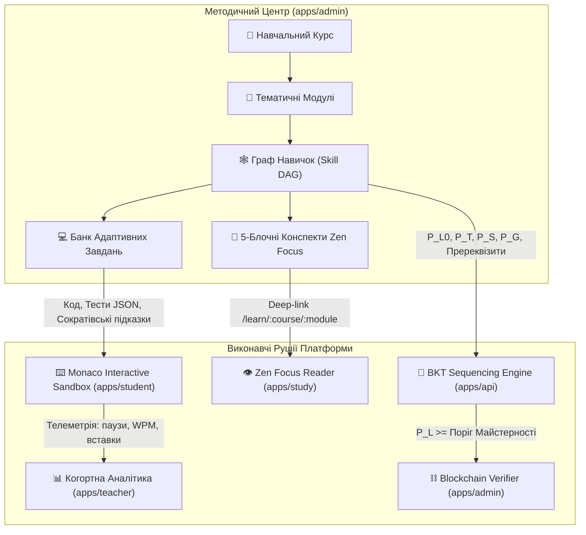
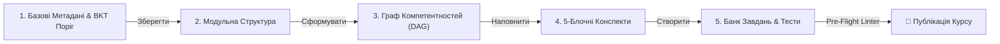
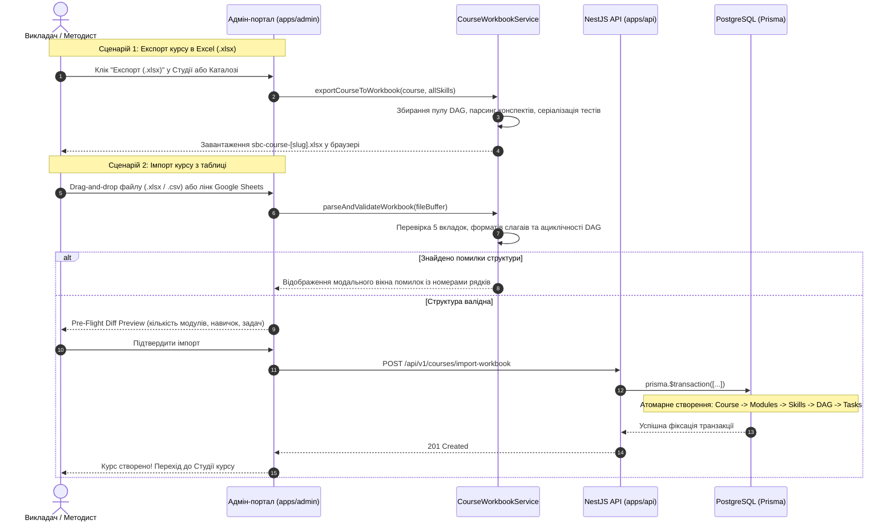

# 📘 Концептуальна Архітектура Інжинірингу Курсів, Табличної Інтеграції та ШІ-Скеффолдингу (Course Engineering & Tabular Engine Specification)

Цей документ є канонічною концептуальною та технічною специфікацією підсистеми конструювання навчальних курсів, табличного експорту/імпорту (Excel / Google Sheets) та ШІ-генерації в платформі **«Smart-BKT-Chain»**.

---

## 🎯 1. Концептуальна Місія та Філософія Курсового Інжинірингу

У класичних системах дистанційного навчання (LMS, Moodle, Google Classroom) навчальний курс є статичним каталогом розрізнених файлів: PDF-конспектів, відеолекцій та тестів із фіксованим прохідним балом. Така структура не враховує динаміку забування, не діагностує когнітивні прогалини та не може адаптуватися під індивідуальний темп учня.

В екосистемі **Smart-BKT-Chain** курс проєктується як **Багатовимірний Граф Компетентностей (Knowledge DAG)**, який виступає єдиним джерелом правди (Single Source of Truth) для всіх 5 взаємопов'язаних застосунків платформи:



### 1.1 Роль Курсу у Підсистемах Екосистеми:
1. **BKT Sequencing Engine (`apps/api`):** Орієнтований ациклічний граф (DAG) визначає суворий порядок відкриття знань. Алгоритм секвенування аналізує поточний вектор $P(L_n)$ та направляє учня вперед (`ADVANCE`), на закріплення (`REINFORCE`), на деградацію складності (`REMEDIATE`) або блокує через незасвоєні пререквізити (`BLOCKED`).
2. **Zen Focus Reading Engine (`apps/study`):** Теорія модулів рендериться за суворим 5-блочним стандартом (гачок, поняття, робочий код, картка оман, висновки) із виключенням будь-якого візуального шуму.
3. **Interactive Student Sandbox (`apps/student`):** Банк завдань містить не просто питання, а тести валідації, еталонні рішення та багаторівневі Сократівські підказки, синхронізовані з клавіатурною телеметрією.
4. **Teacher Cohort Analytics (`apps/teacher`):** Викладач бачить прогрес не у відсотках, а як теплову карту засвоєння кожної компетенції графу, чергу ручної перевірки (Human-in-the-Loop) та індекси академічної доброчесності.
5. **Blockchain Proof-of-Competence (`packages/contracts`):** Досягнення нормативного BKT-порогу майстерності є умовою карбування Soulbound-сертифікатів у блокчейн-релейєрі.

---

## 🛠️ 2. Архітектура 5-Етапного Покрокового Майстра (Sequential Authoring Wizard)

Для захисту системи від неповних або пошкоджених курсів процес створення розбито на **строгий 5-етапний послідовний майстер (Sequential Wizard)** із блокуванням майбутніх кроків та вільною ретроспективною навігацією:



### 2.1 Деталізація Кожного Етапу Майстра:

#### 🟢 Крок 1: Базові Метадані та Калібрування BKT-Порогу
- **Призначення:** Формування паспорта курсу.
- **Поля:** Назва курсу, URL-слаг, предметна категорія, анотація, цільова аудиторія.
- **Нормативний BKT-поріг майстерності ($P(L)$):**
  - `0.85` — Золотий стандарт адаптивного навчання (рекомендовано для більшості IT-дисциплін).
  - `0.90` — Висока академічна строгість (для критичних інженерних або математичних тем).
  - `0.80` — Оглядовий поріг (для вступних або факультативних курсів).
- **Поведінка переходу:** Збереження створює запис курсу зі статусом `isPublished: false` (`Чернетка`). Користувач залишається в контексті створення і плавно переходить до Кроку 2 без перенаправлення до загального каталогу.

#### 🟢 Крок 2: Модульна Структура та Автоматична Нумерація
- **Призначення:** Дидактична декомпозиція дисципліни на логічні розділи.
- **Автоматична нумерація:** Модулі нумеруються автоматично (`modules.length + 1`), усуваючи необхідність писати статичний префікс «Модуль N:».
- **Жива українська транслітерація слага:**
  - Реалізовано за офіційним стандартом Кабінету Міністрів України №55.
  - Назва українською мовою на льоту транслюється у валідний URL-слаг (наприклад, *«Інтерактивні форми & валідація даних»* $\to$ `interaktyvni-formy-and-validatsiya-danykh`).
  - Автоматичне оновлення маршруту підручника: `/learn/${course.slug}/${module.slug}`.
- **Явне поле з валідацією та кнопкою скидання:**
  - Моноширинне поле дозволяє ручне коригування слага.
  - Кнопка `[↻ З назви]` повертає автозгенерований слаг.
  - Живий індикатор: смарагдовий бейджик валідності або червоне попередження про помилку з блокуванням кнопки збереження.

#### 🟢 Крок 3: Граф Компетентностей BKT (DAG)
- **Призначення:** Побудова орієнтованого ациклічного графу атомарних навичок.
- **Атрибути компетенції:**
  - Назва навички (із очищенням від дублюючих префіксів модуля).
  - Складність (`EASY`, `MEDIUM`, `HARD`).
  - Пререквізити (батьківські навички, необхідні для відкриття поточної).
  - Чотиривимірний вектор BKT:
    - $P(L_0)$ — апріорна ймовірність початкового знання (за замовчуванням $0.10$).
    - $P(T)$ — ймовірність переходу до знання при спробі ($0.20$).
    - $P(S)$ — ймовірність випадкової помилки (Slip, $0.10$).
    - $P(G)$ — ймовірність вгадування правильної відповіді (Guess, $0.20$).

#### 🟢 Крок 4: 5-Блочні Конспекти Уроків (Zen Focus Reading Engine)
- **Призначення:** Формування теоретичних матеріалів для `apps/study`.
- **5 Канонічних Блоків Уроку:**
  1. *Інтригуючий гачок (Hook Intro):* Практичний контекст реального світу, що мотивує до вивчення теми.
  2. *Теоретичні поняття (Core Concepts):* Чіткі визначення, правила та структури.
  3. *Еталонний робочий приклад (Code Snippet):* Лаконічний код із підсвіткою синтаксису та коментарями.
  4. *Картка типової омани (Misconception Alert):* Контраст хибного уявлення учня та реальності з лайфхаком виправлення.
  5. *Ключові висновки (Takeaways):* 3–5 тез для швидкого закріплення.

#### 🟢 Крок 5: Банк Адаптивних Завдань та Пісочниця
- **Призначення:** Практичні задачі для інтерактивного тренажера `apps/student`.
- **Модальності завдань:** Практичний код (`CODE`), тестові квізи (`SINGLE_CHOICE`, `MULTIPLE_CHOICE`), відкриті есе (`TEXT_ESSAY`).
- **Складові завдання:** Формулювання умови, стартовий шаблон коду, масив автоматичних тестів у форматі JSON (відкриті та приховані кейси) та багаторівневі підказки Сократа зі штрафними коефіцієнтами.

### 2.2 Керування Станом Майстра (`authorStep` vs `maxUnlockedStep`):
- `authorStep` (1..5): крок, який автор переглядає або редагує в поточний момент.
- `maxUnlockedStep` (1..5): максимальний крок, до якого автор дійшов у процесі створення.
- **Правило доступності:** Крок $N$ доступний для кліку тоді і тільки тоді, коли $N \le \text{maxUnlockedStep}$. Кроки $N > \text{maxUnlockedStep}$ заблоковані з іконкою `🔒` та курсором `not-allowed`.
- **Ретроспективне редагування:** Автор може в будь-який момент повернутися до Кроку 1 (змінити опис, категорію чи BKT-поріг) і повернутися назад до Кроку 2–5 без скидання збережених даних.

---

## 📊 3. Канонічний 5-Вкладковий Стандарт SBC Course Workbook (.xlsx / Google Sheets)

Для забезпечення безшовної взаємодії між системою та зовнішніми редакторами таблиць розроблено єдиний відкритий стандарт **SBC Course Workbook**. Файл Microsoft Excel (`.xlsx`) або Google Таблиця містить суворо 5 іменованих вкладок:

```
sbc-course-[slug].xlsx
├── 1. Course      (Паспорт та загальні метадані дисципліни)
├── 2. Modules     (Тематичні розділи курсу та theoryUrl)
├── 3. Skills      (Граф компетенцій DAG, пререквізити та параметри BKT)
├── 4. Theory      (5-блочні конспекти уроків Zen Focus)
└── 5. Tasks       (Банк практичних завдань, тести JSON, підказки)
```

### 3.1 Специфікація Структури Вкладок:

#### 1. Вкладка `Course`:
| Колонка | Тип | Обов'язкове | Опис | Приклад |
| :--- | :---: | :---: | :--- | :--- |
| `title` | string | Так | Назва навчального курсу | `Основи веб-розробки: Frontend (HTML/CSS/JS)` |
| `slug` | string | Так | Унікальний URL-ідентифікатор курсу | `web-dev-basics` |
| `category` | string | Ні | Предметна галузь або категорія | `Інформатика & IT` |
| `description` | string | Ні | Розширена анотація та цілі навчання | `Комплексний курс клієнтської розробки...` |
| `targetAudience` | string | Ні | Цільова аудиторія учнів | `10-11 класи, Студенти коледжів` |
| `difficultyLevel` | string | Ні | Рівень курсу (`BEGINNER`, `INTERMEDIATE`, `ADVANCED`) | `BEGINNER` |
| `bktMasteryThreshold` | number | Так | Нормативний поріг BKT $P(L)$ | `0.85` |
| `icon` | string | Ні | Назва іконки або емодзі | `Globe` |

#### 2. Вкладка `Modules`:
| Колонка | Тип | Обов'язкове | Опис | Приклад |
| :--- | :---: | :---: | :--- | :--- |
| `orderIndex` | number | Так | Порядковий номер модуля в програмі (1..N) | `1` |
| `title` | string | Так | Назва тематичного модуля | `Семантична структура та анатомія HTML5` |
| `slug` | string | Так | Унікальний URL-слаг модуля | `semantychna-struktura-ta-anatomiya-html5` |
| `theoryUrl` | string | Ні | Deep-link маршрут підручника Zen Focus | `/learn/web-dev-basics/semantychna-struktura...` |
| `bktThreshold` | number | Так | Поріг засвоєння тем модуля | `0.85` |
| `description` | string | Ні | Вступний огляд або конспект модуля | `Вивчення структури DOM-дерева...` |

#### 3. Вкладка `Skills` (BKT DAG):
| Колонка | Тип | Обов'язкове | Опис | Приклад |
| :--- | :---: | :---: | :--- | :--- |
| `moduleSlug` | string | Так | Слаг батьківського модуля | `semantychna-struktura-ta-anatomiya-html5` |
| `orderIndex` | number | Так | Номер компетенції всередині модуля | `1` |
| `title` | string | Так | Назва атомарної навички | `Базова розмітка та DOCTYPE HTML5` |
| `slug` | string | Так | Унікальний слаг компетенції | `html5-doctype-and-root` |
| `difficulty` | string | Так | Рівень складності (`EASY`, `MEDIUM`, `HARD`) | `EASY` |
| `prerequisites` | string | Ні | Слаги батьківських навичок через кому | `html5-doctype-and-root, basic-tags` |
| `pL0` | number | Так | Апріорний рівень знань $P(L_0)$ | `0.10` |
| `pT` | number | Так | Ймовірність переходу $P(T)$ | `0.20` |
| `pS` | number | Так | Ймовірність промаху (Slip) $P(S)$ | `0.10` |
| `pG` | number | Так | Ймовірність вгадування (Guess) $P(G)$ | `0.20` |

#### 4. Вкладка `Theory` (5 Блоків Zen Focus):
| Колонка | Тип | Обов'язкове | Опис | Приклад |
| :--- | :---: | :---: | :--- | :--- |
| `moduleSlug` | string | Так | Слаг модуля, до якого належить урок | `semantychna-struktura-ta-anatomiya-html5` |
| `hookIntro` | string | Так | Блок 1: Інтригуючий гачок реального світу | `Веб-сторінка — це динамічне дерево об'єктів...` |
| `conceptsMarkdown` | string | Так | Блок 2: Теоретичні поняття (Markdown) | `Тег <!DOCTYPE html> гарантує режим...` |
| `codeLang` | string | Ні | Мова коду (`html`, `css`, `js`, `ts`, `python`) | `html` |
| `codeSnippet` | string | Ні | Блок 3: Еталонний робочий приклад коду | `<!DOCTYPE html><html lang="uk">...` |
| `codeExplanation` | string | Ні | Пояснення важливих рядків коду | `Атрибут lang="uk" допомагає скрінрідерам...` |
| `misconceptionTitle` | string | Ні | Блок 4: Назва типової омани | `Плутанина між <head> та <header>` |
| `misconceptionExplanation` | string | Ні | Блок 4: Чому це хибно та як правильно | `<head> — метадані, <header> — видима шапка...` |
| `takeawaysList` | string | Ні | Блок 5: Ключові тези через розділювач `\|` | `DOCTYPE обов'язковий \| Метадані у head...` |

#### 5. Вкладка `Tasks` (Банк Практики):
| Колонка | Тип | Обов'язкове | Опис | Приклад |
| :--- | :---: | :---: | :--- | :--- |
| `skillSlug` | string | Так | Слаг компетенції, до якої прив'язана задача | `html5-doctype-and-root` |
| `orderIndex` | number | Так | Номер завдання для цієї навички | `1` |
| `taskType` | string | Так | Тип (`CODE`, `SINGLE_CHOICE`, `MULTIPLE_CHOICE`) | `CODE` |
| `difficulty` | string | Так | Складність (`EASY`, `MEDIUM`, `HARD`) | `EASY` |
| `title` | string | Так | Короткий заголовок завдання | `Створення базової HTML5 розмітки` |
| `prompt` | string | Так | Умова задачі (підтримує Markdown) | `Оголосіть сучасний стандарт HTML5...` |
| `starterCode` | string | Ні | Шаблонний код у редакторі | `<!-- Напишіть розмітку нижче -->\n` |
| `testCasesJson` | string | Ні | Валідний JSON-масив тестів | `[{"input":"","expectedOutput":"<!DOCTYPE html>"}]` |
| `hintsList` | string | Ні | Підказки Сократа через розділювач `\|` | `Почніть з <!DOCTYPE html> \| Додайте lang="uk"` |

---

## 🔄 4. Двосторонній Рушій Експорту та Імпорту (Табличний Пайплайн)



### 4.1 Захист від Помилок при Імпорті:
1. **Ациклічність Графу (Acyclicity Guard):** Перед збереженням графу компетенцій запускається клієнтський алгоритм пошуку циклів (DFS / Tarjan) через `detectDagCycles`. Якщо навичка A залежить від B, а B від A — імпорт блокується з підсвічуванням точного ланцюжка зациклення.
2. **Атомарність Транзакції (PostgreSQL `$transaction`):** Якщо в будь-якому завданні допущено синтаксичну помилку в JSON тестів, уся транзакція відкочується. Система ніколи не залишає «напівстворених» курсів із поламаними залежностями.
3. **Pre-Flight Inspection Preview у модальному вікні `CourseImportModal`:** Користувач бачить точне зведення (назва, слаг, категорія, Target P(L), кількість тем, навичок, конспектів та вправ у банку) та чекліст валідацій до запису в базу даних.

---

## 🤖 5. ШІ-Скеффолдинг Курсів (AI Scaffolding Engine)

Створення якісного BKT-курсу вручну забирає від 40 до 80 робочих годин методиста. Підсистема ШІ-скеффолдингу скорочує цей час до кількох хвилин за двома моделями взаємодії:

### 5.1 Модель 1: ШІ-Генератор «Під ключ» (One-Shot Course Scaffolder)
- **Вхідні дані:** Одна тема або навчальна програма (наприклад: *«Курс з асинхронного програмування на TypeScript для 11 класу: проміси, async/await, обробка помилок та WebSockets»*).
- **Рушій:** Виклик моделі **Gemini 2.5 Pro / Flash** із примусовою валідацією виводу через Zod/JSON Schema (`Structured Outputs`).
- **Результат:** За один запит генерується повна валідна 5-вкладкова структура курсу:
  - 3–5 послідовних модулів;
  - Зв'язаний ациклічний граф DAG із відкаліброваними BKT-параметрами;
  - Повні 5-блочні конспекти з реальними прикладами коду та картками оман;
  - Набір завдань із валідними юніт-тестами.

### 5.2 Модель 2: Контекстні AI-Копілоти на Кожному Кроці (In-Step Co-Pilots)
- **Крок 1 (Метадані):** Кнопка `[✨ Допомога ШІ]` генерує методичну анотацію курсу та пропонує оптимальний BKT-поріг на основі цільової аудиторії.
- **Крок 2 (Модулі):** ШІ пропонує логічну модульну декомпозицію курсу з автоматичним формуванням слагаів за стандартом КМУ №55.
- **Крок 3 (Компетенції DAG):** ШІ автоматично розбиває модулі на атомарні концепції та розраховує ймовірності $P(L_0), P(T), P(S), P(G)$ залежно від когнітивної складності теми.
- **Крок 4 (Конспекти уроків):** ШІ формує 5-блочний урок Zen Focus, формулюючи неочевидні омани учнів (Misconceptions) на базі типових помилок початківців.
- **Крок 5 (Завдання та Тести):** ШІ пише умови завдань, стартовий каркас і створює набір відкритих та секретних тест-кейсів для автоматичної перевірки у пісочниці.

---

## 🛡️ 6. Чотири Стовпи Продакшен-Надійності та Версіонування

1. **Семантичне Версіонування Курсів (`v1.0.0` / Draft Fork):**
   - Навчальні курси, на яких уже навчаються студенти, фіксуються як незмінні релізи (`v1.0.0`). Це гарантує, що зміна графу автором не зламає активні BKT-сесії учнів і не пошкодить криптографічні хеші блокчейн-сертифікатів.
   - Внесення змін відбувається через створення чернетки нової версії (`v1.1.0-draft`), яка після проходження лінтера безшовно стає активною для нових когорт.
2. **100-Бальний Pre-Flight Quality Linter перед Публікацією:**
   - Перед натисканням кнопки «Опублікувати курс» автоматичний чекер перевіряє 10 критеріїв якості:
     - Відсутність ізольованих навичок (сиріт) без зв'язків у графі;
     - Відсутність модулів без теоретичних конспектів;
     - Наявність щонайменше 2 практичних вправ для кожної BKT-компетенції;
     - Наявність валідних автоматичних тестів для завдань із кодом;
     - Заповненість блоків типових оман (Misconceptions);
     - Коректність діапазонів BKT ($0 < P(S), P(G) < 0.5$);
     - Валідність усіх URL-слагаів та посилань.
3. **Механізм Форкінгу та Клонування Курсів:**
   - Викладач може в 1 клік створити власну копію будь-якого загальнодоступного курсу («Створити форк під мій клас»), адаптувати завдання під рівень своєї групи та призначити індивідуальні BKT-пороги.
4. **Контентна Телеметрія та Аналітика Якості для Автора:**
   - Автори курсу бачать емпіричні метрики кожного завдання:
     - Фактичний рівень промаху $P(S)$ (якщо він $> 0.35$ — формулювання завдання є неоднозначним або заплутаним);
     - Фактичний рівень вгадування $P(G)$ (якщо він $> 0.40$ — варіанти відповідей у квізі занадто очевидні);
     - Середній час читання теоретичного конспекту та точки відсіву учнів.

---

## 🗺️ 7. Дорожня Карта Впровадження (Roadmap Micro-Steps)

| Крок | Задача | Опис | Статус |
| :---: | :---: | :--- | :---: |
| **Крок 0** | **`SBC-416`** | Автонумерація модулів, жива транслітерація та валідація слага | ✅ Завершено (`549501e`) |
| **Брейншторм** | **`SBC-417`** | Стратегічний брейншторм Сесії 20 та концептуальний аудит | ✅ Завершено (`5ee56d6`) |
| **Крок 1** | **`SBC-418`** | Канонічний 5-вкладковий Excel-експорт та генератор шаблону | ✅ Завершено (`4db67bb`) |
| **Крок 2** | **`SBC-419`** | Двосторонній імпорт таблиць (Excel / Sheets) з валідацією та $transaction | ✅ Завершено |
| **Крок 3** | **`SBC-420`** | Генератор курсу під ключ за одним промптом (Gemini 2.5 API) | ⏳ Заплановано |
| **Крок 4** | **`SBC-421`** | Контекстні AI-копілоти на кожному з 5 кроків майстра | ⏳ Заплановано |
| **Крок 5** | **`SBC-422`** | 100-бальний Pre-Flight Quality Linter перед публікацією | ⏳ Заплановано |
| **Крок 6** | **`SBC-423`** | Семантичне версіонування курсів, форкінг та контентна телеметрія | ⏳ Заплановано |
