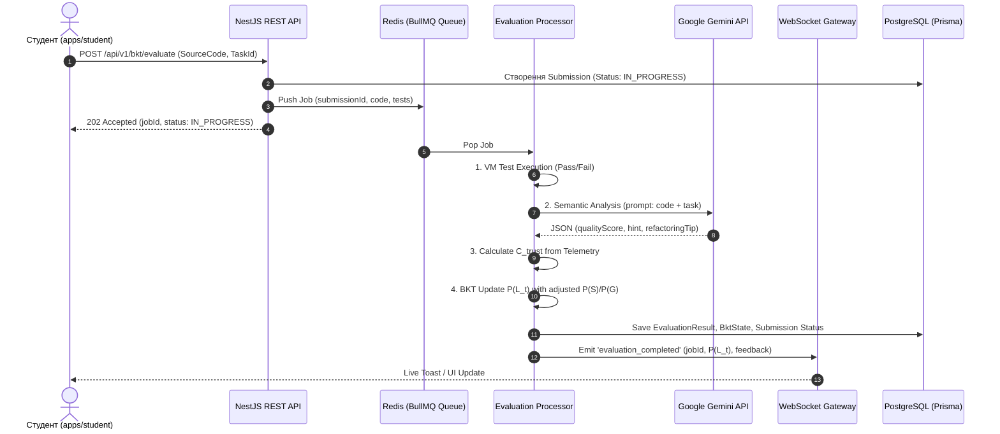

# 📚 Детальний Технічний Журнал Реалізації (Detailed Technical Implementation Log)

Документ містить максимально деталізований опис усіх виконаних технічних робіт, розроблених модулів, математичних алгоритмів, схем даних та архітектурних рішень у проєкті **«Smart-BKT-Chain»**.

---

## 🏗️ 0. Загальна Архітектура Монорепозиторію

Проєкт побудовано за принципами монорепозиторію (npm workspaces):
- `apps/api` — NestJS бекенд (Гексагональна архітектура Ports & Adapters, Swagger OpenAPI, WebSockets, REST).
- `apps/docs` — Документаційний портал (Next.js 16, React 19, TailwindCSS 4).
- `apps/web` — Студентський кабінет з інтеграцією Monaco Editor (Next.js).
- `packages/database` — Ізольований пакет роботи з БД (Prisma ORM, PostgreSQL schema, міграції, сидинг).
### 0.1 Правила Проєкту та Регламент AI-Агента ([`.agents/AGENTS.md`](file:///.agents/AGENTS.md))
Регламент розробки проєкту Smart-BKT-Chain закріплено у файлі [`.agents/AGENTS.md`](file:///.agents/AGENTS.md). Він встановлює обов'язковий порядок дій:
1. **Обов'язковий трьохкомпонентний лог прогресу:** Після виконання кожного мікро-кроку оновлюються [`daily_progress.md`](file:///docs/daily_progress.md), [`detailed_implementation_log.md`](file:///docs/detailed_implementation_log.md) та виконується компіляція `python scripts/compile_docs.py`.
2. **Покрокова розробка (Micro-Steps):** Розбиття задач на малі ітерації із обов'язковим `npm run build:*` / `npm run test:*` та окремим `git commit`.
3. **Захист від припущення:** Перевірка повних трасувань помилок перед виправленням коду.

### 0.2 Модуль Візуальної Інспекції Графу Курсу (`CourseOverviewWidget`)
- **Концепція:** Перевикористовуваний автономний віджет `CourseOverviewWidget` (`apps/teacher/src/features/course-map/ui/CourseOverviewWidget.tsx`), призначений для повного огляду ієрархії курсів, модулів (DAG) та прив'язаних запитань/завдань.
- **Особливості:**
  - Візуалізація DAG-вузлів із розгортанням списку питань.
  - Відображення типів завдань (`CODE`, `SINGLE_CHOICE`, `MULTIPLE_CHOICE`, `TEXT_ESSAY`), складності та правильних відповідей для викладацького аудиту.
  - Швидкий пошук та фільтрація завдань у реальному часі.

### 0.6 Глобальний Стандарт Уніфікованого Стану Навігації (`activeTab` + `isDrawerOpen`)
- **Проблематика:** Раніше у кабінетах стан навігації спирався на тимчасовий `activeDrawer = null`, через що при згортанні сайдбара або закритті хрестиком `✕` втрачався фокус обраної вкладки та скидався до першого елемента списку.
- **Архітектурний стандарт для всіх порталів (`apps/student`, `apps/teacher`, `apps/admin`):**
  ```typescript
  // Приклад реалізації (Student, Teacher, Admin):
  type PortalTab = 'analytics' | 'coursemap' | 'settings'; // або 'task' | 'bkt' | 'tree'
  const [activeTab, setActiveTab] = useState<PortalTab>('analytics');
  const [isDrawerOpen, setIsDrawerOpen] = useState<boolean>(true);

  const handleTabClick = (tab: PortalTab) => {
    if (activeTab === tab) {
      setIsDrawerOpen((prev) => !prev);
    } else {
      setActiveTab(tab);
      setIsDrawerOpen(true);
    }
  };
  ```
- **Уніфіковані стани інтерфейсу:**
  1. `activeTab === tab && isDrawerOpen`: Повне активне підсвічування кнопки + розгорнута бічна панель відповідного розділу (`w-[380px]`).
  2. `activeTab === tab && !isDrawerOpen`: Тоноване підсвічування кнопки з міні-індикатором `h-2`, сайдбар прихований, центральний холст автоматично розтягнуто на 100% ширини (`flex-1`).
  3. Повторний клік по активній кнопці або `✕` в сайдбарі: `setIsDrawerOpen(prev => !prev)` без зміни `activeTab`.
  4. Клік по іншій іконці: перемикає `activeTab` та гарантовано встановлює `isDrawerOpen(true)`.

### 0.7 База Архітектурних Дискусій та Мозкових Штурмів (`docs/brainstorm/`)
- **Концепція:** Централізоване сховище для накопичення теоретичних, алгоритмічних та бізнес-ідей проекту.
- **Сесія 01 (`docs/brainstorm/01_evaluating_mastery_across_task_types.md`):**
  - **Динамічний BKT ($P(G) / P(S)$):** Введення залежності $P(G)$ від часу здачі завдання $T_{\text{submit}}$: якщо $T < 3.0\text{ с}$, ймовірність вгадування $P(G)$ зростає до $0.85$, мінімізуючи ріст знання від випадкового вибору в тестах.
  - **Когнітивна достовірність ($\alpha$-Score):** Мультиплікатор достовірності $\alpha = (1 - CopyPasteRatio) \cdot \text{Penalty}(WPM)$ як коригувальний коефіцієнт BKT.
  - **Мульти-критеріальна триангуляція статусу `MASTERED`:** Опанування теми вимагає зв'язки «Теоретичний тест + Практичний код + Автентична телеметрія».
- **Сесія 02 (`docs/brainstorm/02_edtech_ecosystem_vision.md`):**
  - Just-in-Time теорія та інтервенції, Сократівський діалог, RPG Skill Tree, Teacher Co-Pilot.
- **Сесія 03 (`docs/brainstorm/03_technical_edtech_platform_architecture.md`):**
  - Архітектура монорепозиторію, FSM сесій, InterventionRouter, TelemetryIntegrityEngine (WPM/Burstiness).
- **Сесія 04 (`docs/brainstorm/04_open_ended_questions_semantic_eval.md`):**
  - **Багаторівневий пайплайн семантичного оцінювання (Multi-Tier Assessment Pipeline):**
    - *Tier 1 (Heuristics):* Виявлення обов'язкових коренів понять, перевірка Type-Token Ratio, детекція плагіату умови завдання.
    - *Tier 2 (Vector Embeddings):* Косинусна подібність з еталоном $\text{CosineSimilarity}(\vec{v}_{stu}, \vec{v}_{ref})$ та кластеризація типових помилок (misconceptions).
    - *Tier 3 (LLM Judge):* Оцінювання за структурованими рубриками (`correctness`, `completeness`, `keyConceptsCovered`, `studentFeedback`).
  - **Телеметричний BKT зв'язок:** Штраф $P(G) \to 0.9$ при вставках тексту (`pasteEvents > 0`), фіксація $P(S)$ при когнітивних паузах та видаленнях (`deletionRatio > 0.35`).
  - **Human-in-the-Loop:** Інтеграція черги апеляцій та сумнівних оцінок ($0.45 \le \text{Score} \le 0.70$) у Teacher Portal з можливістю підтвердження/коригування в 1 клік.


### 0.3 Модульний Opera-Style UI Shell, Компактні DAG-Вузли та Патерн «List-in-Drawer / Detail-on-Canvas»
- **Уніфікація UI Shell (`apps/student`, `apps/teacher`, `apps/admin`):**
  - Верхня фіксована навігаційна панель (`h-14 bg-slate-900 border-b border-slate-800`).
  - Вузький вертикальний рейл іконок (`w-14 bg-slate-900`) з блоком `Settings` у найнижчій позиції.
  - Висувні бічні панелі (Drawers) з **фіксованою нерухомою шапкою** (`shrink-0 bg-slate-900/90 backdrop-blur-md`) та скрольованим контентним блоком (`flex-1 overflow-y-auto`).
- **Компактний `SkillDagMap` (`apps/student/src/features/skill-graph/ui/SkillDagMap.tsx`):**
  - Об'єднання заголовка модуля та відсотка $P(L)$ в один рядок для зменшення висоти плашок.
  - Накладання круглих стрілок-з'єднувачів `ArrowDown` з від'ємними маржинами (`-my-2.5 z-20`) над картками модулів.
  - Усунення дубльованих заголовків у внутрішньому суб-барі віджета.
- **Кабінет Викладача (`apps/teacher/src/app/page.tsx`):**
  - **Бокове висувне меню:** Виводить список студентів курсу (з живим текстовим пошуком за ім'ям/email) та структуроване дерево модулів DAG.
  - **Центральний екран (Main Canvas):** При виборі студента показує детальну аналітичну картку (WPM, Copy-Paste, Fatigue Index), BKT Heatmap по модулях та кнопку скидання. При виборі модуля/завдання показує повний інспектор умови завдання, тест-кейсів та ключів відповідей.

### 0.4 Концепт та Архітектура Модульної Телеметрії (Per-Module Telemetry & Course-Level Median)
- **Проблематика:** При загальному підрахунку телеметрії (WPM, Copy-Paste Ratio, Fatigue Index) по всьому курсу списування чи когнітивне перевантаження на окремому модулі "змащується" середніми значеннями.
- **Концепція та Практична Реалізація Модульної Телеметрії:**
  1. **Модульний рівень ($WPM_{skill}, CopyPaste_{skill}, Fatigue_{skill}$):** Кожен вузол графа $Skill_i$ зберігає власні параметри телеметрії. Якщо студент вставив 90% коду під час проходження складного Модуля 3, цей показник зберігається суворо у контексті Модуля 3.
  2. **Курсовий рівень (Медіана + Peak Anomaly):** На верхніх картках загальної аналітики студента розраховується **Медіана ($\text{Median}$)** для виключення спотворень, а поруч виводиться індикатор **Пікової Аномалії (Peak Anomaly)** з вказівкою проблемного модуля.
- **Математична модель агрегації:**
  $$\text{Course } CopyPaste_{\text{median}} = \text{Median}\Big( \big\{ CopyPaste_{skill_1}, CopyPaste_{skill_2}, \dots, CopyPaste_{skill_N} \big\} \Big)$$
  $$\text{Peak Anomaly} = \max_{i} \Big( CopyPaste_{skill_i} \Big) \quad \text{при } CopyPaste_{skill_i} \ge 0.60$$
### 0.5 Автономний RPG-Віджет «Дерево Знань» (`GameSkillTreeWidget`)
- **Концепція та Гейміфікація:** Перетворення класичного орієнтованого графа залежностей навичок DAG у повноцінне інтерактивне RPG Дерево Прокачування (Skill Tree / Skyrim & Path of Exile visual design).
- **Архітектурні складові (`apps/student/src/features/skill-graph/ui/GameSkillTreeWidget.tsx`):**
  1. **Ігрове поле з неоновою кіберпанк-сіткою:** Органічний зигзагоподібний лейаут сузір'їв знань з векторними Bezier-кривими (Power Rays), що з'єднують навички.
  2. **Стани вузлів-рунічних кристалів:**
     - 🔒 **Locked:** Напівпрозорий, контур замка, неактивний до виконання пререквізитів ($P(L) \ge 0.95$).
     - ⚔️ **In Progress:** Пульсуюче синє сяйво, живий відсоток майстерності $P(L_t)$, кнопка «Розпочати квест».
     - ✨ **Mastered:** Золотисто-смарагдовий ореол (`bg-emerald-950/60 border-emerald-400`), позначка засвоєння та розблокування енергетичного променя до наступного рівня.
  3. **RPG Інспектор Навички (Side Quest Card):** Картка модуля з умовами квесту, пререквізитами та прогрес-баром BKT.
  4. **Гейміфікована прогресія:** Підрахунок рівня гравця (`LVL`), очок досвіду (`EXP`) та загального відсотка відкриття дерева знань курсу.
- **Інтеграція в Кабінет Студента:**
  - Акцентна іконка `Network` у лівому вертикальному навігаційному рейлі (`w-14`).
  - Перемикач режимів `[ 📜 Список Модулів | 🌳 RPG Дерево ]` у бічній панелі.
  - Повноекранне модальне вікно огляду та взаємодії з деревом знань.

---

## 🧱 Крок 1: Проєктування бази даних (Prisma Schema) та локальне оточення

### 1.1 Docker & Локальні Сервіси
У файлі `docker-compose.yml` розгорнуто та сконфігуровано 2 контейнери:
- **`sbc-postgres`**: PostgreSQL 16 Alpine (порт `5432:5432`), база даних `smart_bkt_chain`.
- **`sbc-redis`**: Redis 7 Alpine (порт `6379:6379`), призначений для квешування телеметрії та сесій.
- Додано автоматичні перевірки стану (Healthchecks) з інтервалом 10с.

### 1.2 Схема даних Prisma (`packages/database/prisma/schema.prisma`)
Спроєктовано **14 моделей даних**:
1. `User` — Базова сутність користувача (Email, PasswordHash, Role: STUDENT/TEACHER/ADMIN).
2. `UserProfile` — Профіль (FirstName, LastName, Bio, Avatar).
3. `SkillNode` — Вузол графа знань (Title, Slug, Category, Difficulty).
4. `SkillDependency` — Ребра орієнтованого графа (ParentSkillId, ChildSkillId, RequiredMastery = 0.95).
5. `Task` — Практичне завдання (SkillId, Title, Description, StarterCode, Difficulty).
6. `TestCase` — Тест-кейси до задач (Input, ExpectedOutput, IsSecret).
7. `BktState` — Актуальний стан знань $P(L_t)$, $P(T)$, $P(S)$, $P(G)$ для пари (UserId, SkillId).
8. `BktHistory` — Хронологічний лог змін $P(L_t)$ після кожного виконання завдання.
9. `TelemetrySession` — Сесія збору телеметрії вводу коду (UserId, TaskId, StartedAt, EndedAt).
10. `TelemetryLog` — Сирі події телеметрії (KeystrokePauseMs, Wpm, DeleteCount, PasteEvents).
11. `BehavioralProfile` — Поведінковий профіль студента (FatigueIndex, CopyPasteRatio, AvgPauseTime).
12. `Submission` — Спроба вирішення завдання (UserId, TaskId, SourceCode, Status).
13. `EvaluationResult` — Результат перевірки коду (PassedTestsCount, TotalTestsCount, ExecutionTimeMs).
14. `Credential` — Специфікація Web3 NFT-сертифіката засвоєння навичок.

---

## ⚙️ Крок 2: Ініціалізація NestJS бекенду (`apps/api`) & Swagger UI

### 2.1 Налаштування модуля `@sbc/api`
- Ініціалізовано NestJS v10 у папці `apps/api`.
- Додано глобальний префікс всіх REST-запитів `/api/v1`.
- Налаштовано CORS для підтримки взаємодії з клієнтськими веб-додатками.

### 2.2 Гексагональна архітектура (Ports & Adapters)
Організовано структуру директорій:
- **`src/domain/`**: Чиста бізнес-логіка (BKT моделі, Task Sequencing).
- **`src/ports/`**: Інтерфейси вхідних use-cases та вихідних репозиторіїв.
- **`src/adapters/`**:
  - `adapters/outbound/persistence/`: `PrismaService` та `DatabaseModule` для з'єднання з PostgreSQL.
  - `adapters/inbound/http/`: REST контролери (`HealthController`).

### 2.3 Свагер Документація (OpenAPI 3.0)
- Інтегровано `@nestjs/swagger` та `swagger-ui-express`.
- Swagger UI доступний за адресою: **`http://localhost:3000/api/v1/docs`**.
- Створено анотації для `HealthController` (`GET /api/v1/health`), що повертає статус сервера та перевіряє стан БД через `SELECT 1`.

### 2.4 Усунення сумісності з Node.js v22
- Оновлено `packages/database/tsconfig.json` (`rootDir: "src"`) для коректної збірки в `dist/index.js`.
- Замінено синтаксис `declare global` у `packages/database/src/index.ts` на тип-безпечне приведення `globalThis as unknown as ...`.

---

## 🧮 Крок 3: BKT Core Engine, Task Sequencing & Наповнення Міні-Курсом

### 3.1 Контент Міні-Курсу («JavaScript: від синтаксису до асинхронності»)
У скрипті `packages/database/prisma/seed.ts` реалізовано автозаповнення БД:
- **Вузол 1 (`js-basics`):** «Основи JavaScript та Синтаксис»
  - Задача 1: `sum(a, b)` — Сума двох чисел (EASY)
  - Задача 2: `isEven(n)` — Перевірка парності (EASY)
- **Вузол 2 (`js-arrays`):** «Масиви та Методи обходу»
  - Задача 3: `filterEvens(numbers)` — Фільтрація парних елементів (MEDIUM)
  - Задача 4: `calcTotal(items)` — Сума об'єктів кошика (MEDIUM)
- **Вузол 3 (`js-async`):** «Асинхронне програмування»
  - Задача 5: `fetchUser(id)` — Асинхронний запит профілю (HARD)
- **Зв'язки DAG:** `js-basics` ($0.95$) $\rightarrow$ `js-arrays` ($0.95$) $\rightarrow$ `js-async`.

### 3.2 BKT Core Engine ([`apps/api/src/domain/bkt/bkt-engine.ts`](file:///d:/PROJECTS/MAGISTERS/SMART-BKT-CHAIN/apps/api/src/domain/bkt/bkt-engine.ts))
Математичний рушій обчислення $P(L_t)$ на основі Байєсівської адаптації:
- При правильній відповіді:
  $$P(L_t | \text{correct}) = \frac{P(L_{t-1}) \cdot (1 - P(S))}{P(L_{t-1}) \cdot (1 - P(S)) + (1 - P(L_{t-1})) \cdot P(G)}$$
- При помилці:
  $$P(L_t | \text{incorrect}) = \frac{P(L_{t-1}) \cdot P(S)}{P(L_{t-1}) \cdot P(S) + (1 - P(L_{t-1})) \cdot (1 - P(G))}$$
- Оновлення переходу знань:
  $$P(L_t) = P(L_t | \text{obs}) + (1 - P(L_t | \text{obs})) \cdot P(T)$$
- Обмеження діапазону $[0.0001, 0.9999]$ для числової стабільності.

### 3.3 Task Sequencing Engine ([`apps/api/src/domain/sequencing/task-sequencer.ts`](file:///d:/PROJECTS/MAGISTERS/SMART-BKT-CHAIN/apps/api/src/domain/sequencing/task-sequencer.ts))
- Автоматичний аналіз графа знань (DAG).
- Якщо $P(L_t) < 0.95$ — підбір наступного незавершеного завдання з поточного вузла.
- Якщо $P(L_t) \ge 0.95$ — автоматичне розблокування та перехід до наступного зв'язаного вузла у графі.

### 3.4 Юніт-тести (Jest)
- Написано 7 комплексних тестів у `bkt-engine.spec.ts` та `task-sequencer.spec.ts`.
- **Результат:** 100% тестів пройдено успішно (`7 passed, 7 total`).

---

## 📡 Крок 4: REST API, WebSockets та Збір Телеметрії

### 4.1 REST Контролери та Ендпоінти (`apps/api/src/adapters/inbound/http/`)
1. **`TaskController` (`/api/v1/tasks`):**
   - `GET /api/v1/tasks` — Отримання списку всіх доступних практичних завдань згрупованих за вузлами графа навичок.
   - `GET /api/v1/tasks/recommended` — Запит адаптивного рекомендованого завдання для студента на основі стану $P(L_t)$ у BKT.
   - `GET /api/v1/tasks/:id` — Отримання детальної інформації про завдання (початковий код та відкриті тест-кейси).
2. **`BktController` (`/api/v1/bkt`):**
   - `POST /api/v1/bkt/evaluate` — Відправка студентського рішення на ізольоване виконання в Node.js VM context:
     - Безпечна перевірка рішень проти відкритих і прихованих тест-кейсів.
     - Автоматичний розрахунок нового $P(L_t)$ через `BktEngine`.
     - Збереження спроби `Submission` (статус `ACCEPTED` / `REJECTED`), результату `EvaluationResult` та хронології `BktHistory`.
   - `GET /api/v1/bkt/state/:userId` — Перегляд актуального стану $P(L_t)$ студента за всіма вузлами графа навичок.

### 4.2 WebSocket Gateway Телеметрії (`TelemetryGateway`)
- Шлях WebSocket: **`ws://localhost:3000/telemetry`** (Socket.io).
- Події в реальному часі:
  - `join_session` — Приєднання до кімнати телеметрії (`session_{userId}_{taskId}`) та автоматичне створення `TelemetrySession` у PostgreSQL.
  - `telemetry_data` — Збір показників динамики пауз (KeystrokePauseMs), швидкості набору (WPM), видалень (DeleteCount) та вставок (PasteEvents).
  - Автоматична фіксація сирих логів у таблиці `TelemetryLog`.

### 4.3 Інтеграційне Тестування (End-to-End Verification)
- Проведено успішну перевірку ланцюжка через PowerShell HTTP запити:
  - `GET /api/v1/tasks/recommended` $\rightarrow$ повернено рекомендовану задачу `sum(a, b)` ($P(L_t) = 0.5$).
  - `POST /api/v1/bkt/evaluate` $\rightarrow$ успішне виконання 3/3 тест-кейсів, оновлення $P(L_t) \rightarrow 0.8545$, фіксація `SubmissionStatus.ACCEPTED` в БД.

---

## 🎨 Крок 5: Фронтенд кабінету студента та Monaco Editor (`apps/web`)

### 5.1 Ініціалізація та конфігурація Next.js (Мікро-Крок 5.1)
- **Фреймворк:** Створено додаток Next.js 16 (з App Router) та React 19 у директорії [`apps/web`](file:///d:/PROJECTS/MAGISTERS/SMART-BKT-CHAIN/apps/web).
- **Стилізація:** Інтегровано TailwindCSS v4 з кастомними CSS-змінними темного інтерфейсу (`#090d16` background, `#6366f1` primary indigo, `#10b981` emerald accent).
- **Структура:**
  - `src/app/globals.css` — імпорт Tailwind v4 та змінні теми.
  - `src/app/layout.tsx` — `RootLayout` з метаданими та системними шрифтами.
  - `src/app/page.tsx` — початкова головна сторінка студентського кабінету з картками Monaco Editor та BKT Graph.
- **Порт розробки:** Налаштовано запуск локального веб-сервера на порту `3002` (`npm run dev:web`). Успішно проведено статичну збірку `npm run build:web`.

### 5.2 Monaco Editor з перехопленням телеметрії (Мікро-Крок 5.2)
- **Компонент Monaco Editor ([MonacoCodeEditor.tsx](file:///d:/PROJECTS/MAGISTERS/SMART-BKT-CHAIN/apps/web/src/features/code-editor/ui/MonacoCodeEditor.tsx)):**
  - Інтегровано повнофункціональний веб-редактор коду у темній темі (`vs-dark`).
  - Плашка live-телеметрії у верхній частині панелі: WPM, тривалість пауз (ms), кількість видалень (Deletes) та вставок з буфера (Pastes).
  - Кнопка автоматичної відправки коду на оцінювання («Перевірити код»).
- **Кастомний React-хук Телеметрії ([useTelemetry.ts](file:///d:/PROJECTS/MAGISTERS/SMART-BKT-CHAIN/apps/web/src/features/code-editor/lib/useTelemetry.ts)):**
  - Аналіз динаміки написання коду: вимірювання часу між натисканням клавіш (`lastKeyTime`), підрахунок загальних символів та алгоритмічне обчислення WPM:
    $$\text{WPM} = \frac{\text{Кількість символів} / 5}{\text{Минулий час у хвилинах}}$$
  - WebSocket клієнт `socket.io-client`: підключення до `ws://localhost:3000/telemetry`, відправка подій `join_session` та трансляція сирих пакетів `telemetry_data`.
- **Інтеграція REST API у Студентський Портал ([page.tsx](file:///d:/PROJECTS/MAGISTERS/SMART-BKT-CHAIN/apps/web/src/app/page.tsx)):**
  - Автоматичне отримання адаптивного завдання з `GET /api/v1/tasks/recommended`.
  - Відправка коду на оцінювання `POST /api/v1/bkt/evaluate` та миттєве відображення результату перевірки (Passed/Failed, деталі тест-кейсів) і оновленої ймовірності засвоєння навички $P(L_t)$.

### 5.3 Візуалізація Графа Знань Skill DAG (Мікро-Крок 5.3)
- **Компонент Skill DAG Graph ([SkillDagMap.tsx](file:///d:/PROJECTS/MAGISTERS/SMART-BKT-CHAIN/apps/web/src/features/skill-graph/ui/SkillDagMap.tsx)):**
  - Наочне відображення зв'язків орієнтованого графа навчального курсу у форматі прогресивних карток (`js-basics` $\rightarrow$ `js-arrays` $\rightarrow$ `js-async`).
  - Статусна індикація вузлів:
    - 🟢 **Засвоєно (`MASTERED`):** $P(L_t) \ge 0.95$, плашка з іконкою перевірки та зелене світіння.
    - 🟡 **В процесі (`IN_PROGRESS`):** відкритий доступ для тренування.
    - 🔒 **Заблоковано (`LOCKED`):** очікує засвоєння попередників у графі.
  - Анімований progress-bar поточної ймовірності знань $P(L_t)$ під кожним вузлом.
### 5.4 Демонстрація виконання та верифікація рішень в реальному часі (Мікро-Крок 5.4)
- **Жива перевірка BKT-оцінювання:**
  - Надіслано рішення `function sum(a, b) { return a + b; }` для рекомендованого завдання `sum(a, b)` через REST API `POST /api/v1/bkt/evaluate`.
  - Всі 3 тест-кейси успішно пройдено (`status: "ACCEPTED"`, 3/3 passed).
  - Математичний рушій BKT перерахував ймовірність засвоєння навички `js-basics`:
    - **Prior $P(L_{t-1})$:** `0.6752`
    - **Posterior $P(L_t)$:** `0.9227`
  - Інтегровано передачу телеметричних параметрів: темп набору WPM = 52, натискання клавіш = 28.

---

## 🛡️ Крок 6: Панель викладача та адміністратора (`apps/admin`)

### 6.1 Ініціалізація та конфігурація Next.js Admin App (Мікро-Крок 6.1)
- **Фреймворк & Інструменти:** Розгорнуто додаток Next.js 16 (React 19, Turbopack) у директорії [`apps/admin`](file:///d:/PROJECTS/MAGISTERS/SMART-BKT-CHAIN/apps/admin).
- **Стилізація:** Інтегровано TailwindCSS v4 та налаштовано темну тему у [globals.css](file:///d:/PROJECTS/MAGISTERS/SMART-BKT-CHAIN/apps/admin/src/app/globals.css).
- **Конфігурація:**
  - `package.json` — визначено пакет `@sbc/admin` з портами запуску `3003`.
  - `tsconfig.json` — підключено аліаси `@/*` та строгий режим TypeScript.
  - `next.config.ts` — вимкнено індикатори розробника та підключено транспіляцію.
- **Початкові сторінки:**
  - `src/app/layout.tsx` — `RootLayout` із метаданими панелі адміністратора Smart-BKT-Chain.
  - `src/app/page.tsx` — `AdminDashboardPage` з оглядовими картками стану графа знань та BKT показників студентів.
### 6.2 Інтерактивний Конструктор Графа Знань Skill DAG (Мікро-Крок 6.2)
- **Компонент SkillDagEditor ([SkillDagEditor.tsx](file:///d:/PROJECTS/MAGISTERS/SMART-BKT-CHAIN/apps/admin/src/features/skill-editor/ui/SkillDagEditor.tsx)):**
  - **Візуальний полотно графа (DAG Canvas):** відображення списку всіх вузлів графа навичок із підсвічуванням вибраного елемента, їх рівня складності (EASY/MEDIUM/HARD) та батьківських зв'язків.
  - **Плашка BKT параметрів:** швидке інформування про початковий рівень $P(L_0)$, ймовірність вивчення $P(T)$, помилки $P(S)$ та вгадування $P(G)$.
  - **Інтерактивна форма редагування:** можливість тонкого налаштування параметрів кожного вузла з миттєвим оновленням стану та валідацією числових меж $[0, 1]$.
  - **Створення та видалення:** підтримка інтерактивного створення нових вузлів навичок та видалення застарілих елементів.
### 6.3 Аналітичний Дашборд Студентів & BKT Heatmap (Мікро-Крок 6.3)
- **Компонент StudentAnalyticsTable ([StudentAnalyticsTable.tsx](file:///d:/PROJECTS/MAGISTERS/SMART-BKT-CHAIN/apps/admin/src/features/analytics/ui/StudentAnalyticsTable.tsx)):**
  - **Теплова карта засвоєння (BKT Heatmap):** відображення матриці рівнів засвоєння $P(L_t)$ за кожним вузлом навичок для кожного студента з динамічною колірною схемою (зелений $\ge 95\%$, жовтий $\ge 50\%$, червоний $< 50\%$).
  - **Поведінкова телеметрія (Behavioral Telemetry):** візуалізація темпу написання коду (WPM), коефіцієнта копіювання коду (Copy-Paste Ratio) та обчисленого індексу втоми (Fatigue Index) з іконками сповіщення про можливе аномальне списування чи виснаження.
  - **Типізація ([analytics.types.ts](file:///d:/PROJECTS/MAGISTERS/SMART-BKT-CHAIN/apps/admin/src/features/analytics/model/analytics.types.ts)):** інтерфейс `StudentAnalyticsItem` для зведення аналітики BKT та телеметрії.
- **Збірка:** Протестовано збірку через `npm run build:admin` (0 помилок).

### 6.4 Експериментальний Функціонал Анулювання Прогресу Студентів (Мікро-Крок 6.4)
- **REST API Ендпоінт Reset (`POST /api/v1/bkt/reset/:studentId`):**
  - Видалення всіх активних записів `BktState`, спроб розв'язання `Submission`, логів `BktHistory` та сесій телеметрії `TelemetrySession` у [bkt.controller.ts](file:///d:/PROJECTS/MAGISTERS/SMART-BKT-CHAIN/apps/api/src/adapters/inbound/http/bkt.controller.ts).
  - Повне каскадне скидання дозволяє повернути студента до початкового стану без збереження застарілих апріорних ймовірностей.
- **Відображення Нерозпочатого Стан ("UNSTARTED"):**
  - Оновлено адаптацію порожніх відповідей `getStudentState` у [SkillDagMap.tsx](file:///d:/PROJECTS/MAGISTERS/SMART-BKT-CHAIN/apps/web/src/features/skill-graph/ui/SkillDagMap.tsx) та [page.tsx](file:///d:/PROJECTS/MAGISTERS/SMART-BKT-CHAIN/apps/web/src/app/page.tsx).
  - При відсутності запису $P(L_t)$ у БД відображається точний показник `0.0%` зі статусом `UNSTARTED` (замість введеного в оману 50.0%), що забезпечує прозорість після анулювання.
- **Контрольована Навігація Завдань:**
  - Оновлено [page.tsx](file:///d:/PROJECTS/MAGISTERS/SMART-BKT-CHAIN/apps/web/src/app/page.tsx): видалено автоматичну зміну завдання після проходження перевірки (`ACCEPTED`).
  - Студент зберігає можливість ознайомитися із зеленою плашкою успіху, розібрати деталізацію пройдених тестів та оцінити підйоми $P(L_t)$ до переходу до наступного завдання.

### 6.5 Жива Інтеграція Аналітики Студентів & BKT Heatmap (Мікро-Крок 6.5)
- **REST API Ендпоінт `GET /api/v1/bkt/analytics/students`:**
  - Розроблено метод `getStudentsAnalytics` у [bkt.controller.ts](file:///d:/PROJECTS/MAGISTERS/SMART-BKT-CHAIN/apps/api/src/adapters/inbound/http/bkt.controller.ts).
  - Здійснюється агрегація реальних BKT-станів $P(L_t)$ з БД для кожного студента за кожною навичкою, а також обчислення живих показників телеметрії (середній WPM, Copy-Paste Ratio, Fatigue Index).
- **Підключення Кабінету Викладача (`apps/admin`):**
  - Оновлено головну сторінку [page.tsx](file:///d:/PROJECTS/MAGISTERS/SMART-BKT-CHAIN/apps/admin/src/app/page.tsx): додано автоматичний фетчинг аналітики з бекенду при завантаженні та синхронізацію даних Heatmap.
  - Видалено початковий mock-масив студентів зі стану React `useState`, що повністю усунуло миготіння 3 демо-студентів при перезавантаженні сторінки.
  - Синхронізовано `seed.ts` для підтягування імені `Дмитро Стеценко` для тестового облікового запису `student@example.com` у БД PostgreSQL.
- **Точне Виявлення Копіювання (Copy-Paste Ratio):**
  - Додано миттєву трансляцію пакета `telemetry_data` при події `onDidPaste` у [useTelemetry.ts](file:///d:/PROJECTS/MAGISTERS/SMART-BKT-CHAIN/apps/web/src/features/code-editor/lib/useTelemetry.ts).
  - Налаштовано коректне читання поля `pasteEvents` у [bkt.controller.ts](file:///d:/PROJECTS/MAGISTERS/SMART-BKT-CHAIN/apps/api/src/adapters/inbound/http/bkt.controller.ts), що гарантує показник `Copy-Paste Ratio = 100%` при суцільній вставці рішень.
- **Обнулення Аналітики після Анулювання:**
  - При очищенні історії спроб ендпоінт `GET /api/v1/bkt/analytics/students` повертає точні нулі (`WPM = 0`, `Copy-Paste Ratio = 0%`, `Індекс втоми = 0%`) та статус `Нерозпочато` замість припустимих дефолтів.
- **Подвійний Детектор Вставки Коду в Monaco Editor:**
  - У [MonacoCodeEditor.tsx](file:///d:/PROJECTS/MAGISTERS/SMART-BKT-CHAIN/apps/web/src/features/code-editor/ui/MonacoCodeEditor.tsx) підключено розпізнавання одномоментних стрибків розміру тексту (`onDidChangeModelContent > 10 chars`), що гарантує фіксацію телеметрії `onPaste` навіть при драг-енд-дропі коду або вставці гарячими клавішами OS.
- **Покриття Юніт-Тестами (`bkt.controller.spec.ts`):**
  - Написано юніт-тести для перевірки зведення аналітики: підтверджено розрахунок `copyPasteRatio = 1.0` при подіях вставки та гарантовано точне обнулення показників (`0 WPM`, `0% Ratio`, `0% Fatigue`, `Нерозпочато`) при анулюванні прогресу. Усі 9 тестів проєкту пройдено (100% success).
- **Стратегія Скрізного E2E Тестування (Playwright Framework):**
  - Оновлено загальні правила розробки проєкту у [.agents/AGENTS.md](file:///d:/PROJECTS/MAGISTERS/SMART-BKT-CHAIN/.agents/AGENTS.md) з вимогою обов'язкової прогонки E2E тестів для наскрізних сценаріїв.
  - Спроєктовано структуру автоматизованих Playwright тестів у папці `e2e/`:
    1. **Сценарій 1 (Копіювання коду та виявлення спіралі):** Відкриття `localhost:3002`, вставка коду `isEven` у Monaco Editor, натискання «Перевірити код», перехід на `localhost:3003` та автоматична валідація наявності `COPY-PASTE RATIO: 100%`.
    2. **Сценарій 2 (BKT Прогрес & Анулювання):** Виконання завдання, перевірка переходу $P(L_t)$ у $97.1\%$, натискання кнопки «Анулювати» в адмінці та валідація повернення у статус `UNSTARTED` ($0.0\%$).

### 6.6 Усунення Хибних Показників Телеметрії та Дедуплікація (Мікро-Крок 6.6)
- **Кастомне Tailwind Модальне Вікно Анулювання ([StudentAnalyticsTable.tsx](file:///d:/PROJECTS/MAGISTERS/SMART-BKT-CHAIN/apps/admin/src/features/analytics/ui/StudentAnalyticsTable.tsx)):**
  - Замінено стандартний `window.confirm()` на компонент діалогового вікна підтвердження з анімацією `animate-in fade-in zoom-in-95`.
  - Усунено проблему відхилення діалогів у браузерних автотестах Playwright та блокування спливаючих вікон.
- **Точне Обнулення WPM при Копіюванні ([useTelemetry.ts](file:///d:/PROJECTS/MAGISTERS/SMART-BKT-CHAIN/apps/web/src/features/code-editor/lib/useTelemetry.ts) & [bkt.controller.ts](file:///d:/PROJECTS/MAGISTERS/SMART-BKT-CHAIN/apps/api/src/adapters/inbound/http/bkt.controller.ts)):**
  - Видалено штучну фіксацію `wpm: 180` при події вставки `handlePaste`.
  - У бекенд-контролері додано правило: якщо `copyPasteRatio === 1.0` (тобто 100% коду було вставлено), агрегований `avgWpm` автоматично приймається рівним `0 WPM`.
- **Дедуплікація Подій Вставки (300ms Deduplication Threshold):**
  - У [useTelemetry.ts](file:///d:/PROJECTS/MAGISTERS/SMART-BKT-CHAIN/apps/web/src/features/code-editor/lib/useTelemetry.ts) впроваджено лічильник `lastPasteTimeRef`. Повторні сигнали вставок від Monaco API, DOM `paste` та `onDidChangeModelContent`, що виникають протягом 300 мс, ігноруються, що гарантує лічильник `Pastes: 1` за один Ctrl+V.
- **Фільтрація Системних Комбінацій Клавіш (Ctrl+V / Cmd+V / Alt):**
  - Оновлено метод `handleKeyDown` у [useTelemetry.ts](file:///d:/PROJECTS/MAGISTERS/SMART-BKT-CHAIN/apps/web/src/features/code-editor/lib/useTelemetry.ts) з перевіркою прапорців `ctrlKey`, `metaKey`, `altKey` та підтримкою `e.browserEvent` з Monaco Editor. Натискання гарячих клавіш копіювання/вставки більше не нарощують `keystrokeCountRef`.

### 6.7 Інтеграція та Конфігурація Playwright E2E Тестування (Мікро-Крок 6.7)
- **Інсталяція Playwright Test Environment:**
  - Встановлено залежність `@playwright/test` v1.63.0 та завантажено Chromium Headless браузер.
  - Додано команду `"test:e2e": "playwright test"` у кореневий `package.json`.
- **Файл Конфігурації ([playwright.config.ts](file:///d:/PROJECTS/MAGISTERS/SMART-BKT-CHAIN/playwright.config.ts)):**
  - Налаштовано запуск Headless Chrome з baseURL `http://localhost:3002`.
- **Інтеграційний Сценарій ([e2e/full-flow.spec.ts](file:///d:/PROJECTS/MAGISTERS/SMART-BKT-CHAIN/e2e/full-flow.spec.ts)):**
  - Реалізовано наскрізний тест, який відкриває Кабінет Студента (`http://localhost:3002`), перевіряє роботу Monaco Editor, надсилає розв'язок, переходить у Кабінет Викладача (`http://localhost:3001`), перевіряє аналітику та тестує анулювання BKT-стану.

---

## 🤖 Крок 7: Фаза 3 — ШІ-оцінювання та Асинхронний Пайплайн (LLM Judge, BullMQ & Telemetry Trust)

### 7.1 Архітектурна Концепція Фази 3
Фаза 3 розширює базове BKT-оцінювання двома ключовими інтелектуальними інструментами:
1. **Асинхронний фоновий воркер BullMQ + Redis:** Вирішення проблеми масштабованості при одночасному надсиланні сотень студентських розв'язків. Замість блокуючого виконання у Node.js VM під час HTTP-запиту, завдання постановляється у чергу `code-evaluation`.
2. **LLM-Judge на базі Google Gemini API (`gemini-2.5-flash`):** Семантична перевірка коду, визначення дотримування патернів та генерування асистентських підказок.
3. **Розрахунок Коефіцієнта Довіри ($C_{\text{trust}}$) та Коригування $P(S)$ / $P(G)$:**
   - Інтеграція телеметрії у математичне ядро BKT:
     $$C_{\text{trust}} = 1.0 - (0.5 \cdot \text{CopyPasteRatio} + 0.3 \cdot \text{FatigueIndex} + 0.2 \cdot \text{WpmAnomaly})$$
   - Якщо $C_{\text{trust}} < 0.5$, параметри помилки $P(S)$ та вгадування $P(G)$ тимчасово коригуються для зниження довіри до поточного результату:
     $$P(G') = P(G) + (1 - C_{\text{trust}}) \cdot 0.3$$

### 7.2 Схема Асинхронного Пайплайну Оцінювання


---

## 🏛️ Крок 8: Розділення відповідальностей порталів та міграція Skill DAG Editor в Адмін-панель (`apps/admin`)

### 8.1 Архітектурне розмежування ролей
У рамках рефакторингу ролей користувачів виконано розмежування функцій між додатками:
1. **`apps/admin` (Системне управління & CMS):**
   - Управління структурою курсу та графа знань Skill DAG (додавання, редагування назв, опису, складності та параметрів $P(L_0), P(T), P(S), P(G)$).
   - Модулі задач, відкритих та прихованих тест-кейси, конфігурація Web3 релейєра.
2. **`apps/teacher` (Аналітика & Педагогічний контроль):**
   - Візуалізація живого BKT Heatmap усіх студентів.
   - Телеметричні метрики (WPM, Copy-Paste ratio, Fatigue Index, Keystroke Pauses).
   - Швидке анулювання стану $P(L_0) = 0.0$ для проведения повторного зрізу знань.

### 8.2 Зміни у файловій структурі
- Модуль `features/skill-editor` перенесено з `apps/teacher/src/features/skill-editor` у [apps/admin/src/features/skill-editor](file:///d:/PROJECTS/MAGISTERS/SMART-BKT-CHAIN/apps/admin/src/features/skill-editor).
- Компонент [SkillDagEditor.tsx](file:///d:/PROJECTS/MAGISTERS/SMART-BKT-CHAIN/apps/admin/src/features/skill-editor/ui/SkillDagEditor.tsx) інтегровано у головну сторінку [apps/admin/src/app/page.tsx](file:///d:/PROJECTS/MAGISTERS/SMART-BKT-CHAIN/apps/admin/src/app/page.tsx) у вкладці «Skill DAG Builder».
- Оновлено [apps/teacher/src/app/page.tsx](file:///d:/PROJECTS/MAGISTERS/SMART-BKT-CHAIN/apps/teacher/src/app/page.tsx) з повним фокусом на студентську аналітику та BKT Heatmap.

---

## 🌐 Крок 9: Розгортання Мультидисциплінарної Архітектури та Polyglot Evaluation Engine

### 9.1 Схема даних та розширення сутностей (`packages/database/prisma/schema.prisma`)
- **Створено модель `Course`**: `id`, `slug` (унікальний ключ `js-dev`, `english-b2`, `ukraine-law`), `title`, `description`, `icon`, `category`, `createdAt`.
- **Додано перерахування `TaskType`**: `CODE` (виконання JS коду у VM), `SINGLE_CHOICE` (радіо-тести), `MULTIPLE_CHOICE` (чекбокс-тести з частковим балом), `TEXT_ESSAY` (відкриті есе з підрахунком WPM, пауз та збігу ключових слів).
- **Оновлено `SkillNode` та `Task`**: додано обов'язкове посилання `courseId` та зв'язок з `Course`, а також опціональне JSON-поле `options` у `Task` для переліку варіантів відповідей (з полями `id`, `text`, `isCorrect`).

### 9.2 Дисципліни та сидування даних (`packages/database/prisma/seed.ts`)
1. **`js-dev` (JavaScript & Web Development)**: 5 модулів (`js-basics`, `js-functions`, `js-collections`, `js-async`, `js-oop`), 5 `CODE` задач.
2. **`english-b2` (Business & Tech English B2)**: 3 модулі (`eng-vocabulary`, `eng-grammar`, `eng-essay`), 4 завдання (`SINGLE_CHOICE`, `MULTIPLE_CHOICE`, `TEXT_ESSAY`).
3. **`ukraine-law` (Правознавство України)**: 3 модулі (`law-const`, `law-civil`, `law-labor`), 3 завдання (`SINGLE_CHOICE`, `MULTIPLE_CHOICE`, `TEXT_ESSAY`).

### 9.3 Поліглотний двигун оцінювання (`apps/api`)
- **`CourseController` (`/api/v1/courses`)**: розроблено REST-ендпоінти отримання переліку курсів та деталей конкретного курсу за `slug`.
- **`TaskController` (`/api/v1/tasks/recommended`)**: впроваджено query-фільтрацію `courseSlug` для ізольованої рекомендації задач.
- **`BktController` (`POST /api/v1/bkt/evaluate`)**:
  - `SINGLE_CHOICE`: Динамічна оцінка вгадування $P(G_{\text{dyn}})$. Якщо час відповіді `reactionLatencyMs < 2000`, $P(G_{\text{dyn}}) = 0.85$ (штраф за швидкий вгад).
  - `MULTIPLE_CHOICE`: Частковий бал (Partial scoring) $S = \max(0, \frac{N_{\text{correct}} - N_{\text{wrong}}}{N_{\text{total\_correct}}})$.
  - `TEXT_ESSAY`: Оцінка за мінімальну довжину слів (>= 25 слів) та перевірку наявності не менше 50% ключових понять курсу.
  - `CODE`: Перевірка набору відкритих та прихованих тест-кейсах у Node.js VM context.

### 9.4 Фронтенд кабінети (`apps/student`, `apps/teacher`)
- **Кабінет Студента (`apps/student`)**: додано шапку вибору курсу, розроблено UI компоненти `QuizTaskEditor.tsx` (радіо/чекбокси з точним вимірюванням часу реакції в ms) та `EssayTaskEditor.tsx` (текстове поле з підрахунком слів, пауз у наборі та WPM).
- **Кабінет Викладача (`apps/teacher`)**: додано вкладочне перемикання предметів для фільтрації BKT Heatmap та студентської аналітики за курсом.

### 9.5 Стабілізація локального оточення та усунення збоїв Turbopack (`apps/student`)
- **Проблема**: Під час виконання `npm run dev:student` Next.js v16 за замовчуванням активував Turbopack engine, який викликав сбій воркерів `tokio-runtime-worker` з панікою Rust `Every task must have a task type TaskGuard` через пошкоджений дисковий кеш `.next`.
- **Конфігурація**: 
  - Видалено пошкоджений кеш `apps/student/.next`.
  - У `apps/student/package.json` оновлено dev-скрипт на `"dev": "npx next dev --webpack --port 3002"`.
### 9.7 Виправлення Алгоритму TaskSequencer & Ізоляція Заблокованих Модулів (`apps/api/src/domain/sequencing/task-sequencer.ts`)
- **Проблема**: За наявності 1 або кількох завдань у модулі, коли студент виконував усі завдання модуля, але ще не досяг порогу засвоєння $P(L_t) \ge 0.95$, `TaskSequencer` здійснював передчасний пошук по всьому курсу (`tasks.find(...)`) та видавав завдання з наступних заблокованих модулів. У результаті студент отримував задачі з заблокованого Модуля 3, хоча на UI активним вважався Модуль 2.
- **Модифікація бізнес-логіки**:
  - `TaskSequencer.recommendNextTask` спрощено та ізольовано: визначення `currentActiveSkill` відбувається серед розблокованих вузлів (`unlockedSkills`), де $P(L_t) < 0.95$.
  - Якщо `currentActiveSkill` визначено, система гарантовано видає невиконане завдання з цього модуля, а у разі якщо всі завдання модуля вже спробовано один раз — повертає перше завдання цього ж модуля `activeSkillTasks[0]` для повторного практикування до моменту досягнення $P(L_t) \ge 0.95$.
### 9.8 Динамічне Нарощування BKT P(L_t) при Повторній Практиці Завдань (`apps/api/src/adapters/inbound/http/bkt.controller.ts`)
### 9.9 Механізм Завершення Завдань Модуля & Модальне Вікно Анулювання Прогресу
- **Концептуальне рішення**: Якщо у поточному розблокованому модулі закінчилися всі доступні завдання, а студент ще не здобув рівень $P(L_t) \ge 0.95$, система повертає `isExhausted: true` та виводить модальний попап для підтвердженого анулювання прогресу саме цього модуля.
- **Реалізація**:
  - `TaskSequencer` повертає статус `MODULE_TASKS_EXHAUSTED` та `isExhausted: true` коли `uncompletedInActive` відсутній.
  - `BktController` розширено REST ендпоінтом `POST /api/v1/bkt/reset-skill` (приймає `userId` та `skillId`), який видаляє записи `Submission`, `BktHistory` та `BktState` виключно для вказаного модуля.
  - [page.tsx](file:///d:/PROJECTS/MAGISTERS/SMART-BKT-CHAIN/apps/student/src/app/page.tsx) показує модальне вікно (Popup) з повідомленням *«Завдання даного модуля закінчилися, і ви не набрали необхідну кількість балів (>=95%). Ваш прогрес на цьому модулі буде анульований для повторної спроби.»* та кнопкою підтвердження **«ОК, анулювати прогрес модуля»**.

### 9.10 Концептуальне Проєктування Повноцінної EdTech-Екосистеми (`docs/brainstorm/02_edtech_ecosystem_vision.md`)
- **Проблематика та Візія:** Перехід від вузького фокусу «тестувальника знань» до самодостатньої персоналізованої навчальної платформи (EdTech Ecosystem).
- **5 Ключових Архітектурних Векторів:**
  1. **Dynamic Adaptive Pathways & Just-in-Time Theory:** Інтерактивні інтервенції (45-секундні візуалізатори пам'яті/Event Loop, flash-картки) у момент фіксації високого $P(Slip)$ або падіння $P(L_t)$. Модель забування за Еббінгаузом $P(L_{t+\Delta t}) = P(L_t) \cdot e^{-\lambda \Delta t}$.
  2. **Socratic AI-Scaffolding:** Заборона прямої генерації коду тьютором. Аналіз коду та помилок студента з наданням навідних запитань і багаторівневою підтримкою (Fading Assistance).
  3. **RPG Skill Tree & Boss Fights:** Повноцінне інтегрування дерева талантів з різними спеціалізаціями розробника та комплексними завданнями підвищеної складності (виправлення memory leak, аудит безпеки).
  4. **Teacher Co-Pilot:** Теплова карта когнітивного навантаження групи в реальному часі на основі WebSocket телеметрії для виявлення кластерів нерозуміння теми.
  5. **Proof-of-Competence:** Валідація авторства розв'язку на основі телеметрії набору (WPM, паузи, відсутність аномального копіпасту) з формуванням Soulbound токенів навичок (SBT).

### 9.11 Суто Технічна Архітектура Платформи у Монорепозиторії (`docs/brainstorm/03_technical_edtech_platform_architecture.md`)
- **Hexagonal Backend Core (`apps/api`):**
  - `LearningSessionEngine`: Кінцевий автомат (FSM) сесії: $\text{DIAGNOSTIC} \to \text{PRACTICE} \to \text{INTERVENTION} \to \text{SCAFFOLDED} \to \text{MASTERY}$.
  - `InterventionRouter`: Реактивний тригер інтервенцій ($\Delta t_{\text{idle}} > 45\text{ с} \land P(Slip) > 0.65 \land \text{failedRuns} \ge 2$) без очікування сабміту.
  - `SocraticScaffoldingService`: LLM-агент з забороною прямого коду та ін'єкцією AST контексту та телеметрії.
  - `TelemetryIntegrityEngine`: Обчислення $WPM_{\text{instant}}$, $\text{Burstiness}$ та $\alpha$-Score проти читерства.
- **Розширення Моделі Даних (`packages/database`):**
  - `TheorySnippet` (інтерактивна мікро-теорія, visualizers, 45-сек читання).
  - `SocraticDialogue` (історія запитань/відповідей, tier рівень підказок).
  - `CompetenceCredential` (верифіковані $P(L) \ge 0.95$ та $\alpha$-Score для Soulbound NFT).
- **Клієнтські Інтерфейси (`apps/student`, `apps/teacher`):**
  - `apps/student`: Split-Screen Workspace (Code IDE + Micro-Theory + AST Call Stack Visualizer) та Socratic Drawer.
  - `apps/teacher`: Підписка на кімнату WebSocket `ws://api/telemetry/classroom/:courseId` для живої теплової карти когнітивного стану групи (Flow, Pause, Cognitive Block).

### 10.1 Phase 2 · `BehavioralAdjuster` — динамічна корекція Slip/Guess (`apps/api/src/domain/bkt/behavioral-adjuster.ts`)
- **Призначення:** чистий доменний модуль (без NestJS/Prisma), що повертає скориговані $P(S)$, $P(G)$ **лише для однієї відповіді**; базові параметри в `bkt_states` не змінюються.
- **API:** `BehavioralAdjuster.adjust(base: {pSlip, pGuess}, signals: BehavioralSignals) → {pSlip, pGuess, reasons[]}`.
- **Сигнали:** `taskType`, `isCorrect`, `currentMastery`, `reactionLatencyMs`, `deletionRatio`, `pauseCount`, `passedTestsRatio`.
- **Правила (`ADJUSTER_CONFIG`):**
  - Guess: правильна відповідь у `SINGLE_CHOICE`/`MULTIPLE_CHOICE` за $< 2000$ мс → $P(G) = \max(P(G), 0.85)$.
  - Slip (лише для неправильних відповідей):
    - хаотичні правки (`deletionRatio` ≥ 0.4 або `pauseCount` ≥ 5) при $P(L) \le 0.3$ → $P(S) = 0.05$ (справжнє незнання); при вищому $P(L)$ — базовий $P(S)$;
    - `CODE` з $0.7 \le$ `passedTestsRatio` $< 1$ → $P(S) = 0.25$ (промах на граничному випадку);
    - $P(L) \ge 0.7$ і `deletionRatio` ≤ 0.15 → $P(S) = 0.3$ (ймовірна описка).
  - Результат обмежується діапазоном $[0.01, 0.9]$.
- **Ефект:** сильний студент ($P(L)=0.9$) з опискою: при $S=0.1$ $P(L)$ падає до ≈0.50, при $S=0.3$ — лише до ≈0.79.
- **Тести:** `behavioral-adjuster.spec.ts` (8 тестів, включно з інтеграцією з `BktEngine`).

### 10.2 Phase 2 · Інтеграція `BehavioralAdjuster` у `POST /api/v1/bkt/evaluate`
- **Потік:** оцінювання відповіді → `BehavioralAdjuster.adjust({pSlip, pGuess} з bkt_states, signals)` → `BktEngine.calculateNextState(...)` зі скоригованими $S, G$ → оновлення лише `pMastery` у `bkt_states`.
- **Bugfix:** раніше при створенні `bkt_states` писалось `pGuess: customPGuess || 0.2` — швидка перша відповідь назавжди фіксувала $P(G)=0.85$. Тепер базове значення завжди 0.2.
- **Схема (`bkt_histories`):** `pSlipUsed Float?`, `pGuessUsed Float?`, `adjustReasons String[] @default([])` (застосовано через `prisma db push`, адитивно, без втрати даних).
- **DTO `SubmitTaskDto`:** нові необов'язкові поля `deletionRatio` (0..1), `pauseCount`.
- **Відповідь API:** `bktUpdate.pSlipUsed`, `bktUpdate.pGuessUsed`, `bktUpdate.adjustReasons[]`; до `feedback` додається «⚡ можливе вгадування» (G↑) або «🛡️ схоже на випадкову помилку» (S↑).

### 10.3 Phase 2 · Розподіл Відображення Телеметрії (Студент vs Викладач)
- **Студентський кабінет (`apps/student`):**
  - Повністю вимкнено та приховано секундомір/таймер реакції на інтерфейсі, щоб запобігти створенню когнітивного стресу під час тестування.
  - Приховано внутрішні баєсівські змінні $P(G)$, $P(S)$ та службові логи коригувань — студент бачить лише свій наочний прогрес $P(L_t)$ у відсотках.
  - Вимірювання `reactionLatencyMs` продовжує працювати безшумно у фоновому режимі (від появи тесту до моменту `onSubmit`).

### 10.4 Phase 2 · Індикація Аномалій та Журнал Телеметрії у Дереві Знань (`apps/teacher`)
- **Інтерфейс аналітики викладача (`apps/teacher`):**
  - Додано блок **«Журнал Адаптацій BKT та Поведінкової Телеметрії»** (`GET /api/v1/bkt/analytics/students`), де відображаються останні 10 дій студента з точними мітками часу, результатами тестів, значеннями $P(Guess)$, $P(Slip)$ та текстовими причинами від `BehavioralAdjuster`.
  - Загальний статус студента підсвічує аномалію вгадування: `⚡ Виявлено підозру на вгадування (P(Guess) > 0.3)`.
- **RPG Skill Tree Інспектор (`GameSkillTreeWidget`):**
  - **Рунічний кристал на полотні:** Отримує спеціальний бейдж у кутку вузла:
    - ⚡ `!` — якщо в цьому модулі зафіксовано аномалію вгадування (`hasGuessAnomaly`).
    - ⚠️ `!` — якщо зафіксовано аномалію копіпасту коду $\ge 60\%$ (`hasCopyPasteAnomaly`).
  - **Бічна панель детального аудиту:**
    - Окремий розгорнутий банер попередження з описом характеру аномалії для викладача.
    - Журнал телеметричних коригувань для обраного вузла дерева знань з історією $G$ та $S$.

### 10.5 Phase 2 · Інтерактивне Ієрархічне «Дерево Аномалій» (`AnomalyTreeWidget`)
- **Схема Prisma (`packages/database/prisma/schema.prisma`):**
  - Додано прямий зв'язок `taskId String?` у таблицю `BktHistory` із відношенням `task Task? @relation(fields: [taskId], references: [id])`.
  - Забезпечено збереження точного ідентифікатора завдання під час виклику `POST /api/v1/bkt/evaluate`.
- **Розширення REST API (`apps/api/src/adapters/inbound/http/bkt.controller.ts`):**
  - Ендпоінт `GET /api/v1/bkt/analytics/students` підтягує зв'язані завдання (`task: true`) та повертає повну структуру завдання у `recentAdjustments`: `id`, `skillSlug`, `skillTitle`, `taskId`, `taskTitle`, `taskType`, `taskDescription`, `taskOptions`.
- **Deep Dive Аудит Запитання (Modal Inspector):**
  - Клік по будь-якому питанню відкриває детальне модальне вікно з повним описом завдання, списком варіантів відповідей, використаними коефіцієнтами $P(G), P(S)$, вердиктом `BehavioralAdjuster` та прямою кнопкою швидкого переходу до редактора завдань модуля.

### 10.6 Phase 2 · Мультирежимне Відображення Дерева Аномалій (Module Tree DAG, Category Tree, DAG Graph, RPG Matrix)
- **Компонент (`apps/teacher/src/features/analytics/ui/AnomalyTreeWidget.tsx`):**
  - Створено перемикач 4 режимів відображення:
    1. **`module_tree` (Дерево Модулів Аномалій за DAG-ланцюгом — За замовчуванням):**
       - Будує дерево на основі відношень батьківських та дочірніх модулів курсу (`parentSkillIds`), у яких зафіксовано аномалії.
       - Якщо кілька модулів з аномаліями належать до одного топологічного рангу — вони виводяться пліч-о-пліч як сусіди.
       - Кожен модуль містить розгортаний список запитань із повними телеметричними мітками ($G$, $S$), типом завдання та часом здачі.
    2. **`tree` (Ієрархічне Дерево за Категоріями):** 
       - Класична деревоподібна навігація з папками категорій аномалій (`⚡ Аномалії Вгадування`, `⚠️ Описки Сильних Студентів`).
       - Вкладені папки навичок курсу з підрахунком кількості інцидентів та переліком запитань-листя.
       - Живий повнотекстовий пошук по дереву навичок і питань.
    3. **`graph` (Топологічний Граф Знань):**
       - Топологічна сітка зв'язків між модулями курсу.
       - Індикатори статусу опанування навички ($P(L_t)$) та бейджі кількості зафіксованих аномалій на вузлі.
       - Бічна панель інспектора при виборі модуля із переліком усіх аномальних запитань модуля.
    4. **`rpg` (Кібер-рунічна Матриця):**
       - Гейміфіковане представлення вузлів курсу у вигляді кібернетичних рунічних кристалів.
       - Неонові статуси (`✨ Засвоєно`, `⚡ В процесі`, `🔒 Заблоковано`) та пульсуючі бейджики аномалій.
  - **Миттєва Візуалізація Завдання в Деревах та Модалі:**
    - Усі картки запитань у деревах отримали розширений вигляд: назва запитання, бейдж типу завдання (`SINGLE_CHOICE`, `CODE`), прев'ю змісту питання (`taskDescription`) та плашку діагнозу телеметрії.
    - Автоматичне збагачення метаданих: якщо в `bktHistories` зберігався лише ID завдання, віджет синхронізує його з завантаженими завданнями відповідного модуля графу знань (`nodes.tasks`), підтягуючи повний опис та варіанти відповідей як для відображення в дереві, так і в Deep Dive Modal.
  - **Вибірковий Фокус Анімацій на Вузлах:**
    - Анімацію `animate-bounce` для статусних та аномальних іконок на деревах навичок переведено в режим фокусу: вона спрацьовує виключно для обраного (`isSelected`) або активного (`isCurrentActive`) модуля, що прибирає зайвий візуальний шум від одночасного стрибання десятка іконок.
  - **Автономність та портативність:**
    - Компонент ізольований і не залежить від глобального стану, що дозволяє підключати його як у кабінеті викладача, так і тимчасово у студентському кабінеті для налагодження телеметрії.

### 10.7 Phase 2 · Перемикач Дерева Аномалій у Студентському Дереві Знань (`apps/student`)
- Додано перемикач режимів `[ 🌿 Дерево Знань | ⚡ Дерево Аномалій ]` безпосередньо у верхню статус-панель віджета (поруч із рівнем гравця LVL та прогрес-баром).
- На кнопці «⚡ Дерево Аномалій» виводиться точний лічильник інцидентів, зафіксованих у студента за поточним курсом.
- При активації режиму аномалій замість полотна дерева навичок рендериться повнофункціональний `AnomalyTreeWidget`, сфокусований на інцидентах цього студента в рамках активного курсу.
- Під час завантаження структури курсу функція `fetchCourseStructureAndState` викликає `GET /api/v1/bkt/analytics/students?courseSlug=${courseSlug}` та збагачує вузли інцидентами `recentAdjustments`.

### 10.8 Phase 2 · Уніфікація `GameSkillTreeWidget` та `AnomalyTreeWidget` у Пакеті `@sbc/ui`
- **Проблематика та ліквідація дублювання:**
  - Раніше обидва портали (`apps/student` та `apps/teacher`) містили локальні копії `GameSkillTreeWidget.tsx` та `AnomalyTreeWidget.tsx`. Будь-яке оновлення розмітки дерева знань або логіки аномалій вимагало ручного копіювання коду.
- **Єдина архітектурна реалізація (`packages/ui/src/skill-graph/GameSkillTreeWidget.tsx`):**
  - Віджет перенесено в бібліотеку `@sbc/ui` разом з спільними типами (`skill-graph.types.ts`) та `AnomalyTreeWidget.tsx`.
  - Введено єдиний інтерфейс з параметром `role?: 'student' | 'teacher'`:
    - **`role === 'teacher'`:** Сайдкартка показує live-телеметрію (WPM, копіпаст, втома), банери аномалій, журнал BKT-коригувань та кнопку переходу до списку завдань модуля.
    - **`role === 'student'`:** Сайдкартка оптимізована під проходження квестів (без стресу від показників швидкості друку), з динамічною кнопкою «Розпочати квест модуля ➔» або «Тренувати знову».
    - **Спільна навігація:** Обидва портали отримують верхній статусний перемикач `[ 🌿 Дерево Знань | ⚡ Дерево Аномалій ]` за наявності аномалій у студента.
- **Інтеграція в додатки та конфігурація стилів:**
  - У `apps/student/package.json` та `apps/teacher/package.json` додано залежність `@sbc/ui: "*"`.
  - У обох порталах імпорти оновлено на чистий `import { GameSkillTreeWidget, SkillGraphNode } from '@sbc/ui'`.
  - В обох `globals.css` додано директиву Tailwind v4: `@source "../../../../packages/ui/src";`, що забезпечує автоматичну генерацію та компіляцію утилітарних класів Tailwind для спільних компонентів монорепозиторію.
- **Очищення та стабілізація візуального оформлення кристалів:**
  - Повністю відновлено оригінальну форму круглих кристалів `w-16 h-16 rounded-2xl` із фоновими градієнтами, кутовими бейджами відсотка майстерності $P(L)\%$ та внутрішніми неоновими іконками.
  - Ліквідовано артефакт розмитої фіолетової плями: прибрано старий шар `Selection Beacon Halo` (`blur-md/lg opacity-40`), який створював туманний ореол навколо першого або обраного модуля. Виділення активного кристала тепер здійснюється виключно чітким контуром `ring-4 ring-purple-500/60 scale-105`.
- **Контроль якості:**
  - Виконано перевірку компіляції: `npm run build:student` ✅ та `npm run build:teacher` ✅ (0 помилок типізації).

---

## 🔬 11. Phase 3: Багаторівневе Семантичне Оцінювання Відкритих Відповідей та BKT

### 11.1 Доменний Модуль `OpenTextHeuristicEvaluator` (Tier 1 Heuristics)
- **Файл реалізації:** [`apps/api/src/domain/evaluation/open-text-heuristic-evaluator.ts`](file:///apps/api/src/domain/evaluation/open-text-heuristic-evaluator.ts).
- **Архітектурний принцип:** Повністю чистий доменний модуль без прив'язки до NestJS/Prisma. Може викликатися як на бекенді, так і в клієнтському коді для миттєвої валідації введення.
- **Ключові алгоритмічні механізми:**
  1. **Семантичне покриття понять (`conceptCoverageRatio`):**
     - Підтримка альтернативних синонімів через розділювач `|` (наприклад, `декоратор|wrapping`, `функція|target`).
     - Перевірка входження лем/коренів понять у нормалізований нижній регістр відповіді студента.
  2. **Лексична різноманітність (Type-Token Ratio):**
     - Розрахунок $\text{TTR} = \frac{|\text{UniqueWords}|}{|\text{TotalWords}|}$.
     - Відсікання сміттєвого тексту або тавтології (якщо $\text{TTR} < 0.45$ при довжині $\ge 6$ слів).
  3. **Детекція копіпасту запитання:**
     - Розрахунок коефіцієнта перекриття слів із текстом умови запитання (`questionOverlapRatio`).
     - Якщо $\ge 60\%$ слів студента є словами із самого запитання, відповідь відхиляється як `isQuestionCopyPaste = true` з конструктивним поясненням: *«Відповідь здебільшого дублює саме запитання. Будь ласка, сформулюйте визначення власними словами»*.
  4. **Інтегральний бал (Score 0..1):**
     $$\text{Score} = 0.6 \cdot \text{ConceptFactor} + 0.25 \cdot \text{LengthFactor} + 0.15 \cdot \text{DiversityFactor}$$
  5. **Конструктивний фідбек:** Автоматичний перелік врахованих і пропущених понять для підказки студенту.
- **Unit-тести:** [`open-text-heuristic-evaluator.spec.ts`](file:///apps/api/src/domain/evaluation/open-text-heuristic-evaluator.spec.ts) — 5/5 тестів ✅.

### 11.2 Інтеграція з `BehavioralAdjuster` та `BktController`
- **Файл реалізації:** [`apps/api/src/domain/bkt/behavioral-adjuster.ts`](file:///apps/api/src/domain/bkt/behavioral-adjuster.ts).
- **Розширення моделі сигналів `BehavioralSignals`:**
  - `pasteEvents?: number` — кількість подій вставки з буфера.
  - `typingWpm?: number` — швидкість набору тексту (Words Per Minute).
  - `conceptCoverageRatio?: number` — ступінь розкриття понять у відкритій відповіді.
- **Правила адаптації:**
  1. **Детекція копіпасту у відкритих відповідях:**
     $$(\text{pasteEvents} > 0 \lor \text{latency} < 3000\text{ms} \lor \text{WPM} > 120) \implies P(Guess) = \max(P(G), 0.90)$$
     - Фіксація причини: *«G↑ 0.9: підозра на сторонній копіпаст тексту»*.
  2. **Вагання при частковій відповіді:**
     $$(\text{conceptCoverageRatio} \ge 0.5 \land \text{deletionRatio} \ge 0.25) \implies P(Slip) = \max(P(S), 0.35)$$
     - Студент знає тему, але вагався у формулюванні. Штраф BKT пом'якшується.
- **Оновлення REST API:**
  - `SubmitTaskDto` приймає нові параметри телеметрії `pasteEvents` та `typingWpm`.
  - В `BktController.evaluateSubmission` замінено наївний підрахунок слів на виклик `OpenTextHeuristicEvaluator`.
  - Усі unit-тести API: 26/26 ✅.

### 11.3 Розширення Схеми Даних Prisma (`packages/database`)
- **Файл схеми:** [`packages/database/prisma/schema.prisma`](file:///packages/database/prisma/schema.prisma).
- **Зміни в енумах:**
  - Додано `TaskType.OPEN_TEXT` для явного позначення відкритих письмових запитань.
  - Створено `enum TeacherReviewStatus`:
    - `NONE` — стандартний автоматичний вердикт без потреби ручного втручання.
    - `PENDING_REVIEW` — відповідь потрапила у сіру зону або очікує перевірки викладачем після апеляції студента.
    - `APPROVED` — викладач підтвердив або підвищив оцінку відповіді.
    - `REJECTED` — викладач відхилив відповідь із коментарем.
- **Розширення моделі `Task`:**
  - `referenceAnswer String?` — еталонна авторська відповідь або приклад для семантичного порівняння.
  - `rubrics Json?` — конфігурація критеріїв оцінки (`keywords`, `minWords`, `rubricCriteria`).
  - `misconceptions Json?` — перелік типових когнітивних помилок або хибних тверджень.
- **Розширення моделей `BktHistory` та `Submission`:**
  - `semanticScore Float?` — розрахований семантичний бал ($0.0 \dots 1.0$).
  - `feedbackText String?` — збережений розгорнутий текстовий відгук системи для студента.
  - `teacherReviewStatus TeacherReviewStatus @default(NONE)` — статус викладацького аудиту.
  - `teacherComment String?` — персональний коментар викладача.
- **Синхронізація:**
  - `npx prisma db push --schema=packages/database/prisma/schema.prisma` виконано успішно.
  - `npx prisma generate` оновив клієнт Prisma в монорепозиторії.
### 11.4 Сервіс Багаторівневого Семантичного Оцінювання (`OpenAnswerEvaluatorService`)
- **Файл реалізації:** [`apps/api/src/domain/evaluation/open-answer-evaluator.service.ts`](file:///apps/api/src/domain/evaluation/open-answer-evaluator.service.ts).
- **Архітектурне призначення:** Центральний оркестратор оцінки відкритих відповідей, що комбінує детерміновані евристики, векторну схожість та оцінку за рубриками.
- **Етапи виконання оцінювання:**
  1. **Tier 1 (Евристики):**
     - Викликає `OpenTextHeuristicEvaluator`.
     - Якщо виявлено плагіат умови запитання або нульовий обсяг $\implies$ миттєвий вердикт без подальших обчислень.
  2. **Tier 2 (Векторна/N-грам Косинусна Схожість):**
     - Розраховує косинусну схожість за 3-грамами з підтримкою Unicode-символів (українська кирилиця та англійська латиниця):
       $$\text{Similarity}(\vec{A}, \vec{B}) = \frac{\vec{A} \cdot \vec{B}}{\|\vec{A}\| \|\vec{B}\|}$$
     - Перевіряє близькість до типових місконцепцій (`misconceptions`). Якщо відповідь ближча до місконцепції, ніж до еталону $\implies$ фіксується попередження для викладача.
     - Якщо схожість $\ge 0.70$ та базові критерії виконано $\implies$ швидке зарахування за Tier 2.
  3. **Tier 3 (Синтез Рубрик та Зважений Бал):**
     - Обчислює інтегральний показник:
       $$\text{BlendedScore} = 0.5 \cdot \text{Correctness} + 0.3 \cdot \text{Completeness} + 0.2 \cdot \text{DiversityFactor}$$
     - Детектує «сіру зону» ($0.45 \le \text{BlendedScore} \le 0.70$) або низьку впевненість ($\text{Confidence} < 0.80$) $\implies$ прапорець `needsTeacherReview = true`.
- **Інтеграція в `BktController`:**
  - `POST /api/v1/bkt/evaluate` викликає `openAnswerEvaluator.evaluate(...)` для завдань `TEXT_ESSAY` та `OPEN_TEXT`.
  - Якщо `needsTeacherReview === true`, статус відповіді автоматично маркується як `TeacherReviewStatus.PENDING_REVIEW` як у таблиці `submissions`, так і в `bkt_histories`.
- **Unit-тести:**
  - [`apps/api/src/domain/evaluation/open-answer-evaluator.service.spec.ts`](file:///apps/api/src/domain/evaluation/open-answer-evaluator.service.spec.ts) (3/3 тестів ✅).
  - Повне покриття бекенду API: 29/29 unit-тестів (7 тест-сьютів) ✅.

### 11.5 Посилений фільтр беззмістовного тексту (Gibberish) та калібрування рубрик
- **Файл реалізації:** [pps/api/src/domain/evaluation/open-text-heuristic-evaluator.ts](file:///apps/api/src/domain/evaluation/open-text-heuristic-evaluator.ts).
- **Проблематика:** Якщо завдання не мало визначених ключових слів/рубрики (наприклад, тестове завдання про Event Loop у seed.ts), старий дефолтний евристичний калькулятор нараховував бали виключно на основі кількості слів та Type-Token Ratio. Це призводило до зарахування беззмістовного набору літер з високим балом (до 83%).
- **Технічне вирішення:**
  1. **Детекція абракадабри та клавіатурного спаму:**
     - Аналіз відсутності голосних у токенах довжиною від 3 символів.
     - Аналіз аномального співвідношення голосних у довгих словах (< 20%).
     - Фільтр характерних серій сусідніх клавіш клавіатури (QWERTY / ЙЦУКЕН / ФІВАПРОЛ тощо).
     - Перевірка повторення одного символу 3+ разів підряд.
     - При виявленні isGibberish = true відповідь штрафується до score <= 0.1 та негайно відхиляється.
  2. **Захист від порожніх критеріїв:**
     - Якщо в завданні не вказано жодних ключових понять чи рубрик, максимальний можливий автоматичний бал обмежується до 0.45.
     - Відповідь автоматично позначається 
eedsTeacherReview = true та спрямовується до черги викладача.
  3. **Оновлення сидингу бази даних (packages/database/prisma/seed.ts):**
     - Для завдання «Event Loop» додано 
eferenceAnswer, критерії options.keywords (microtask|мікротаск|promise|проміс, macrotask|макротаск|settimeout|таймер, call stack|стек, черга|queue) та minWords: 15.
- **Тестування:**
  - Оновлено тест-сьют open-text-heuristic-evaluator.spec.ts (7 тестів ✅).
  - Усі 31 unit-тест API успішно проходять, збірка uild:api успішна.

### 11.6 Візуалізація результатів семантичного оцінювання у Студентському Кабінеті (pps/student)
- **Компоненти реалізації:** [pps/student/src/app/page.tsx](file:///apps/student/src/app/page.tsx), [pps/api/src/adapters/inbound/http/bkt.controller.ts](file:///apps/api/src/adapters/inbound/http/bkt.controller.ts).
- **Архітектурна інтеграція:**
  1. BktController.evaluateSubmission повертає додаткове поле semanticDetails із результатами OpenAnswerEvaluatorService (keyConceptsCovered, missingConcepts, detectedMisconceptions, 	ierUsed, confidenceScore).
  2. В інтерфейсі студента панель підсумків evalResult візуалізує:
     - Семантичний бал у відсотках.
     - Бейдж викладацького аудиту (TeacherReviewStatus.PENDING_REVIEW або APPROVED).
     - Зелені чіпси розкритих понять (keyConceptsCovered) та червоні чіпси упущених понять (missingConcepts).
     - Попередження при виявленні відомих місконцепцій (detectedMisconceptions).
- **Верифікація:**
  - `npm run build:student` успішно компілюється Next.js Turbopack без помилок типів.

### 11.7 Human-in-the-Loop Кабінет Викладача та REST API Верифікації (`apps/teacher`, `apps/api`)
- **Файли реалізації:**
  - [`apps/api/src/adapters/inbound/http/bkt.controller.ts`](file:///apps/api/src/adapters/inbound/http/bkt.controller.ts)
  - [`apps/api/src/adapters/inbound/http/bkt.controller.spec.ts`](file:///apps/api/src/adapters/inbound/http/bkt.controller.spec.ts)
  - [`apps/teacher/src/features/reviews/ui/ReviewQueueInspector.tsx`](file:///apps/teacher/src/features/reviews/ui/ReviewQueueInspector.tsx)
  - [`apps/teacher/src/app/page.tsx`](file:///apps/teacher/src/app/page.tsx)
- **REST Ендпоінти Верифікації:**
  1. `GET /api/v1/bkt/reviews/queue`:
     - Отримує перелік робіт зі статусом `PENDING_REVIEW` або `REJECTED`, збагачений даними про завдання (назва, умова, `referenceAnswer`, `rubrics`, `misconceptions`), модуль знань та студента.
  2. `POST /api/v1/bkt/reviews/:submissionId/decision`:
     - Тіло запиту: `{ decision: 'APPROVE' | 'REJECT', teacherComment?: string, scoreOverride?: number }`.
     - При рішенні `APPROVE`:
       - Оновлює запис у `submissions` зі статусом `TeacherReviewStatus.APPROVED`, встановлює фінальний бал `scoreOverride` або збережений `semanticScore`, записує `teacherComment`.
       - Оновлює запис у таблиці `bkt_histories` (`isCorrect = true`, `teacherReviewStatus = APPROVED`).
       - Розраховує наступний BKT стан студента для навички: `BktEngine.calculateNextState(currentState, true)`.
       - Зберігає оновлений рівень майстерності $P(L)$ у таблиці `bkt_states`.
     - При рішенні `REJECT`:
       - Оновлює статус на `TeacherReviewStatus.REJECTED` та фіксує коментар викладача.
- **Frontend Модуль Кабінету Викладача (`ReviewQueueInspector`):**
  - Створено модульний компонент згідно з **Правилом 6 (Reusability & DRY First)**.
  - Лічильник черги робіт у навігаційній рейці та бічній панелі.
  - Повний контекст для оцінювання:
    - Умова завдання та еталонне пояснення (`Reference Answer`).
    - Текст відповіді студента з точним підрахунком кількості слів.
    - Чіпси ключових понять критеріїв оцінювання (рубрик).
    - Форма введення персонального коментаря викладача та числового перевизначення балу (0.0..1.0).
    - Кнопки швидкої верифікації «✓ Затвердити відповідь» та «✕ Відхилити відповідь».
- **Тестування та Верифікація:**
  - 33/33 unit-тестів API пройдено (7 тест-сьютів, включно з верифікацією та BKT перерахунком).
  - Повна компіляція `npm run build:teacher` та `npm run build:api` завершується без помилок.

### 11.8 Захист від Keyword Stuffing («Мішка слів») та Передача Телеметрії Відкритої Відповіді
- **Файли реалізації:**
  - [`apps/api/src/domain/evaluation/open-text-heuristic-evaluator.ts`](file:///apps/api/src/domain/evaluation/open-text-heuristic-evaluator.ts)
  - [`apps/api/src/domain/evaluation/open-text-heuristic-evaluator.spec.ts`](file:///apps/api/src/domain/evaluation/open-text-heuristic-evaluator.spec.ts)
  - [`apps/api/src/domain/evaluation/open-answer-evaluator.service.ts`](file:///apps/api/src/domain/evaluation/open-answer-evaluator.service.ts)
  - [`apps/student/src/features/essay-editor/ui/EssayTaskEditor.tsx`](file:///apps/student/src/features/essay-editor/ui/EssayTaskEditor.tsx)
  - [`apps/student/src/app/page.tsx`](file:///apps/student/src/app/page.tsx)
- **Проблематика та Сценарій Атаки:**
  - Студент може штучно отримати високий бал ($71\%$), надіславши точні ключові слова з рубрики у стовпчик (`microtask`, `macrotask`, `call stack`), розбавивши їх випадковими короткими словами (`це`, `щось`, `про`, `др`, `дддю`) для подолання порогу слів.
  - Оскільки слова з рубрики були присутні, а абракадабри було менше порогу, BKT необґрунтовано збільшував рівень знань ($23.5\% \to 66.4\%$).
- **Алгоритмічний Захист:**
  1. **Детектор Вертикального Списку (Vertical Word Dump):**
     - Розраховується середня кількість слів на рядок: $\text{avgWordsPerLine} = \frac{\text{wordCount}}{\text{rawLines.length}}$.
     - Якщо $\text{rawLines.length} \ge 3$, $\text{avgWordsPerLine} \le 2.2$ та в тексті відсутня синтаксична пунктуація речень (`.`, `!`, `?`) $\implies$ фіксується `isKeywordStuffing = true`.
  2. **Детектор Сміттєвих Слів-Паразитів:**
     - Розраховується частка токенів довжиною $\le 2$ літер: якщо вона перевищує $35\%$ при $\ge 6$ токенах $\implies$ ознака заповнення обсягу сміттєвими словами.
  3. **Штраф та Блокування Зарахування:**
     - При `isKeywordStuffing = true`: $\text{Score} \le 0.35$, $\text{isPassed} = \text{false}$, $\text{needsTeacherReview} = \text{true}$.
     - Студент отримує розгорнуту підказку: *«Відповідь виглядає як ізольований перелік слів або тегів без зв’язного пояснення. Будь ласка, викладіть думку повними реченнями та поясніть взаємозв’язок понять»*.
- **Передача Повної Телеметрії Друку/Вставки:**
  - `EssayTaskEditor` формує об'єкт телеметрії (`reactionLatencyMs`, `deletionRatio`, `pauseCount`, `pasteEvents`, `typingWpm`) та передає його у `handleEvaluate`.
  - За наявності $\ge 1$ події копіпасту `BehavioralAdjuster` встановлює $P(G) \to 0.90$, запобігаючи неавтентичному зростанню знань у BKT.
- **Верифікація:**
  - 34/34 unit-тестів API пройдено (7 тест-сьютів) ✅.
  - `npm run build:student` та `npm run build:api` збираються успішно ✅.

### 11.9 Захист від Фразового Лупінгу (Phrase Looping) та Безумовна Маршрутизація у Чергу при Аномаліях Вставки
- **Файли реалізації:**
  - [`apps/api/src/domain/evaluation/open-text-heuristic-evaluator.ts`](file:///apps/api/src/domain/evaluation/open-text-heuristic-evaluator.ts)
  - [`apps/api/src/domain/evaluation/open-text-heuristic-evaluator.spec.ts`](file:///apps/api/src/domain/evaluation/open-text-heuristic-evaluator.spec.ts)
  - [`apps/api/src/adapters/inbound/http/bkt.controller.ts`](file:///apps/api/src/adapters/inbound/http/bkt.controller.ts)
- **Проблематика та Сценарій Обходу:**
  - Студент спробував скопіювати 5 однакових рядків, що містять 4-5 слів (`microtask macrotask call stack черга`), склеїв токени на стику мов (`чергаmicrotask`), і здійснив 11 операцій вставки (paste).
  - Оскільки середня кількість слів у рядку була $\approx 5$ ($> 2.2$), перевірка вертикального списку не спрацьовувала, а склеєне слово створювало фіктивний унікальний токен, через що відповідь набрала $74\%$ балів та оминула чергу викладача через поріг «сірої зони» ($> 70\%$).
- **Алгоритмічні Вдосконалення:**
  1. **Нормалізація Склеєних Слів (Language Boundary Split):**
     - Токенізатор розбиває злиплі слова на межі кирилиці та латини (`/[\p{Script=Cyrillic}]+|[\p{Script=Latin}]+/gu`). Таким чином `чергаmicrotask` коректно перетворюється на 2 окремих слова `черга` та `microtask`.
  2. **Детекція 3-Грамного Циклічного Лупінгу (Phrase Repeat Counter):**
     - Здійснюється ковзне вікно по послідовності слів довжиною 3 токени ($N=3$).
     - Якщо будь-яка 3-грама повторюється $\ge 3$ разів $\implies$ фіксується циклічний лупінг спаму (`maxNgramRepeats >= 3`).
  3. **Контроль Лексичного Різноманіття при Великому Обсязі:**
     - Якщо загальна кількість слів $\ge 12$, але множина унікальних слів $\le 5$, фіксується зациклена термінологічна «карусель».
  4. **Безумовна Маршрутизація до Черги Викладача (`TeacherReviewStatus.PENDING_REVIEW`):**
     - У `bkt.controller.ts` додано безкомпромісну перевірку: якщо для завдань `TEXT_ESSAY` або `OPEN_TEXT` зафіксовано $\ge 3$ подій вставки з буфера (`pasteEvents >= 3`) або поведінковий модуль зафіксував високу ймовірність спаму чи вгадування ($P(G) \ge 0.85$), робота **БЕЗУМОВНО** маркується як `PENDING_REVIEW`.
     - Запис у таблиці `Submission` негайно оновлюється у базі даних, щоб робота миттєво з'явилася на панелі викладача `GET /api/v1/bkt/reviews/queue`.
- **Верифікація:**
  - 35/35 unit-тестів API пройдено (7 тест-сьютів) ✅.
  - Повна компіляція `npm run build:api` завершується успішно ✅.
