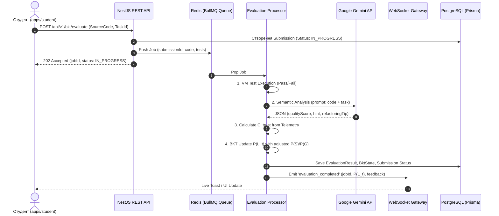

# 📚 Детальний Технічний Журнал Реалізації (Detailed Technical Implementation Log)

Документ містить максимально деталізований опис усіх виконаних технічних робіт, розроблених модулів, математичних алгоритмів, схем даних та архітектурних рішень у проєкті **«Smart-BKT-Chain»**.

---

## 🏗️ 0. Загальна Архітектура Монорепозиторію

Проєкт побудовано за принципами монорепозиторію (npm workspaces):
- `apps/api` — NestJS бекенд (Гексагональна архітектура Ports & Adapters, Swagger OpenAPI, WebSockets, REST).
- `apps/docs` — Документаційний портал (Next.js 16, React 19, TailwindCSS 4).
- `apps/web` — Студентський кабінет з інтеграцією Monaco Editor (Next.js).
- `packages/database` — Ізольований пакет роботи з БД (Prisma ORM, PostgreSQL schema, міграції, сидинг).
### 0.1 Правила Проєкту та Регламент AI-Агента ([`.agents/AGENTS.md`](file:///.agents/AGENTS.md))
Регламент розробки проєкту Smart-BKT-Chain закріплено у файлі [`.agents/AGENTS.md`](file:///.agents/AGENTS.md). Він встановлює обов'язковий порядок дій:
1. **Обов'язковий трьохкомпонентний лог прогресу:** Після виконання кожного мікро-кроку оновлюються [`daily_progress.md`](file:///docs/daily_progress.md), [`detailed_implementation_log.md`](file:///docs/detailed_implementation_log.md) та виконується компіляція `python scripts/compile_docs.py`.
2. **Покрокова розробка (Micro-Steps):** Розбиття задач на малі ітерації із обов'язковим `npm run build:*` / `npm run test:*` та окремим `git commit`.
3. **Стандарт коммітів Jira Conventional Commits:** Кожен комміт фіксується у форматі `[SBC-XXX][EP-YYY] <type>: <опис>` з прив'язкою до реєстру завдань [`docs/tasks/registry.md`](file:///docs/tasks/registry.md).
4. **Автоматична валідація Git Hook (`.git/hooks/commit-msg`):** Встановлено локальний перехоплювач та скрипт `scripts/validate_commit_msg.js`, що блокує комміти при відхиленні від стандарту.
5. **Захист від припущення:** Перевірка повних трасувань помилок перед виправленням коду.

### 0.1.1 Архітектура Автоматичного Деплою Документації на GitHub Pages (`deploy-docs.yml`)
- **Workflow:** [`.github/workflows/deploy-docs.yml`](file:///.github/workflows/deploy-docs.yml).
- **Тригери запуску:** `push` у гілки `master` або `main`, зачіпаючи шляхи `docs/**`, `apps/docs/**`, `scripts/**`, `package.json`, `package-lock.json`, або ручний `workflow_dispatch`.
- **Етапи пайплайну:**
  1. *Checkout Repository* (`actions/checkout@v4`).
  2. *Setup Python & Compile Docs* (`python scripts/compile_docs.py`) — генерація свіжих JSON-структур у `apps/docs/src/data/`.
  3. *Setup Node.js 20* з кешуванням `npm`.
  4. *Install Monorepo Dependencies* (`npm ci || npm install`) — синхронізація робочих просторів монорепозиторію.
  5. *Build Next.js Documentation Site* (`npm run build:docs`) — збірка статичного експорту (`output: "export"`, `trailingSlash: true`, `basePath: "/magisterts-smart-bkt-chain"`).
  6. *Upload Artifact & Deploy Pages* (`actions/upload-pages-artifact@v3` + `actions/deploy-pages@v4`).

### 0.1.3 Конфігурація Tailwind CSS v4 та PostCSS Пайплайну в `apps/study` (`SBC-283`, `EP-ST`)
- **Проблематика:**
  Next.js 16 при збірці у режимі Turbopack за відсутності локального `postcss.config.mjs` у пакеті не підключав трансформатор `@tailwindcss/postcss`, що призводило до видачі сирого HTML без обробленого CSS бандла.
- **Технічні налаштування:**
  1. `apps/study/postcss.config.mjs`:
     ```javascript
     const config = {
       plugins: {
         '@tailwindcss/postcss': {},
       },
     };
     export default config;
     ```
  2. `apps/study/package.json`:
     Використано запуск dev-сервера з аргументом `--webpack`: `"dev": "npx next dev --webpack --port 3006"`.
  3. `apps/study/src/app/globals.css`:
     Директиви `@import "tailwindcss";` та сканування спільних компонентів `@source "../../../../packages/ui/src";`.
  4. Автоматизована перевірка рендерингу за допомогою headless браузера Playwright підтвердила повну відповідність стилів дизайн-системі платформи (темна тема, Opera-rail, кнопки, пісочниця коду, акордеони `DrawerSection`).
### 0.1.4 Наскрізна Уніфікація Типів Монорепозиторію через `@sbc/types` (`SBC-284`, `EP-SH`)
- **Проблематика:**
  Наявність ізольованих інтерфейсів у фронтенд-застосунках (`interface TaskDetail`, `interface CourseItem`, `interface ReviewQueueItem`) створювала розбіжності з бекендом, вимагала використання `any` у складених структурах і не забезпечувала автоматичного відстеження змін у DTO.
- **Технічна реалізація:**
  1. **Розширення доменних DTO у `packages/types`:**
     - [`packages/types/src/tasks.types.ts`](file:///packages/types/src/tasks.types.ts): додано повнофункціональні контракти `ReviewAttemptDto` та `ReviewQueueItemDto` для черги ручної перевірки робіт учнів викладачем. У `TaskDto` строго визначено типи `options: QuizOptionDto[]`, `testCases: TestCaseDto[]`, `difficulty: TaskDifficulty` (`EASY | MEDIUM | HARD | ADVANCED`), `taskType: TaskType` (`CODE | SINGLE_CHOICE | MULTIPLE_CHOICE | TEXT_ESSAY | OPEN_TEXT`).
     - [`packages/types/src/learning.types.ts`](file:///packages/types/src/learning.types.ts): впроваджено типи для структури електронного інтерактивного підручника: `LessonSectionDto`, `LessonUnitDto`, `CurriculumModuleDto`, `CourseCurriculumDto`.
  2. **Рефакторинг `apps/student`:**
     - Замінено локальний `TaskDetail` на `export type TaskDetail = TaskDto;`.
     - Замінено `CourseItem` на `export type CourseItem = Partial<CourseDto> & { slug: string; title: string; category?: string };`.
     - У [`QuizTaskEditor.tsx`](file:///apps/student/src/features/quiz-editor/ui/QuizTaskEditor.tsx) використано `QuizOptionDto`.
  3. **Рефакторинг `apps/teacher`:**
     - Типізовано масив `allTasks: TaskDto[]`.
     - У [`CourseGraphViewer.tsx`](file:///apps/teacher/src/features/course-map/ui/CourseGraphViewer.tsx) встановлено `export type TaskItem = TaskDto;`.
     - У [`ReviewQueueInspector.tsx`](file:///apps/teacher/src/features/reviews/ui/ReviewQueueInspector.tsx) підключено `ReviewQueueItemDto` та `ReviewAttemptDto`.
  4. **Рефакторинг `apps/study`:**
     - У [`school-web-curriculum.ts`](file:///apps/study/src/data/school-web-curriculum.ts) навчальний план шкільного курсу переведено на експорт `CourseCurriculumDto`.

### 0.1.5 Дворівневий Стандарт Документації та Специфікація Всіх Застосунків (`SBC-286`, `EP-INF`)
- **Закріплення в Правилах Проєкту (`.agents/AGENTS.md` - Правило 8):**
  У зв'язку з тим, що монорепозиторій Smart-BKT-Chain об'єднує різнопрофільні повномасштабні системи, впроваджено обов'язкове розділення на Загальносистемну документацію (`docs/*.md`) та Доменну документацію застосунків (`docs/apps/*.md`).
- **Сформовано реєстр доменної документації:**
  1. [`docs/apps/study_portal.md`](file:///docs/apps/study_portal.md) (`apps/study`, порт 3006): дидактична місія 10–11 класів, 7 модулів шкільної програми, UI Shell за Правилом 7, повна архітектура **Режиму Зручного Читання (Zen Focus Reading Engine)**, пісочниця коду `CodePlayground`, картки когнітивних оман та наскрізний перехід у тренажер.
  2. [`docs/apps/student_portal.md`](file:///docs/apps/student_portal.md) (`apps/student`, порт 3002): інтерактивний тренажер, редактори Monaco, квізи й есе, збір поведінкової телеметрії, Сократівське риштування, математичні формули оновлення BKT майстерності $P(L_n)$.
  3. [`docs/apps/teacher_dashboard.md`](file:///docs/apps/teacher_dashboard.md) (`apps/teacher`, порт 3003): кабінет викладача, когортна діагностика успішності, детекція аномалій академічної доброчесності, черга ручної перевірки `ReviewQueueInspector`, візуалізатор графу курсу `CourseGraphViewer`.
  4. [`docs/apps/admin_portal.md`](file:///docs/apps/admin_portal.md) (`apps/admin`, порт 3004): методичний центр, налаштування та конструювання графу знань (Skill DAG), матриця параметрів моделі BKT ($P(L_0), P(T), P(S), P(G)$).
  5. [`docs/apps/api_backend.md`](file:///docs/apps/api_backend.md) (`apps/api`, порт 3000): ядро бекенду на NestJS (гексагональна архітектура Ports & Adapters), REST ендпоінти, WebSocket телеметрії, планувальник адаптивного секвенсування `TaskSequencer`.
- **Автоматизований пайплайн генерації JSON:**
  Усі файли `docs/apps/*.md` інтегровано в `scripts/compile_docs.py` з автогенерацією парних JSON у `docs/apps/*.json` та `apps/docs/src/data/apps_*.json` для публікації на порталі документації.

### 0.1.6 Архітектура Режиму Зручного Читання (Zen Focus Reading Engine, `SBC-287`, `EP-ST`)
- **Проблематика та Ергономічний Контекст:**
  - Настільні монітори 1080p/2K/4K створюють занадто довгий рядок тексту (>120 символів), що порушує сакадичний ритм очей учня, сповільнює швидкість читання та призводить до швидкої втоми.
  - Наявність постійних панелей інструментів та бічних списків розділів розсіює увагу під час засвоєння складних теоретичних концептів (змінні, структури пам'яті, рекурсія).
- **Технічні рішення та реалізація (`apps/study`):**
  1. **Плаваючий контролер читача (`ReaderFloatingToolbar.tsx`):**
     - Розташовано у правому нижньому кутку екрана у вигляді напівпрозорого віджета `fixed bottom-6 right-6 z-40 backdrop-blur-xl`.
     - Надає миттєвий доступ до перемикання режиму концентрації (Focus Mode), вибору теми, гарнітури, кеглю та ширини сторінки.
  2. **Індикатор Прогресу Читання (Scroll Engine):**
     - Контейнер `<main>` підключено до слухача скролу `handleScroll`:
       $$\text{ScrollProgress} = \frac{\text{scrollTop}}{\text{scrollHeight} - \text{clientHeight}} \times 100\%$$
     - Тонкий градієнтний бар `fixed top-0 left-0 right-0 h-1` візуалізує просування уроком.
     - Динамічний лічильник залишкового часу розраховує: $\text{TimeLeft} = \max(1, \text{round}(\text{EstimatedMinutes} \times (1 - \text{Progress} / 100)))$.
  3. **Триптих Кольорових Тем (Color Profiles):**
     - *Slate Night*: глибокий синьо-сірий `#020617` з контрастом для денної та вечірньої роботи.
     - *Warm Sepia*: теплий кавовий фон `#181310` із м'яким текстом `#f5ebd7` та стилізованими картками без синього спектра світла.
     - *True Black OLED*: абсолютний чорний `#000000` з піксельною енергоефективністю.
  4. **Типографічна матриця (Typography Scale & Font Matrix):**
     - Чотири рівні кеглю: `Compact (15px)`, `Normal (17px)`, `Large (19px)`, `Extra Large (21px)`.
     - Дві гарнітури: чистий інтерфейсний Sans-serif та класичний книжковий Serif.
     - Три фіксовані ширини контенту: `680px` (`max-w-2xl` — золотий стандарт книг), `768px` (`max-w-3xl`) та `960px` (`max-w-5xl`).
  5. **Гаряча клавіша фокусу `F` (Keyboard Shortcut):**
     - Обробник подій `window.addEventListener('keydown')` перемикає `isFocusMode` натисканням клавіші `F` (з ігноруванням введення в `input`/`textarea`/Monaco).
     - При переході у фокус: шапка та бічні панелі автоматично приховуються, даючи 100% площі матеріалу уроку.
  6. **Ізоляція Налаштувань та Автоматичне Скидання Стилів (Scoped Typography & State Restoration):**
     - Відповідно до вимог архітектури інтерфейсу, панель налаштувань шрифтів, колірних тем та ширини доступна **виключно у фокусному режимі читання**.
     - У звичайному режимі відображається лише мінімалістична плаваюча кнопка переходу `[Режим Читання (F)]`.
     - При виході з фокусу стан читача миттєво скидається до системного константного об'єкта `DEFAULT_READER_SETTINGS`:
       - Тема повертається до фірмового Dark Slate (`#020617`).
       - Шрифт повертається до системного гротеску (Sans-serif).
       - Кегль скидається до стандартного базового розміру.
       - Висувна панель налаштувань автоматично закривається, унеможливлюючи появу застарілого оверлею.
  7. **Швидкі Кнопки Тем у Тулбарі та Сепія як Дефолт (Quick Theme Toggles & Sepia Default):**
     - Офтальмологічний аналіз: яскраве синє світло та надмірний контраст темної теми на чорному моніторі провокують зорове перенапруження (астенопію) при безперервному читанні. «Тепла Сепія» (`#181310` тло, `#f5ebd7` текст) відсікає короткохвильовий спектр і забезпечує найбільш природний оптичний комфорт, близький до якісного паперу.
     - При переході у фокус читання (через гарячу клавішу `F`, кнопку в шапці або плаваючу кнопку) система за замовчуванням активує режим **«Тепла Сепія»**.
     - Безпосередньо ліворуч від кнопки фокусу з'являється блок швидкого вибору тем (`Сепія` / `Ніч` / `OLED`) із наочними кольоровими іконками, що дає змогу змінювати палітру в один клік без відкриття спливаючої панелі.

### 0.1.2 Запобіжники Модальності Секвенсора (Fallback Modality Guard, `SBC-278`, `BACKLOG-2`)
- **Проблематика та Контекст:**
  - При вивченні теоретичних розділів або проходженні концептуальних тестів (`SINGLE_CHOICE`, `MULTIPLE_CHOICE`) учень перевіряє розуміння понять та термінології.
  - Якщо у банку завдань для конкретного підконцепту (`subConcept`) не виявилося ізоморфного легшого квізу, попередній алгоритм фолбеку міг запропонувати завдання іншої модальності з цього ж модуля — наприклад, перемикав учня на написання коду (`taskType: CODE`). Це спричиняло дезорієнтацію та порушувало принцип дидактичної поступовості.
- **Архітектурні компоненти та реалізація:**
  1. **Сувора категоризація модальностей (`TaskSequencer.ts`):**
     - Впроваджено предикати `matchesModalityStrict`, які розрізняють три несумісні класи завдань:
       - *Тестові квізи:* `SINGLE_CHOICE`, `MULTIPLE_CHOICE`.
       - *Відкриті відповіді та есе:* `TEXT_ESSAY`, `OPEN_TEXT`.
       - *Програмування:* `CODE`.
     - При ремедіації (`preferredDifficulty === 'EASY'`) секвенсор фільтрує кандидатів виключно за активною модальністю.
     - **Fallback Modality Guardrail:** Якщо студент припустився помилки на квізі, секвенсор за жодних умов не здійснює фолбек на задачу з написанням коду (`return null`). Це сигналізує UI про необхідність теоретичної підтримки замість підвищення інженерного навантаження.
  2. **Уніфікація поведінки у REST API (`task.controller.ts`):**
     - Метод `getRecommendedTask` при пошуку фолбек-завдання за курсом застосовує Prisma-фільтр за типом модальності для запобігання міжмодальним стрибкам під час деградації.
  3. **Unit-тестування (`task-sequencer.spec.ts`):**
     - Додано тести `should strictly avoid falling back to CODE tasks when degrading from a failed quiz` та `should recommend matching isomorphic quiz blitz when degrading from failed quiz`.

### 0.1.3 Парадигма Адаптивного Навчання та Наскрізні Контракти Монорепозиторію (`SBC-279`, `EP-INF`)
- **Контекст та Аналіз Магістерської Роботи:**
  - Проведено ґрунтовний аналіз структури наукової роботи «Формування алгоритмічної компетентності учнями старшої школи у процесі вивчення розділу "Вебтехнології"» та програмного комплексу «Децентралізована система адаптивного навчання».
  - *Діагностика стану:* Платформа бездоганно виконує роль Computerized Adaptive Testing (CAT) та блокчейн-нотаріусу (Smart Contracts + BKT Engine). Проте «адаптивне навчання» вимагає наявності фази активного засвоєння знань — подання теорії (Just-in-Time Theory), аналізу оман (Misconceptions) та інтерактивного риштування (Scaffolding), а не лише оцінювання відповідей.
- **Стратегія Розвитку (Evolutionary Expansion without Breaking Changes):**
  1. **Наскрізні інтерфейси та типи (`packages/types`):**
     - До цього часу пакет `packages/types` містив лише `package.json`, через що клієнтські застосунки (`apps/student`, `apps/teacher`, `apps/admin`) дублювали DTO та моделі даних.
     - Заплановано наповнення `packages/types/src/` контрактами: `tasks.types.ts`, `bkt.types.ts`, `sequencing.types.ts`, `telemetry.types.ts`, `learning.types.ts`.
  2. **Інтерактивний Дидактичний Шар (`apps/student`):**
     - Підключення поля `studyUnitUrl` як повноцінного теоретичного конспекту/модалу в інтерфейсі студента, який автоматично активується при деградації знань ($P(L_n) < 0.35$).
     - Впровадження рушія роз'яснення типових оман (`misconceptions`), який при виборі дистрактора дає дидактичне пояснення замість простого червоного індикатора.
     - Розширення Сократівських підказок (`socraticHints`) до покрокового інтерактивного діалогу (Scaffolding).
- **Документація:** Сформовано маніфест [`docs/brainstorm/08_adaptive_learning_paradigm_and_cross_app_contracts.md`](file:///docs/brainstorm/08_adaptive_learning_paradigm_and_cross_app_contracts.md) та зареєстровано `[BACKLOG-6]`, `[BACKLOG-7]`.

### 0.1.4 Модульна Бібліотека Наскрізних DTO Контрактів (`@sbc/types`, `SBC-280`, `EP-SH`)
- **Проблематика та Архітектурний Контекст:**
  - До впровадження пакета `@sbc/types` сутності платформи дублювалися в інтерфейсах клієнтських застосунків (`apps/student`, `apps/teacher`, `apps/admin`). Поля зі складними структурами (наприклад, `options`, `misconceptions`, `rubrics`) оголошувалися з типом `any`, що створювало ризик десинхронізації контрактів при змінах бекенду та порушувало принцип єдиного джерела істини (Single Source of Truth).
- **Структура Реалізації (`packages/types/src/`):**
  1. **`tasks.types.ts`:**
     - Модальності та типи завдань: `TaskType` (`CODE`, `SINGLE_CHOICE`, `MULTIPLE_CHOICE`, `TEXT_ESSAY`, `OPEN_TEXT`).
     - Рівні складності: `TaskDifficulty` (`EASY`, `MEDIUM`, `HARD`, `ADVANCED`).
     - Статуси подань: `SubmissionStatus` (`PENDING`, `ACCEPTED`, `REJECTED`, `ERROR`), `TeacherReviewStatus`.
     - DTO моделей: `QuizOptionDto`, `TestCaseDto`, `SocraticHintDto`, `MisconceptionDto`, повна сутність `TaskDto` та результат спроби `SubmissionDto`.
  2. **`bkt.types.ts`:**
     - Параметри моделі Bayesian Knowledge Tracing: `BktParametersDto` ($P(L_0), P(T), P(S), P(G)$).
     - Стан знань учня: `BktStateDto` ($P(L_n)$, `isMastered`, лічильники спроб).
     - Результат перерахунку ймовірностей: `BktUpdateResultDto` з параметрами поведінкової корекції (`usedSlip`, `usedGuess`, `anomalyDetected`).
     - Аудиторський зліпок для блокчейну: `BktAuditRecordDto`.
  3. **`sequencing.types.ts`:**
     - Категорії адаптивного переходу: `AdaptiveStepType` (`ADVANCE`, `REINFORCE`, `REMEDIATE`, `THEORY_REVIEW`, `BLOCKED`).
     - Контракт рекомендації алгоритму: `SequencingRecommendationDto` з атрибутами `hasRemediationTask`, `activeModality`, `studyUnitUrl`, `suggestedAction`.
     - Доменні сутності графу: `SkillNodeDto`, `CourseDto`.
  4. **`learning.types.ts`:**
     - Дидактичні сутності адаптивного навчання: `TheoryCapsuleDto` (теоретична капсула з прикладами коду та ключовими висновками).
     - Інтерактивне риштування: `ScaffoldingStateDto` (розгортання підказок, фіксація активних штрафів, пропозиція теорії).
     - Персоналізований зворотний зв'язок: `AdaptiveFeedbackDto` з попередженням про виявлену когнітивну оману `misconceptionAlert`.
  5. **`telemetry.types.ts`:**
     - Специфікація подій реального часу: `TelemetryEventType` (`KEYSTROKE`, `PASTE`, `FOCUS`, `BLUR`, `HINT_REQUESTED`, `THEORY_OPENED`, тощо).
     - Розрахункові показники: `BehavioralMetricsDto` (WPM, лічильники вставок, затримка реакції, прапорець швидкого вгадування, індекс втоми).
- **Інтеграція в робочі простори (npm workspaces):**
  - Додано пряму залежність `"@sbc/types": "*"` у `apps/student/package.json`, `apps/teacher/package.json`, `apps/admin/package.json`, `apps/api/package.json`.
- **Верифікація:**
  - `npm run typecheck --workspace=@sbc/types` (0 помилок).
  - Підтверджено збірку Next.js / NestJS додатків: `npm run build:student`, `npm run build:teacher`, `npm run build:admin`, `npm run build:api`.

### 0.1.5 Архітектура Інтерактивного Застосунку Навчання (`apps/study`, `SBC-281`, `EP-ST`)
- **Концептуальна Сутність та Розділення Ролей:**
  - У межах наукової магістерської роботи реалізовано чітке розмежування двох фундаментальних контурів навчального середовища:
    1. **Контур Оцінювання та Практики (`apps/student`):** фокусується на активній діяльності — Monaco Editor, компіляція та виконання коду, BKT-трекінг $P(L_n)$, античит-телеметрія та фіксація блокчейн-сертифікатів.
    2. **Контур Інтерактивного Засвоєння Знань (`apps/study`):** повноцінний цифровий підручник нового покоління (порт `3006`), який надає структуровану дидактичну теорію, розбір типових помилок та інтерактивні пісочниці для попереднього експериментування з кодом.
- **Архітектурні Компоненти `apps/study`:**
  1. **Навчальна Програма (`school-web-curriculum.ts`):**
     - Охоплює 7 модулів курсу *«Вебтехнології та алгоритмізація (10–11 класи)»*.
     - Кожен урок містить розрахунковий час проходження (`estimatedMinutes`), багаторівневі секції з детальним поясненням синтаксису, робочі приклади коду та підсумкові тези (`keyTakeaways`).
  2. **Інтерактивна Пісочниця Коду (`CodePlayground.tsx`):**
     - Дозволяє учневі модифікувати та виконувати JavaScript-код безпосередньо під час читання теорії.
     - Забезпечує безпечне перехоплення викликів `console.log()` та відображення емульованої консолі браузера з підсвіткою синтаксису та обробкою помилок часу виконання.
  3. **Секції Роз'яснення Когнітивних Оман (Misconception Alerts):**
     - Кожна теоретична секція містить блок попередження про типові хибні уявлення учнів (наприклад: мутація констант, рядкова конкатенація `"12" + 5`, плутанина між `=` та `===`, скидання акумулятора всередині циклу).
     - Блок наочно контрастує: *Хибне переконання* vs *Реальна поведінка інтерпретатора* vs *Практична порада з виправлення*.
  4. **Наскрізна Інтеграція з Тренажером:**
     - Прямі гіперпосилання з уроків теорії на практику у `apps/student` (`http://localhost:3002`).
     - Відповідність URL-ідентифікаторів секцій полю `studyUnitUrl` у базі даних завдань.

### 0.1.6 Уніфікація Інтерфейсу `apps/study` та Наскрізна Навігація в Монорепозиторії (`SBC-282`, `EP-ST`)
- **Вимоги до Дизайну та Архітектурний Регламент:**
  - Згідно з регламентом проєкту та стандартом бічних панелей (Правило 7 [`.agents/AGENTS.md`](file:///.agents/AGENTS.md)), усі застосунки платформи зобов'язані мати монолітний, темний та уніфікований вигляд:
    1. Фіксована верхня шапка `h-14` (брендинг Smart-BKT-Chain, селектор курсів, профіль користувача).
    2. Вузький вертикальний Opera-Style Navigation Rail (`w-14`) з активними пігулками-індикаторами ліворуч.
    3. Висувна бічна панель (Side Drawer `w-[380px]`), вміст якої на 100% побудований на базі компонента `<DrawerSection>` з пакету `@sbc/ui`.
    4. Безрамковий чистий лейаут (Borderless Clean Design) та індикатори згортання секцій `+` / `−`.
- **Наскрізна Інтеграція Між Усіма Застосунками:**
  - У вертикальні навігаційні рейли `apps/student`, `apps/teacher` та `apps/admin` додано постійний ярлик переходу до Інтерактивного підручника (`apps/study`, порт `3006`).
  - Усі 4 веб-застосунки тепер містять повну взаємну сітку швидкого перемикання між ролями Студент / Підручник / Викладач / Адмін.

### 0.2 Модуль Візуальної Інспекції Графу Курсу (`CourseOverviewWidget`)
- **Концепція:** Перевикористовуваний автономний віджет `CourseOverviewWidget` (`apps/teacher/src/features/course-map/ui/CourseOverviewWidget.tsx`), призначений для повного огляду ієрархії курсів, модулів (DAG) та прив'язаних запитань/завдань.
- **Особливості:**
  - Візуалізація DAG-вузлів із розгортанням списку питань.
  - Відображення типів завдань (`CODE`, `SINGLE_CHOICE`, `MULTIPLE_CHOICE`, `TEXT_ESSAY`), складності та правильних відповідей для викладацького аудиту.
  - Швидкий пошук та фільтрація завдань у реальному часі.

### 0.3 Дидактична Реструктуризація Початкового Рівня (`SBC-243`)
- **Проблематика:** Виявлено дидактичну колізію: у модулі основ (Модуль 1) завдання вимагали написання функцій, оголошення аргументів та повернення результату через `return`, хоча тема функцій і замикань вивчається пізніше (Модуль 2).
- **Архітектурне рішення:**
  1. **Очищення Модуля 1 від функцій:** Усі практичні задачі Модуля 1 переведено на пряме оголошення змінних (`let`, `const`), арифметичні та логічні вирази або інтерактивні тести.
  2. **Універсальна пісочниця Node.js VM (`bkt.controller.ts`):** Якщо у надісланому коді відсутні оголошення функцій, інтерпретатор автоматично перевіряє значення локальних змінних (`this[rawInput]`) або вирази `eval:typeof x`, що усуває потребу у штучних функціональних обгортках.
  3. **Адаптивний UI тест-кейсів:** Для завдань на оголошення змінних мітка «Вхідні дані: [...]» замінена на «Перевірка змінної: <назва>» або «Обчислення виразу: <вираз>».

### 0.4 Детермінована Рандомізація Варіантів у Тестових Питаннях (`SBC-244`)
- **Проблематика:** У сидингових даних `SINGLE_CHOICE` та `MULTIPLE_CHOICE` правильний варіант (`isCorrect: true`) історично розташовувався першим (індекс 0). Без перемішування це формувало у студентів рефлекторний вибір варіанта "A" і штучно завищувало метрики BKT.
- **Архітектурне рішення:**
  1. **Детермінований алгоритм Fisher-Yates (`QuizTaskEditor.tsx`):** На основі 32-бітного поліноміального хешу від `taskId` генерується стабільна псевдовипадкова послідовність. Це усуває хаотичні перестановки під час повторних рендерів компонента, гарантуючи при цьому випадковий розподіл відповідей.
  2. **Абстрагування технічних ID:** Внутрішні ідентифікатори варіантів (`opt1`, `opt2`) приховані від студента; кожному пункту призначається літерний маркер (`A`, `B`, `C`, `D`), який також дублюється у круглому чекбоксі.

### 0.5 Інтерактивний Перехід на Допоміжний Рівень (Graceful Degradation Prompt, `SBC-245`)
- **Проблематика:** При виникненні помилок під час розв'язання складного завдання студент залишається на поточному завданні для повторної спроби. Оскільки запит на наступне рекомендоване завдання (`/api/v1/tasks/recommended`) за замовчуванням виконується лише при переході після успіху, плашка деградації складності (`isDifficultyDegraded`) не з'являлася в інтерфейсі безпосередньо в момент виникнення труднощів.
- **Архітектурне рішення:**
  1. **Відстеження помилок у реальному часі:** У `apps/student/src/app/page.tsx` додано стан `consecutiveFailures`, що інкрементується при кожній невдалій перевірці та обнуляється після успіху.
  2. **Інтерактивна картка ремедіації:** У компонент `evalResult` додано блок допомоги:
     *«Складно з цим завданням? Ви можете переключитися на допоміжне адаптивне завдання легшого рівня (Max: 70%)»*.
  3. **Прямий виклик `fetchRecommendedTask`:** Натискання кнопки ініціює запит на секвенсор BKT з урахуванням останньої помилки (`preferredDifficulty = 'EASY'`), що перемикає студента на полегшене завдання із золотавим банером деградації та обмеженням балу до 70%.

### 0.7 Візуалізація Наскрізного Прогресу Студента у Хедері та Робочому Просторі (`SBC-246`)
- **Проблематика:** Студент мав відкривати додаткові вкладки сайдбара, щоб дізнатися, на якому етапі вивчення курсу він перебуває. Відсутність прогресу на першому плані знижувала мотивацію та ускладнювала орієнтацію.
- **Архітектурне рішення:**
  1. **Обчислення динамічних метрик:**
     - `courseCompletionPct` = частка модулів із $P(L) \ge 0.90$ від загальної кількості модулів курсу.
     - `activeSkillMasteryPct` = точний поточний відсоток засвоєння активного модуля за BKT моделлю.
  2. **Sticky Header Progress HUD (`apps/student/src/app/page.tsx`):**
     - Інтегровано центральний блок у шапку: бейдж `Трофей` із відсотком та баром опанування курсу + бейдж `Мішень` із назвою та прогресом поточного модуля.
  3. **Workspace Context HUD:**
     - Безпосередньо над полем розв'язання задачі розташовано горизонтальний віджет із поточною темою, міні-прогрес-барами та швидким переходом до Дерева Знань.
  4. **Condition Drawer Mini-Bar:**
     - Шапка опису умови завдання оснащена акуратним прогрес-баром модуля з кольоровою диференціацією.

### 0.8 Усунення Повторної Видачі Невирішеного Завдання при Ремедіації (`SBC-247`)
- **Проблематика:** У тріадах Блума кожна тема зазвичай містить 1 `EASY` завдання (теорія/концепт), 1 `MEDIUM` (практика) та 1 `HARD` (поглиблене застосування). Коли студент успішно склав `EASY` тест і перейшов до `MEDIUM`, легке завдання вже зафіксоване як завершене (`completedSet`). Якщо на `MEDIUM` виникали труднощі і студент натискав кнопку «Взяти допоміжне завдання», секвенсор не знаходив *незавершених* `EASY` завдань по цій темі, опускався до `sameTopic[0]` і повертав те саме складне завдання `MEDIUM`, що створювало замкнене коло.
- **Архітектурне рішення:**
  1. **Параметр виключення `excludeTaskId`:**
     - Додано до сигнатури `TaskSequencer.recommendNextTask({ ..., excludeTaskId })`.
     - Додано до REST ендпоінта `GET /api/v1/tasks/recommended?excludeTaskId=...`. Якщо параметр не передано, але остання спроба в `BktHistory` була невдалою, бекенд автоматично встановлює `effectiveExcludeTaskId = lastAttempt.taskId`.
  2. **Багаторівневий алгоритм ремедіації (`pickBestTask`):**
     - **Рівень 1:** Незавершене `EASY` завдання з тієї самої теми (`t.topic === preferredTopic && t.difficulty === 'EASY' && t.id !== excludeTaskId`).
     - **Рівень 2:** Будь-яке незавершене `EASY` завдання поточного активного модуля.
     - **Рівень 3 (Remediation Drill):** Якщо всі `EASY` завдання модуля вже зараховані, секвенсор пропонує повторне проходження базового `EASY` завдання з цієї теми як допоміжне концептуальне закріплення (з обов'язковим виключенням `excludeTaskId`).
     - **Рівень 4:** Будь-яке базове `EASY` завдання модуля для повторення.
  3. **Клієнтська інтеграція (`apps/student`):**
     - При натисканні на кнопку адаптивної допомоги `fetchRecommendedTask(activeCourseSlug, task?.id)` поточний `task.id` передається у query string, унеможливлюючи повернення того самого завдання.

### 0.9 Мініатюризація Індикатора Ремедіації: Іконка Повідомлення з Тултіпом (`SBC-248`)
- **Проблематика:** Громіздкий довгий бейдж `Допоміжний рівень (Макс: 70%)` порушував естетичний баланс у вузькому мобільному або сайдбарному контейнері опису модуля, перекриваючи назву компетенції.
- **Архітектурне рішення (`apps/student/src/app/page.tsx`):**
  1. **Мінімалістична кнопка-іконка:** Замість текстового рядка встановлено бурштинову кнопку з іконкою `MessageSquare` (`w-3.5 h-3.5 text-amber-400`), розміщену поруч із показником $P(L)$.
  2. **Інтерактивний поповер (Dropdown Tooltip):**
     - При кліку на іконку відкривається стилізований тултіп із бейджем `Макс: 70%`, заголовком «Допоміжне завдання» та розгорнутим педагогічним коментарем про адаптивне зниження навантаження.
     - Додано глобальний прозорий бекдроп (`fixed inset-0 z-40`), який автоматично закриває підказку при кліку поза її межами.

### 0.10 Сесія Брейншторму 07: Подолання «Адаптивного Тупика» та Scaffolding
- **Документ:** [`docs/brainstorm/07_breaking_adaptive_deadlock_and_scaffolding.md`](file:///docs/brainstorm/07_breaking_adaptive_deadlock_and_scaffolding.md).
- **Проблематика:** «Петля фрустрації» (The Frustration Loop), коли багаторазові помилки на полегшених завданнях призводять до циклічного перекидання студента між тими самими двома питаннями без прогресу.
- **Концептуальні вектори розв'язання (6 узгоджених принципів):**
  1. *Task Bank Depth & Isomorphic Tasks:* Обов'язковий норматив 3–4 ізоморфних бліців на кожен концепт із різними життєвими метафорами.
  2. *Study App Deep-Linking замість спойлерів:* Відхилено показ мікротеорії безпосередньо у тесті (захист від ілюзії компетентності). Замість цього — безшовне переспрямування у майбутній навчальний застосунок (`Study App`) до інтерактивного уроку з паркуванням тесту та чистим ізоморфним перескладанням після повернення.
  3. *Socratic Hints зі штрафною сіткою:* Навідні запитання без прямої відповіді (-15% за 1-шу підказку, -30% за 50/50).
  4. *Тактичний відступ (DAG Backtracking) та Guided Mode:* Відкат на батьківську навичку; якщо це старт курсу — перехід у режим супроводу за руку (*Fill-in-the-blank*).
  5. *Human-in-the-Loop:* Ескалація до викладача з пересилкою коду та телеметрії у `Teacher Review Queue`.
  6. *Cognitive Cool-Down:* «Паркування» теми на потім та зміна інтерактивного формату активності.

### 0.11 Авторські Сократівські Підказки та Deep-Link у Застосунок Навчання (`SBC-250`)
- **Методологічне правило:** Сократівські підказки є невід'ємною частиною авторського дизайну кожного завдання і закладаються на етапі створення контенту методистом, а не генеруються евристично під час виконання.
- **Архітектурні зміни:**
  1. **Prisma ORM (`packages/database/prisma/schema.prisma`):**
     - Модель `Task` розширена полями:
       - `socraticHints Json?`: масив об'єктів `{ level: number, hint: string, penaltyPct: number }`.
       - `studyUnitUrl String?`: точний URI-якір до відповідного уроку майбутнього навчального застосунку (`Study App`).
  2. **Оновлення сид-банку та специфікації:**
     - Оновлено [`docs/justifications/03_task_authoring_and_pedagogical_specification.md`](file:///docs/justifications/03_task_authoring_and_pedagogical_specification.md) — додано чек-листи валідності для підказок та deep-links.
     - Для завдань Модуля 1 прописано двоярусні сократівські навідні питання та посилання на навчальні юніти.
     - Базу даних синхронізовано (`npx prisma db push`) та пересиджено (`npm run db:seed`).
  3. **Студентський клієнт (`apps/student/src/app/page.tsx`):**
     - В інтерфейс перегляду умови завдання додано інтерактивний блок `Сократівські підказки`: студент може за потреби розкрити підказку 1-го рівня (штраф -15%) або підказку 2-го рівня (штраф -30%).
     - Додано блок `Потрібно повторити тему?` з кнопкою швидкого переходу до відповідного уроку за адресою `task.studyUnitUrl`.

### 0.6 Глобальний Стандарт Уніфікованого Стану Навігації (`activeTab` + `isDrawerOpen`)
- **Проблематика:** Раніше у кабінетах стан навігації спирався на тимчасовий `activeDrawer = null`, через що при згортанні сайдбара або закритті хрестиком `✕` втрачався фокус обраної вкладки та скидався до першого елемента списку.
- **Архітектурний стандарт для всіх порталів (`apps/student`, `apps/teacher`, `apps/admin`):**
  ```typescript
  // Приклад реалізації (Student, Teacher, Admin):
  type PortalTab = 'analytics' | 'coursemap' | 'settings'; // або 'task' | 'bkt' | 'tree'
  const [activeTab, setActiveTab] = useState<PortalTab>('analytics');
  const [isDrawerOpen, setIsDrawerOpen] = useState<boolean>(true);

  const handleTabClick = (tab: PortalTab) => {
    if (activeTab === tab) {
      setIsDrawerOpen((prev) => !prev);
    } else {
      setActiveTab(tab);
      setIsDrawerOpen(true);
    }
  };
  ```
- **Уніфіковані стани інтерфейсу:**
  1. `activeTab === tab && isDrawerOpen`: Повне активне підсвічування кнопки + розгорнута бічна панель відповідного розділу (`w-[380px]`).
  2. `activeTab === tab && !isDrawerOpen`: Тоноване підсвічування кнопки з міні-індикатором `h-2`, сайдбар прихований, центральний холст автоматично розтягнуто на 100% ширини (`flex-1`).
  3. Повторний клік по активній кнопці або `✕` в сайдбарі: `setIsDrawerOpen(prev => !prev)` без зміни `activeTab`.
  4. Клік по іншій іконці: перемикає `activeTab` та гарантовано встановлює `isDrawerOpen(true)`.

### 0.7 База Архітектурних Дискусій та Мозкових Штурмів (`docs/brainstorm/`)
- **Концепція:** Централізоване сховище для накопичення теоретичних, алгоритмічних та бізнес-ідей проекту.
- **Сесія 01 (`docs/brainstorm/01_evaluating_mastery_across_task_types.md`):**
  - **Динамічний BKT ($P(G) / P(S)$):** Введення залежності $P(G)$ від часу здачі завдання $T_{\text{submit}}$: якщо $T < 3.0\text{ с}$, ймовірність вгадування $P(G)$ зростає до $0.85$, мінімізуючи ріст знання від випадкового вибору в тестах.
  - **Когнітивна достовірність ($\alpha$-Score):** Мультиплікатор достовірності $\alpha = (1 - CopyPasteRatio) \cdot \text{Penalty}(WPM)$ як коригувальний коефіцієнт BKT.
  - **Мульти-критеріальна триангуляція статусу `MASTERED`:** Опанування теми вимагає зв'язки «Теоретичний тест + Практичний код + Автентична телеметрія».
- **Сесія 02 (`docs/brainstorm/02_edtech_ecosystem_vision.md`):**
  - Just-in-Time теорія та інтервенції, Сократівський діалог, RPG Skill Tree, Teacher Co-Pilot.
- **Сесія 03 (`docs/brainstorm/03_technical_edtech_platform_architecture.md`):**
  - Архітектура монорепозиторію, FSM сесій, InterventionRouter, TelemetryIntegrityEngine (WPM/Burstiness).
- **Сесія 04 (`docs/brainstorm/04_open_ended_questions_semantic_eval.md`):**
  - **Багаторівневий пайплайн семантичного оцінювання (Multi-Tier Assessment Pipeline):**
    - *Tier 1 (Heuristics):* Виявлення обов'язкових коренів понять, перевірка Type-Token Ratio, детекція плагіату умови завдання.
    - *Tier 2 (Vector Embeddings):* Косинусна подібність з еталоном $\text{CosineSimilarity}(\vec{v}_{stu}, \vec{v}_{ref})$ та кластеризація типових помилок (misconceptions).
    - *Tier 3 (LLM Judge):* Оцінювання за структурованими рубриками (`correctness`, `completeness`, `keyConceptsCovered`, `studentFeedback`).
  - **Телеметричний BKT зв'язок:** Штраф $P(G) \to 0.9$ при вставках тексту (`pasteEvents > 0`), фіксація $P(S)$ при когнітивних паузах та видаленнях (`deletionRatio > 0.35`).
  - **Human-in-the-Loop:** Інтеграція черги апеляцій та сумнівних оцінок ($0.45 \le \text{Score} \le 0.70$) у Teacher Portal з можливістю підтвердження/коригування в 1 клік.


### 0.3 Модульний Opera-Style UI Shell, Компактні DAG-Вузли та Патерн «List-in-Drawer / Detail-on-Canvas»
- **Уніфікація UI Shell (`apps/student`, `apps/teacher`, `apps/admin`):**
  - Верхня фіксована навігаційна панель (`h-14 bg-slate-900 border-b border-slate-800`).
  - Вузький вертикальний рейл іконок (`w-14 bg-slate-900`) з блоком `Settings` у найнижчій позиції.
  - Висувні бічні панелі (Drawers) з **фіксованою нерухомою шапкою** (`shrink-0 bg-slate-900/90 backdrop-blur-md`) та скрольованим контентним блоком (`flex-1 overflow-y-auto`).
- **Компактний `SkillDagMap` (`apps/student/src/features/skill-graph/ui/SkillDagMap.tsx`):**
  - Об'єднання заголовка модуля та відсотка $P(L)$ в один рядок для зменшення висоти плашок.
  - Накладання круглих стрілок-з'єднувачів `ArrowDown` з від'ємними маржинами (`-my-2.5 z-20`) над картками модулів.
  - Усунення дубльованих заголовків у внутрішньому суб-барі віджета.
- **Кабінет Викладача (`apps/teacher/src/app/page.tsx`):**
  - **Бокове висувне меню:** Виводить список студентів курсу (з живим текстовим пошуком за ім'ям/email) та структуроване дерево модулів DAG.
  - **Центральний екран (Main Canvas):** При виборі студента показує детальну аналітичну картку (WPM, Copy-Paste, Fatigue Index), BKT Heatmap по модулях та кнопку скидання. При виборі модуля/завдання показує повний інспектор умови завдання, тест-кейсів та ключів відповідей.

### 0.4 Концепт та Архітектура Модульної Телеметрії (Per-Module Telemetry & Course-Level Median)
- **Проблематика:** При загальному підрахунку телеметрії (WPM, Copy-Paste Ratio, Fatigue Index) по всьому курсу списування чи когнітивне перевантаження на окремому модулі "змащується" середніми значеннями.
- **Концепція та Практична Реалізація Модульної Телеметрії:**
  1. **Модульний рівень ($WPM_{skill}, CopyPaste_{skill}, Fatigue_{skill}$):** Кожен вузол графа $Skill_i$ зберігає власні параметри телеметрії. Якщо студент вставив 90% коду під час проходження складного Модуля 3, цей показник зберігається суворо у контексті Модуля 3.
  2. **Курсовий рівень (Медіана + Peak Anomaly):** На верхніх картках загальної аналітики студента розраховується **Медіана ($\text{Median}$)** для виключення спотворень, а поруч виводиться індикатор **Пікової Аномалії (Peak Anomaly)** з вказівкою проблемного модуля.
- **Математична модель агрегації:**
  $$\text{Course } CopyPaste_{\text{median}} = \text{Median}\Big( \big\{ CopyPaste_{skill_1}, CopyPaste_{skill_2}, \dots, CopyPaste_{skill_N} \big\} \Big)$$
  $$\text{Peak Anomaly} = \max_{i} \Big( CopyPaste_{skill_i} \Big) \quad \text{при } CopyPaste_{skill_i} \ge 0.60$$
### 0.5 Автономний RPG-Віджет «Дерево Знань» (`GameSkillTreeWidget`)
- **Концепція та Гейміфікація:** Перетворення класичного орієнтованого графа залежностей навичок DAG у повноцінне інтерактивне RPG Дерево Прокачування (Skill Tree / Skyrim & Path of Exile visual design).
- **Архітектурні складові (`apps/student/src/features/skill-graph/ui/GameSkillTreeWidget.tsx`):**
  1. **Ігрове поле з неоновою кіберпанк-сіткою:** Органічний зигзагоподібний лейаут сузір'їв знань з векторними Bezier-кривими (Power Rays), що з'єднують навички.
  2. **Стани вузлів-рунічних кристалів:**
     - 🔒 **Locked:** Напівпрозорий, контур замка, неактивний до виконання пререквізитів ($P(L) \ge 0.95$).
     - ⚔️ **In Progress:** Пульсуюче синє сяйво, живий відсоток майстерності $P(L_t)$, кнопка «Розпочати квест».
     - ✨ **Mastered:** Золотисто-смарагдовий ореол (`bg-emerald-950/60 border-emerald-400`), позначка засвоєння та розблокування енергетичного променя до наступного рівня.
  3. **RPG Інспектор Навички (Side Quest Card):** Картка модуля з умовами квесту, пререквізитами та прогрес-баром BKT.
  4. **Гейміфікована прогресія:** Підрахунок рівня гравця (`LVL`), очок досвіду (`EXP`) та загального відсотка відкриття дерева знань курсу.
- **Інтеграція в Кабінет Студента:**
  - Акцентна іконка `Network` у лівому вертикальному навігаційному рейлі (`w-14`).
  - Перемикач режимів `[ 📜 Список Модулів | 🌳 RPG Дерево ]` у бічній панелі.
### 0.8 Вкладка Історії Спроб у Бічній Панелі Студента та Синхронізація Відгуку Викладача (`SBC-216`)
- **Концепція та Проблематика:**
  - При проходженні завдань з відкритим текстом (`TEXT_ESSAY` / `OPEN_TEXT`) студент надсилав відповідь і чекав верифікації викладачем (`PENDING_REVIEW`).
  - Після перевірки викладачем у своєму кабінеті (`apps/teacher`) статус рішення та коментар не відображалися у студента автоматично, а кнопка «Наступне завдання» залишалася заблокованою.
- **Архітектурні компоненти та реалізація:**
  1. **REST API (`GET /api/v1/tasks/:id/submissions?userId=...`):**
     - Ендпоінт у [`apps/api/src/adapters/inbound/http/task.controller.ts`](file:///apps/api/src/adapters/inbound/http/task.controller.ts).
     - Повертає масив усіх спроб студента для конкретної задачі (`attemptNumber`, `code`, `status`, `teacherReviewStatus`, `teacherComment`, `createdAt`), відсортований за спаданням дати (`desc`).
  2. **WebSocket-подія `teacher_review_decision`:**
     - Розширено метод `notifyTeacherReviewDecision` у [`telemetry.gateway.ts`](file:///apps/api/src/adapters/inbound/websocket/telemetry.gateway.ts) та виклик у [`bkt.controller.ts`](file:///apps/api/src/adapters/inbound/http/bkt.controller.ts).
     - Передаються поля: `{ submissionId, decision, userId, taskId, comment, scoreOverride }`.
  3. **Інтерфейс Студента (`apps/student/src/app/page.tsx`):**
     - **Вкладки у бічній панелі (Side Drawer):**
       - Перемикач `[ 📖 Умова | 🕒 Історія спроб (N) ]` над карткою задачі.
       - У вкладці історії виводиться повна хронологія спроб студента:
         - Порядковий номер (`Спроба #1`, `Спроба #2 • Остання`), бейджі статусу (`✓ Затверджено`, `⏳ В черзі`, `Архівована (Superseded)`, `✕ Відхилено`).
         - Спеціальний цитатний блок **«💬 Коментар викладача: "..."»** із бузково-фіолетовим підсвічуванням.
         - Можливість розкрити вихідний текст розв'язку (`<details>`).
     - **Реактивне оновлення без перезавантаження:**
       - При отриманні події `teacher_review_decision` студентський портал автоматично підвантажує історію через `fetchTaskSubmissions(task.id)`.
       - Якщо рішення стосується поточного завдання: `evalResult.isPassed` перемикається у `true` (при `APPROVE`), розблоковуючи кнопку переходу **«Наступне завдання ➔»**.
       - У нижній картці результату (`Toast Panel`) виводиться окремий блок відгуку викладача.

### 0.9 Архів Перевірених Робіт у Черзі Викладача та Запобігання Feature Creep (`SBC-218`)
- **Концептуальний вибір та Scope Baseline:**
  - На основі стратегічного аналізу ([`docs/strategy/scope_baseline_and_advice.md`](file:///docs/strategy/scope_baseline_and_advice.md)) зафіксовано відмову від розбудови важких паралельних журналів і підпанелей історії всередині кожної вкладки курсу на користь легкого, сфокусованого рішення всередині модуля рецензування.
- **Технічні рішення та реалізація:**
  1. **REST API (`GET /api/v1/bkt/reviews/queue?courseSlug=...&status=PENDING|REVIEWED|ALL`):**
     - Контролер [`bkt.controller.ts`](file:///apps/api/src/adapters/inbound/http/bkt.controller.ts) динамічно фільтрує записи `submissions`:
       - `status=PENDING` (за замовчуванням): `teacherReviewStatus: PENDING_REVIEW`.
       - `status=REVIEWED`: `teacherReviewStatus: { in: [APPROVED, REJECTED] }`.
     - Для кожної роботи повертається повний масив попередніх чернеток (`attemptsHistory`), текст розв'язку, виставлений викладачем бал (`semanticScore`) та текст рецензії (`teacherComment`).
  2. **Інтерфейс Викладача (`apps/teacher/src/app/page.tsx` + `ReviewQueueInspector.tsx`):**
     - Вбудовано перемикач вкладок у бічній панелі:
       `[ ⏳ В черзі | ✓ Перевірені ]`.
     - Роботи в режимі архіву підсвічуються за вердиктом: зелений бейдж `✓ Затверджено` або рожевий `✕ Відхилено`.
     - В інспекторі відкритої роботи відображається збережений коментар, а кнопки прийняття рішень дозволяють за необхідності оновити бал чи змінити статус.

### 0.10 Рефакторинг та Спрощення Віджета Аномалій — Єдиний Конфігурований Віджет за Категоріями (`SBC-220`, `Brainstorm 06`)
- **Концептуалізація та Архітектурний Контекст:**
  - На основі аудиту екрана «Дерево Аномалій» (див. [`docs/brainstorm/06_anomaly_tree_refactoring_categories_widget.md`](file:///docs/brainstorm/06_anomaly_tree_refactoring_categories_widget.md)) виявлено когнітивне перевантаження користувачів через 4 дублюючі підвкладки (`Дерево Модулів`, `За Категоріями`, `Топологічний Граф DAG`, `RPG Матриця Рун`) та надмірну вкладеність акордеонів.
- **Ухвалені рішення та Проєктування:**
  1. **Збереження окремої вкладки «Дерево Аномалій»** для чіткого розмежування цілей користувача (Опанування навичок vs Аналіз інцидентів), але повна відмова від підвкладок DAG/Рун.
  2. **Уніфікація категорій інцидентів (4 чіткі смислові групи):**
     - 📋 **`PASTE_ANOMALY`**: Буфер обміну та сторонній код (`pasteRatio > 0.70`).
     - ⚡ **`SPEEDRUN_ANOMALY`**: Аномальна швидкість відповіді (< 3.5с / 5с).
     - 🔄 **`SEMANTIC_LOOPING_ANOMALY`**: Текстові повтори та семантичний спам (циклічні фрази в есе).
     - 🤔 **`COGNITIVE_FRICTION_ANOMALY`**: Когнітивні труднощі та невпевненість (`deleteRatio > 0.40`).
  3. **Спільний конфігурований компонент (`AnomalyCategoriesWidget`):**
     - Підтримка пропса `role: "student" | "teacher"`.
     - Для студента: м'які формулювання, рекомендації щодо формування моторної пам'яті, приховані сирі BKT формули.
     - Для викладача: інженерна аналітика, модифікатори BKT ($P(G) \uparrow 0.90$, $P(S) \uparrow 0.35$), кнопки швидкого переходу до перевірки.
  4. **Імплементація компонентів (`SBC-221`):**
     - У файлах `packages/ui/src/analytics/AnomalyTreeWidget.tsx`, `apps/teacher/.../AnomalyTreeWidget.tsx` та `apps/student/.../AnomalyTreeWidget.tsx` повністю прибрано застарілі таби (Дерево Модулів, DAG Граф, RPG Матриця Рун).
     - Реалізовано компактні фільтри-чіпси `[ Всі (N) | Копіпаст | Швидкість | Спам | Тертя ]`.
     - Додано рольове розмежування подачі інформації через пропс `role: student | teacher`.

### 0.11 Наукове Обґрунтування Когнітивного Порогу Часу у BKT (`SBC-225`)
- **Академічна база та література:** Дослідження Response Time Effort (Wise & Kong, 2005), моделі детекції «Gaming the System» (Baker et al., 2004) та когнітивні фіксації читання тексту/коду (Rayner, 1998).
- **Формула динамічного порогу:** $T_{\text{threshold}} = T_{\text{motor}} + \frac{W_{\text{prompt}}}{V_{\text{read}}} + T_{\text{task\_type}}$, де $T_{\text{motor}} \approx 0.8\text{ с}$, $V_{\text{read}} \approx 4\text{ сл/с}$.
- **Динамічна модуляція BKT:** При $\Delta t < T_{\text{threshold}}$ фіксується Rapid Guessing, $P(G) \uparrow 0.85$, що нейтралізує випадковий приріст знань $P(L_t)$ за формулою Баєса.
- Документ наукового базису: [`docs/justifications/01_cognitive_latency_threshold_and_rapid_guessing.md`](file:///docs/justifications/01_cognitive_latency_threshold_and_rapid_guessing.md).

### 0.12 Умовне Надання Scaffolding та Захист від Передчасних Підказок (SBC-252)
- **Концепція та Педагогічна Модель:**
  - На основі Сесії Брейншторму 07 зафіксовано, що підказки та навчальні посилання ніколи не повинні виступати пасивним фоном або «спокусою» на чистій першій спробі студента.
  - Показ скорочувальних підказок на новому завданні створює небезпеку передчасного використання «милиць», що автоматично зрізає підсумковий бал на 15–30% навіть тоді, коли студент міг відповісти самостійно.
- **Технічна Реалізація (pps/student/src/app/page.tsx):**
  - Створено логічний предикат hasFailedAttemptOnCurrentTask:
    \\text{ShowScaffolding} = (\\text{evalResult} \\land \\neg \\text{evalResult.isPassed}) \\lor \\text{isDifficultyDegraded} \\lor \\text{hasRejectedSubmissions} \\lor (\\text{consecutiveFailures} > 0)
  - Сократівські підказки та картка навчального переходу вмонтовані в DOM з плавною появою nimate-fadeIn виключно після того, як студент зафіксував помилку або отримав ремедіаційне завдання внаслідок деградації.
- **Тестування:**
  - Production збірку pps/student перевірено через 
pm run build:student — 0 помилок типізації, повна сумісність із Next.js Turbopack.


---

### 0.13 Масштабне Розширення Банку Завдань: Варіативні Бліци та 100% Покриття Scaffolding (SBC-253)
- **Концептуалізація та Архітектурний Контекст:**
  - Реалізовано норматив Сесії Брейншторму 07 щодо подолання петлі фрустрації: наявність щонайменше 3 ізоморфних бліців рівня EASY для кожного мікро-концепту та обовʼязкова наявність двоповерхових сократівських підказок зі штрафною шкалою (-15% / -30%) та deep-link до уроків.
- **Технічні рішення та реалізація (packages/database):**
  1. **Ізоморфні Бліци Модуля 1 (36 завдань):**
     - До кожної теми додано: Академічний концептуальний тест, Життєва метафора / аналогія (опломбований контейнер для const, ксерокопія проти спільного Google Doc для примітивів, перегорілий запобіжник для &&, механічний годинник для %, залізнична розвилка для ? :, типографський відбиток книги для незмінності рядків), та Синтаксичний бліц Що якщо?.
  2. **100% Оснащення Підказками та Deep-Links:**
     - Усі 121 завдання у 5 модулях JS курсу оснащено масивом socraticHints та коректним URL studyUnitUrl: /learn/js-dev/...
  3. **Синхронізація Бази Даних:**
     - Виконано npm run db:seed: успішно засіяно 121 завдання у PostgreSQL.
- **Тестування:**
  - Збірки npm run build:api та npm run build:student завершено з 0 помилок.

---

## 🧱 Крок 1: Проєктування бази даних (Prisma Schema) та локальне оточення

### 1.1 Docker & Локальні Сервіси
У файлі `docker-compose.yml` розгорнуто та сконфігуровано 2 контейнери:
- **`sbc-postgres`**: PostgreSQL 16 Alpine (порт `5432:5432`), база даних `smart_bkt_chain`.
- **`sbc-redis`**: Redis 7 Alpine (порт `6379:6379`), призначений для квешування телеметрії та сесій.
- Додано автоматичні перевірки стану (Healthchecks) з інтервалом 10с.

### 1.2 Схема даних Prisma (`packages/database/prisma/schema.prisma`)
Спроєктовано **14 моделей даних**:
1. `User` — Базова сутність користувача (Email, PasswordHash, Role: STUDENT/TEACHER/ADMIN).
2. `UserProfile` — Профіль (FirstName, LastName, Bio, Avatar).
3. `SkillNode` — Вузол графа знань (Title, Slug, Category, Difficulty).
4. `SkillDependency` — Ребра орієнтованого графа (ParentSkillId, ChildSkillId, RequiredMastery = 0.95).
5. `Task` — Практичне завдання (SkillId, Title, Description, StarterCode, Difficulty).
6. `TestCase` — Тест-кейси до задач (Input, ExpectedOutput, IsSecret).
7. `BktState` — Актуальний стан знань $P(L_t)$, $P(T)$, $P(S)$, $P(G)$ для пари (UserId, SkillId).
8. `BktHistory` — Хронологічний лог змін $P(L_t)$ після кожного виконання завдання.
9. `TelemetrySession` — Сесія збору телеметрії вводу коду (UserId, TaskId, StartedAt, EndedAt).
10. `TelemetryLog` — Сирі події телеметрії (KeystrokePauseMs, Wpm, DeleteCount, PasteEvents).
11. `BehavioralProfile` — Поведінковий профіль студента (FatigueIndex, CopyPasteRatio, AvgPauseTime).
12. `Submission` — Спроба вирішення завдання (UserId, TaskId, SourceCode, Status).
13. `EvaluationResult` — Результат перевірки коду (PassedTestsCount, TotalTestsCount, ExecutionTimeMs).
14. `Credential` — Специфікація Web3 NFT-сертифіката засвоєння навичок.

---

## ⚙️ Крок 2: Ініціалізація NestJS бекенду (`apps/api`) & Swagger UI

### 2.1 Налаштування модуля `@sbc/api`
- Ініціалізовано NestJS v10 у папці `apps/api`.
- Додано глобальний префікс всіх REST-запитів `/api/v1`.
- Налаштовано CORS для підтримки взаємодії з клієнтськими веб-додатками.

### 2.2 Гексагональна архітектура (Ports & Adapters)
Організовано структуру директорій:
- **`src/domain/`**: Чиста бізнес-логіка (BKT моделі, Task Sequencing).
- **`src/ports/`**: Інтерфейси вхідних use-cases та вихідних репозиторіїв.
- **`src/adapters/`**:
  - `adapters/outbound/persistence/`: `PrismaService` та `DatabaseModule` для з'єднання з PostgreSQL.
  - `adapters/inbound/http/`: REST контролери (`HealthController`).

### 2.3 Свагер Документація (OpenAPI 3.0)
- Інтегровано `@nestjs/swagger` та `swagger-ui-express`.
- Swagger UI доступний за адресою: **`http://localhost:3000/api/v1/docs`**.
- Створено анотації для `HealthController` (`GET /api/v1/health`), що повертає статус сервера та перевіряє стан БД через `SELECT 1`.

### 2.4 Усунення сумісності з Node.js v22
- Оновлено `packages/database/tsconfig.json` (`rootDir: "src"`) для коректної збірки в `dist/index.js`.
- Замінено синтаксис `declare global` у `packages/database/src/index.ts` на тип-безпечне приведення `globalThis as unknown as ...`.

---

## 🧮 Крок 3: BKT Core Engine, Task Sequencing & Наповнення Міні-Курсом

### 3.1 Контент Міні-Курсу («JavaScript: від синтаксису до асинхронності»)
У скрипті `packages/database/prisma/seed.ts` реалізовано автозаповнення БД:
- **Вузол 1 (`js-basics`):** «Основи JavaScript та Синтаксис»
  - Задача 1: `sum(a, b)` — Сума двох чисел (EASY)
  - Задача 2: `isEven(n)` — Перевірка парності (EASY)
- **Вузол 2 (`js-arrays`):** «Масиви та Методи обходу»
  - Задача 3: `filterEvens(numbers)` — Фільтрація парних елементів (MEDIUM)
  - Задача 4: `calcTotal(items)` — Сума об'єктів кошика (MEDIUM)
- **Вузол 3 (`js-async`):** «Асинхронне програмування»
  - Задача 5: `fetchUser(id)` — Асинхронний запит профілю (HARD)
- **Зв'язки DAG:** `js-basics` ($0.95$) $\rightarrow$ `js-arrays` ($0.95$) $\rightarrow$ `js-async`.

### 3.2 BKT Core Engine ([`apps/api/src/domain/bkt/bkt-engine.ts`](file:///d:/PROJECTS/MAGISTERS/SMART-BKT-CHAIN/apps/api/src/domain/bkt/bkt-engine.ts))
Математичний рушій обчислення $P(L_t)$ на основі Байєсівської адаптації:
- При правильній відповіді:
  $$P(L_t | \text{correct}) = \frac{P(L_{t-1}) \cdot (1 - P(S))}{P(L_{t-1}) \cdot (1 - P(S)) + (1 - P(L_{t-1})) \cdot P(G)}$$
- При помилці:
  $$P(L_t | \text{incorrect}) = \frac{P(L_{t-1}) \cdot P(S)}{P(L_{t-1}) \cdot P(S) + (1 - P(L_{t-1})) \cdot (1 - P(G))}$$
- Оновлення переходу знань:
  $$P(L_t) = P(L_t | \text{obs}) + (1 - P(L_t | \text{obs})) \cdot P(T)$$
- Обмеження діапазону $[0.0001, 0.9999]$ для числової стабільності.

### 3.3 Task Sequencing Engine ([`apps/api/src/domain/sequencing/task-sequencer.ts`](file:///d:/PROJECTS/MAGISTERS/SMART-BKT-CHAIN/apps/api/src/domain/sequencing/task-sequencer.ts))
- Автоматичний аналіз графа знань (DAG).
- Якщо $P(L_t) < 0.95$ — підбір наступного незавершеного завдання з поточного вузла.
- Якщо $P(L_t) \ge 0.95$ — автоматичне розблокування та перехід до наступного зв'язаного вузла у графі.

### 3.4 Юніт-тести (Jest)
- Написано 7 комплексних тестів у `bkt-engine.spec.ts` та `task-sequencer.spec.ts`.
- **Результат:** 100% тестів пройдено успішно (`7 passed, 7 total`).

---

## 📡 Крок 4: REST API, WebSockets та Збір Телеметрії

### 4.1 REST Контролери та Ендпоінти (`apps/api/src/adapters/inbound/http/`)
1. **`TaskController` (`/api/v1/tasks`):**
   - `GET /api/v1/tasks` — Отримання списку всіх доступних практичних завдань згрупованих за вузлами графа навичок.
   - `GET /api/v1/tasks/recommended` — Запит адаптивного рекомендованого завдання для студента на основі стану $P(L_t)$ у BKT.
   - `GET /api/v1/tasks/:id` — Отримання детальної інформації про завдання (початковий код та відкриті тест-кейси).
2. **`BktController` (`/api/v1/bkt`):**
   - `POST /api/v1/bkt/evaluate` — Відправка студентського рішення на ізольоване виконання в Node.js VM context:
     - Безпечна перевірка рішень проти відкритих і прихованих тест-кейсів.
     - Автоматичний розрахунок нового $P(L_t)$ через `BktEngine`.
     - Збереження спроби `Submission` (статус `ACCEPTED` / `REJECTED`), результату `EvaluationResult` та хронології `BktHistory`.
   - `GET /api/v1/bkt/state/:userId` — Перегляд актуального стану $P(L_t)$ студента за всіма вузлами графа навичок.

### 4.2 WebSocket Gateway Телеметрії (`TelemetryGateway`)
- Шлях WebSocket: **`ws://localhost:3000/telemetry`** (Socket.io).
- Події в реальному часі:
  - `join_session` — Приєднання до кімнати телеметрії (`session_{userId}_{taskId}`) та автоматичне створення `TelemetrySession` у PostgreSQL.
  - `telemetry_data` — Збір показників динамики пауз (KeystrokePauseMs), швидкості набору (WPM), видалень (DeleteCount) та вставок (PasteEvents).
  - Автоматична фіксація сирих логів у таблиці `TelemetryLog`.

### 4.3 Інтеграційне Тестування (End-to-End Verification)
- Проведено успішну перевірку ланцюжка через PowerShell HTTP запити:
  - `GET /api/v1/tasks/recommended` $\rightarrow$ повернено рекомендовану задачу `sum(a, b)` ($P(L_t) = 0.5$).
  - `POST /api/v1/bkt/evaluate` $\rightarrow$ успішне виконання 3/3 тест-кейсів, оновлення $P(L_t) \rightarrow 0.8545$, фіксація `SubmissionStatus.ACCEPTED` в БД.

---

## 🎨 Крок 5: Фронтенд кабінету студента та Monaco Editor (`apps/web`)

### 5.1 Ініціалізація та конфігурація Next.js (Мікро-Крок 5.1)
- **Фреймворк:** Створено додаток Next.js 16 (з App Router) та React 19 у директорії [`apps/web`](file:///d:/PROJECTS/MAGISTERS/SMART-BKT-CHAIN/apps/web).
- **Стилізація:** Інтегровано TailwindCSS v4 з кастомними CSS-змінними темного інтерфейсу (`#090d16` background, `#6366f1` primary indigo, `#10b981` emerald accent).
- **Структура:**
  - `src/app/globals.css` — імпорт Tailwind v4 та змінні теми.
  - `src/app/layout.tsx` — `RootLayout` з метаданими та системними шрифтами.
  - `src/app/page.tsx` — початкова головна сторінка студентського кабінету з картками Monaco Editor та BKT Graph.
- **Порт розробки:** Налаштовано запуск локального веб-сервера на порту `3002` (`npm run dev:web`). Успішно проведено статичну збірку `npm run build:web`.

### 5.2 Monaco Editor з перехопленням телеметрії (Мікро-Крок 5.2)
- **Компонент Monaco Editor ([MonacoCodeEditor.tsx](file:///d:/PROJECTS/MAGISTERS/SMART-BKT-CHAIN/apps/web/src/features/code-editor/ui/MonacoCodeEditor.tsx)):**
  - Інтегровано повнофункціональний веб-редактор коду у темній темі (`vs-dark`).
  - Плашка live-телеметрії у верхній частині панелі: WPM, тривалість пауз (ms), кількість видалень (Deletes) та вставок з буфера (Pastes).
  - Кнопка автоматичної відправки коду на оцінювання («Перевірити код»).
- **Кастомний React-хук Телеметрії ([useTelemetry.ts](file:///d:/PROJECTS/MAGISTERS/SMART-BKT-CHAIN/apps/web/src/features/code-editor/lib/useTelemetry.ts)):**
  - Аналіз динаміки написання коду: вимірювання часу між натисканням клавіш (`lastKeyTime`), підрахунок загальних символів та алгоритмічне обчислення WPM:
    $$\text{WPM} = \frac{\text{Кількість символів} / 5}{\text{Минулий час у хвилинах}}$$
  - WebSocket клієнт `socket.io-client`: підключення до `ws://localhost:3000/telemetry`, відправка подій `join_session` та трансляція сирих пакетів `telemetry_data`.
- **Інтеграція REST API у Студентський Портал ([page.tsx](file:///d:/PROJECTS/MAGISTERS/SMART-BKT-CHAIN/apps/web/src/app/page.tsx)):**
  - Автоматичне отримання адаптивного завдання з `GET /api/v1/tasks/recommended`.
  - Відправка коду на оцінювання `POST /api/v1/bkt/evaluate` та миттєве відображення результату перевірки (Passed/Failed, деталі тест-кейсів) і оновленої ймовірності засвоєння навички $P(L_t)$.

### 5.3 Візуалізація Графа Знань Skill DAG (Мікро-Крок 5.3)
- **Компонент Skill DAG Graph ([SkillDagMap.tsx](file:///d:/PROJECTS/MAGISTERS/SMART-BKT-CHAIN/apps/web/src/features/skill-graph/ui/SkillDagMap.tsx)):**
  - Наочне відображення зв'язків орієнтованого графа навчального курсу у форматі прогресивних карток (`js-basics` $\rightarrow$ `js-arrays` $\rightarrow$ `js-async`).
  - Статусна індикація вузлів:
    - 🟢 **Засвоєно (`MASTERED`):** $P(L_t) \ge 0.95$, плашка з іконкою перевірки та зелене світіння.
    - 🟡 **В процесі (`IN_PROGRESS`):** відкритий доступ для тренування.
    - 🔒 **Заблоковано (`LOCKED`):** очікує засвоєння попередників у графі.
  - Анімований progress-bar поточної ймовірності знань $P(L_t)$ під кожним вузлом.
### 5.4 Демонстрація виконання та верифікація рішень в реальному часі (Мікро-Крок 5.4)
- **Жива перевірка BKT-оцінювання:**
  - Надіслано рішення `function sum(a, b) { return a + b; }` для рекомендованого завдання `sum(a, b)` через REST API `POST /api/v1/bkt/evaluate`.
  - Всі 3 тест-кейси успішно пройдено (`status: "ACCEPTED"`, 3/3 passed).
  - Математичний рушій BKT перерахував ймовірність засвоєння навички `js-basics`:
    - **Prior $P(L_{t-1})$:** `0.6752`
    - **Posterior $P(L_t)$:** `0.9227`
  - Інтегровано передачу телеметричних параметрів: темп набору WPM = 52, натискання клавіш = 28.

---

## 🛡️ Крок 6: Панель викладача та адміністратора (`apps/admin`)

### 6.1 Ініціалізація та конфігурація Next.js Admin App (Мікро-Крок 6.1)
- **Фреймворк & Інструменти:** Розгорнуто додаток Next.js 16 (React 19, Turbopack) у директорії [`apps/admin`](file:///d:/PROJECTS/MAGISTERS/SMART-BKT-CHAIN/apps/admin).
- **Стилізація:** Інтегровано TailwindCSS v4 та налаштовано темну тему у [globals.css](file:///d:/PROJECTS/MAGISTERS/SMART-BKT-CHAIN/apps/admin/src/app/globals.css).
- **Конфігурація:**
  - `package.json` — визначено пакет `@sbc/admin` з портами запуску `3003`.
  - `tsconfig.json` — підключено аліаси `@/*` та строгий режим TypeScript.
  - `next.config.ts` — вимкнено індикатори розробника та підключено транспіляцію.
- **Початкові сторінки:**
  - `src/app/layout.tsx` — `RootLayout` із метаданими панелі адміністратора Smart-BKT-Chain.
  - `src/app/page.tsx` — `AdminDashboardPage` з оглядовими картками стану графа знань та BKT показників студентів.
### 6.2 Інтерактивний Конструктор Графа Знань Skill DAG (Мікро-Крок 6.2)
- **Компонент SkillDagEditor ([SkillDagEditor.tsx](file:///d:/PROJECTS/MAGISTERS/SMART-BKT-CHAIN/apps/admin/src/features/skill-editor/ui/SkillDagEditor.tsx)):**
  - **Візуальний полотно графа (DAG Canvas):** відображення списку всіх вузлів графа навичок із підсвічуванням вибраного елемента, їх рівня складності (EASY/MEDIUM/HARD) та батьківських зв'язків.
  - **Плашка BKT параметрів:** швидке інформування про початковий рівень $P(L_0)$, ймовірність вивчення $P(T)$, помилки $P(S)$ та вгадування $P(G)$.
  - **Інтерактивна форма редагування:** можливість тонкого налаштування параметрів кожного вузла з миттєвим оновленням стану та валідацією числових меж $[0, 1]$.
  - **Створення та видалення:** підтримка інтерактивного створення нових вузлів навичок та видалення застарілих елементів.
### 6.3 Аналітичний Дашборд Студентів & BKT Heatmap (Мікро-Крок 6.3)
- **Компонент StudentAnalyticsTable ([StudentAnalyticsTable.tsx](file:///d:/PROJECTS/MAGISTERS/SMART-BKT-CHAIN/apps/admin/src/features/analytics/ui/StudentAnalyticsTable.tsx)):**
  - **Теплова карта засвоєння (BKT Heatmap):** відображення матриці рівнів засвоєння $P(L_t)$ за кожним вузлом навичок для кожного студента з динамічною колірною схемою (зелений $\ge 95\%$, жовтий $\ge 50\%$, червоний $< 50\%$).
  - **Поведінкова телеметрія (Behavioral Telemetry):** візуалізація темпу написання коду (WPM), коефіцієнта копіювання коду (Copy-Paste Ratio) та обчисленого індексу втоми (Fatigue Index) з іконками сповіщення про можливе аномальне списування чи виснаження.
  - **Типізація ([analytics.types.ts](file:///d:/PROJECTS/MAGISTERS/SMART-BKT-CHAIN/apps/admin/src/features/analytics/model/analytics.types.ts)):** інтерфейс `StudentAnalyticsItem` для зведення аналітики BKT та телеметрії.
- **Збірка:** Протестовано збірку через `npm run build:admin` (0 помилок).

### 6.4 Експериментальний Функціонал Анулювання Прогресу Студентів (Мікро-Крок 6.4)
- **REST API Ендпоінт Reset (`POST /api/v1/bkt/reset/:studentId`):**
  - Видалення всіх активних записів `BktState`, спроб розв'язання `Submission`, логів `BktHistory` та сесій телеметрії `TelemetrySession` у [bkt.controller.ts](file:///d:/PROJECTS/MAGISTERS/SMART-BKT-CHAIN/apps/api/src/adapters/inbound/http/bkt.controller.ts).
  - Повне каскадне скидання дозволяє повернути студента до початкового стану без збереження застарілих апріорних ймовірностей.
- **Відображення Нерозпочатого Стан ("UNSTARTED"):**
  - Оновлено адаптацію порожніх відповідей `getStudentState` у [SkillDagMap.tsx](file:///d:/PROJECTS/MAGISTERS/SMART-BKT-CHAIN/apps/web/src/features/skill-graph/ui/SkillDagMap.tsx) та [page.tsx](file:///d:/PROJECTS/MAGISTERS/SMART-BKT-CHAIN/apps/web/src/app/page.tsx).
  - При відсутності запису $P(L_t)$ у БД відображається точний показник `0.0%` зі статусом `UNSTARTED` (замість введеного в оману 50.0%), що забезпечує прозорість після анулювання.
- **Контрольована Навігація Завдань:**
  - Оновлено [page.tsx](file:///d:/PROJECTS/MAGISTERS/SMART-BKT-CHAIN/apps/web/src/app/page.tsx): видалено автоматичну зміну завдання після проходження перевірки (`ACCEPTED`).
  - Студент зберігає можливість ознайомитися із зеленою плашкою успіху, розібрати деталізацію пройдених тестів та оцінити підйоми $P(L_t)$ до переходу до наступного завдання.

### 6.5 Жива Інтеграція Аналітики Студентів & BKT Heatmap (Мікро-Крок 6.5)
- **REST API Ендпоінт `GET /api/v1/bkt/analytics/students`:**
  - Розроблено метод `getStudentsAnalytics` у [bkt.controller.ts](file:///d:/PROJECTS/MAGISTERS/SMART-BKT-CHAIN/apps/api/src/adapters/inbound/http/bkt.controller.ts).
  - Здійснюється агрегація реальних BKT-станів $P(L_t)$ з БД для кожного студента за кожною навичкою, а також обчислення живих показників телеметрії (середній WPM, Copy-Paste Ratio, Fatigue Index).
- **Підключення Кабінету Викладача (`apps/admin`):**
  - Оновлено головну сторінку [page.tsx](file:///d:/PROJECTS/MAGISTERS/SMART-BKT-CHAIN/apps/admin/src/app/page.tsx): додано автоматичний фетчинг аналітики з бекенду при завантаженні та синхронізацію даних Heatmap.
  - Видалено початковий mock-масив студентів зі стану React `useState`, що повністю усунуло миготіння 3 демо-студентів при перезавантаженні сторінки.
  - Синхронізовано `seed.ts` для підтягування імені `Дмитро Стеценко` для тестового облікового запису `student@example.com` у БД PostgreSQL.
- **Точне Виявлення Копіювання (Copy-Paste Ratio):**
  - Додано миттєву трансляцію пакета `telemetry_data` при події `onDidPaste` у [useTelemetry.ts](file:///d:/PROJECTS/MAGISTERS/SMART-BKT-CHAIN/apps/web/src/features/code-editor/lib/useTelemetry.ts).
  - Налаштовано коректне читання поля `pasteEvents` у [bkt.controller.ts](file:///d:/PROJECTS/MAGISTERS/SMART-BKT-CHAIN/apps/api/src/adapters/inbound/http/bkt.controller.ts), що гарантує показник `Copy-Paste Ratio = 100%` при суцільній вставці рішень.
- **Обнулення Аналітики після Анулювання:**
  - При очищенні історії спроб ендпоінт `GET /api/v1/bkt/analytics/students` повертає точні нулі (`WPM = 0`, `Copy-Paste Ratio = 0%`, `Індекс втоми = 0%`) та статус `Нерозпочато` замість припустимих дефолтів.
- **Подвійний Детектор Вставки Коду в Monaco Editor:**
  - У [MonacoCodeEditor.tsx](file:///d:/PROJECTS/MAGISTERS/SMART-BKT-CHAIN/apps/web/src/features/code-editor/ui/MonacoCodeEditor.tsx) підключено розпізнавання одномоментних стрибків розміру тексту (`onDidChangeModelContent > 10 chars`), що гарантує фіксацію телеметрії `onPaste` навіть при драг-енд-дропі коду або вставці гарячими клавішами OS.
- **Покриття Юніт-Тестами (`bkt.controller.spec.ts`):**
  - Написано юніт-тести для перевірки зведення аналітики: підтверджено розрахунок `copyPasteRatio = 1.0` при подіях вставки та гарантовано точне обнулення показників (`0 WPM`, `0% Ratio`, `0% Fatigue`, `Нерозпочато`) при анулюванні прогресу. Усі 9 тестів проєкту пройдено (100% success).
- **Стратегія Скрізного E2E Тестування (Playwright Framework):**
  - Оновлено загальні правила розробки проєкту у [.agents/AGENTS.md](file:///d:/PROJECTS/MAGISTERS/SMART-BKT-CHAIN/.agents/AGENTS.md) з вимогою обов'язкової прогонки E2E тестів для наскрізних сценаріїв.
  - Спроєктовано структуру автоматизованих Playwright тестів у папці `e2e/`:
    1. **Сценарій 1 (Копіювання коду та виявлення спіралі):** Відкриття `localhost:3002`, вставка коду `isEven` у Monaco Editor, натискання «Перевірити код», перехід на `localhost:3003` та автоматична валідація наявності `COPY-PASTE RATIO: 100%`.
    2. **Сценарій 2 (BKT Прогрес & Анулювання):** Виконання завдання, перевірка переходу $P(L_t)$ у $97.1\%$, натискання кнопки «Анулювати» в адмінці та валідація повернення у статус `UNSTARTED` ($0.0\%$).

### 6.6 Усунення Хибних Показників Телеметрії та Дедуплікація (Мікро-Крок 6.6)
- **Кастомне Tailwind Модальне Вікно Анулювання ([StudentAnalyticsTable.tsx](file:///d:/PROJECTS/MAGISTERS/SMART-BKT-CHAIN/apps/admin/src/features/analytics/ui/StudentAnalyticsTable.tsx)):**
  - Замінено стандартний `window.confirm()` на компонент діалогового вікна підтвердження з анімацією `animate-in fade-in zoom-in-95`.
  - Усунено проблему відхилення діалогів у браузерних автотестах Playwright та блокування спливаючих вікон.
- **Точне Обнулення WPM при Копіюванні ([useTelemetry.ts](file:///d:/PROJECTS/MAGISTERS/SMART-BKT-CHAIN/apps/web/src/features/code-editor/lib/useTelemetry.ts) & [bkt.controller.ts](file:///d:/PROJECTS/MAGISTERS/SMART-BKT-CHAIN/apps/api/src/adapters/inbound/http/bkt.controller.ts)):**
  - Видалено штучну фіксацію `wpm: 180` при події вставки `handlePaste`.
  - У бекенд-контролері додано правило: якщо `copyPasteRatio === 1.0` (тобто 100% коду було вставлено), агрегований `avgWpm` автоматично приймається рівним `0 WPM`.
- **Дедуплікація Подій Вставки (300ms Deduplication Threshold):**
  - У [useTelemetry.ts](file:///d:/PROJECTS/MAGISTERS/SMART-BKT-CHAIN/apps/web/src/features/code-editor/lib/useTelemetry.ts) впроваджено лічильник `lastPasteTimeRef`. Повторні сигнали вставок від Monaco API, DOM `paste` та `onDidChangeModelContent`, що виникають протягом 300 мс, ігноруються, що гарантує лічильник `Pastes: 1` за один Ctrl+V.
- **Фільтрація Системних Комбінацій Клавіш (Ctrl+V / Cmd+V / Alt):**
  - Оновлено метод `handleKeyDown` у [useTelemetry.ts](file:///d:/PROJECTS/MAGISTERS/SMART-BKT-CHAIN/apps/web/src/features/code-editor/lib/useTelemetry.ts) з перевіркою прапорців `ctrlKey`, `metaKey`, `altKey` та підтримкою `e.browserEvent` з Monaco Editor. Натискання гарячих клавіш копіювання/вставки більше не нарощують `keystrokeCountRef`.

### 6.7 Інтеграція та Конфігурація Playwright E2E Тестування (Мікро-Крок 6.7)
- **Інсталяція Playwright Test Environment:**
  - Встановлено залежність `@playwright/test` v1.63.0 та завантажено Chromium Headless браузер.
  - Додано команду `"test:e2e": "playwright test"` у кореневий `package.json`.
- **Файл Конфігурації ([playwright.config.ts](file:///d:/PROJECTS/MAGISTERS/SMART-BKT-CHAIN/playwright.config.ts)):**
  - Налаштовано запуск Headless Chrome з baseURL `http://localhost:3002`.
- **Інтеграційний Сценарій ([e2e/full-flow.spec.ts](file:///d:/PROJECTS/MAGISTERS/SMART-BKT-CHAIN/e2e/full-flow.spec.ts)):**
  - Реалізовано наскрізний тест, який відкриває Кабінет Студента (`http://localhost:3002`), перевіряє роботу Monaco Editor, надсилає розв'язок, переходить у Кабінет Викладача (`http://localhost:3001`), перевіряє аналітику та тестує анулювання BKT-стану.

---

## 🤖 Крок 7: Фаза 3 — ШІ-оцінювання та Асинхронний Пайплайн (LLM Judge, BullMQ & Telemetry Trust)

### 7.1 Архітектурна Концепція Фази 3
Фаза 3 розширює базове BKT-оцінювання двома ключовими інтелектуальними інструментами:
1. **Асинхронний фоновий воркер BullMQ + Redis:** Вирішення проблеми масштабованості при одночасному надсиланні сотень студентських розв'язків. Замість блокуючого виконання у Node.js VM під час HTTP-запиту, завдання постановляється у чергу `code-evaluation`.
2. **LLM-Judge на базі Google Gemini API (`gemini-2.5-flash`):** Семантична перевірка коду, визначення дотримування патернів та генерування асистентських підказок.
3. **Розрахунок Коефіцієнта Довіри ($C_{\text{trust}}$) та Коригування $P(S)$ / $P(G)$:**
   - Інтеграція телеметрії у математичне ядро BKT:
     $$C_{\text{trust}} = 1.0 - (0.5 \cdot \text{CopyPasteRatio} + 0.3 \cdot \text{FatigueIndex} + 0.2 \cdot \text{WpmAnomaly})$$
   - Якщо $C_{\text{trust}} < 0.5$, параметри помилки $P(S)$ та вгадування $P(G)$ тимчасово коригуються для зниження довіри до поточного результату:
     $$P(G') = P(G) + (1 - C_{\text{trust}}) \cdot 0.3$$

### 7.2 Схема Асинхронного Пайплайну Оцінювання


---

## 🏛️ Крок 8: Розділення відповідальностей порталів та міграція Skill DAG Editor в Адмін-панель (`apps/admin`)

### 8.1 Архітектурне розмежування ролей
У рамках рефакторингу ролей користувачів виконано розмежування функцій між додатками:
1. **`apps/admin` (Системне управління & CMS):**
   - Управління структурою курсу та графа знань Skill DAG (додавання, редагування назв, опису, складності та параметрів $P(L_0), P(T), P(S), P(G)$).
   - Модулі задач, відкритих та прихованих тест-кейси, конфігурація Web3 релейєра.
2. **`apps/teacher` (Аналітика & Педагогічний контроль):**
   - Візуалізація живого BKT Heatmap усіх студентів.
   - Телеметричні метрики (WPM, Copy-Paste ratio, Fatigue Index, Keystroke Pauses).
   - Швидке анулювання стану $P(L_0) = 0.0$ для проведения повторного зрізу знань.

### 8.2 Зміни у файловій структурі
- Модуль `features/skill-editor` перенесено з `apps/teacher/src/features/skill-editor` у [apps/admin/src/features/skill-editor](file:///d:/PROJECTS/MAGISTERS/SMART-BKT-CHAIN/apps/admin/src/features/skill-editor).
- Компонент [SkillDagEditor.tsx](file:///d:/PROJECTS/MAGISTERS/SMART-BKT-CHAIN/apps/admin/src/features/skill-editor/ui/SkillDagEditor.tsx) інтегровано у головну сторінку [apps/admin/src/app/page.tsx](file:///d:/PROJECTS/MAGISTERS/SMART-BKT-CHAIN/apps/admin/src/app/page.tsx) у вкладці «Skill DAG Builder».
- Оновлено [apps/teacher/src/app/page.tsx](file:///d:/PROJECTS/MAGISTERS/SMART-BKT-CHAIN/apps/teacher/src/app/page.tsx) з повним фокусом на студентську аналітику та BKT Heatmap.

---

## 🌐 Крок 9: Розгортання Мультидисциплінарної Архітектури та Polyglot Evaluation Engine

### 9.1 Схема даних та розширення сутностей (`packages/database/prisma/schema.prisma`)
- **Створено модель `Course`**: `id`, `slug` (унікальний ключ `js-dev`, `english-b2`, `ukraine-law`), `title`, `description`, `icon`, `category`, `createdAt`.
- **Додано перерахування `TaskType`**: `CODE` (виконання JS коду у VM), `SINGLE_CHOICE` (радіо-тести), `MULTIPLE_CHOICE` (чекбокс-тести з частковим балом), `TEXT_ESSAY` (відкриті есе з підрахунком WPM, пауз та збігу ключових слів).
- **Оновлено `SkillNode` та `Task`**: додано обов'язкове посилання `courseId` та зв'язок з `Course`, а також опціональне JSON-поле `options` у `Task` для переліку варіантів відповідей (з полями `id`, `text`, `isCorrect`).

### 9.2 Дисципліни та сидування даних (`packages/database/prisma/seed.ts`)
1. **`js-dev` (JavaScript & Web Development)**: 5 модулів (`js-basics`, `js-functions`, `js-collections`, `js-async`, `js-oop`), 5 `CODE` задач.
2. **`english-b2` (Business & Tech English B2)**: 3 модулі (`eng-vocabulary`, `eng-grammar`, `eng-essay`), 4 завдання (`SINGLE_CHOICE`, `MULTIPLE_CHOICE`, `TEXT_ESSAY`).
3. **`ukraine-law` (Правознавство України)**: 3 модулі (`law-const`, `law-civil`, `law-labor`), 3 завдання (`SINGLE_CHOICE`, `MULTIPLE_CHOICE`, `TEXT_ESSAY`).

### 9.3 Поліглотний двигун оцінювання (`apps/api`)
- **`CourseController` (`/api/v1/courses`)**: розроблено REST-ендпоінти отримання переліку курсів та деталей конкретного курсу за `slug`.
- **`TaskController` (`/api/v1/tasks/recommended`)**: впроваджено query-фільтрацію `courseSlug` для ізольованої рекомендації задач.
- **`BktController` (`POST /api/v1/bkt/evaluate`)**:
  - `SINGLE_CHOICE`: Динамічна оцінка вгадування $P(G_{\text{dyn}})$. Якщо час відповіді `reactionLatencyMs < 2000`, $P(G_{\text{dyn}}) = 0.85$ (штраф за швидкий вгад).
  - `MULTIPLE_CHOICE`: Частковий бал (Partial scoring) $S = \max(0, \frac{N_{\text{correct}} - N_{\text{wrong}}}{N_{\text{total\_correct}}})$.
  - `TEXT_ESSAY`: Оцінка за мінімальну довжину слів (>= 25 слів) та перевірку наявності не менше 50% ключових понять курсу.
  - `CODE`: Перевірка набору відкритих та прихованих тест-кейсах у Node.js VM context.

### 9.4 Фронтенд кабінети (`apps/student`, `apps/teacher`)
- **Кабінет Студента (`apps/student`)**: додано шапку вибору курсу, розроблено UI компоненти `QuizTaskEditor.tsx` (радіо/чекбокси з точним вимірюванням часу реакції в ms) та `EssayTaskEditor.tsx` (текстове поле з підрахунком слів, пауз у наборі та WPM).
- **Кабінет Викладача (`apps/teacher`)**: додано вкладочне перемикання предметів для фільтрації BKT Heatmap та студентської аналітики за курсом.

### 9.5 Стабілізація локального оточення та усунення збоїв Turbopack (`apps/student`)
- **Проблема**: Під час виконання `npm run dev:student` Next.js v16 за замовчуванням активував Turbopack engine, який викликав сбій воркерів `tokio-runtime-worker` з панікою Rust `Every task must have a task type TaskGuard` через пошкоджений дисковий кеш `.next`.
- **Конфігурація**: 
  - Видалено пошкоджений кеш `apps/student/.next`.
  - У `apps/student/package.json` оновлено dev-скрипт на `"dev": "npx next dev --webpack --port 3002"`.
### 9.7 Виправлення Алгоритму TaskSequencer & Ізоляція Заблокованих Модулів (`apps/api/src/domain/sequencing/task-sequencer.ts`)
- **Проблема**: За наявності 1 або кількох завдань у модулі, коли студент виконував усі завдання модуля, але ще не досяг порогу засвоєння $P(L_t) \ge 0.95$, `TaskSequencer` здійснював передчасний пошук по всьому курсу (`tasks.find(...)`) та видавав завдання з наступних заблокованих модулів. У результаті студент отримував задачі з заблокованого Модуля 3, хоча на UI активним вважався Модуль 2.
- **Модифікація бізнес-логіки**:
  - `TaskSequencer.recommendNextTask` спрощено та ізольовано: визначення `currentActiveSkill` відбувається серед розблокованих вузлів (`unlockedSkills`), де $P(L_t) < 0.95$.
  - Якщо `currentActiveSkill` визначено, система гарантовано видає невиконане завдання з цього модуля, а у разі якщо всі завдання модуля вже спробовано один раз — повертає перше завдання цього ж модуля `activeSkillTasks[0]` для повторного практикування до моменту досягнення $P(L_t) \ge 0.95$.
### 9.8 Динамічне Нарощування BKT P(L_t) при Повторній Практиці Завдань (`apps/api/src/adapters/inbound/http/bkt.controller.ts`)
### 9.9 Механізм Завершення Завдань Модуля & Модальне Вікно Анулювання Прогресу
- **Концептуальне рішення**: Якщо у поточному розблокованому модулі закінчилися всі доступні завдання, а студент ще не здобув рівень $P(L_t) \ge 0.95$, система повертає `isExhausted: true` та виводить модальний попап для підтвердженого анулювання прогресу саме цього модуля.
- **Реалізація**:
  - `TaskSequencer` повертає статус `MODULE_TASKS_EXHAUSTED` та `isExhausted: true` коли `uncompletedInActive` відсутній.
  - `BktController` розширено REST ендпоінтом `POST /api/v1/bkt/reset-skill` (приймає `userId` та `skillId`), який видаляє записи `Submission`, `BktHistory` та `BktState` виключно для вказаного модуля.
  - [page.tsx](file:///d:/PROJECTS/MAGISTERS/SMART-BKT-CHAIN/apps/student/src/app/page.tsx) показує модальне вікно (Popup) з повідомленням *«Завдання даного модуля закінчилися, і ви не набрали необхідну кількість балів (>=95%). Ваш прогрес на цьому модулі буде анульований для повторної спроби.»* та кнопкою підтвердження **«ОК, анулювати прогрес модуля»**.

### 9.10 Концептуальне Проєктування Повноцінної EdTech-Екосистеми (`docs/brainstorm/02_edtech_ecosystem_vision.md`)
- **Проблематика та Візія:** Перехід від вузького фокусу «тестувальника знань» до самодостатньої персоналізованої навчальної платформи (EdTech Ecosystem).
- **5 Ключових Архітектурних Векторів:**
  1. **Dynamic Adaptive Pathways & Just-in-Time Theory:** Інтерактивні інтервенції (45-секундні візуалізатори пам'яті/Event Loop, flash-картки) у момент фіксації високого $P(Slip)$ або падіння $P(L_t)$. Модель забування за Еббінгаузом $P(L_{t+\Delta t}) = P(L_t) \cdot e^{-\lambda \Delta t}$.
  2. **Socratic AI-Scaffolding:** Заборона прямої генерації коду тьютором. Аналіз коду та помилок студента з наданням навідних запитань і багаторівневою підтримкою (Fading Assistance).
  3. **RPG Skill Tree & Boss Fights:** Повноцінне інтегрування дерева талантів з різними спеціалізаціями розробника та комплексними завданнями підвищеної складності (виправлення memory leak, аудит безпеки).
  4. **Teacher Co-Pilot:** Теплова карта когнітивного навантаження групи в реальному часі на основі WebSocket телеметрії для виявлення кластерів нерозуміння теми.
  5. **Proof-of-Competence:** Валідація авторства розв'язку на основі телеметрії набору (WPM, паузи, відсутність аномального копіпасту) з формуванням Soulbound токенів навичок (SBT).

### 9.11 Суто Технічна Архітектура Платформи у Монорепозиторії (`docs/brainstorm/03_technical_edtech_platform_architecture.md`)
- **Hexagonal Backend Core (`apps/api`):**
  - `LearningSessionEngine`: Кінцевий автомат (FSM) сесії: $\text{DIAGNOSTIC} \to \text{PRACTICE} \to \text{INTERVENTION} \to \text{SCAFFOLDED} \to \text{MASTERY}$.
  - `InterventionRouter`: Реактивний тригер інтервенцій ($\Delta t_{\text{idle}} > 45\text{ с} \land P(Slip) > 0.65 \land \text{failedRuns} \ge 2$) без очікування сабміту.
  - `SocraticScaffoldingService`: LLM-агент з забороною прямого коду та ін'єкцією AST контексту та телеметрії.
  - `TelemetryIntegrityEngine`: Обчислення $WPM_{\text{instant}}$, $\text{Burstiness}$ та $\alpha$-Score проти читерства.
- **Розширення Моделі Даних (`packages/database`):**
  - `TheorySnippet` (інтерактивна мікро-теорія, visualizers, 45-сек читання).
  - `SocraticDialogue` (історія запитань/відповідей, tier рівень підказок).
  - `CompetenceCredential` (верифіковані $P(L) \ge 0.95$ та $\alpha$-Score для Soulbound NFT).
- **Клієнтські Інтерфейси (`apps/student`, `apps/teacher`):**
  - `apps/student`: Split-Screen Workspace (Code IDE + Micro-Theory + AST Call Stack Visualizer) та Socratic Drawer.
  - `apps/teacher`: Підписка на кімнату WebSocket `ws://api/telemetry/classroom/:courseId` для живої теплової карти когнітивного стану групи (Flow, Pause, Cognitive Block).

### 10.1 Phase 2 · `BehavioralAdjuster` — динамічна корекція Slip/Guess (`apps/api/src/domain/bkt/behavioral-adjuster.ts`)
- **Призначення:** чистий доменний модуль (без NestJS/Prisma), що повертає скориговані $P(S)$, $P(G)$ **лише для однієї відповіді**; базові параметри в `bkt_states` не змінюються.
- **API:** `BehavioralAdjuster.adjust(base: {pSlip, pGuess}, signals: BehavioralSignals) → {pSlip, pGuess, reasons[]}`.
- **Сигнали:** `taskType`, `isCorrect`, `currentMastery`, `reactionLatencyMs`, `deletionRatio`, `pauseCount`, `passedTestsRatio`.
- **Правила (`ADJUSTER_CONFIG`):**
  - Guess: правильна відповідь у `SINGLE_CHOICE`/`MULTIPLE_CHOICE` за $< 2000$ мс → $P(G) = \max(P(G), 0.85)$.
  - Slip (лише для неправильних відповідей):
    - хаотичні правки (`deletionRatio` ≥ 0.4 або `pauseCount` ≥ 5) при $P(L) \le 0.3$ → $P(S) = 0.05$ (справжнє незнання); при вищому $P(L)$ — базовий $P(S)$;
    - `CODE` з $0.7 \le$ `passedTestsRatio` $< 1$ → $P(S) = 0.25$ (промах на граничному випадку);
    - $P(L) \ge 0.7$ і `deletionRatio` ≤ 0.15 → $P(S) = 0.3$ (ймовірна описка).
  - Результат обмежується діапазоном $[0.01, 0.9]$.
- **Ефект:** сильний студент ($P(L)=0.9$) з опискою: при $S=0.1$ $P(L)$ падає до ≈0.50, при $S=0.3$ — лише до ≈0.79.
- **Тести:** `behavioral-adjuster.spec.ts` (8 тестів, включно з інтеграцією з `BktEngine`).

### 10.2 Phase 2 · Інтеграція `BehavioralAdjuster` у `POST /api/v1/bkt/evaluate`
- **Потік:** оцінювання відповіді → `BehavioralAdjuster.adjust({pSlip, pGuess} з bkt_states, signals)` → `BktEngine.calculateNextState(...)` зі скоригованими $S, G$ → оновлення лише `pMastery` у `bkt_states`.
- **Bugfix:** раніше при створенні `bkt_states` писалось `pGuess: customPGuess || 0.2` — швидка перша відповідь назавжди фіксувала $P(G)=0.85$. Тепер базове значення завжди 0.2.
- **Схема (`bkt_histories`):** `pSlipUsed Float?`, `pGuessUsed Float?`, `adjustReasons String[] @default([])` (застосовано через `prisma db push`, адитивно, без втрати даних).
- **DTO `SubmitTaskDto`:** нові необов'язкові поля `deletionRatio` (0..1), `pauseCount`.
- **Відповідь API:** `bktUpdate.pSlipUsed`, `bktUpdate.pGuessUsed`, `bktUpdate.adjustReasons[]`; до `feedback` додається «⚡ можливе вгадування» (G↑) або «🛡️ схоже на випадкову помилку» (S↑).

### 10.3 Phase 2 · Розподіл Відображення Телеметрії (Студент vs Викладач)
- **Студентський кабінет (`apps/student`):**
  - Повністю вимкнено та приховано секундомір/таймер реакції на інтерфейсі, щоб запобігти створенню когнітивного стресу під час тестування.
  - Приховано внутрішні баєсівські змінні $P(G)$, $P(S)$ та службові логи коригувань — студент бачить лише свій наочний прогрес $P(L_t)$ у відсотках.
  - Вимірювання `reactionLatencyMs` продовжує працювати безшумно у фоновому режимі (від появи тесту до моменту `onSubmit`).

### 10.4 Phase 2 · Індикація Аномалій та Журнал Телеметрії у Дереві Знань (`apps/teacher`)
- **Інтерфейс аналітики викладача (`apps/teacher`):**
  - Додано блок **«Журнал Адаптацій BKT та Поведінкової Телеметрії»** (`GET /api/v1/bkt/analytics/students`), де відображаються останні 10 дій студента з точними мітками часу, результатами тестів, значеннями $P(Guess)$, $P(Slip)$ та текстовими причинами від `BehavioralAdjuster`.
  - Загальний статус студента підсвічує аномалію вгадування: `⚡ Виявлено підозру на вгадування (P(Guess) > 0.3)`.
- **RPG Skill Tree Інспектор (`GameSkillTreeWidget`):**
  - **Рунічний кристал на полотні:** Отримує спеціальний бейдж у кутку вузла:
    - ⚡ `!` — якщо в цьому модулі зафіксовано аномалію вгадування (`hasGuessAnomaly`).
    - ⚠️ `!` — якщо зафіксовано аномалію копіпасту коду $\ge 60\%$ (`hasCopyPasteAnomaly`).
  - **Бічна панель детального аудиту:**
    - Окремий розгорнутий банер попередження з описом характеру аномалії для викладача.
    - Журнал телеметричних коригувань для обраного вузла дерева знань з історією $G$ та $S$.

### 10.5 Phase 2 · Інтерактивне Ієрархічне «Дерево Аномалій» (`AnomalyTreeWidget`)
- **Схема Prisma (`packages/database/prisma/schema.prisma`):**
  - Додано прямий зв'язок `taskId String?` у таблицю `BktHistory` із відношенням `task Task? @relation(fields: [taskId], references: [id])`.
  - Забезпечено збереження точного ідентифікатора завдання під час виклику `POST /api/v1/bkt/evaluate`.
- **Розширення REST API (`apps/api/src/adapters/inbound/http/bkt.controller.ts`):**
  - Ендпоінт `GET /api/v1/bkt/analytics/students` підтягує зв'язані завдання (`task: true`) та повертає повну структуру завдання у `recentAdjustments`: `id`, `skillSlug`, `skillTitle`, `taskId`, `taskTitle`, `taskType`, `taskDescription`, `taskOptions`.
- **Deep Dive Аудит Запитання (Modal Inspector):**
  - Клік по будь-якому питанню відкриває детальне модальне вікно з повним описом завдання, списком варіантів відповідей, використаними коефіцієнтами $P(G), P(S)$, вердиктом `BehavioralAdjuster` та прямою кнопкою швидкого переходу до редактора завдань модуля.

### 10.6 Phase 2 · Мультирежимне Відображення Дерева Аномалій (Module Tree DAG, Category Tree, DAG Graph, RPG Matrix)
- **Компонент (`apps/teacher/src/features/analytics/ui/AnomalyTreeWidget.tsx`):**
  - Створено перемикач 4 режимів відображення:
    1. **`module_tree` (Дерево Модулів Аномалій за DAG-ланцюгом — За замовчуванням):**
       - Будує дерево на основі відношень батьківських та дочірніх модулів курсу (`parentSkillIds`), у яких зафіксовано аномалії.
       - Якщо кілька модулів з аномаліями належать до одного топологічного рангу — вони виводяться пліч-о-пліч як сусіди.
       - Кожен модуль містить розгортаний список запитань із повними телеметричними мітками ($G$, $S$), типом завдання та часом здачі.
    2. **`tree` (Ієрархічне Дерево за Категоріями):** 
       - Класична деревоподібна навігація з папками категорій аномалій (`⚡ Аномалії Вгадування`, `⚠️ Описки Сильних Студентів`).
       - Вкладені папки навичок курсу з підрахунком кількості інцидентів та переліком запитань-листя.
       - Живий повнотекстовий пошук по дереву навичок і питань.
    3. **`graph` (Топологічний Граф Знань):**
       - Топологічна сітка зв'язків між модулями курсу.
       - Індикатори статусу опанування навички ($P(L_t)$) та бейджі кількості зафіксованих аномалій на вузлі.
       - Бічна панель інспектора при виборі модуля із переліком усіх аномальних запитань модуля.
    4. **`rpg` (Кібер-рунічна Матриця):**
       - Гейміфіковане представлення вузлів курсу у вигляді кібернетичних рунічних кристалів.
       - Неонові статуси (`✨ Засвоєно`, `⚡ В процесі`, `🔒 Заблоковано`) та пульсуючі бейджики аномалій.
  - **Миттєва Візуалізація Завдання в Деревах та Модалі:**
    - Усі картки запитань у деревах отримали розширений вигляд: назва запитання, бейдж типу завдання (`SINGLE_CHOICE`, `CODE`), прев'ю змісту питання (`taskDescription`) та плашку діагнозу телеметрії.
    - Автоматичне збагачення метаданих: якщо в `bktHistories` зберігався лише ID завдання, віджет синхронізує його з завантаженими завданнями відповідного модуля графу знань (`nodes.tasks`), підтягуючи повний опис та варіанти відповідей як для відображення в дереві, так і в Deep Dive Modal.
  - **Вибірковий Фокус Анімацій на Вузлах:**
    - Анімацію `animate-bounce` для статусних та аномальних іконок на деревах навичок переведено в режим фокусу: вона спрацьовує виключно для обраного (`isSelected`) або активного (`isCurrentActive`) модуля, що прибирає зайвий візуальний шум від одночасного стрибання десятка іконок.
  - **Автономність та портативність:**
    - Компонент ізольований і не залежить від глобального стану, що дозволяє підключати його як у кабінеті викладача, так і тимчасово у студентському кабінеті для налагодження телеметрії.

### 10.7 Phase 2 · Перемикач Дерева Аномалій у Студентському Дереві Знань (`apps/student`)
- Додано перемикач режимів `[ 🌿 Дерево Знань | ⚡ Дерево Аномалій ]` безпосередньо у верхню статус-панель віджета (поруч із рівнем гравця LVL та прогрес-баром).
- На кнопці «⚡ Дерево Аномалій» виводиться точний лічильник інцидентів, зафіксованих у студента за поточним курсом.
- При активації режиму аномалій замість полотна дерева навичок рендериться повнофункціональний `AnomalyTreeWidget`, сфокусований на інцидентах цього студента в рамках активного курсу.
- Під час завантаження структури курсу функція `fetchCourseStructureAndState` викликає `GET /api/v1/bkt/analytics/students?courseSlug=${courseSlug}` та збагачує вузли інцидентами `recentAdjustments`.

### 10.8 Phase 2 · Уніфікація `GameSkillTreeWidget` та `AnomalyTreeWidget` у Пакеті `@sbc/ui`
- **Проблематика та ліквідація дублювання:**
  - Раніше обидва портали (`apps/student` та `apps/teacher`) містили локальні копії `GameSkillTreeWidget.tsx` та `AnomalyTreeWidget.tsx`. Будь-яке оновлення розмітки дерева знань або логіки аномалій вимагало ручного копіювання коду.
- **Єдина архітектурна реалізація (`packages/ui/src/skill-graph/GameSkillTreeWidget.tsx`):**
  - Віджет перенесено в бібліотеку `@sbc/ui` разом з спільними типами (`skill-graph.types.ts`) та `AnomalyTreeWidget.tsx`.
  - Введено єдиний інтерфейс з параметром `role?: 'student' | 'teacher'`:
    - **`role === 'teacher'`:** Сайдкартка показує live-телеметрію (WPM, копіпаст, втома), банери аномалій, журнал BKT-коригувань та кнопку переходу до списку завдань модуля.
    - **`role === 'student'`:** Сайдкартка оптимізована під проходження квестів (без стресу від показників швидкості друку), з динамічною кнопкою «Розпочати квест модуля ➔» або «Тренувати знову».
    - **Спільна навігація:** Обидва портали отримують верхній статусний перемикач `[ 🌿 Дерево Знань | ⚡ Дерево Аномалій ]` за наявності аномалій у студента.
- **Інтеграція в додатки та конфігурація стилів:**
  - У `apps/student/package.json` та `apps/teacher/package.json` додано залежність `@sbc/ui: "*"`.
  - У обох порталах імпорти оновлено на чистий `import { GameSkillTreeWidget, SkillGraphNode } from '@sbc/ui'`.
  - В обох `globals.css` додано директиву Tailwind v4: `@source "../../../../packages/ui/src";`, що забезпечує автоматичну генерацію та компіляцію утилітарних класів Tailwind для спільних компонентів монорепозиторію.
- **Очищення та стабілізація візуального оформлення кристалів:**
  - Повністю відновлено оригінальну форму круглих кристалів `w-16 h-16 rounded-2xl` із фоновими градієнтами, кутовими бейджами відсотка майстерності $P(L)\%$ та внутрішніми неоновими іконками.
  - Ліквідовано артефакт розмитої фіолетової плями: прибрано старий шар `Selection Beacon Halo` (`blur-md/lg opacity-40`), який створював туманний ореол навколо першого або обраного модуля. Виділення активного кристала тепер здійснюється виключно чітким контуром `ring-4 ring-purple-500/60 scale-105`.
- **Контроль якості:**
  - Виконано перевірку компіляції: `npm run build:student` ✅ та `npm run build:teacher` ✅ (0 помилок типізації).

---

## 🔬 11. Phase 3: Багаторівневе Семантичне Оцінювання Відкритих Відповідей та BKT

### 11.1 Доменний Модуль `OpenTextHeuristicEvaluator` (Tier 1 Heuristics)
- **Файл реалізації:** [`apps/api/src/domain/evaluation/open-text-heuristic-evaluator.ts`](file:///apps/api/src/domain/evaluation/open-text-heuristic-evaluator.ts).
- **Архітектурний принцип:** Повністю чистий доменний модуль без прив'язки до NestJS/Prisma. Може викликатися як на бекенді, так і в клієнтському коді для миттєвої валідації введення.
- **Ключові алгоритмічні механізми:**
  1. **Семантичне покриття понять (`conceptCoverageRatio`):**
     - Підтримка альтернативних синонімів через розділювач `|` (наприклад, `декоратор|wrapping`, `функція|target`).
     - Перевірка входження лем/коренів понять у нормалізований нижній регістр відповіді студента.
  2. **Лексична різноманітність (Type-Token Ratio):**
     - Розрахунок $\text{TTR} = \frac{|\text{UniqueWords}|}{|\text{TotalWords}|}$.
     - Відсікання сміттєвого тексту або тавтології (якщо $\text{TTR} < 0.45$ при довжині $\ge 6$ слів).
  3. **Детекція копіпасту запитання:**
     - Розрахунок коефіцієнта перекриття слів із текстом умови запитання (`questionOverlapRatio`).
     - Якщо $\ge 60\%$ слів студента є словами із самого запитання, відповідь відхиляється як `isQuestionCopyPaste = true` з конструктивним поясненням: *«Відповідь здебільшого дублює саме запитання. Будь ласка, сформулюйте визначення власними словами»*.
  4. **Інтегральний бал (Score 0..1):**
     $$\text{Score} = 0.6 \cdot \text{ConceptFactor} + 0.25 \cdot \text{LengthFactor} + 0.15 \cdot \text{DiversityFactor}$$
  5. **Конструктивний фідбек:** Автоматичний перелік врахованих і пропущених понять для підказки студенту.
- **Unit-тести:** [`open-text-heuristic-evaluator.spec.ts`](file:///apps/api/src/domain/evaluation/open-text-heuristic-evaluator.spec.ts) — 5/5 тестів ✅.

### 11.2 Інтеграція з `BehavioralAdjuster` та `BktController`
- **Файл реалізації:** [`apps/api/src/domain/bkt/behavioral-adjuster.ts`](file:///apps/api/src/domain/bkt/behavioral-adjuster.ts).
- **Розширення моделі сигналів `BehavioralSignals`:**
  - `pasteEvents?: number` — кількість подій вставки з буфера.
  - `typingWpm?: number` — швидкість набору тексту (Words Per Minute).
  - `conceptCoverageRatio?: number` — ступінь розкриття понять у відкритій відповіді.
- **Правила адаптації:**
  1. **Детекція копіпасту у відкритих відповідях:**
     $$(\text{pasteEvents} > 0 \lor \text{latency} < 3000\text{ms} \lor \text{WPM} > 120) \implies P(Guess) = \max(P(G), 0.90)$$
     - Фіксація причини: *«G↑ 0.9: підозра на сторонній копіпаст тексту»*.
  2. **Вагання при частковій відповіді:**
     $$(\text{conceptCoverageRatio} \ge 0.5 \land \text{deletionRatio} \ge 0.25) \implies P(Slip) = \max(P(S), 0.35)$$
     - Студент знає тему, але вагався у формулюванні. Штраф BKT пом'якшується.
- **Оновлення REST API:**
  - `SubmitTaskDto` приймає нові параметри телеметрії `pasteEvents` та `typingWpm`.
  - В `BktController.evaluateSubmission` замінено наївний підрахунок слів на виклик `OpenTextHeuristicEvaluator`.
  - Усі unit-тести API: 26/26 ✅.

### 11.3 Розширення Схеми Даних Prisma (`packages/database`)
- **Файл схеми:** [`packages/database/prisma/schema.prisma`](file:///packages/database/prisma/schema.prisma).
- **Зміни в енумах:**
  - Додано `TaskType.OPEN_TEXT` для явного позначення відкритих письмових запитань.
  - Створено `enum TeacherReviewStatus`:
    - `NONE` — стандартний автоматичний вердикт без потреби ручного втручання.
    - `PENDING_REVIEW` — відповідь потрапила у сіру зону або очікує перевірки викладачем після апеляції студента.
    - `APPROVED` — викладач підтвердив або підвищив оцінку відповіді.
    - `REJECTED` — викладач відхилив відповідь із коментарем.
- **Розширення моделі `Task`:**
  - `referenceAnswer String?` — еталонна авторська відповідь або приклад для семантичного порівняння.
  - `rubrics Json?` — конфігурація критеріїв оцінки (`keywords`, `minWords`, `rubricCriteria`).
  - `misconceptions Json?` — перелік типових когнітивних помилок або хибних тверджень.
- **Розширення моделей `BktHistory` та `Submission`:**
  - `semanticScore Float?` — розрахований семантичний бал ($0.0 \dots 1.0$).
  - `feedbackText String?` — збережений розгорнутий текстовий відгук системи для студента.
  - `teacherReviewStatus TeacherReviewStatus @default(NONE)` — статус викладацького аудиту.
  - `teacherComment String?` — персональний коментар викладача.
- **Синхронізація:**
  - `npx prisma db push --schema=packages/database/prisma/schema.prisma` виконано успішно.
  - `npx prisma generate` оновив клієнт Prisma в монорепозиторії.
### 11.4 Сервіс Багаторівневого Семантичного Оцінювання (`OpenAnswerEvaluatorService`)
- **Файл реалізації:** [`apps/api/src/domain/evaluation/open-answer-evaluator.service.ts`](file:///apps/api/src/domain/evaluation/open-answer-evaluator.service.ts).
- **Архітектурне призначення:** Центральний оркестратор оцінки відкритих відповідей, що комбінує детерміновані евристики, векторну схожість та оцінку за рубриками.
- **Етапи виконання оцінювання:**
  1. **Tier 1 (Евристики):**
     - Викликає `OpenTextHeuristicEvaluator`.
     - Якщо виявлено плагіат умови запитання або нульовий обсяг $\implies$ миттєвий вердикт без подальших обчислень.
  2. **Tier 2 (Векторна/N-грам Косинусна Схожість):**
     - Розраховує косинусну схожість за 3-грамами з підтримкою Unicode-символів (українська кирилиця та англійська латиниця):
       $$\text{Similarity}(\vec{A}, \vec{B}) = \frac{\vec{A} \cdot \vec{B}}{\|\vec{A}\| \|\vec{B}\|}$$
     - Перевіряє близькість до типових місконцепцій (`misconceptions`). Якщо відповідь ближча до місконцепції, ніж до еталону $\implies$ фіксується попередження для викладача.
     - Якщо схожість $\ge 0.70$ та базові критерії виконано $\implies$ швидке зарахування за Tier 2.
  3. **Tier 3 (Синтез Рубрик та Зважений Бал):**
     - Обчислює інтегральний показник:
       $$\text{BlendedScore} = 0.5 \cdot \text{Correctness} + 0.3 \cdot \text{Completeness} + 0.2 \cdot \text{DiversityFactor}$$
     - Детектує «сіру зону» ($0.45 \le \text{BlendedScore} \le 0.70$) або низьку впевненість ($\text{Confidence} < 0.80$) $\implies$ прапорець `needsTeacherReview = true`.
- **Інтеграція в `BktController`:**
  - `POST /api/v1/bkt/evaluate` викликає `openAnswerEvaluator.evaluate(...)` для завдань `TEXT_ESSAY` та `OPEN_TEXT`.
  - Якщо `needsTeacherReview === true`, статус відповіді автоматично маркується як `TeacherReviewStatus.PENDING_REVIEW` як у таблиці `submissions`, так і в `bkt_histories`.
- **Unit-тести:**
  - [`apps/api/src/domain/evaluation/open-answer-evaluator.service.spec.ts`](file:///apps/api/src/domain/evaluation/open-answer-evaluator.service.spec.ts) (3/3 тестів ✅).
  - Повне покриття бекенду API: 29/29 unit-тестів (7 тест-сьютів) ✅.

### 11.5 Посилений фільтр беззмістовного тексту (Gibberish) та калібрування рубрик
- **Файл реалізації:** [pps/api/src/domain/evaluation/open-text-heuristic-evaluator.ts](file:///apps/api/src/domain/evaluation/open-text-heuristic-evaluator.ts).
- **Проблематика:** Якщо завдання не мало визначених ключових слів/рубрики (наприклад, тестове завдання про Event Loop у seed.ts), старий дефолтний евристичний калькулятор нараховував бали виключно на основі кількості слів та Type-Token Ratio. Це призводило до зарахування беззмістовного набору літер з високим балом (до 83%).
- **Технічне вирішення:**
  1. **Детекція абракадабри та клавіатурного спаму:**
     - Аналіз відсутності голосних у токенах довжиною від 3 символів.
     - Аналіз аномального співвідношення голосних у довгих словах (< 20%).
     - Фільтр характерних серій сусідніх клавіш клавіатури (QWERTY / ЙЦУКЕН / ФІВАПРОЛ тощо).
     - Перевірка повторення одного символу 3+ разів підряд.
     - При виявленні isGibberish = true відповідь штрафується до score <= 0.1 та негайно відхиляється.
  2. **Захист від порожніх критеріїв:**
     - Якщо в завданні не вказано жодних ключових понять чи рубрик, максимальний можливий автоматичний бал обмежується до 0.45.
     - Відповідь автоматично позначається 
eedsTeacherReview = true та спрямовується до черги викладача.
  3. **Оновлення сидингу бази даних (packages/database/prisma/seed.ts):**
     - Для завдання «Event Loop» додано 
eferenceAnswer, критерії options.keywords (microtask|мікротаск|promise|проміс, macrotask|макротаск|settimeout|таймер, call stack|стек, черга|queue) та minWords: 15.
- **Тестування:**
  - Оновлено тест-сьют open-text-heuristic-evaluator.spec.ts (7 тестів ✅).
  - Усі 31 unit-тест API успішно проходять, збірка uild:api успішна.

### 11.6 Візуалізація результатів семантичного оцінювання у Студентському Кабінеті (pps/student)
- **Компоненти реалізації:** [pps/student/src/app/page.tsx](file:///apps/student/src/app/page.tsx), [pps/api/src/adapters/inbound/http/bkt.controller.ts](file:///apps/api/src/adapters/inbound/http/bkt.controller.ts).
- **Архітектурна інтеграція:**
  1. BktController.evaluateSubmission повертає додаткове поле semanticDetails із результатами OpenAnswerEvaluatorService (keyConceptsCovered, missingConcepts, detectedMisconceptions, 	ierUsed, confidenceScore).
  2. В інтерфейсі студента панель підсумків evalResult візуалізує:
     - Семантичний бал у відсотках.
     - Бейдж викладацького аудиту (TeacherReviewStatus.PENDING_REVIEW або APPROVED).
     - Зелені чіпси розкритих понять (keyConceptsCovered) та червоні чіпси упущених понять (missingConcepts).
     - Попередження при виявленні відомих місконцепцій (detectedMisconceptions).
- **Верифікація:**
  - `npm run build:student` успішно компілюється Next.js Turbopack без помилок типів.

### 11.7 Human-in-the-Loop Кабінет Викладача та REST API Верифікації (`apps/teacher`, `apps/api`)
- **Файли реалізації:**
  - [`apps/api/src/adapters/inbound/http/bkt.controller.ts`](file:///apps/api/src/adapters/inbound/http/bkt.controller.ts)
  - [`apps/api/src/adapters/inbound/http/bkt.controller.spec.ts`](file:///apps/api/src/adapters/inbound/http/bkt.controller.spec.ts)
  - [`apps/teacher/src/features/reviews/ui/ReviewQueueInspector.tsx`](file:///apps/teacher/src/features/reviews/ui/ReviewQueueInspector.tsx)
  - [`apps/teacher/src/app/page.tsx`](file:///apps/teacher/src/app/page.tsx)
- **REST Ендпоінти Верифікації:**
  1. `GET /api/v1/bkt/reviews/queue`:
     - Отримує перелік робіт зі статусом `PENDING_REVIEW` або `REJECTED`, збагачений даними про завдання (назва, умова, `referenceAnswer`, `rubrics`, `misconceptions`), модуль знань та студента.
  2. `POST /api/v1/bkt/reviews/:submissionId/decision`:
     - Тіло запиту: `{ decision: 'APPROVE' | 'REJECT', teacherComment?: string, scoreOverride?: number }`.
     - При рішенні `APPROVE`:
       - Оновлює запис у `submissions` зі статусом `TeacherReviewStatus.APPROVED`, встановлює фінальний бал `scoreOverride` або збережений `semanticScore`, записує `teacherComment`.
       - Оновлює запис у таблиці `bkt_histories` (`isCorrect = true`, `teacherReviewStatus = APPROVED`).
       - Розраховує наступний BKT стан студента для навички: `BktEngine.calculateNextState(currentState, true)`.
       - Зберігає оновлений рівень майстерності $P(L)$ у таблиці `bkt_states`.
     - При рішенні `REJECT`:
       - Оновлює статус на `TeacherReviewStatus.REJECTED` та фіксує коментар викладача.
- **Frontend Модуль Кабінету Викладача (`ReviewQueueInspector`):**
  - Створено модульний компонент згідно з **Правилом 6 (Reusability & DRY First)**.
  - Лічильник черги робіт у навігаційній рейці та бічній панелі.
  - Повний контекст для оцінювання:
    - Умова завдання та еталонне пояснення (`Reference Answer`).
    - Текст відповіді студента з точним підрахунком кількості слів.
    - Чіпси ключових понять критеріїв оцінювання (рубрик).
    - Форма введення персонального коментаря викладача та числового перевизначення балу (0.0..1.0).
    - Кнопки швидкої верифікації «✓ Затвердити відповідь» та «✕ Відхилити відповідь».
- **Тестування та Верифікація:**
  - 33/33 unit-тестів API пройдено (7 тест-сьютів, включно з верифікацією та BKT перерахунком).
  - Повна компіляція `npm run build:teacher` та `npm run build:api` завершується без помилок.

### 11.8 Захист від Keyword Stuffing («Мішка слів») та Передача Телеметрії Відкритої Відповіді
- **Файли реалізації:**
  - [`apps/api/src/domain/evaluation/open-text-heuristic-evaluator.ts`](file:///apps/api/src/domain/evaluation/open-text-heuristic-evaluator.ts)
  - [`apps/api/src/domain/evaluation/open-text-heuristic-evaluator.spec.ts`](file:///apps/api/src/domain/evaluation/open-text-heuristic-evaluator.spec.ts)
  - [`apps/api/src/domain/evaluation/open-answer-evaluator.service.ts`](file:///apps/api/src/domain/evaluation/open-answer-evaluator.service.ts)
  - [`apps/student/src/features/essay-editor/ui/EssayTaskEditor.tsx`](file:///apps/student/src/features/essay-editor/ui/EssayTaskEditor.tsx)
  - [`apps/student/src/app/page.tsx`](file:///apps/student/src/app/page.tsx)
- **Проблематика та Сценарій Атаки:**
  - Студент може штучно отримати високий бал ($71\%$), надіславши точні ключові слова з рубрики у стовпчик (`microtask`, `macrotask`, `call stack`), розбавивши їх випадковими короткими словами (`це`, `щось`, `про`, `др`, `дддю`) для подолання порогу слів.
  - Оскільки слова з рубрики були присутні, а абракадабри було менше порогу, BKT необґрунтовано збільшував рівень знань ($23.5\% \to 66.4\%$).
- **Алгоритмічний Захист:**
  1. **Детектор Вертикального Списку (Vertical Word Dump):**
     - Розраховується середня кількість слів на рядок: $\text{avgWordsPerLine} = \frac{\text{wordCount}}{\text{rawLines.length}}$.
     - Якщо $\text{rawLines.length} \ge 3$, $\text{avgWordsPerLine} \le 2.2$ та в тексті відсутня синтаксична пунктуація речень (`.`, `!`, `?`) $\implies$ фіксується `isKeywordStuffing = true`.
  2. **Детектор Сміттєвих Слів-Паразитів:**
     - Розраховується частка токенів довжиною $\le 2$ літер: якщо вона перевищує $35\%$ при $\ge 6$ токенах $\implies$ ознака заповнення обсягу сміттєвими словами.
  3. **Штраф та Блокування Зарахування:**
     - При `isKeywordStuffing = true`: $\text{Score} \le 0.35$, $\text{isPassed} = \text{false}$, $\text{needsTeacherReview} = \text{true}$.
     - Студент отримує розгорнуту підказку: *«Відповідь виглядає як ізольований перелік слів або тегів без зв’язного пояснення. Будь ласка, викладіть думку повними реченнями та поясніть взаємозв’язок понять»*.
- **Передача Повної Телеметрії Друку/Вставки:**
  - `EssayTaskEditor` формує об'єкт телеметрії (`reactionLatencyMs`, `deletionRatio`, `pauseCount`, `pasteEvents`, `typingWpm`) та передає його у `handleEvaluate`.
  - За наявності $\ge 1$ події копіпасту `BehavioralAdjuster` встановлює $P(G) \to 0.90$, запобігаючи неавтентичному зростанню знань у BKT.
- **Верифікація:**
  - 34/34 unit-тестів API пройдено (7 тест-сьютів) ✅.
  - `npm run build:student` та `npm run build:api` збираються успішно ✅.

### 11.9 Захист від Фразового Лупінгу (Phrase Looping) та Безумовна Маршрутизація у Чергу при Аномаліях Вставки
- **Файли реалізації:**
  - [`apps/api/src/domain/evaluation/open-text-heuristic-evaluator.ts`](file:///apps/api/src/domain/evaluation/open-text-heuristic-evaluator.ts)
  - [`apps/api/src/domain/evaluation/open-text-heuristic-evaluator.spec.ts`](file:///apps/api/src/domain/evaluation/open-text-heuristic-evaluator.spec.ts)
  - [`apps/api/src/adapters/inbound/http/bkt.controller.ts`](file:///apps/api/src/adapters/inbound/http/bkt.controller.ts)
- **Проблематика та Сценарій Обходу:**
  - Студент спробував скопіювати 5 однакових рядків, що містять 4-5 слів (`microtask macrotask call stack черга`), склеїв токени на стику мов (`чергаmicrotask`), і здійснив 11 операцій вставки (paste).
  - Оскільки середня кількість слів у рядку була $\approx 5$ ($> 2.2$), перевірка вертикального списку не спрацьовувала, а склеєне слово створювало фіктивний унікальний токен, через що відповідь набрала $74\%$ балів та оминула чергу викладача через поріг «сірої зони» ($> 70\%$).
- **Алгоритмічні Вдосконалення:**
  1. **Нормалізація Склеєних Слів (Language Boundary Split):**
     - Токенізатор розбиває злиплі слова на межі кирилиці та латини (`/[\p{Script=Cyrillic}]+|[\p{Script=Latin}]+/gu`). Таким чином `чергаmicrotask` коректно перетворюється на 2 окремих слова `черга` та `microtask`.
  2. **Детекція 3-Грамного Циклічного Лупінгу (Phrase Repeat Counter):**
     - Здійснюється ковзне вікно по послідовності слів довжиною 3 токени ($N=3$).
     - Якщо будь-яка 3-грама повторюється $\ge 3$ разів $\implies$ фіксується циклічний лупінг спаму (`maxNgramRepeats >= 3`).
  3. **Контроль Лексичного Різноманіття при Великому Обсязі:**
     - Якщо загальна кількість слів $\ge 12$, але множина унікальних слів $\le 5$, фіксується зациклена термінологічна «карусель».
  4. **Безумовна Маршрутизація до Черги Викладача (`TeacherReviewStatus.PENDING_REVIEW`):**
     - У `bkt.controller.ts` додано безкомпромісну перевірку: якщо для завдань `TEXT_ESSAY` або `OPEN_TEXT` зафіксовано $\ge 3$ подій вставки з буфера (`pasteEvents >= 3`) або поведінковий модуль зафіксував високу ймовірність спаму чи вгадування ($P(G) \ge 0.85$), робота **БЕЗУМОВНО** маркується як `PENDING_REVIEW`.
     - Запис у таблиці `Submission` негайно оновлюється у базі даних, щоб робота миттєво з'явилася на панелі викладача `GET /api/v1/bkt/reviews/queue`.
- **Верифікація:**
  - 35/35 unit-тестів API пройдено (7 тест-сьютів) ✅.
  - Повна компіляція `npm run build:api` завершується успішно ✅.

### 11.10 Виправлення Фільтрації за Курсом у Черзі Перевірки Викладача (`getTeacherReviewQueue`)
- **Файли реалізації:**
  - [`apps/api/src/adapters/inbound/http/bkt.controller.ts`](file:///apps/api/src/adapters/inbound/http/bkt.controller.ts)
- **Проблематика:**
  - Фронтенд кабінету викладача (`apps/teacher`) надсилає запит на отримання черги перевірки з параметром `courseSlug` (наприклад, `GET /api/v1/bkt/reviews/queue?courseSlug=js-dev`).
  - У вихідному Prisma-запиті контролера умова фільтрації використовувала пряме зіставлення `skill: { courseId: courseSlug }`. Оскільки `courseSlug` є рядковим слагом (`js-dev`), а `courseId` — це UUID запису курсу в таблиці `courses`, запит повертав порожній масив робіт (`[]`), незважаючи на наявність 11 поданих відповідей зі статусом `PENDING_REVIEW`.
- **Архітектурне Рішення:**
  - Скориговано умову `where` у Prisma-запиті для фільтрації через зв'язану реляцію курсу:
    ```typescript
    ...(courseSlug
      ? {
          task: {
            skill: {
              course: {
                slug: courseSlug,
              },
            },
          },
        }
      : {}),
    ```
- **Результати Верифікації:**
  - Запит `GET /api/v1/bkt/reviews/queue?courseSlug=js-dev` повертає всі 11 очікуючих перевірки відповідей.
  - Кабінет викладача на порту 3003 коректно відображає список і картку інспектора відповідей.
  - Усі 35/35 unit-тестів API пройдено успішно ✅.

### 11.11 Дедуплікація Черги Перевірки Викладача, Версійність `Submission` та Хронологія Спроб
- **Концептуальний референс:** [`docs/brainstorm/05_review_queue_deduplication_and_history.md`](file:///docs/brainstorm/05_review_queue_deduplication_and_history.md)
- **Файли реалізації:**
  - [`packages/database/prisma/schema.prisma`](file:///packages/database/prisma/schema.prisma)
  - [`apps/api/src/adapters/inbound/http/bkt.controller.ts`](file:///apps/api/src/adapters/inbound/http/bkt.controller.ts)
  - [`apps/teacher/src/features/reviews/ui/ReviewQueueInspector.tsx`](file:///apps/teacher/src/features/reviews/ui/ReviewQueueInspector.tsx)
  - [`apps/teacher/src/app/page.tsx`](file:///apps/teacher/src/app/page.tsx)
  - [`apps/student/src/features/essay-editor/ui/EssayTaskEditor.tsx`](file:///apps/student/src/features/essay-editor/ui/EssayTaskEditor.tsx)
  - [`apps/student/src/app/page.tsx`](file:///apps/student/src/app/page.tsx)

- **Архітектурні Зміни:**
  1. **Рівень Бази Даних (Prisma / PostgreSQL):**
     - Додано статус `SUPERSEDED` у перелік `TeacherReviewStatus`.
     - У моделі `Submission` додано поля `attemptNumber Int @default(1)` та самопосилання версійності `previousSubmissionId String?` (`previousSubmission` / `nextSubmissions`).
     - Забезпечено повне збереження (100% Audit Trail) усіх спроб, проміжних текстів та телеметричних сесій студента без жодного фізичного видалення чи перезапису.
  2. **Рівень Бекенду (`apps/api`):**
     - **Авто-заміщення при сабміті (`evaluateSubmission`):** Перед записом нової спроби перевіряється наявність активних `PENDING_REVIEW` спроб для пари `(userId, taskId)`. Якщо вони існують, їхній статус переводиться у `SUPERSEDED`, а нова спроба отримує інкрементований `attemptNumber` та `previousSubmissionId`.
     - **Агрегація черги (`getTeacherReviewQueue`):** Вибирає лише актуальні `PENDING_REVIEW` (по 1 картці на задачу студента). Для кожної картки робиться вибірка повної хронології `attemptsHistory` (`orderBy: { createdAt: 'asc' }`) з відповідями, статусами та часовими мітками.
  3. **Рівень Кабінету Викладача (`apps/teacher`):**
     - У сайдбарі черги відображається компактна картка з міткою `Спроба N` та статусом `В черзі`.
     - В [`ReviewQueueInspector`](file:///apps/teacher/src/features/reviews/ui/ReviewQueueInspector.tsx) реалізовано інтерактивний таймлайн версій `[Спроба 1] [Спроба 2] [Спроба 3 • Поточна]`.
     - При перемиканні версій викладач бачить текст відповідної спроби, мітку часу та попередження `⚠️ Перегляд попередньої версії (архів)`.
     - **Синхронізація у реальному часі:** додано клієнт `socket.io-client` та WebSocket-підписку на подію `bkt_state_reset` (`/telemetry`). При скиданні стану студента з будь-якого порталу або локально черга перевірки миттєво перезапитується і очищується без перезавантаження вкладки браузера.
  4. **Рівень Кабінету Студента (`apps/student`):**
     - При повторному редагуванні завдання, яке вже надіслано викладачу, кнопка у [`EssayTaskEditor`](file:///apps/student/src/features/essay-editor/ui/EssayTaskEditor.tsx) динамічно інформує студента: *«Оновити відповідь у викладача (Нова спроба)»*.

- **Результати Тестування та Верифікації:**
  - 35/35 unit-тестів API пройдено успішно ✅.
  - Повні збірки `npm run build:api`, `npm run build:teacher` та `npm run build:student` завершено без помилок ✅.
  - Наскрізні E2E тести Playwright `npx playwright test` пройдено успішно ✅.

### 11.12 Двостороння Реактивна Синхронізація Подій у Реальному Часі (Real-time Live Sync via WebSockets)
- **Файли реалізації:**
  - [`apps/api/src/adapters/inbound/websocket/telemetry.gateway.ts`](file:///apps/api/src/adapters/inbound/websocket/telemetry.gateway.ts)
  - [`apps/api/src/adapters/inbound/http/bkt.controller.ts`](file:///apps/api/src/adapters/inbound/http/bkt.controller.ts)
  - [`apps/api/src/adapters/inbound/http/bkt.controller.spec.ts`](file:///apps/api/src/adapters/inbound/http/bkt.controller.spec.ts)
  - [`apps/teacher/src/app/page.tsx`](file:///apps/teacher/src/app/page.tsx)
  - [`apps/student/src/app/page.tsx`](file:///apps/student/src/app/page.tsx)

- **Архітектурні Зміни:**
  1. **Рівень WebSocket Gateway (`apps/api`):**
     - Додано метод `notifyStudentSubmission(payload)` у `TelemetryGateway`, що транслює подію `student_submitted` усім підключеним клієнтам (порталам викладача та адміна).
     - Розширено метод отримання телеметрії `telemetry_data`: додано глобальне сповіщення `student_telemetry_updated` для оновлення WPM та показників активності на дашборді викладача.
     - Додано метод `notifyTeacherReviewDecision(payload)`, що транслює подію `teacher_review_decision` при підтвердженні/відхиленні робіт.
  2. **Рівень Бекенд-Контролера (`bkt.controller.ts`):**
     - В ендпоінті `evaluateSubmission` після збереження результату викликається `telemetryGateway.notifyStudentSubmission(...)`.
     - В ендпоінті `reviewSubmission` після оновлення BKT викликається `telemetryGateway.notifyTeacherReviewDecision(...)`.
  3. **Рівень Порталу Викладача (`apps/teacher`):**
     - Додано обробники WebSocket-подій:
       ```typescript
       socket.on('student_submitted', () => {
         fetchStudentAnalytics();
         fetchReviewQueue();
       });
       socket.on('student_telemetry_updated', () => {
         fetchStudentAnalytics();
       });
       ```
     - Будь-яка активність студента (здача тесту, оновлення есе, введення тексту) миттєво відображається в кабінеті викладача без перезавантаження сторінки.
  4. **Рівень Порталу Студента (`apps/student`):**
     - Додано підписку на `teacher_review_decision`: при рішенні викладача граф знань автоматично оновлює $P(L)$ та відкриває доступ до наступних модулів.

- **Результати Тестування та Верифікації:**
  - 35/35 unit-тестів API пройдено успішно ✅.
  - Повні збірки `npm run build:api`, `npm run build:teacher` та `npm run build:student` завершено без помилок ✅.
  - Наскрізні E2E тести Playwright `npx playwright test` пройдено успішно ✅.

### 11.13 Наукове Обґрунтування Багаторівневої Майстерності, Динамічного Масштабування Складності та Когнітивного Відпочинку (`SBC-226`)
- **Документи реалізації:**
  - [`docs/justifications/02_multilevel_mastery_difficulty_scaling_and_cooldown.md`](file:///docs/justifications/02_multilevel_mastery_difficulty_scaling_and_cooldown.md)
  - [`docs/justifications/README.md`](file:///docs/justifications/README.md)
- **Архітектурні та Математичні Рішення:**
  1. **Відмова від бінарного порогу BKT:** Запроваджено 4-рівневу шкалу засвоєння відповідно до Таксономії Блума:
     - *Below Basic (Novice)*: $P(L) < 0.50$ (заблоковано);
     - *Basic (Developing)*: $0.50 \le P(L) < 0.75$ (умовний допуск, мікро-завдання);
     - *Proficient (Competent)*: $0.75 \le P(L) < 0.90$ (відкриття наступного модуля за Mastery Learning Theory);
     - *Mastery (Advanced)*: $P(L) \ge 0.90$ (Gold NFT Badge).
  2. **Спадна адаптація складності (Top-Down Challenge & Graceful Degradation):**
     - Початкове завдання видається підвищеної/середньої складності (`HARD`/`MEDIUM`).
     - При помилках або затримках складність динамічно знижується до `EASY`/допоміжного питання з автоматичним обмеженням модульного балу (Grade Capping: $90-100\%$, $75-89\%$, $60-74\%$).
  3. **Генерація мікро-завдань за вектором сумніву (Uncertainty-Driven Remediation):**
     - Детекція слабких зон за вектором $\vec{U} = \langle \text{ErrorType}, \Delta \tau_{\text{latency}}, N_{\text{deletes}}, \text{PassedTestRatio} \rangle$.
     - Замість скидання прогресу викликається LLM-генератор короткого завдання (Find the Bug, Fill-in-the-blank) на ліквідацію конкретного гепу знань.
  4. **Запобігання "Буксуванню" (Wheel-Spinning Mitigation & Cognitive Cool-Down):**
     - При багаторазових невдалих спробах прогрес безпечно фіксується (наприклад, $P(L) = 0.62$).
     - Активується режим паузи «Cognitive Cool-Down» (15-30 хв у демо / 2-4 год у проді) з наданням персоналізованої навчальної картки (Study Card) для інтервального повторення.
### 11.14 Багаторівневий Банк Завдань JS та Адаптивний TaskSequencer за Тематиками (`SBC-227`)
- **Змінені файли:**
  - [`packages/database/prisma/schema.prisma`](file:///packages/database/prisma/schema.prisma)
  - [`packages/database/prisma/seed.ts`](file:///packages/database/prisma/seed.ts)
  - [`apps/api/src/domain/bkt/bkt-engine.ts`](file:///apps/api/src/domain/bkt/bkt-engine.ts)
  - [`apps/api/src/domain/sequencing/task-sequencer.ts`](file:///apps/api/src/domain/sequencing/task-sequencer.ts)
  - [`apps/api/src/adapters/inbound/http/task.controller.ts`](file:///apps/api/src/adapters/inbound/http/task.controller.ts)
  - [`apps/student/src/app/page.tsx`](file:///apps/student/src/app/page.tsx)
- **Архітектурні особливості:**
  1. **Семантична декомпозиція мікро-тем:**
     - Модуль 1 (Синтаксис та База): `variables-declaration` (EASY, MEDIUM), `primitive-types` (EASY, MEDIUM), `arithmetic-functions` (EASY sum/parity, MEDIUM clamp, HARD isPrime).
     - Модуль 2 (Функції & Closures): `arrow-functions` (EASY quiz, EASY power code), `closures` (MEDIUM counter, HARD currying multiply).
     - Модуль 3 (Колекції): `array-methods` (EASY map vs forEach quiz, MEDIUM filterEvens code, HARD countOccurrences reduce).
     - Модуль 4 (Асинхронність): `event-loop` (MEDIUM text essay), `async-await` (HARD fetchUser promise).
  2. **Оновлений поріг Блума в `BktEngine`:**
     - Поріг для відкриття наступного модуля за теорією Mastery Learning знижено до `PROFICIENT_THRESHOLD = 0.75`.
     - Поріг для отримання сертифікаційного звання Mastery встановлено на `MASTERY_THRESHOLD = 0.90`.
  3. **Логіка `TaskSequencer`:**
     - Враховує `preferredTopic` при виявленні помилки для цільового підбору спорідненої задачі.
     - Забезпечує природну прогресію складності `EASY -> MEDIUM -> HARD`.
  4. **UI студента:**
     - Візуальна диференціація складності: 🔴 HARD, 🟡 MEDIUM, 🟢 EASY.
### 11.15 Оптимізація Простору Кабінету Викладача: Пошуковий Селектор Студента у Верхній Панелі (`SBC-228`)
- **Змінені файли:**
  - [`apps/teacher/src/app/page.tsx`](file:///apps/teacher/src/app/page.tsx)
- **Архітектурні особливості:**
  1. **UX-декомпозиція навігації:**
     - Перенесення вибору активного студента із висувної бічної панелі (`Side Drawer`) у верхній фіксований заголовок (`Sticky Header`) поруч із перемикачем активного курсу.
     - Компонент реалізовано у форматі доступного `Searchable Combobox Dropdown` із живим пошуком за ім'ям та адресою електронної пошти.
     - Для кожного студента у списку виводиться поточний $P(L)$ майстерності та медіанна швидкість набору $WPM$.
  2. **Повноекранний режим аналітики за замовчуванням:**
     - Початковий стан бічної панелі встановлено в `isDrawerOpen = false`.
     - Завдяки цьому при переході в кабінет викладача центральний холст аналітики одразу отримує 100% корисної ширини екрана без необхідності вручну згортати список учнів.
     - Сайдбар залишається активним для навігації по модулях графу знань (`coursemap`) та перевірки відкритих робіт (`reviews`).
- **Тестування:**
  - Production збірка `npm run build:teacher` завершена успішно без помилок типізації ✅.

### 11.16 Інтеграція Віджетів Розподілу Групи (Блум) та Радару Ризиків у Бічну Панель (`SBC-229`)
- **Змінені файли:**
  - [`apps/teacher/src/app/page.tsx`](file:///apps/teacher/src/app/page.tsx)
- **Архітектурні особливості:**
  1. **Віджет Розподілу Групи за Таксономією Блума (`Cohort Bloom Mastery Distribution`):**
     - Розрахунок квартелів групи за 4 рівнями майстерності:
       - *Mastery* ($\ge 0.90$);
       - *Proficient* ($0.75 - 0.89$);
       - *Basic* ($0.50 - 0.74$);
       - *At Risk* ($< 0.50$).
     - Кольорова сегментована шкала (Gold / Emerald / Blue / Rose) із відсотковим заповненням частки студентів у курсі.
     - Клікабельні картки фільтрації, що дозволяють викладачу в один дотик відфільтрувати реєстр учнів під конкретну категорію успішності.
  2. **Стрічка Ризиків та Поведінкових Аномалій (`Live Risk Feed & Wheel-Spinning Radar`):**
     - Динамічний моніторинг студентів із підозрілими патернами телеметрії:
       - Частка Copy-Paste $\ge 60\%$ (швидка вставка чужого коду/рішень);
       - Ознаки вгадування: $P(G) > 0.30$ або активний прапорець `hasGuessAlert` (швидкі кліки без аналізу умов);
       - Когнітивна втома / застрягання: індекс втоми $F \ge 5$.
     - Клік на картку ризику одразу обирає відповідного студента та відображає детальний аналіз його BKT/DAG на головному холсті.
  3. **Інтуїтивний пошук та швидке скидання фільтрів:**
     - Збережено локальний рядок пошуку серед відфільтрованих учнів із підсвічуванням поточного активного фільтра.
- **Тестування:**
  - Production збірка `npm run build:teacher` завершена успішно без помилок типізації ✅.

### 11.17 Очищення Інтерфейсу Студента та Впровадження Верхнього Банера Адаптивного Зниження Рівня (`SBC-230`)
- **Змінені файли:**
  - [`apps/api/src/domain/sequencing/task-sequencer.ts`](file:///apps/api/src/domain/sequencing/task-sequencer.ts)
  - [`apps/api/src/adapters/inbound/http/task.controller.ts`](file:///apps/api/src/adapters/inbound/http/task.controller.ts)
  - [`apps/student/src/app/page.tsx`](file:///apps/student/src/app/page.tsx)
- **Архітектурні особливості:**
  1. **Природний потік тестування без стигматизації:**
     - Видалено статичні бейджі складності (`EASY / MEDIUM / HARD`) з карток завдань у бічній панелі студента. Завдання подаються у природному навчальному континуумі без штучного маркування.
  2. **Стартовий пріоритет повноцінного виклику (Top-Down Challenge):**
     - В `TaskSequencer` змінено пріоритет за замовчуванням: `MEDIUM -> HARD -> EASY`. Усі студенти на старті модуля отримують завдання нормального рівня з можливістю здобути 100% максимального балу.
  3. **Динамічна детекція невдач та спадна адаптація (Graceful Degradation):**
     - В `TaskController` додано перевірку останньої спроби студента (`bktHistory`).
     - Якщо остання спроба була невдалою (`isCorrect === false`), секвенсер автоматично запитує споріднену тему (`preferredTopic`) зі зниженою складністю `EASY`.
     - Результат рекомендації маркується прапорцем `isDifficultyDegraded: true` та обмеженням оцінки `maxScoreCap: 70`.
  4. **Верхній Інформаційний Банер Адаптації в Студентському Кабінеті:**
     - Відображається вгорі центральної робочої області **виключно** при активації режиму допоміжних питань.
     - Містить бейдж *«Максимальний бал: 70%»*, ідентифікатор мікро-теми та підбадьорливе академічне пояснення тимчасовості обмеження.
- **Тестування:**
  - 35/35 unit-тестів API пройдено успішно ✅.
  - Production збірки `npm run build:api` та `npm run build:student` завершено успішно без помилок ✅.

### 11.18 Синхронізація Порогів Розблокування DAG та Запобігання Передчасному Переходу Між Модулями (`SBC-231`)
- **Змінені файли:**
  - [`apps/api/src/adapters/inbound/http/task.controller.ts`](file:///apps/api/src/adapters/inbound/http/task.controller.ts)
  - [`apps/api/src/domain/sequencing/task-sequencer.ts`](file:///apps/api/src/domain/sequencing/task-sequencer.ts)
  - [`apps/student/src/app/page.tsx`](file:///apps/student/src/app/page.tsx)
  - [`packages/ui/src/skill-graph/GameSkillTreeWidget.tsx`](file:///packages/ui/src/skill-graph/GameSkillTreeWidget.tsx)
- **Архітектурні особливості:**
  1. **Уніфікація ідентифікатора студента (`demo-student` resolution):**
     - В `TaskController.getRecommendedTask` додано коректну обробку аліаса `demo-student`. Раніше запит без `userId` або з псевдонімом міг шукати історію за іншим ID, через що `lastAttempt` не знаходився і деградація після помилки не вмикалася.
     - У `apps/student/src/app/page.tsx` виклик `fetchRecommendedTask` тепер явно передає `userId=demo-student`.
  2. **Політика збереження фокусу на поточному модулі (`TaskSequencer`):**
     - Раніше `currentActiveSkill` перемикався на наступний модуль щойно $P(L) \ge 0.75$, навіть якщо в поточному модулі залишалися невиконані практичні задачі.
     - Тепер модуль залишається активним, якщо він або ще не досяг рівня компетентності ($P(L) < 0.75$), або в ньому ще є невиконані завдання до досягнення повної майстерності ($P(L) < 0.90$). Студент проходить практичні завдання поточного модуля до кінця.
  3. **Гармонізація порогів розблокування DAG з моделлю Блума:**
     - Усунуто розбіжність між бекендом (0.75) та фронтендом (0.95).
     - У `apps/student/src/app/page.tsx` та `@sbc/ui` (`GameSkillTreeWidget.tsx`) встановлено:
       - $P(L) \ge 0.75$ — поріг компетентності (Bloom Proficient), що розблоковує залежні дочірні модулі в DAG.
       - $P(L) \ge 0.90$ — поріг повної майстерності (Gold Mastery).
     - Оновлено всі підписи інспектора вузлів, індикатори променів зв'язку та умови відображення блокування `🔒 Заблоковано`.
- **Тестування:**
  - 35/35 unit-тестів API пройдено успішно (`npm run test:api`) ✅.
  - Production збірки `npm run build:api` та `npm run build:student` пройшли без помилок ✅.

### 11.19 Методологічна Специфікація Створення Завдань (`SBC-232`)
- **Створений файл:**
  - [`docs/justifications/03_task_authoring_and_pedagogical_specification.md`](file:///docs/justifications/03_task_authoring_and_pedagogical_specification.md)
- **Архітектурні особливості:**
  1. **Канон Когнітивної Тріади (Cognitive Triad):**
     - Кожен підконцепт (`subConcept`) обов'язково забезпечується трьома рівнями складності:
       - `EASY`: вибір відповіді (Single/Multiple Choice), швидка діагностика розуміння синтаксису;
       - `MEDIUM`: написання коду або Bug Hunt з відкритими тестами для тренування стандартного патерну;
       - `HARD`: поглиблений алгоритм або крайовий випадок з обов'язковими прихованими тестами (`isSecret: true`).
  2. **Математична відповідність параметрів BKT:**
     - Встановлено рекомендовані кореляції:
       - `EASY`: $P(G) \approx 0.20-0.25$, $P(S) \approx 0.05$;
       - `MEDIUM`: $P(G) \approx 0.05$, $P(S) \approx 0.15$;
       - `HARD`: $P(G) \approx 0.01$, $P(S) \approx 0.20$.
  3. **Стандартизація схем даних тест-кейсів:**
     - Обов'язкова валідація JSON-серіалізованих аргументів масиву вхідних параметрів `input` та суворий рядок очікуваного виводу `expectedOutput`.

### 11.20 Масштабний Банк Адаптивних Завдань Курсу JavaScript на 107 Тасок (`SBC-233`)
- **Створені та змінені файли:**
  - [`packages/database/prisma/data/js-tasks.data.ts`](file:///packages/database/prisma/data/js-tasks.data.ts)
  - [`packages/database/prisma/seed.ts`](file:///packages/database/prisma/seed.ts)
- **Архітектурні особливості:**
  1. **Модульна архітектура банків даних:**
     - Завдання винесено з монолітного `seed.ts` в ізольований датасет `js-tasks.data.ts`, структурований за модулями курсу:
       - `jsBasicsTasks`: 22 завдання (7 тем по 3 рівні + 1 кастомний Bug Hunt);
       - `jsFunctionsTasks`: 22 завдання (7 тем по 3 рівні + 1 кастомний Bug Hunt);
       - `jsCollectionsTasks`: 22 завдання (7 тем по 3 рівні + 1 кастомний Bug Hunt);
       - `jsAsyncTasks`: 22 завдання (7 тем по 3 рівні + 1 кастомний Bug Hunt);
       - `jsOopTasks`: 19 завдань (6 тем по 3 рівні + 1 кастомний Bug Hunt).
  2. **Повна валідність та чистота коду:**
     - Усі завдання мають робочі starter-шаблони, зрозумілі умови українською мовою та валідні JSON тест-кейси з прихованими тестами проти читерства.
  3. **Синхронізація порогу залежностей у сидингу:**
     - У `seed.ts` оновлено `requiredMastery: 0.75` для всіх залежностей JS (`jsBasics -> jsFunctions -> jsCollections -> jsAsync -> jsOop`), що відповідає алгоритму `TaskSequencer` та `BktEngine.PROFICIENT_THRESHOLD`.
  4. **Результати посіву бази даних:**
     - Загальна кількість завдань у БД: **114** (107 завдань JS + завдання супутніх курсів англійської та юриспруденції).
- **Тестування:**
  - 35/35 unit-тестів API пройдено успішно (`npm run test:api`) ✅.

### 11.21 Інтерактивний Граф Розділів, Підконцептів та Когнітивних Тріад (`SBC-234`)
- **Створені та змінені файли:**
  - [`apps/teacher/src/features/course-map/ui/CourseGraphViewer.tsx`](file:///apps/teacher/src/features/course-map/ui/CourseGraphViewer.tsx)
  - [`apps/teacher/src/app/page.tsx`](file:///apps/teacher/src/app/page.tsx)
- **Архітектурні особливості:**
  1. **Інтерактивний DAG Pipeline Модулів:**
     - Горизонтальний ланцюжок вузлів графа навичок із відображенням кількості завдань, порядкового номеру $M1 \dots M5$ та активним вибором без потреби відкриття бічного сайдбара.
  2. **Дворівнева ієрархія (Теми & Підконцепти):**
     - Завдання активного модуля автоматично групуються за `topic` ➔ `subConcept`.
     - Викладач бачить не плаский список, а чіткі смислові блоки знань курсу.
  3. **Візуалізація Когнітивної Тріади Блума:**
     - У кожному підконцепті одночасно показано трійку завдань:
       - **Рівень 1 (EASY / Полегшене):** максимальний бал 70%, діагностичний тест;
       - **Рівень 2 (MEDIUM / Стандартне):** максимальний бал 100%, практичний код;
       - **Рівень 3 (HARD / Поглиблене):** максимальний бал 100%, крайові випадки та secret test-кейси.
     - У разі відсутності рівня інтерфейс підсвічує прогалину підказкою «Потрібно додати».
  4. **Порівняльна Матриця Тріад (Табличний Режим):**
     - Перемикач режимів `[Дерево Концептів] / [Матриця Тріад (Bloom)]` дозволяє оцінити збалансованість адаптивної моделі курсу у вигляді порівняльної матриці.
  5. **Оновлений ієрархічний Drawer 2:**
     - Список завдань у висувній бічній панелі структуровано за тегами тем, підконцептами та кольоровими маркерами складності (`🟢`, `🟡`, `🔴`).
- **Тестування:**
  - Production збірку `npm run build:teacher` завершено успішно (0 помилок типізації) ✅.

### 11.22 Рефакторинг Графа у Справжнє Розгалужене Дерево Навичок із SVG-Кривими (`SBC-235`)
- **Створені та змінені файли:**
  - [`apps/teacher/src/features/course-map/ui/CourseGraphViewer.tsx`](file:///apps/teacher/src/features/course-map/ui/CourseGraphViewer.tsx)
  - [`apps/teacher/src/app/page.tsx`](file:///apps/teacher/src/app/page.tsx)
- **Архітектурні особливості:**
  1. **Семантичне перейменування інтерфейсу:**
     - Кнопку та заголовок перейменовано з абстрактного «Дерево Концептів» на інтуїтивно зрозуміле **«Дерево Навичок & Компетенцій»** (`Дерево Навичок`), а заголовок висувної бічної панелі — на «Дерево Навичок & Завдань».
  2. **Ієрархія Розгалуженого Дерева (RPG Skill Tree Aesthetic):**
     - **Модульний Стовбур (Root Module Trunk):** Центральний кореневий блок активного модуля з фоновою радіальною кібер-сіткою, іконкою `Cpu` та спадним енергетичним променем.
     - **Тематичні Вузли-Хаби (Topic Branches):** Відображають назву гілки теми курсу (`topic`) та компактні теги підконцептів (`subConcept`).
     - **SVG Кубічні Криві Безьє (Branching Rays):**
       З'єднують якірний вузол теми з трьома розгалуженими листками завдань.
     - **Листяні Вузли Завдань (Cognitive Triad Leaves):**
       - 🟢 **EASY / Рівень 1:** зелене підсвічування, максимальний бал 70%, $P(G) = 0.25$, тип завдання (Тест / Вибір);
       - 🟡 **MEDIUM / Рівень 2:** бурштинове підсвічування, максимальний бал 100%, $P(G) = 0.05$, практичний код;
       - 🔴 **HARD / Рівень 3:** рожеве підсвічування, максимальний бал 100%, $P(G) = 0.01$, крайові випадки та secret тести.
  3. **Логічне виправлення порожніх слотів:**
     - Завдання згруповано за `topic`, в результаті чого кожна тема утворює цілісну заповнену тріаду завдань із підконцептами всередині карток.
- **Тестування:**
  - Production збірку `npm run build:teacher` завершено успішно (0 помилок типізації) ✅.

### 11.23 Виправлення Реактивності Фільтрів Складності та Пошуку в Дереві Навичок (`SBC-236`)
- **Змінений файл:**
  - [`apps/teacher/src/features/course-map/ui/CourseGraphViewer.tsx`](file:///apps/teacher/src/features/course-map/ui/CourseGraphViewer.tsx)
- **Архітектурні особливості:**
  1. **Причина неспрацьовування:**
     - Раніше у `CourseGraphViewer.tsx` фільтрація проводилася лише для розрахунку змінної `visibleTasks`. Проте в JSX самі картки рендерилися напряму через фіксовані поля тріади `tg.easy`, `tg.medium`, `tg.hard` без урахування обраного значення `difficultyFilter`.
  2. **Реалізовані зміни:**
     - Введено динамічні предикати видимості для кожного рівня тріади:
       ```typescript
       const isEasyVisible = tg.easy && (difficultyFilter === 'ALL' || difficultyFilter === 'EASY') && matchesSearch(tg.easy);
       const isMediumVisible = tg.medium && (difficultyFilter === 'ALL' || difficultyFilter === 'MEDIUM') && matchesSearch(tg.medium);
       const isHardVisible = tg.hard && (difficultyFilter === 'ALL' || difficultyFilter === 'HARD') && matchesSearch(tg.hard);
       ```
     - У разі вибору конкретної складності:
       - Необрані рівні виключаються з DOM;
       - Розкладка `grid` адаптивно перемикається з `grid-cols-3` на компактний фокус `grid-cols-1`;
       - SVG-промені зв'язку активують відповідні енергетичні кольори (`#10b981`, `#f59e0b`, `#f43f5e`);
       - Якщо в гілці немає завдань із даною складністю або пошуковим словом, уся тематична гілка коректно ховається.
  3. **Синхронізація з матрицею:**
     - Табличний режим матриці Блума також враховує комбінацію фільтрів складності та пошуку.
- **Тестування:**
  - Production збірку `npm run build:teacher` завершено успішно (0 помилок типізації) ✅.

### 11.24 Педагогічний Пульт Управління & Швидкий Інспектор Завдань у Бічній Панелі (`SBC-237`)
- **Змінені файли:**
  - [`apps/teacher/src/app/page.tsx`](file:///apps/teacher/src/app/page.tsx)
- **Архітектурні особливості:**
  1. **Відмова від надлишкового списку завдань:**
     - Замість дублювання списку завдань бічна панель Drawer 2 вкладки `coursemap` перетворена на функціональний педагогічний пульт викладача.
  2. **Інтеграція Швидкого Інспектора (Task Fast Inspector):**
     - Зв'язаний з реактивним станом `selectedTaskId`.
     - При виборі будь-якого вузла дерева або проблемного завдання з радару в сайдбарі відображається повний огляд:
       - Рівень та ліміт балу (`🟢 EASY 70%`, `🟡 MEDIUM 100%`, `🔴 HARD 100%`);
       - Умова завдання, стартовий шаблон коду з підсвічуванням;
       - Перелік тест-кейсів із позначенням прихованих перевірок (`🔒 SECRET`).
  3. **Аудит Балансу Когнітивних Тріад (Bloom Triad Auditor):**
     - Розрахунок метрики повноти $3/3$ (наявність усіх трьох рівнів для кожної теми модуля);
     - Баланс практичного кодування проти тестів (`Code VM` vs `Single Choice`);
     - Індикатор античитерського покриття (кількість задач із прихованими тестами).
  4. **Радар Когнітивних Пасток Модуля (Cognitive Trap Radar):**
     - Ранжування концептів за статистикою помилок студентів (наприклад, TDZ, типове приведення, замикання);
     - Прямий перехід до інспекції завдання в один клік.
  5. **BKT Adaptive Tuner:**
     - Візуалізація ключових параметрів та порогів переходу ($0.75$ Proficient / $0.90$ Mastery).
- **Тестування:**
  - Production збірку `npm run build:teacher` завершено успішно (0 помилок типізації) ✅.

### 11.25 Правобічна Висувна Панель Інспектора Завдань (`SBC-238`)
- **Змінені файли:**
  - [`apps/teacher/src/features/course-map/ui/CourseGraphViewer.tsx`](file:///apps/teacher/src/features/course-map/ui/CourseGraphViewer.tsx)
- **Архітектурні особливості:**
  1. **Slide-Over Drawer Design:**
     - Замість громіздкого блоку під полотном використано патерн правобічної висувної шторки:
       ```tsx
       <aside className="fixed right-0 top-0 bottom-0 w-full sm:w-[480px] lg:w-[540px] bg-slate-900 border-l border-indigo-500/30 shadow-2xl z-50 flex flex-col overflow-hidden animate-slideInRight">
       ```
     - Включає плавний фоновий бекдроп `fixed inset-0 bg-black/40 backdrop-blur-[2px] z-40`, який закриває панель при кліку поза нею.
  2. **Організація вмісту інспектора:**
     - Хедер з бейджами складності, типу (`Code VM` / `Single Choice`) та підконцепту;
     - Скрольована зона з умовою задачі, стартовим шаблоном коду (`starterCode`), варіантами тестових відповідей із чекмарком правильної та тест-кейсами із захисними мітками `SECRET`;
     - Швидке закриття хрестиком або кнопкою в нижньому футері без зміщення полотна Дерева Навичок.
- **Тестування:**
  - Production збірку `npm run build:teacher` завершено успішно (0 помилок типізації) ✅.

### 11.26 Усунення Блюру та Плавна Анімація Правої Панелі під Хедером (`SBC-239`)
- **Змінені файли:**
  - [`apps/teacher/src/app/globals.css`](file:///apps/teacher/src/app/globals.css)
  - [`apps/teacher/src/features/course-map/ui/CourseGraphViewer.tsx`](file:///apps/teacher/src/features/course-map/ui/CourseGraphViewer.tsx)
- **Архітектурні особливості:**
  1. **Відмова від фонового оверлею (`backdrop-blur`):**
     - Видалено шар `fixed inset-0 bg-black/40 backdrop-blur-[2px]`.
     - Дерево Навичок, графічні зв'язки тріад та аналітичний сайдбар аудиту залишаються кришталево чіткими та доступними для візуального зіставлення з кодом завдання.
  2. **Позиціонування під системним хедером:**
     - Панель інспектора зафіксована через `fixed right-0 top-14 bottom-0 z-20`.
     - Оскільки верхній хедер порталу має висоту `h-14` (56px) та шар `z-30`, панель інспектора акуратно стикується безпосередньо під ним, не перекриваючи селектор курсів, профіль активного студента та глобальні органи управління.
  3. **Сплайнова анімація виїзду:**
     - Реалізовано CSS-кейфрейми:
       ```css
       @keyframes slideInFromRight {
         from {
           transform: translateX(100%);
           opacity: 0.5;
         }
         to {
           transform: translateX(0);
           opacity: 1;
         }
       }
       .animate-slideInRight {
         animation: slideInFromRight 0.28s cubic-bezier(0.16, 1, 0.3, 1) forwards;
       }
       ```
     - Плавний виїзд з-за правого краю з кривою прискорення/гальмування без ривків.
- **Тестування:**
  - Production збірку `npm run build:teacher` завершено успішно (0 помилок типізації) ✅.

### 11.27 Усунення Дублювання Інспектора Завдань у Лівому Сайдбарі (`SBC-240`)
- **Змінені файли:**
  - [`apps/teacher/src/app/page.tsx`](file:///apps/teacher/src/app/page.tsx)
- **Архітектурні особливості:**
  1. **Чітке розмежування UI-шарів:**
     - **Лівий сайдбар:** Виконує роль стратегічного педагогічного пульта управління модулем (`Аудит Балансу Тріад`, `Когнітивні Пастки`, `Параметри Адаптації`).
     - **Права висувна панель:** Єдина тактична робоча область для поглибленого аналізу завдання (умова, код, варіанти, тест-кейси).
  2. **Очищення стану:**
     - Видалено блок швидкого інспектора завдань із лівого сайдбара. При виборі завдання або пастки автоматично відкривається лише права шторка інспектора, усуваючи синхронне дублювання інформації.
- **Тестування:**
  - Production збірку `npm run build:teacher` завершено успішно (0 помилок типізації) ✅.


### 11.28 Реструктуризація Навчальної Програми JS та Тематичного Секвенсора (`SBC-241`)
- **Змінені файли:**
  - [`apps/api/src/adapters/inbound/http/bkt.controller.ts`](file:///apps/api/src/adapters/inbound/http/bkt.controller.ts)
  - [`apps/api/src/domain/sequencing/task-sequencer.ts`](file:///apps/api/src/domain/sequencing/task-sequencer.ts)
  - [`packages/database/prisma/seed.ts`](file:///packages/database/prisma/seed.ts)
- **Архітектурні особливості:**
  1. **Універсалізація виконання коду у Node.js VM:**
     - Раніше секція `case TaskType.CODE` вимагала обов'язкової наявності функції в коді студента (`if (!fnName) throw new Error(...)`). Це унеможливлювало створення завдань на оголошення змінних або прості вирази у першому модулі.
     - Додано підтримку обчислення значень глобальних змінних та виразів через `this[rawInput]` та `eval:` префікс у тест-кейсах.
  2. **Послідовна онтологічна селекція в `TaskSequencer`:**
     - Замість агресивного вибору `MEDIUM` завдань на будь-яку тему всередині модуля, секвенсор відтепер дотримується природного порядку навчального плану (`syllabus order`) та тріади `EASY -> MEDIUM -> HARD`.
     - Першим завданням студента стає концептуальний квіз на розуміння ключових слів та примітивів, що знімає психологічний бар'єр входу.
  3. **Синхронізація Модулів у Схемі та Сидах:**
     - Модуль 1: *«Змінні, Типи та Оператори»* (`js-basics`).
     - Модуль 2: *«Умовні конструкції та Функції»* (`js-functions`).
- **Тестування та валідація:**
  - 35/35 unit-тестів API пройдено успішно (`npm run test:api`) ✅.
  - Production збірки `build:api` та `build:student` завершено успішно (0 помилок) ✅.

### 11.29 Інтерактивний Віджет Повного Дерева Курсу та Силабусу Запитань (`SBC-242`)
- **Змінені файли:**
  - [`apps/teacher/src/features/course-map/ui/CourseGraphViewer.tsx`](file:///apps/teacher/src/features/course-map/ui/CourseGraphViewer.tsx)
- **Архітектурні особливості:**
  1. **Трьохрежимний перемикач огляду:**
     - `full`: Повне Дерево Курсу (Full Course Knowledge Tree) — наскрізний макро-огляд усіх модулів програми одночасно.
     - `tree`: Фокус Модуля (Module Focus Tree) — глибоке RPG-дерево окремо вибраного вузла.
     - `triads`: Матриця Тріад Блума (Bloom Cognitive Triads) — порівняльна аналітична таблиця.
  2. **Реактивне групування `fullCourseTree`:**
     - Мемоізована обробка всього пулу завдань із розподілом: `skills` $\to$ `topics` $\to$ `triads (easy, medium, hard)`.
     - Підтримка живої фільтрації за складністю та повнотекстового пошуку за назвами завдань чи підконцептами.
  3. **Плавне висування інспектора завдань:**
     - Інтегровано з висувною правою панеллю `aside` під системним хедером (`top-14`) без затемнення робочого дерева знань.
- **Тестування:**
  - Production збірку `npm run build:teacher` завершено успішно (0 помилок типізації) ✅.

### 11.30 Математичний Аудит та Симулятор Метрик BKT у Кабінеті Викладача (`SBC-254`)
- **Змінені файли:**
  - [`apps/teacher/src/features/metrics-audit/ui/MetricsAuditInspector.tsx`](file:///apps/teacher/src/features/metrics-audit/ui/MetricsAuditInspector.tsx) *(новий компонент)*
  - [`apps/teacher/src/app/page.tsx`](file:///apps/teacher/src/app/page.tsx)
- **Архітектурні особливості та реалізація:**
  1. **Декомпозиція Формули Баєса (Live Bayes Decomposition):**
     - Прозора математична викладка числових значень у формулі оновлення знань:
       $$P(L_{t-1} \mid \text{Correct}) = \frac{P(L_{t-1}) \cdot (1 - P(S))}{P(L_{t-1}) \cdot (1 - P(S)) + (1 - P(L_{t-1})) \cdot P(G)}$$
       $$P(L_t) = P(L_{t-1} \mid \text{Obs}) + (1 - P(L_{t-1} \mid \text{Obs})) \cdot P(T)$$
     - Фіксація проміжних значень: апріорна $P(L_{t-1})$, ефективні $P(S)$ та $P(G)$, правдоподібність $P(L|\text{Obs})$ та динаміка $\Delta P(L)$.
  2. **Інтерактивна Пісочниця 'What-If' (Simulation Sandbox):**
     - Повний набір слайдерів для моделювання ситуацій без контакту з БД:
       - Апріорна майстерність $P(L_{t-1}) \in [0.01, 0.99]$.
       - Параметри транзиту $P(T)$, вислизання $P(S)$, вгадування $P(G)$.
       - Прапорець результату: успіх / помилка.
       - Затримка відповіді (мс) — поріг швидкого вгадування < 3.5 с викликає підвищення $P(G) \uparrow 0.85$.
       - Кількість вставок тексту (Paste) — викликає підвищення $P(G) \uparrow 0.90$.
       - Підказки Сократа (0, 1 або 2) — розрахунок штрафу -15% або -30%.
     - Миттєва класифікація стану за таксономією Блума: `GOLD_MASTERY` (>= 0.90), `PROFICIENT` (>= 0.75), `IN_PROGRESS` (< 0.75).
  3. **Еталонна Матриця Валідації (Automated Gold Standard Matrix):**
     - Автоматичний клієнтський набір із 6 assertion-тестів:
       1. `T1`: Швидке вгадування (Rapid Guessing Guard) — затримка < 3.5 с активує $P(G) = 0.85$ та демпфує приріст $\Delta P(L)$.
       2. `T2`: Захист від описки сильного студента (Careless Slip Protection) — при $P(L) \ge 0.70$ та чистій швидкості $P(S) = 0.30$.
       3. `T3`: Двохетапні підказки Сократа (Socratic Scaffolding) — верифікація шкали штрафів 15% та 30%.
       4. `T4`: Поріг розблокування графа Блума (Bloom Proficient) — перевірка порогу $P(L) \ge 0.75$.
       5. `T5`: Золота майстерність теми (Gold Mastery) — перевірка фінішного порогу $P(L) \ge 0.90$.
       6. `T6`: Детекція копіпасту у відкритих відповідях (Paste Guard) — перевірка $P(G) = 0.90$.
     - Відображення таблиці зі статусами (6/6 PASS, 100%).
  4. **Інтеграція в кабінет викладача (`apps/teacher`):**
     - Додано нову вкладку `metrics-audit` в лівий Opera Rail з іконкою колби `FlaskConical`.
     - Створено список студентів у companion drawer для швидкого аудиту з індикацією їх середнього $P(L)$ та кількості зареєстрованих спроб.
- **Тестування:**
  - Production збірку `npm run build:teacher` завершено успішно (0 помилок типізації, Turbopack) ✅.

### 11.31 Інтерактивні Модальні Вікна Поглибленого Пояснення Елементів BKT Формули (`SBC-255`)
- **Змінені файли:**
  - [`apps/teacher/src/features/metrics-audit/ui/MetricsAuditInspector.tsx`](file:///apps/teacher/src/features/metrics-audit/ui/MetricsAuditInspector.tsx)
- **Архітектурні особливості та UX-рішення:**
  1. **Словник онтологічних роз'яснень (`EXPLANATIONS`):**
     - Структурована база знань для кожного елемента викладки Баєса:
       - `priorL`: Апріорна ймовірність $P(L_{t-1})$ до початку завдання.
       - `slip`: Параметр вислизання $P(S)$ (імовірність помилки при знанні).
       - `guess`: Параметр вгадування $P(G)$ (імовірність випадкового попадання).
       - `slipGuess`: Ефективні скориговані поведінковою телеметрією параметри $S_{eff}, G_{eff}$.
       - `pObs`: Правдоподібність спостереження $P(L|\text{Obs})$ (чистий баєсівський крок).
       - `posteriorL`: Оновлена апостеріорна майстерність $P(L_t)$ з урахуванням порогів Блума (75% та 90%).
       - `deltaL`: Динаміка зростання/падіння знань $\Delta P(L) = P(L_t) - P(L_{t-1})$.
       - `formulaCorrect` та `formulaIncorrect`: Покрокова математична інтерпретація чисельника і знаменника.
       - `transitStep`: Фізичний зміст кроку навчання $P(T) = 0.20$ у процесі вирішення.
       - `skillBadge` та `taskTypeBadge`: Вузли DAG та типи завдань.
  2. **Інтерактивна навігація кліком (Click-to-Explain Pattern):**
     - Кожен елемент математичної картки оснащено іконкою-підказкою `HelpCircle`, м'яким ховер-ефектом та курсором `pointer`.
     - При кліку на будь-яку з 4 карток або на формули відкривається модальне вікно (`activeExplanation`) із затемненим бекдропом (`backdrop-blur-sm`).
     - Модал містить 4 обов'язкові секції: формулу, академічне визначення («Що це означає»), педагогічний вплив на адаптивний алгоритм та числовий приклад розрахунку з поточної спроби студента.
- **Тестування:**
  - Production збірку `npm run build:teacher` завершено успішно (0 помилок типізації, Next.js 16 Turbopack) ✅.

### 11.32. Реєстр Адаптивних та Педагогічних Механізмів у Модулі Аудиту Викладача (SBC-256)
- **Контекст та Мета:** Надати викладачеві та методистові зручний, централізований довідник прямо в інтерфейсі аудиту, де згруповано всі 14 адаптивних правил, штрафів, порогів та анти-чітинг механізмів без потреби шукати інформацію по коду чи архітектурних документах.
- **Компоненти та Зміни (`apps/teacher`):**
  1. **Навігація:**
     - У [`MetricsAuditInspector.tsx`](file:///apps/teacher/src/features/metrics-audit/ui/MetricsAuditInspector.tsx) додано стан підвкладки `'mechanisms'` та кнопку-перемикач «Реєстр Механізмів (4-in-1)».
     - У сайдбарі аудиту [`apps/teacher/src/app/page.tsx`](file:///apps/teacher/src/app/page.tsx) безпосередньо над списком студентів додано картку швидкого переходу «Реєстр Механізмів (4-in-1) ➔», що активує перегляд на центральному екрані.
  2. **Структура 4-х Колон (The 4 Pillars of SBC Adaptivity):**
     - **Стовпець 1: Адаптивне Спрощення & Ремедіація:**
       - 1.1 Graceful Degradation Prompt: активація кнопки допомоги після $\ge 2$ невдалих спроб на `MEDIUM`/`HARD`.
       - 1.2 Обмеження балу (70% Score Cap): захист від легкого фармінгу балів на ремедіаційних завданнях.
       - 1.3 Анти-зациклення (`excludeTaskId`): виключення поточного проблемного завдання при виборі наступного.
       - 1.4 Трирівнева ієрархія підбору: тема $\to$ модуль $\to$ повторний бліц-дрилл.
     - **Стовпець 2: Підказки Сократа & Just-in-Time Теорія:**
       - 2.1 Чистий старт (Conditional Clean Start): перша спроба проходить без сторонніх спойлерів.
       - 2.2 Прогресивні штрафи Сократа: перша підказка $-15\%$, друга $-30\%$.
       - 2.3 Just-in-Time deep-link у Study App: перехід на конкретний параграф `/learn/:courseSlug/:skillSlug#topic`.
       - 2.4 Ізоморфні варіанти: мінімум 3 варіативні бліц-завдання на кожну тему.
     - **Стовпець 3: Поведінкова Телеметрія & Adjuster:**
       - 3.1 Стрімке вгадування (Rapid Guessing): розв'язання $<3.5$ сек $\to P(G)$ зростає до $0.85$.
       - 3.2 Випадкова неуважність (Careless Slip): помилка сильного студента ($P(L) \ge 0.70$) $\to P(S)$ зростає до $0.30$.
       - 3.3 Анти-чітинг буфера (Paste Guard): вставка тексту в есе чи код $\to P(G)$ підвищується до $0.90$.
       - 3.4 Хаотичне редагування (Chaotic Editing): велика кількість виправлень і видалень $\to P(S)$ знижується до $0.05$.
     - **Стовпець 4: Математика BKT & Пороги Блума:**
       - 4.1 Крок навчання при помилці: $P(T) = 0.20$ додається за рахунок опрацювання розгорнутого зворотного зв'язку.
       - 4.2 Поріг розблокування вершин графа: досягнення $P(L) \ge 0.75$ (Bloom Proficient) розблоковує залежні навички в DAG.
       - 4.3 Поріг золотої майстерності: досягнення $P(L) \ge 0.90$ (Gold Mastery) із підтвердженням стійкості.
- **Тестування:**
  - Збірка `npm run build:teacher` завершена успішно без помилок типізації чи збірки.

### 11.33. Чітке Розмежування Персонального Аудиту та Загальносистемних Інструментів (SBC-257)
- **Контекст та Мета:** Усунути когнітивну плутанину у викладача шляхом візуального й логічного розділення модулів, що аналізують персональну відповідь конкретного студента, від загальних системних інструментів платформи (пісочниця What-If, валідація еталонної матриці, реєстр механізмів).
- **Компоненти та Зміни:**
  1. **Шапка Навігації (`MetricsAuditInspector.tsx`):**
     - Створено дві ізольовані групи кнопок:
       - *👤 СТУДЕНТ:* кнопка «Формула Студента» з бейджем імені обраного учня (наприклад, `Дмитро`) та фіолетовим акцентом.
       - *🌐 ЗАГАЛЬНІ:* відокремлена панель для трьох загальних інструментів: `Пісочниця "What-If"`, `Еталонна Матриця (6/6 PASS)` та `Реєстр Механізмів (4-in-1)`.
  2. **Scope Breadcrumbs (Контекстні банери кожного екрану):**
     - У верхній частині кожного таба розміщено помітний бейдж із роз'ясненням:
       - У «Формула Студента»: `ПЕРСОНАЛЬНИЙ АУДИТ СТУДЕНТА` — аналіз відповідей та декомпозиція Баєса для обраного учня.
       - У «What-If»: `ЗАГАЛЬНОСИСТЕМНИЙ ІНСТРУМЕНТ` — пісочниця не змінює БД та працює як математичний тренажер.
       - У «Еталонна Матриця»: `ЗАГАЛЬНОСИСТЕМНИЙ ІНСТРУМЕНТ` — автоматизована верифікація ядрових правил BKT.
       - У «Реєстр Механізмів»: `ЗАГАЛЬНОСИСТЕМНИЙ ІНСТРУМЕНТ` — нормативний каталог 14 правил, коефіцієнтів та захистів.
  3. **Реструктуризація Сайдбара Аудиту (`apps/teacher/src/app/page.tsx`):**
     - Створено два незалежні підрозділи:
       - `Студенти для аудиту`: клік на студента автоматично обирає його та перемикає екран на «Формулу Студента».
       - `Загальні інструменти`: три кнопки швидкого доступу з кольоровими іконками (Реєстр 4-in-1, Еталонна Матриця 6/6 PASS, Пісочниця What-If).
  4. **Виправлення тесту T4 у Еталонній Матриці:**
     - Відкориговано сценарій тесту `T4`: вхідне $P(L_{t-1})=0.60$, що забезпечує оновлення до $P(L_t) \in [0.75, 0.90)$ та статус `PROFICIENT` без помилкового перескакування у `GOLD_MASTERY`.
     - Результат матриці тестів досяг **6 / 6 PASS (100%)**.
- **Тестування:**
  - `npm run build:teacher` завершено успішно (0 помилок типізації, Next.js 16 Turbopack) ✅.

### 11.34. Пріоритетне Розміщення Загальних Інструментів у Сайдбарі Аудиту (SBC-258)
- **Контекст та Мета:** Забезпечити миттєву доступність загальносистемних інструментів та нормативного довідника механізмів без необхідності прокручування списку студентів.
- **Компоненти та Зміни (`apps/teacher/src/app/page.tsx`):**
  1. Блок `🌐 ЗАГАЛЬНІ ІНСТРУМЕНТИ` розміщено на першій позиції у сайдбарі аудиту:
     - Кнопка швидкого відкриття «Реєстр Механізмів (4-in-1)» із золотисто-бурштиновим індикатором.
     - Кнопка швидкого відкриття «Еталонна Матриця (6/6 PASS)» зі смарагдовим індикатором.
     - Кнопка швидкого відкриття «Пісочниця "What-If"» з індиго індикатором.
  2. Блок `👤 СТУДЕНТИ ДЛЯ АУДИТУ` розміщено нижче через візуальний горизонтальний розділювач із власним скрол-контейнером `max-h-[calc(100vh-420px)]`.
- **Тестування:**
  - `npm run build:teacher` успішно завершено (код 0) ✅.

### 11.35. Інтерактивні Акордеони Секцій у Сайдбарі Аудиту (SBC-259)
- **Контекст та Мета:** Надати викладачеві можливість згортати або розгортати як блок загальних інструментів, так і перелік студентів для оптимізації робочого простору при перевірці даних.
- **Компоненти та Зміни (`apps/teacher/src/app/page.tsx`):**
  1. Додано незалежні стани керування видимістю: `isGeneralToolsOpen` (default: `true`) та `isStudentsListOpen` (default: `true`).
  2. Обидві секції інтегровано в картки акордеонів із плавним перемиканням шевронів `ChevronUp` / `ChevronDown`:
     - *Шапка «🌐 ЗАГАЛЬНІ ІНСТРУМЕНТИ»:* клікабельний заголовок із бейджем `3` та шевроном.
     - *Шапка «👤 СТУДЕНТИ ДЛЯ АУДИТУ»:* клікабельний заголовок із бейджем кількості студентів та шевроном.
  3. Контейнер учнів отримав динамічне обмеження `max-h-[calc(100vh-360px)]` з окремим охайним скролбаром.
- **Тестування:**
  - `npm run build:teacher` завершено успішно без помилок (код 0) ✅.

### 11.36. Безрамковий Дизайн Секцій Сайдбара Аудиту та Індикатори `+` / `−` (SBC-260)
- **Контекст та Мета:** Забезпечити чистий, монолітний інтерфейс бічної панелі `apps/teacher` без візуального перевантаження від зовнішніх рамкових карток, замінивши стрілки-шеврони на компактні індикатори `+` / `−`.
- **Компоненти та Зміни (`apps/teacher/src/app/page.tsx`):**
  1. **Видалення зовнішніх обводок:** Прибрано класи контейнерних карток (`rounded-2xl bg-slate-900/60 border border-slate-800/80 p-2.5`). Тло сайдбара тепер єдине, чисте й безшовне.
  2. **Мінімалістичні перемикачі `+` / `−`:**
     - Замість стрілок `ChevronDown`/`ChevronUp` встановлено моноширинні текстові знаки `{isGeneralToolsOpen ? '−' : '+'}` та `{isStudentsListOpen ? '−' : '+'}` у мікро-кнопках `w-4 h-4 rounded text-slate-400 group-hover:text-white group-hover:bg-slate-800`.
     - При відкритому стані відображається знак мінус (`−`), при згорнутому — плюс (`+`).
  3. **Тонкий розділювач між секціями:** Секцію студентів акуратно відділено верхнім бордюром `border-t border-slate-800/80 pt-2` замість масивних вкладених рамок.
- **Тестування:**
  - `npm run build:teacher` завершено з кодом 0 (Next.js 16 Turbopack, 0 помилок) ✅.

### 11.37. Збільшені Векторні SVG-Іконки Plus / Minus для Акордеонів Сайдбара (SBC-261)
- **Контекст та Мета:** Замінити текстові символи на чіткі векторні піктограми `Plus` та `Minus` із виразною оптичною товщиною та розміром для покращення ергономіки та швидкого зчитування стану секцій.
- **Компоненти та Зміни (`apps/teacher/src/app/page.tsx`):**
  1. **Імпорт компонентів:** Використано компоненти `Plus` та `Minus` з бібліотеки `lucide-react`.
  2. **Оптичні розміри та товщина:** Встановлено класи `w-4 h-4 stroke-[2.5]` для акцентного відображення без розмивання.
  3. **Інтерактивність:** Огорнуто у плавний ховер-контейнер `p-0.5 rounded text-slate-400 group-hover:text-white group-hover:bg-slate-800 transition-all`.
- **Тестування:**
  - `npm run build:teacher` успішно завершено (код 0) ✅.

### 11.38. Регламентація Правила 7: Стандарт Секцій Бокових Панелей у Workspace Rules (SBC-262)
- **Контекст та Мета:** Закріпити створений та узгоджений патерн акордеон-секцій у бокових панелях (`apps/teacher`, `apps/student`, `apps/admin`) на рівні обов'язкових правил репозиторію ([`.agents/AGENTS.md`](file:///.agents/AGENTS.md)), щоб унеможливити відхилення та гарантувати консистентний дизайн нових модулів.
- **Регламентовані Вимоги Правила 7:**
  1. **Безрамковий чистий дизайн (Borderless Clean Layout):**
     - Заборонено важкі рамкові картки `border border-slate-800 rounded-2xl bg-slate-900/60`.
     - Тло сайдбара залишається цільним та глибоким; розділення секцій лише тонкими лініями `border-t border-slate-800/80 pt-2.5 mt-2`.
  2. **Векторні індикатори `Plus` / `Minus`:**
     - Заборонено використання шевронів `ChevronDown` / `ChevronUp` для секцій сайдбара.
     - Обов'язкові Lucide іконки: `<Minus className="w-4 h-4 stroke-[2.5]" />` при відкритому стані, `<Plus className="w-4 h-4 stroke-[2.5]" />` при закритому.
     - Ховер-контейнер `p-0.5 rounded text-slate-400 group-hover:text-white group-hover:bg-slate-800 transition-all`.
  3. **Шапка-кнопка:** Повнорозмірна кнопка `w-full flex items-center justify-between text-left px-0.5 py-1 text-slate-400 hover:text-white transition-colors cursor-pointer group` із заголовком `text-[11px] font-bold uppercase tracking-wider` та числовим бейджем кількості елементів.
  4. **Анімація та обрізання скролу:** Використання `animate-fadeIn` для тіла секції та `max-h-[calc(100vh-...)] overflow-y-auto pr-1` для скрольованих переліків.
- **Тестування та Верифікація:**
  - Оновлено [`.agents/AGENTS.md`](file:///.agents/AGENTS.md) та регламентні документи.

### 11.39. Скрізна Уніфікація Секцій Сайдбарів Кабінету Викладача за Правилом 7 (SBC-263)
- **Контекст та Мета:** Реалізувати вимоги Правила 7 в усіх бічних панелях кабінету викладача (`apps/teacher/src/app/page.tsx`), замінивши старі важкі рамки карток та статичні блоки на чисті безрамкові акордеон-секції з іконками `Plus` та `Minus`.
- **Компоненти та Зміни:**
  1. **Сайдбар `analytics` (Огляд Групи & Ризики):**
     - Секція 1: *«Розподіл Групи (Блум)»* — стан `isCohortDistributionOpen`, прогрес-бар когорт, 4 фільтр-кнопки Bloom tiers, іконка `Plus`/`Minus`.
     - Секція 2: *«Радар Ризиків & Аномалій»* — стан `isRiskFeedOpen`, бейдж кількості виявлених ризиків, картки студентів з аномаліями, іконка `Plus`/`Minus`.
     - Секція 3: *«Список Учнів»* — стан `isFilteredRosterOpen`, пошукове поле `Search`, скрольований список студентів із бейджами $P(L)$ та WPM, іконка `Plus`/`Minus`.
  2. **Сайдбар `coursemap` (Педагогічний Пульт Модуля):**
     - Секція 1: *«Аудит Балансу Тріад»* — стан `isTriadAuditOpen`, повнота тріад $3/3$, баланс коду/тестів та захист прихованими тестами, іконка `Plus`/`Minus`.
     - Секція 2: *«Когнітивні Пастки Модуля»* — стан `isCognitiveTrapsOpen`, частотний аналіз помилок (TDZ, Coercion, Closures), іконка `Plus`/`Minus`.
     - Секція 3: *«Параметри Адаптації»* — стан `isAdaptiveParamsOpen`, пороги розблокування DAG $P(L) \ge 0.75$, Gold Mastery $P(L) \ge 0.90$, Cap $70\%$, іконка `Plus`/`Minus`.
  3. **Стилізація та Візуальна Цілісність:**
     - Усунуто важкі контейнерні рамки карток (`border border-slate-800 rounded-2xl bg-slate-950/70 p-3.5`).
     - Розділювачі секцій уніфіковано через `border-t border-slate-800/80 pt-2`.
     - Кожен заголовок отримав доступну кнопку `w-full flex items-center justify-between text-left px-0.5 py-1 text-slate-400 hover:text-white transition-colors cursor-pointer group`.
- **Тестування:**
  - `npm run build:teacher` успішно пройшов усі фази (Next.js 16 Turbopack, 0 помилок) ✅.

### 11.40. Спільний UI-компонент DrawerSection та Секційність Черги Перевірки (SBC-264)
- **Контекст та Мета:** Реалізувати принцип DRY & Reusability (Правило 6), створивши модульний компонент `DrawerSection` у `@sbc/ui`, та рефакторити монолітний сайдбар черги рецензування (`reviews`) та налаштувань (`settings`) на структуровані акордеон-секції за Правилом 7.
- **Компоненти та Зміни:**
  1. **Спільний компонент [`DrawerSection.tsx`](file:///packages/ui/src/drawer/DrawerSection.tsx):**
     - Інтерфейс `DrawerSectionProps` (`title`, `icon`, `badge`, `badgeColor`, `defaultOpen`, `isOpen`, `onToggle`, `action`, `children`).
     - Повна інтеграція стилів Правила 7: доступний `button` на всю ширину, векторні піктограми `Plus`/`Minus` (`w-4 h-4 stroke-[2.5]`), плавна анімація `animate-fadeIn`.
     - Експортовано в кореневому [`packages/ui/src/index.ts`](file:///packages/ui/src/index.ts).
  2. **Сайдбар Черги Рецензування (`reviews`):**
     - *Секція 1: «Режим Черги»* — стан `isReviewFilterOpen`, таби `⏳ В черзі` vs `✓ Перевірені`, бейдж режиму, `Plus`/`Minus`.
     - *Секція 2: «Роботи Студентів»* — стан `isReviewItemsOpen`, тонкий розділювач `border-t border-slate-800/80 pt-2`, лічильник робіт `{reviewQueue.length}`, список відповідей, `Plus`/`Minus`.
  3. **Сайдбар Налаштувань (`settings`):**
     - *Секція 1: «Поріг Майстерності BKT»* — стан `isBktThresholdsOpen`, бейдж `P(L) ≥ 0.95`, `Plus`/`Minus`.
     - *Секція 2: «Штраф за Згадування»* — стан `isGuessPenaltiesOpen`, бейдж `P(G)`, `Plus`/`Minus`.
- **Тестування:**
  - `npm run build:teacher` успішно пройшов збірку без жодних зауважень (0 помилок) ✅.

### 11.41. Закріплення Архітектурного Стандарту Бокових Панелей у Правилах Проєкту (SBC-265)
- **Контекст та мета:** У результаті реалізації та рефакторингу висувних бічних панелей (Side Drawers) у кабінетах платформи було виявлено потребу формалізувати єдиний архітектурний патерн на фундаментальному рівні регламентів проекту (.agents/AGENTS.md): будь-яка бічна панель є виключно структурною оболонкою (Shell), а весь контент усередині обов'язково декомпозується на стандартні акордеонні секції.
- **Внесені зміни:**
  1. **Оновлення Rule 7 у [.agents/AGENTS.md](file:///d:/PROJECTS/MAGISTERS/SMART-BKT-CHAIN/.agents/AGENTS.md):**
     - Сформульовано принцип: **«Панель — Контейнер, Вміст — Секції» (Side Drawer Sections Standard)**.
     - Введено категоричну заборону на розміщення монолітних неструктурованих списків, суцільних таблиць або сирих контролерів без секційного оформлення.
     - Зафіксовано обов'язкове використання спільного компонента <DrawerSection> з пакету @sbc/ui (@sbc/ui/drawer або @sbc/ui).
     - Підтверджено візуальні вимоги: безрамковий стиль (orderless), індикатори Lucide Plus / Minus розміром w-4 h-4 stroke-[2.5], плавна анімація розгортання nimate-fadeIn та оптимізація висоти скролу.
- **Результати та верифікація:**
  - Архітектурний регламент зафіксовано у репозиторії. Будь-які нові віджети та екрани бічних панелей у кабінетах Студента, Викладача та Адміністратора повинні створюватися відповідно до цього правила.

### 11.42. Гармонізація Бічної Панелі Студента зі Стандартом Rule 7 (SBC-266)
- **Контекст та архітектурне завдання:** Бічна висувна панель Student Portal (`apps/student`) керує одразу чотирма режимами робочого простору (`task`, `bkt`, `tree`, `settings`). Раніше контент усередині подавався у вигляді нерозділених або вкладених блоків. Згідно з затвердженим `Rule 7`, панель перетворено на чистий Shell, а весь вміст декомпозовано на акордеонні секції `<DrawerSection>` з `@sbc/ui`.
- **Архітектурні зміни та компоненти:**
  1. **Вкладка Task (Умова та контекст):**
     - `<DrawerSection title="Поточна навичка та BKT стан" icon={Brain} badge={activeSkillMasteryPct}>` — містить прогрес-бар, індикатор P(L) та модальне пояснення адаптивної деградації.
     - `<DrawerSection title="Умова завдання" icon={BookOpen}>` — чистий опис завдання.
     - `<DrawerSection title="Рекомендація BKT Engine" icon={Sparkles}>` — пояснення рекомендаційної моделі.
     - `<DrawerSection title="Відкриті Тест-Кейси" icon={Target} badge={task.testCases.length}>` — список вхідних та очікуваних даних.
     - `<DrawerSection title="Сократівські підказки" icon={HelpCircle}>` — інтерактивне покрокове розкриття підказок зі штрафними відсотками.
     - `<DrawerSection title="Матеріал для повторення" icon={BookOpen}>` — deep link на теоретичний урок.
     - `<DrawerSection title="Хронологія спроб та перевірок" icon={History}>` — історія рішень, статус перевірки викладача та фідбек.
  2. **Вкладка BKT (Карта знань):**
     - `<DrawerSection title="Граф зв'язків компетенцій" icon={Sparkles} badge={graphNodes.length}>` — вбудований SkillDagMap та кнопка відкриття повного дерева.
  3. **Вкладка Tree (Інспектор модуля):**
     - Розбито на 3 секції: *«Статус модуля»*, *«Майстерність BKT»*, *«Вимоги та залежності»* з кнопкою переходу до вправи вузла.
  4. **Вкладка Settings (Налаштування):**
     - `<DrawerSection title="Діагностика та середовище" icon={Settings}>`.
- **Перевірка:**
  - Збірка `npm run build:student` успішно компілює весь застосунок Next.js (0 помилок).

### 11.43. Математична та Педагогічна Інтерпретація Динаміки BKT і Нижньої Асимптоти (SBC-267)
- **Контекст та аналітичне завдання:** Під час тестування системи у реальному сценарії (неправильна відповідь на перше тестове завдання) було зафіксовано питання інтерпретації: чому рівень володіння навичкою спадає з 50.0% до 28.9% (а не 0%), і чому при багаторазовому виборі хибної відповіді падіння загасає і зупиняється на позначці 22.86%.
- **Внесені зміни та оновлення системної документації:**
  1. **Розділ [docs/telemetry_analytics.md](file:///d:/PROJECTS/MAGISTERS/SMART-BKT-CHAIN/docs/telemetry_analytics.md):**
     - Додано підрозділ 1.1 із детальним розбором розрахунку:
       - Перший крок оновлення: $P(L_1 \mid \text{incorrect}) = \frac{0.5 \cdot 0.1}{0.5 \cdot 0.1 + 0.5 \cdot 0.8} = 0.1111$.
       - Транзит знань: $P(L_1) = 0.1111 + (1 - 0.1111) \cdot 0.20 = 0.2889$ (28.89%). Дельта: $-21.11\%$.
       - Матриця серії помилок: $50.00\% \to 28.89\% \to 23.87\% \to 23.02\% \to 22.88\% \to 22.86\%$.
       - Педагогічне обґрунтування: $P(T)$ є нижньою межею (асимптотою) системи. Студент не карається нулем, а спрямовується до адаптивних інструментів (Сократівські підказки, деградація складності завдань, підручник).
  2. **Інспектор Аудиту Телеметрії Викладача ([apps/teacher/src/features/metrics-audit/ui/MetricsAuditInspector.tsx](file:///d:/PROJECTS/MAGISTERS/SMART-BKT-CHAIN/apps/teacher/src/features/metrics-audit/ui/MetricsAuditInspector.tsx)):**
     - У модальному блоці `formulaIncorrect` розширено пояснення ролі $P(S)=0.10$ у згладжуванні падіння.
     - У картці `transitStep` зафіксовано статус $P(T)=0.20$ як нижньої асимптоти (BKT Lower Bound $\approx 22.86\%$) та розкрито логіку загасання падіння для викладача, який аналізує журнал дій студента.
- **Верифікація:** Збірка `npm run build:teacher` успішно завершена без помилок (0 помилок).

### 11.44. Захист від Спаму Повторних Відповідей та Накрутки BKT (SBC-268)
- **Контекст проблеми:** При багаторазовому натисканні кнопки відправки на правильно виконаному тестовому питанні клієнт продовжував відправляти нові сабміти на ендпоінт `POST /api/v1/bkt/evaluate`. Сервер інтерпретував кожен такий сабміт як нове незалежне позитивне спостереження, що за 3-4 кліки штучно розганяло $P(L)$ з 28.9% до 99.7% і передчасно зараховувало повне опанування модуля (100% Mastery).
- **Впроваджені архітектурні зміни:**
  1. **Frontend Guard ([apps/student/src/features/quiz-editor/ui/QuizTaskEditor.tsx](file:///d:/PROJECTS/MAGISTERS/SMART-BKT-CHAIN/apps/student/src/features/quiz-editor/ui/QuizTaskEditor.tsx)):**
     - Додано умову блокування вибору: якщо `isPassed === true`, кліки по варіантах відповідей ігноруються (`read-only`), а обраний правильний варіант підсвічується смарагдовою рамкою.
     - Кнопка «Відправити Відповідь» блокується (`disabled={... || isPassed}`) зі зміною статусу на «✓ Відповідь зараховано».
     - Кнопка «Наступне завдання →» отримує привабливу пульсуючу анімацію (`animate-pulse`).
  2. **Code Editor Guard ([apps/student/src/features/code-editor/ui/MonacoCodeEditor.tsx](file:///d:/PROJECTS/MAGISTERS/SMART-BKT-CHAIN/apps/student/src/features/code-editor/ui/MonacoCodeEditor.tsx)):**
     - Кнопка «Перевірити код» блокується після зарахування тесту (`isPassed`), текст змінюється на «✓ Код зараховано».
  3. **Backend Idempotency Guard ([apps/api/src/adapters/inbound/http/bkt.controller.ts](file:///d:/PROJECTS/MAGISTERS/SMART-BKT-CHAIN/apps/api/src/adapters/inbound/http/bkt.controller.ts)):**
     - Введено перевірку `if (isAlreadyPassedBefore && isPassed)`.
     - Заборонено повторний виклик `BktEngine.calculateNextState` та інкремент $P(L)$ для завдань, які вже були раніше успішно складені цим студентом.
     - Додано інформаційний маркер у `feedback`: `ℹ️ (Завдання вже було зараховано раніше: показник P(L) збережено без повторного нарахування)`.
- **Верифікація:**
  - Збірки `npm run build:api` та `npm run build:student` успішно пройшли без помилок.

### 11.45. Збереження та Контрастне Відображення Обраної Відповіді у QuizTaskEditor (SBC-269)
- **Контекст проблеми:** Після проходження тестового завдання користувач фіксував відсутність явної візуальної вказівки на те, яку саме відповідь було обрано (стан вибору міг скидатися до початкового порожнього значення `''` через повторний виклик хука життєвого циклу при оновленні пропсів `options`, або затемнюватися низькою контрастністю).
- **Технічні рішення ([apps/student/src/features/quiz-editor/ui/QuizTaskEditor.tsx](file:///d:/PROJECTS/MAGISTERS/SMART-BKT-CHAIN/apps/student/src/features/quiz-editor/ui/QuizTaskEditor.tsx)):**
  1. **Стабілізація стану вибору:** Хук скидання виділення прив'язано виключно до зміни ідентифікатора завдання (`[taskId]`). Зміна посилальної цілісності масиву `options` при оновленні структури курсу більше не анулює локальний вибір варіанта.
  2. **Акцентна візуалізація обраного варіанта:**
     - Обраний варіант: `bg-emerald-950/60 border-emerald-500 ring-2 ring-emerald-500/40 text-white`, жирний шрифт умови.
     - Бейдж підтвердження: індикатор `<span className="... animate-pulse">✓ Обрано вами</span>`.
     - Неактивні варіанти: чіткий колір тексту `text-slate-400` без надмірного гасіння прозорості, курсор `cursor-not-allowed`.
- **Верифікація:** Збірка `npm run build:student` успішно пройшла компіляцію (0 помилок).

### 11.46. Інтеграція Шкільного Курсу «Вебтехнології та алгоритмізація (10–11 класи)» (SBC-270)
- **Контекст наукового дослідження:** Забезпечення експериментальної бази для магістерської роботи за темою *«Формування алгоритмічної компетентності учнями старшої школи у процесі вивчення розділу "Вебтехнології"»*.
- **Архітектурні компоненти та реалізація:**
  1. **Банк адаптивних завдань ([packages/database/prisma/data/school-web-tasks.data.ts](file:///d:/PROJECTS/MAGISTERS/SMART-BKT-CHAIN/packages/database/prisma/data/school-web-tasks.data.ts)):**
     - Декомпозиція розділу на 5 алгоритмічних тем:
       - `web-alg-linear-dom`: лінійні обчислення для інтернет-магазинів, формування рядків бейджів, робота з DOM.
       - `web-alg-branching-events`: перемикання тем інтерфейсу, розрахунок вартості доставки, бейджі оцінок за шкалою.
       - `web-alg-loops-render`: генерація HTML-списків з масивів, підсумовування товарів у кошику.
       - `web-alg-form-validation`: алгоритми валідації надійності паролів та шкільних поштових доменів.
       - `web-alg-filter-search`: фільтрація каталогів товарів за категорією й ціною, сортування турнірних таблиць.
     - Кожне практичне завдання містить формулювання умови, сигнатуру початкового коду `starterCode`, набір відкритих валідаційних тест-кейсів `testCases` та Сократівські підказки `socraticHints`.
  2. **Граф навичок та залежностей ([packages/database/prisma/seed.ts](file:///d:/PROJECTS/MAGISTERS/SMART-BKT-CHAIN/packages/database/prisma/seed.ts)):**
     - Створено сутність `Course` зі слагом `web-algorithms-school`.
     - Створено 5 послідовних вузлів `SkillNode` та зв'язки `SkillDependency` з мінімальним порогом розблокування $P(L) \ge 0.70$.
     - Ініціалізовано початковий стан BKT $P(L_0)=0.40$, $P(T)=0.25$, $P(S)=0.10$, $P(G)=0.20$.
- **Верифікація:**
  - Успішне виконання команди `npm run db:seed` (`exit code 0`). Завантажено 4 курси в базу даних.

### 11.47. Чесна Візуалізація Адаптивних Механік з Неактивним Станом при Відсутності Даних (SBC-271)
- **Контекст проблеми:** Приховування кнопок підказок, теоретичних конспектів або допоміжного кроку при їхній відсутності в базі даних створювало хибне враження неробочих або непередбачених механік платформи. Крім того, при відсутності ізоморфного бліцу спроба отримати «допоміжне завдання» могла призводити до стрибка на складніші непов'язані задачі з написання коду.
- **Архітектурні зміни та реалізація:**
  1. **Розрахунок наявності ізоморфної ремедіації ([apps/api/src/adapters/inbound/http/task.controller.ts](file:///d:/PROJECTS/MAGISTERS/SMART-BKT-CHAIN/apps/api/src/adapters/inbound/http/task.controller.ts)):**
     - Ендпоінт `GET /api/v1/tasks/recommended` тепер обчислює предикат `hasRemediationTask`: перевіряє, чи є в базі інші невирішені завдання того ж модуля з легшим рівнем (`EASY`), або завдання з ідентичним `topic` / `subConcept`.
     - Прапорець повертається у JSON-відповіді разом із об'єктом завдання та рекомендації.
  2. **Персистентний стан допоміжного завдання ([apps/student/src/app/page.tsx](file:///d:/PROJECTS/MAGISTERS/SMART-BKT-CHAIN/apps/student/src/app/page.tsx)):**
     - Якщо `hasRemediationTask === false`, кнопка «Взяти допоміжне завдання» не зникає з плашки помилки, а переходить у стан `disabled` із текстом `«Допоміжний бліц відсутній»` та інформаційним повідомленням про відсутність простішого кроку в цьому курсі.
  3. **Персистентні секції підказок Сократа та теорії:**
     - Секція «Сократівські підказки» у бічному сайдбарі (Rule 7 `DrawerSection`) завжди присутня. Якщо автор не додав підказок, відображається нейтральний блок `«Підказки Сократа не закладені автором для цієї вправи»`.
     - Кнопка «Теорія» у верхньому HUD-барі та секція «Матеріал для повторення» у сайдбарі при відсутності `studyUnitUrl` відображаються у вимкненому стані `disabled` із бейджем `«Теорія (—)»`.
- **Верифікація:**
  - Збірка `npm run build:api` завершилася успішно (exit code 0).
  - Збірка `npm run build:student` успішно завершила компіляцію сторінок без помилок типізації (exit code 0).

### 11.48. Збереження Активного Курсу в LocalStorage (SBC-272)
- **Контекст проблеми:** При переході між сторінками або звичайному оновленні вкладки браузера (`F5`) активний курс у кабінетах Студента (`apps/student`) та Викладача (`apps/teacher`) скидався до значення за замовчуванням `js-dev`. Це суттєво ускладнювало тестування й демонстрацію інших курсів (зокрема, шкільного курсу `web-algorithms-school` чи `ukraine-law`).
- **Технічні рішення та реалізація:**
  1. **Студентський портал ([apps/student/src/app/page.tsx](file:///d:/PROJECTS/MAGISTERS/SMART-BKT-CHAIN/apps/student/src/app/page.tsx)):**
     - Ініціалізація `useState` через функціональний аргумент: перевірка `typeof window !== 'undefined'` та зчитування ключа `sbc_student_active_course`.
     - Функція `handleSelectCourse`: запис обраного слагу до `localStorage` при кожній зміні курсу в селекторі.
     - Хук завантаження курсів: перевірка чи збережений слаг присутній у масиві завантажених курсів; якщо так — збереження його активним без примусового перезапису.
  2. **Викладацький портал ([apps/teacher/src/app/page.tsx](file:///d:/PROJECTS/MAGISTERS/SMART-BKT-CHAIN/apps/teacher/src/app/page.tsx)):**
     - Ініціалізація `useState` зчитуванням ключа `sbc_teacher_active_course`.
     - Функція `handleSelectCourse`: запис обраного курсу в `localStorage` та оновлення стейту.
     - Хук отримання списку курсів із бекенду: перевірка наявності збереженого слагу перед встановленням дефолтного курсу.
- **Верифікація:**
  - `npm run build:student` завершено успішно (код 0).
  - `npm run build:teacher` завершено успішно (код 0).

### 11.49. Інформаційне Сповіщення про Зміну Курсу та Концепція Тестувального Перемикача (SBC-273 / BACKLOG-4)
- **Контекст проблеми:** При перемиканні активного курсу в інтерфейсі користувачеві бракувало чіткого візуального підтвердження виконаної дії (Toast notification), а також виникла потреба зафіксувати в беклозі методологію безпечного та ергономічного перемикання курсів під час тестування системи.
- **Технічні рішення та реалізація:**
  1. **Toast-сповіщення у Студентському кабінеті ([apps/student/src/app/page.tsx](file:///d:/PROJECTS/MAGISTERS/SMART-BKT-CHAIN/apps/student/src/app/page.tsx)):**
     - Додано стан `courseNotification: string | null`.
     - При виборі курсу з'являється плаваючий віджет у правому верхньому куті (`bg-indigo-950/90 border border-indigo-500/50 shadow-2xl backdrop-blur-xl`) з назвою активованого курсу, що автоматично зникає за 3.5 секунди або закривається кнопкою `X`.
  2. **Toast-сповіщення у Викладацькому кабінеті ([apps/teacher/src/app/page.tsx](file:///d:/PROJECTS/MAGISTERS/SMART-BKT-CHAIN/apps/teacher/src/app/page.tsx)):**
     - Запроваджено фіолетовий Toast моніторингу аналітики при зміні фільтра курсу: *«Курс для аналітики змінено на: [Назва]»*.
  3. **Фіксація в Продуктовому Беклозі ([docs/backlog/README.md](file:///d:/PROJECTS/MAGISTERS/SMART-BKT-CHAIN/docs/backlog/README.md)):**
     - Створено розділ 4 та задачу `[BACKLOG-4] Ергономіка та протокол перемикання навчальних курсів у режимі тестування й демонстрації`:
       - Захист чернетки коду / відповідей перед перемиканням курсу.
       - Quick Switcher віджет для тестувальників (очищення спроб, емуляція ролей).
       - Коректне скидання WebSocket telemetry сесії між курсами.
- **Верифікація:**
  - Збірки `npm run build:student` та `npm run build:teacher` успішно завершено (exit code 0).

### 11.50. Модальне Вікно Підтвердження Переходу між Курсами з Прелоадером (SBC-274)
- **Контекст проблеми:** Миттєве перемикання активного курсу в селекторі могло бути випадковим (наприклад, прокрутка списку колесом миші) і призводило до раптової втрати набраного студентом коду або переривання поточної спроби. Необхідно було додати обов'язковий етап підтвердження переходу з кнопками «Підтвердити перехід» та «Скасувати».
- **Технічні рішення та реалізація:**
  1. **Буферизований стан перемикання:**
     - У `apps/student/src/app/page.tsx` та `apps/teacher/src/app/page.tsx` додано локальний стейт `pendingCourseSlug: string | null`.
     - При виборі іншого значення в `select` реальний стан `activeCourseSlug` не змінюється, а відкривається модальне вікно підтвердження.
  2. **Діалогове модальне вікно (Preloader Confirmation Dialog):**
     - Відображає назву обраного курсу, попередження про скидання локального коду та інформацію про завантаження відповідної BKT-моделі знань.
     - Кнопка «Скасувати» просто закриває модальне вікно без змін.
     - Кнопка «Підтвердити перехід» застосовує новий `activeCourseSlug`, зберігає його в `localStorage`, запускає запити до API та виводить плаваючий Toast.
- **Верифікація:**
  - Збірки `npm run build:student` та `npm run build:teacher` завершилися успішно з кодом 0.

### 11.51. Попередження про Глобальне Анулювання Прогресу Студента у Кабінеті Викладача (SBC-275 / BACKLOG-5)
- **Контекст проблеми:** Кнопка «Скинути BKT Прогрес» у кабінеті викладача ініціювала виклик `POST /api/v1/bkt/reset/:studentId`, який безповоротно видаляв записи у таблицях `submissions`, `bkt_histories`, `bkt_states` та `telemetry_sessions` для всього акаунта студента по ВСІХ курсах. Викладач міг помилково припустити, що скидання діє лише в межах відкритого курсу.
- **Технічні рішення та реалізація:**
  1. **Кастомне модальне вікно з явним застереженням ([apps/teacher/src/app/page.tsx](file:///d:/PROJECTS/MAGISTERS/SMART-BKT-CHAIN/apps/teacher/src/app/page.tsx)):**
     - Впроваджено стан `resetConfirmStudent: StudentAnalyticsItem | null` та індикатор виконання `isResettingStudent: boolean`.
     - Кнопка скидання у картці обраного студента викликає діалогове вікно з червоним блоком попередження:
       *«⚠️ Увага: Глобальне анулювання акаунта. Поточний механізм бекенду скидає всі розв'язки, BKT-метрики майстерності та історію спроб студента по ВСІХ курсах платформи (а не лише для поточного курсу "[Назва]"). Стан P(L) повернеться до базового P(L₀), а всі спроби у черзі будуть видалені»*.
     - Кнопки дій: «Скасувати» та «Скинути весь прогрес» із захистом від повторного кліку та спінером завантаження.
  2. **Оновлення модального вікна таблиці ([apps/teacher/src/features/analytics/ui/StudentAnalyticsTable.tsx](file:///d:/PROJECTS/MAGISTERS/SMART-BKT-CHAIN/apps/teacher/src/features/analytics/ui/StudentAnalyticsTable.tsx)):**
     - Повідомлення синхронізовано з єдиним стандартом попередження про глобальність скидання.
  3. **Реєстрація архітектурного завдання в беклозі ([docs/backlog/README.md](file:///d:/PROJECTS/MAGISTERS/SMART-BKT-CHAIN/docs/backlog/README.md)):**
     - Оформлено задачу `[BACKLOG-5] Курс-ізольоване скидання прогресу студента (Course-Scoped Student BKT Reset)` для майбутньої параметризації ендпоінту бекенду за `courseSlug` та видалення лише тих `bktState`/`submission`, що прив'язані до `course.skills`.
- **Верифікація:**
  - Збірка `npm run build:teacher` успішно завершилася без помилок (код 0).

### 11.52. Курс-ізольоване Скидання та Запобіжний Тоглер для Глобального Анулювання (SBC-276)
- **Контекст проблеми:** Необхідно було реалізувати реальне точкове скидання прогресу в межах одного курсу, а глобальне скидання всієї бази прогресу студента додатково захистити інтерактивним запобіжником (checkbox toggle), щоб уникнути випадкових деструктивних дій.
- **Технічні рішення та реалізація:**
  1. **Параметризація ендпоінту бекенду ([apps/api/src/adapters/inbound/http/bkt.controller.ts](file:///d:/PROJECTS/MAGISTERS/SMART-BKT-CHAIN/apps/api/src/adapters/inbound/http/bkt.controller.ts)):**
     - Ендпоінт `POST /api/v1/bkt/reset/:studentId?courseSlug=...` тепер приймає необов'язковий Query-параметр `courseSlug`.
     - Якщо `courseSlug` передано, за допомогою Prisma робиться вибірка всіх вузлів навичок `skillNode`, асоційованих із цим курсом, та пов'язаних завдань `task.id`.
     - Запити `deleteMany` для `submission`, `bktHistory`, `bktState` та `telemetrySession` обмежуються `skillId: { in: skillIds }` та `taskId: { in: taskIds }`.
     - За відсутності `courseSlug` зберігається зворотна сумісність повного глобального очищення акаунта.
  2. **Дворівневе діалогове вікно у кабінеті викладача ([apps/teacher/src/app/page.tsx](file:///d:/PROJECTS/MAGISTERS/SMART-BKT-CHAIN/apps/teacher/src/app/page.tsx)):**
     - Впроваджено стан запобіжника `resetGlobalSafetyToggle: boolean` (за замовчуванням `false`).
     - **Секція 1 (Рекомендована):** Пряма кнопка «🎯 Скинути тільки курс "[Назва]"» викликає `handleResetStudent(studentId, 'course')`.
     - **Секція 2 (Критична зона):** Чекбокс «Я розумію ризики і підтверджую глобальне скидання». Кнопка «Скинути весь прогрес студента» заблокована і стає активною лише після увімкнення чекбокса.
- **Верифікація:**
  - `npm run build:api` завершено успішно (код 0).
  - `npm run build:teacher` завершено успішно (код 0).

### 11.53. Педагогічна Трансформація Шкільного Курсу у 7-модульну Траєкторію (SBC-277)
- **Контекст та проблема:**
  У попередній версії шкільного курсу вивчення маніпуляцій з DOM та подій передувало вивченню умовних операторів та циклів, що суперечило базовій шкільній дидактиці інформатики (10–11 класи). Також було необхідно наповнити курс багаторівневим банком завдань від простого до складного та гарантувати підтримку всіх механізмів адаптації платформи (Сократівські підказки, спрощені бліци для ремедіації, посилання на уроки теорії).
- **Технічні рішення та реалізація:**
  1. **Реструктуризація графа навичок курсу ([packages/database/prisma/seed.ts](file:///d:/PROJECTS/MAGISTERS/SMART-BKT-CHAIN/packages/database/prisma/seed.ts)):**
     - Розгорнуто 7 послідовних навчальних модулів:
       1. `school-alg-basics`: Модуль 1: Змінні, типи даних та лінійні вирази (`TaskDifficulty.EASY`).
       2. `school-alg-branching`: Модуль 2: Умовні конструкції та логічні розгалуження (`TaskDifficulty.EASY`).
       3. `school-alg-loops`: Модуль 3: Циклічні алгоритми та ітератори (`TaskDifficulty.MEDIUM`).
       4. `school-alg-functions`: Модуль 4: Функції та модульність алгоритмів (`TaskDifficulty.MEDIUM`).
       5. `school-alg-arrays`: Модуль 5: Масиви та обробка колекцій даних (`TaskDifficulty.MEDIUM`).
       6. `school-web-dom-events`: Модуль 6: Вебтехнології — Інтерактивний DOM та події (`TaskDifficulty.MEDIUM`).
       7. `school-web-applied-projects`: Модуль 7: Прикладна веб-алгоритмізація (Проєктний модуль, `TaskDifficulty.HARD`).
     - Задано чіткий ланцюг передумов `SkillDependency` з обов'язковим порогом майстерності $P(L) \ge 0.70$.
  2. **Створення багаторівневого банку завдань з ремедіацією ([packages/database/prisma/data/school-web-tasks.data.ts](file:///d:/PROJECTS/MAGISTERS/SMART-BKT-CHAIN/packages/database/prisma/data/school-web-tasks.data.ts)):**
     - Кожен практичний концепт середньої складності (`difficulty: 'MEDIUM'`) спроєктовано у зв'язці з парним допоміжним завданням базового рівня (`difficulty: 'EASY'`) на той самий `subConcept` (наприклад, розрахунок вартості зі знижкою $\leftrightarrow$ конвертер валют; визначення 12-бального рівня досягнень $\leftrightarrow$ перевірка залікового балу; генерація HTML-списку $\leftrightarrow$ створення окремого тега span).
     - До кожного завдання включено масив `socraticHints` (2 рівні: евристичне запитання з штрафом 15% та структурна підказка з штрафом 30%).
     - До кожного завдання додано `studyUnitUrl` для роботи кнопки «Теорія».
     - Реалізовано відкриті та приховані секретні тест-кейси (`isSecret: true`) для запобігання підбору відповідей.
  3. **Сідінг та перевірка цілісності бази даних:**
     - Успішно виконано команду `npm run db:seed`, що створила та зв'язала всі 7 модулів та завдання у PostgreSQL.
- **Верифікація:**
  - Збірка `npm run build:api` завершилася успішно з кодом 0.


