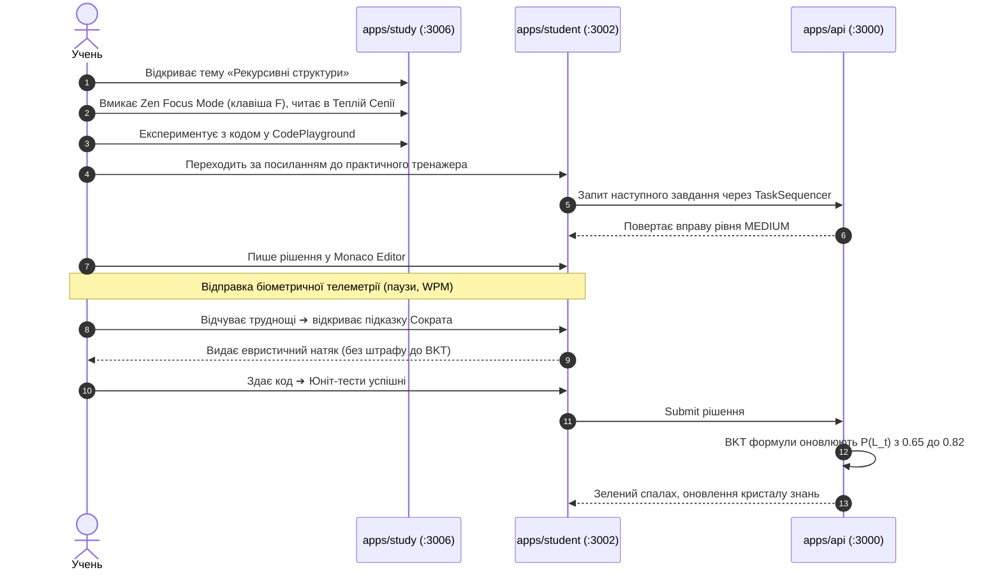

# 📖 Повний Наскрізний Гайд Платформи Smart-BKT-Chain (Master Handbook & Architecture Guide)

Цей документ є централізованим, вичерпним довідником архітектури, дидактичних сценаріїв, математичного апарату та інженерної кодової бази комплексу **Smart-BKT-Chain**.

---

## 🚀 1. Швидкий Старт та Онбординг (Getting Started & Ecosystem Shell)

### 1.1 Сутність та Візія Платформи
**Smart-BKT-Chain** — це відкрита децентралізована платформа адаптивного навчання та об'єктивного оцінювання компетенцій, розроблена на стику комп'ютерної дидактики, байєсівського моделювання знань та технологій Web3.

Система розв'язує фундаментальну проблему традиційного e-learning: **розрив між механічним зазубрюванням / списуванням та реальним формуванням стійких когнітивних навичок**. Замість лінійного тестування платформа пропонує динамічну навчальну траєкторію, де учень спочатку комфортно опановує теорію без стресу оцінювання, тренується на багатомодальних практичних вправах під наглядом розумного риштування Сократа, а його прогрес підтверджується криптографічними дипломами.

### 1.2 Карта Застосунків Монорепозиторію
Платформа побудована за архітектурою розподілених взаємопов'язаних веб-сервісів (npm workspaces):

| Застосунок | Локальний Порт | Роль у Системі | Технологічний Стек |
| :--- | :---: | :--- | :--- |
| **`apps/study`** | `3006` | **Інтерактивний Навчальний Простір:** підручник, режим Zen Focus, кодова пісочниця, картки подолання оман. | Next.js 16, React 19, Tailwind CSS v4, Lucide |
| **`apps/student`** | `3002` | **Адаптивний Практичний Тренажер:** 5 модальностей задач, Monaco Editor, BKT, підказки Сократа. | Next.js 16, Monaco Editor, WebSockets, Tailwind |
| **`apps/teacher`** | `3003` | **Кабінет Викладача:** когортна аналітика, дедуплікована черга ручної перевірки, дерево навичок RPG, BKT-аудит. | Next.js 16, WebSockets, Tailwind v4, `@sbc/ui` |
| **`apps/admin`** | `3004` | **Методичний Центр & CMS:** редактор графу знань Skill DAG, калібрування BKT параметрів, скидання прогресу. | Next.js 16, Vis Network, Tailwind, `@sbc/ui` |
| **`apps/api`** | `3000` | **Ядро Бекенду:** гексагональна архітектура, BKT-секвенсор, Socket.io шлюз телеметрії, Prisma ORM. | NestJS 10, Prisma, PostgreSQL 16, Swagger |
| **`apps/docs`** | `3005` | **Центральний Портал Документації:** повна технічна специфікація, дорожня карта, Jira-епіки. | Next.js 16, React Markdown, Tailwind |

### 1.3 Покрокове Розгортання Оточення

```bash
# Крок 1. Клонування репозиторію та перехід у робочий каталог
git clone https://github.com/DmitryStetsenko/magisterts-smart-bkt-chain.git
cd magisterts-smart-bkt-chain

# Крок 2. Встановлення залежностей для всіх робочих просторів
npm install

# Крок 3. Підготовка локальної бази даних PostgreSQL через Docker
docker run --name sbc-postgres -e POSTGRES_PASSWORD=postgres -e POSTGRES_DB=smart_bkt -p 5432:5432 -d postgres:16-alpine

# Крок 4. Запуск початкових міграцій та сидингу шкільного курсу й банку 107+ завдань
npm run db:seed

# Крок 5. Запуск сервісів для розробки
npm run dev:api     # Бекенд API (http://localhost:3000)
npm run dev:docs    # Портал документації (http://localhost:3005)
npm run dev:study   # Інтерактивний підручник (http://localhost:3006)
npm run dev:student # Тренажер учня (http://localhost:3002)
npm run dev:teacher # Кабінет викладача (http://localhost:3003)
npm run dev:admin   # Адмін-центр (http://localhost:3004)
```

---

## 📱 2. Каталог та Архітектура Застосунків Екосистеми (Ecosystem Applications)

### 2.1 `apps/study` — Інтерактивний Навчальний Простір (Порт `3006`)
* **Призначення:** Відповідає за когнітивне осмислення, первинне знайомство з концепціями, інтерактивне дослідження прикладів коду та деконструкцію типових оман учнів старшої школи (10–11 класи). Тут учень не перебуває під стресом оцінювання, а комфортно опановує теоретичний матеріал у власному темпі.
* **Ключові архітектурні модулі:**
  * **Режим Зручного Читання (Zen Focus Reading Engine):**
    * Плаваючий віджет `ReaderFloatingToolbar` з динамічним індикатором прогресу скролу (0% → 100%) та розрахунком залишкового часу опрацювання.
    * Гаряча клавіша `F` для миттєвого входу/виходу у фокусний режим.
    * Повне приховування відволікаючих бічних панелей (Opera-rail, модулі змісту).
    * Автоматичне скидання стилів до системних дефолтів платформи при виході з фокусу.
  * **Триптих Ергономічних Тем:**
    * **«Тепла Сепія» (`Warm Sepia`, фон `#181310`, текст `#f5ebd7`):** тема за замовчуванням при переході у фокус читання, повністю усуває синє світлове випромінювання та знижує напругу очей.
    * **«Ніч» (`Slate Night`, фон `#020617`):** фірмовий глибокий темний фон системи.
    * **«OLED» (`True Black`, фон `#000000`):** контрастний чорний фон для економії енергії та високої чіткості.
  * **Автономна Кодова Пісочниця (`CodePlayground`):**
    * Дозволяє учневі запускати та експериментувати з кодом прямо всередині статті підручника.
    * Перехоплення викликів `console.log()` та виведення термінальних логів безпосередньо у вікно віджета без звернення до зовнішнього сервера.
  * **Блоки Когнітивних Оман (`Misconception Alerts`):**
    * Спеціальні виділені блоки кольору бурштину, що аналізують типові хибні уявлення учнів про алгоритмічні структури (наприклад, плутанина між індексами масиву та його значеннями, мутабельність об'єктів тощо).

### 2.2 `apps/student` — Адаптивний Практичний Тренажер (Порт `3002`)
* **Призначення:** Формативне оцінювання знань, практичне тренування в написанні коду, фіксація біометричної поведінкової телеметрії та перерахунок математичної моделі BKT.
* **Ключові можливості:**
  * **Monaco Editor інтеграція:** професійне середовище розробки з підсвіткою коду, темною темою та автодоповненням.
  * **5 типів завдань:** інженерний код (`CODE`), одиночний вибір (`SINGLE_CHOICE`), множинний вибір (`MULTIPLE_CHOICE`), розгорнуте есе (`TEXT_ESSAY`), лаконічна відкрита відповідь (`OPEN_TEXT`).
  * **Сократівське Риштування (Socratic Scaffolding):** 3-рівнева система діалогових підказок (метафорична аналогія → натяк на архітектуру → шаблон або псевдокод), яка допомагає учневі знайти відповідь самостійно без нарахування штрафів до ймовірності майстерності $P(L_t)$.
  * **Візуальний Кристал Знання:** інтерактивний індикатор майстерності навички, що змінює забарвлення від червоного/жовтого до сяючого смарагдового при досягненні порогу $P(L_t) \ge 0.95$.
  * **Наскрізний перехід до теорії:** кнопка швидкого виклику уроку в `apps/study` (`studyUnitUrl`) при виникненні застрягання.

### 2.3 `apps/teacher` — Кабінет та Аналітика Викладача (Порт `3003`)
* **Призначення:** Комплексний моніторинг навчальної когорти, верифікація академічної доброчесності, ручна перевірка нестандартних робіт та аудит формул BKT.
* **Ключові можливості:**
  * **Інспектор черги ручної перевірки (`ReviewQueueInspector`):**
    * Дедуплікація завдань за зв'язкою «Студент + Завдання»: якщо учень надсилає нову версію роботи, попередня автоматично заміщується (`SUPERSEDED`).
    * Таймлайн спроб (Attempt 1, Attempt 2) із збереженням попередніх коментарів викладача.
    * Миттєва трансляція вердиктів (Схвалено / Відхилено) на клієнт учня через WebSocket.
  * **RPG-Дерево Навичок Курсу (`CourseGraphViewer`):**
    * Інтерактивна візуалізація графу тем з кривими зв'язками передумов.
    * Розподіл завдань за Когнітивною Тріадою: Синтаксис (Базовий рівень), Алгоритміка (Середній рівень), Архітектура (Поглиблений рівень).
  * **Класифікатор Аномалій Доброчесності (`AnomalyTreeWidget`):**
    * Автоматична детекція нетипової поведінки учня: підозрілий темп набору (WPM > 140), вставки великих фрагментів коду без пауз осмислення, спроби вгадування відповідей на бліц-тестах за 1–2 секунди.
  * **Аудиторський BKT Пісочник (`MetricsAuditInspector`):**
    * Покрокова симуляція оновлення $P(L_t)$ при різних параметрах $P(L_0), P(T), P(S), P(G)$ з інтерактивними поясненнями для вчителя.

### 2.4 `apps/admin` — Методичний Центр & Skill DAG CMS (Порт `3004`)
* **Призначення:** Проєктування навчальних планів, конфігурація графу навичок, налаштування коефіцієнтів адаптивності та управління життєвим циклом даних.
* **Ключові можливості:**
  * **Skill DAG Editor:** візуальний вузловий конструктор для додавання нових навичок, визначення зв'язків передумов (Pre-requisites) та налаштування послідовності проходження.
  * **Матриця BKT Параметрів:** конфігурація чутливості байєсівської моделі для кожного окремого концепту курсу.
  * **Управління Даними та Безпечне Скидання:** інструменти для ізольованого скидання історії спроб і станів $P(L_t)$ окремого учня у межах конкретного курсу або всієї системи з обов'язковим діалоговим підтвердженням.

### 2.5 `apps/api` — Ядро Бекенду (Порт `3000`)
* **Призначення:** Серверна бізнес-логіка, математичний секвенсор, збереження стану в PostgreSQL та комунікаційна шина реального часу.
* **Ключові можливості:**
  * **Гексагональна Архітектура (Ports & Adapters):** ізольоване ядро BKT математики (`domain/bkt`), захищене від впливу фреймворків чи деталей бази даних.
  * **Адаптивний Секвенсор (`TaskSequencer`):** інтелектуальний підбір наступної вправи з фільтрацією за сумісністю модальностей.
  * **Двосторонній WebSocket Шлюз:** трансляція подій друку в реальному часі та миттєва синхронізація оцінок викладача.
  * **Swagger OpenAPI:** автоматична генерація інтерактивної документації ендпоінтів (`/api/v1/docs`).

---

## 🎓 3. Інтерактивні Сценарії Користувача за Ролями (User Journeys)

### 3.1 Сценарій Учня (The Student Experience Loop)


### 3.2 Сценарій Викладача (The Teacher Audit & Review Loop)
1. **Оперативний моніторинг:** Викладач заходить у `apps/teacher` та відкриває віджет `AnomalyTreeWidget`. Система показує 2 студентів з високим індексом підозрілості через масивний копіпаст.
2. **Перевірка відкритої відповіді:** У розділі «Черга перевірки» викладач бачить нове есе учня. Інспектор показує повний текст, попередні спроби та коефіцієнт семантичної близькості від LLM Judge.
3. **Вердикт:** Вчитель залишає текстовий коментар і тисне «Схвалити». Через WebSocket учень у ту саму секунду отримує сповіщення у своєму кабінеті.

---

## 🧠 4. Математичний Апарат BKT, Секвенсор та Античіт

### 4.1 Модель Bayesian Knowledge Tracing (BKT)
Алгоритм BKT моделює ймовірність того, що учень володіє навичкою $k$ на кроці $t$, через 4 фундаментальні параметри:
* $P(L_0)$ (`pMasteryPrior` = 0.50): апріорна ймовірність володіння темою до початку роботи.
* $P(T)$ (`pTransit` = 0.20): ймовірність опанувати навичку в процесі виконання вправи.
* $P(S)$ (`pSlip` = 0.10): ймовірність припуститися описки/помилки при наявному знанні.
* $P(G)$ (`pGuess` = 0.20): ймовірність випадково вгадати відповідь при відсутності знань.

#### Математичні формули оновлення:
1. **При правильній відповіді ($obs = 1$):**
   $$P(L_t \mid \text{correct}) = \frac{P(L_{t-1}) \cdot (1 - P(S))}{P(L_{t-1}) \cdot (1 - P(S)) + (1 - P(L_{t-1})) \cdot P(G)}$$
2. **При неправильній відповіді ($obs = 0$):**
   $$P(L_t \mid \text{incorrect}) = \frac{P(L_{t-1}) \cdot P(S)}{P(L_{t-1}) \cdot P(S) + (1 - P(L_{t-1})) \cdot (1 - P(G))}$$
3. **Крок навчання (Transit):**
   $$P(L_t) = P(L_t \mid obs) + (1 - P(L_t \mid obs)) \cdot P(T)$$

### 4.2 Феномен Нижньої Асимптоти BKT (~22.86%)
На відміну від звичайних тестових балів, у моделі BKT знання живого учня **ніколи не падають до нуля ($0\%$)**, навіть при серії невдалих спроб. Завдяки складовій переходу до навчання $(1 - P) \cdot P(T)$ досягається стабільне плато на рівні:
$$P(L_{\infty}) = \frac{P(S) \cdot P(T)}{P(S) \cdot P(T) + (1 - P(G)) \cdot (1 - P(T))} \approx 22.86\%$$
Це гуманістичний дидактичний бар'єр: сам факт читання умови завдання дає потенціал навчання. При виході на асимптоту система активує інтервенцію — перенаправляє учня в підручник `apps/study`.

### 4.3 Адаптивний Секвенсор (`TaskSequencer`)
Секвенсор керується вектором майстерності учня та підбирає оптимальний наступний крок:
* **`ADVANCE`**: $P(L_t) \ge 0.95$ — перехід до наступного концепту в графі знань.
* **`REINFORCE`**: $0.70 \le P(L_t) < 0.95$ — видача ізоморфної інженерної задачі для закріплення.
* **`REMEDIATE`**: $P(L_t) < 0.70$ — перехід на полегшені бліц-квізи тієї самої теми.
* **`THEORY_REVIEW`**: при серійних помилках — видача прямого посилання на підручник `apps/study`.
* **Запобіжник модальності:** алгоритм суворо блокує стрибки з провалених концептуальних тестів на складний код.

---

## ⛓️ 5. Блокчейн-Шар та Децентралізована Верифікація

Традиційні сертифікати онлайн-курсів легко підробити або втратити при закритті сервера навчального закладу. Smart-BKT-Chain використовує блокчейн як незмінний шар довіри:
1. **Динамічні dNFT дипломи (ERC-721):**
   * Випускаються у момент досягнення порогу повної майстерності ($P(L_t) \ge 0.95$).
   * Метадані токена оновлюються в міру проходження нових модулів шкільного курсу.
2. **Soulbound токени (ERC-5192):**
   * Непередавані сертифікати, жорстко прив'язані до криптографічного гаманця учня, що гарантує захист від перепродажу досягнень.
3. **Криптографічний ланцюг доказів (`BktAuditRecordDto`):**
   * Кожна спроба фіксує підписаний хеш: час виконання, коефіцієнт телеметрії доброчесності, початкове та фінальне значення $P(L_t)$.

---

## ⚙️ 6. Інженерна Архітектура Монорепозиторію та Стандарти

### 6.1 Архітектурні Шаблони
* **Front-end:** Feature-Sliced Design (FSD) — чіткий поділ кодової бази на `app/`, `widgets/`, `features/`, `entities/`, `shared/`.
* **Back-end:** Гексагональна архітектура Ports & Adapters — чисте ядро бізнес-логіки не знає про існування Prisma чи HTTP.
* **Спільні Пакети:**
  * `@sbc/types`: єдине джерело істини для всіх інтерфейсів і контрактів DTO.
  * `@sbc/ui`: дизайн-система платформи (`DrawerSection`, `AnomalyTreeWidget`, `GameSkillTreeWidget`).

### 6.2 Обов'язкові Регламентні Стандарти (`.agents/AGENTS.md`)
* **Правило 7 (Side Drawer Sections Standard):** будь-яка бічна шторка є лише контейнером, а весь вміст структурується через акордеонні секції `<DrawerSection>` з інтерактивними індикаторами `Plus` / `Minus`.
* **Правило 8 (Dual-Level Architecture Documentation):** дворівневий стандарт документації — загальносистемний у `docs/` та доменний по кожному застосунку в `docs/apps/*.md`.
* **Git Flow:** використання конвенційних коммітів `[SBC-XXX][EP-YYY] <type>: ...` з валідацією через git-hooks.

---

## 🔬 7. Науково-Методичний Базис Магістерського Дослідження

Проєкт розроблено відповідно до вимог підготовки магістрів за спеціальністю «Середня освіта (Інформатика)» / «Комп'ютерні науки»:
* **Відповідність стандарту:** навчальна програма в `apps/study` повністю відповідає змістовній лінії «Вебтехнології та алгоритмізація» для 10–11 класів (академічний та профільний рівні).
* **Дидактична новизна:** інтеграція комп'ютерного адаптивного тестування (CAT) з деконструкцією типових когнітивних оман та діалоговими евристиками Сократа.
* **Інженерна новизна:** поєднання поведінкової телеметрії набору коду у Monaco Editor з імовірнісною моделлю BKT та децентралізованим зберіганням академічних результатів.
