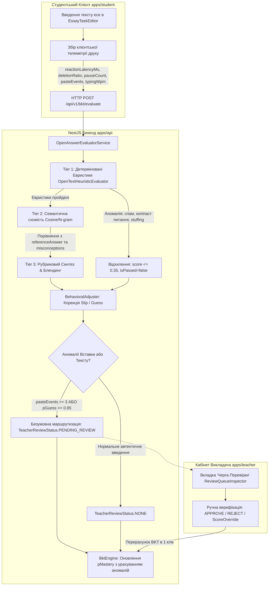

# 📊 Специфікація Аналітичних Показників та Телеметрії (Telemetry & Behavioral Analytics Specification)

Цей документ містить повний математичний та технічний опис усіх аналітичних показників, поведінкових метрик та баєсівських параметрів, які збираються та розраховуються у системі **«Smart-BKT-Chain»**.

---

## 📐 1. Математичні Параметри BKT (Bayesian Knowledge Tracing)

Алгоритм BKT імовірнісно оцінює рівень засвоєння кожної навички $P(L_t) \in [0.0001, 0.9999]$ на основі спостережень.

| Параметр | Позначення | Діапазон | Дефолтне значення | Опис та роль у системі |
| :--- | :--- | :--- | :--- | :--- |
| **$P(L_0)$** | `pMasteryPrior` | $[0.0, 1.0]$ | `0.5` ($50\%$) | **Початкова ймовірність знання.** Баєсівська апріорна ймовірність того, що студент володіє навичкою до початку виконання завдань. |
| **$P(T)$** | `pTransit` | $[0.0, 1.0]$ | `0.2` ($20\%$) | **Ймовірність навчання.** Імовірність того, що студент засвоїть навичку в процесі виконання поточного завдання. |
| **$P(S)$** | `pSlip` | $[0.0, 1.0]$ | `0.1` ($10\%$) | **Ймовірність промаху/помилки.** Імовірність припуститися помилки у завданні при **наявному знанні** матеріалу (наприклад, випадкова опечатка). |
| **$P(G)$** | `pGuess` | $[0.0, 1.0]$ | `0.2` ($20\%$) | **Ймовірність вгадування.** Імовірність випадково здати тест при **відсутності знання** (наприклад, вгадування або вставка готового коду). |
| **$P(L_t)$** | `pMastery` | $[0.0, 1.0]$ | Динамічне | **Актуальна ймовірність засвоєння.** Оновлюється за теоремою Баєса після кожної спроби. Поріг повного засвоєння: **$P(L_t) \ge 0.95$**. |

---

## ⚡ 2. Клієнтські Телеметричні Показники (Monaco Editor Telemetry)

Збираються хуком `useTelemetry` у реальному часі під час роботи студента в кодовому редакторі Monaco та передаються по WebSockets (`ws://localhost:3000/telemetry`).

### 2.1. Швидкість набору коду (`WPM` — Words Per Minute)
- **Формула розрахунку:** 
  $$\text{WPM} = \frac{\text{characterCount} / 5}{\text{timeInMinutes}}$$
- **Призначення:** Вимірює темп друку символів коду. 
- **Захист від викривлення:** Якщо код було повністю вставлено (Copy-Paste Ratio = 100%), агрегований значення $WPM$ у бекенді автоматично обнуляється до `0 WPM`, щоб запобігти штучному накручуванню показників.

### 2.2. Затримки та Паузи (`KeystrokePauseMs`)
- **Опис:** Вимірює час у мілісекундах між послідовними натисканнями клавіш.
- **Поріг паузи:** Паузи понад **$5000\text{ мс}$ (5 секунд)** фіксуються як періоди когнітивних роздумів або труднощів із формулюванням алгоритму.

### 2.3. Кількість Видалень (`deleteCount`)
- **Опис:** Підраховує кількість натискань клавіш `Backspace` та `Delete`.
- **Значення:** Висока частота видалень вказує на метод «проб і помилок» або сумніви студента у правильності обраного підходу.

### 2.4. Події Вставки Коду (`pasteEvents` & `Copy-Paste Ratio`)
- **Детекція:** Багаторівневе перехоплення через Monaco API `onDidPaste`, DOM `paste` listener та стрибки довжини коду ($> 3\text{ символів}$).
- **Copy-Paste Ratio:** 
  $$\text{CopyPasteRatio} = \begin{cases} 1.0 \text{ (100\%)}, & \text{якщо зафіксовано події вставки} \\ 0.0 \text{ (0\%)}, & \text{якщо код набрано вручну} \end{cases}$$
- **Сигналізація:** Використовується викладачем для виявлення потенційного списування або копіювання коду зі сторонніх джерел чи ШІ-генераторів.

---

## 🧠 3. Інтегровані Поведінкові Метрики (Behavioral Profile)

Похідні аналітичні показники, що розраховуються бекендом для формування поведінкового профілю студента (`BehavioralProfile`).

### 3.1. Коефіцієнт Довіри (`TrustCoefficient`)
- **Діапазон:** $[0.0, 1.0]$ ($0\% - 100\%$).
- **Опис:** Агрегований показник самостійності виконання завдань.
- **Вплив:** Зменшується при високому `Copy-Paste Ratio` та високих показниках аномальних дій.

### 3.2. Індекс Втоми (`FatigueIndex`)
- **Формула:** 
  $$\text{FatigueIndex} = 1.0 - \text{TrustCoefficient}$$
- **Діапазон:** $[0.0, 1.0]$ ($0\% - 100\%$).
- **Опис:** Вимірює рівень когнітивного виснаження, сумнівів або поспіху студента.
- **Інтерпретація:**
  - `0% - 30%` (🟢 **Низька втома**): Стабільний темп набору, висока впевненість.
  - `31% - 60%` (🟡 **Помірна втома**): Збільшення пауз та кількості видалень.
  - `61% - 100%` (🔴 **Висока втома**): Сигналізує викладачу про необхідність перерви або спрощення завдань.

---

## 🔄 4. Стан Анулювання Результатів (Reset / Unstarted State)

При анулюванні результатів BKT через ендпоінт `POST /api/v1/bkt/reset/:studentId`:
- Всі попередні записи `BktState`, `Submission`, `BktHistory` та `TelemetrySession` видаляються з БД.
- В аналітиці викладача та на графі навичок встановлюється точний стан **`UNSTARTED`**:
  - $P(L_t) = 0.0\%$
  - $\text{WPM} = 0$
  - $\text{Copy-Paste Ratio} = 0\%$
  - $\text{Fatigue Index} = 0\%$

---

## ⚡ 5. Поведінкові Аномалії та Індикація у Дереві Знань (Behavioral Anomalies & Skill Tree Indicators)

Система реалізує наскрізну детекцію двох критичних поведінкових аномалій із виведенням попереджень у кабінеті викладача та в інспекторі Дерева Знань (RPG Skill Tree):

### 5.1. Аномалія Вгадування (`hasGuessAnomaly` / $P(Guess) > 0.3$)
- **Параметр:** `hasGuessAnomaly: boolean`
- **Тригер спрацьовування:** Відповідь на тестові завдання (`SINGLE_CHOICE`, `MULTIPLE_CHOICE`) за час `reactionLatencyMs < 3500` мс.
- **Математична дія:** Доменний модуль `BehavioralAdjuster` динамічно підвищує параметр ймовірності вгадування до **$P(G_{\text{used}}) = 0.85$** для конкретної спроби.
- **Вплив на BKT:** Навіть при правильній відповіді ріст рівня майстерності $P(L_t)$ блокується або суттєво мінімізується:
  $$P(L_t \mid \text{Correct}) = \frac{P(L_{t-1}) \cdot (1 - P(S))}{P(L_{t-1}) \cdot (1 - P(S)) + (1 - P(L_{t-1})) \cdot P(G_{\text{used}})}$$
  Оскільки знаменник значно зростає через $P(G)=0.85$, приріст знань майже нульовий.
- **Візуалізація для викладача:**
  - **На холсті Дерева Знань:** Рунічний кристал модуля отримує пульсуючий бейдж ⚡ `!`.
  - **В інспекторі модуля:** Жовтий банер *«Аномалія Вгадування (P(Guess) > 0.3)»* із поясненням та записом в історію $G=0.85$.

### 5.2. Аномалія Копіпасту (`hasCopyPasteAnomaly` / $\text{CopyPasteRatio} \ge 60\%$)
- **Параметр:** `hasCopyPasteAnomaly: boolean`
- **Тригер спрацьовування:** Частка коду, вставленого через комбінації клавіш (`Ctrl+V`) або контекстне меню, сягає $\ge 60\%$ від загального обсягу символів розв'язку.
- **Візуалізація для викладача:**
  - **На холсті Дерева Знань:** Червоний бейдж ⚠️ `!` на рунічному вузлі.
  - **В інспекторі модуля:** Червоний банер *«Аномалія Копіпасту (≥ 60%): Зафіксовано високу частку прямої вставки коду/тексту. Можливе списування або використання зовнішніх генераторів»*.

### 5.3. Розподіл прав показу (Privacy & Anti-Stress Rule)
- **Студент:** Секундомір та значення $P(G)/P(S)$ **повністю приховані** для уникнення когнітивного стресу таймера та спроб обману алгоритму.
- **Викладач:** Має повний доступ до детального журналу коригувань `adjustReasons`, часових міток та використаних коефіцієнтів.

---

## 📝 6. Повний Пайплайн Перевірки Відкритих Текстових Завдань (`OPEN_TEXT` / `TEXT_ESSAY`)

Для відкритих завдань (есе, теоретичні пояснення) система реалізує комплексний багаторівневий механізм **Multi-Tier Semantic & Behavioral Evaluation**, розроблений для запобігання неавтентичній інфляції BKT-знань ($P(Guess)$) та необґрунтованому штрафуванню ($P(Slip)$).

### 6.1. Архітектура Багаторівневої Перевірки (Multi-Tier Evaluation)

---

### 6.2. Класифікація Текстових Аномалій та Алгоритми Детекції

У модулі [`OpenTextHeuristicEvaluator`](file:///apps/api/src/domain/evaluation/open-text-heuristic-evaluator.ts) реалізовано алгоритмічний захист від 6 категорій текстових маніпуляцій:

| Тип Аномалії | Ознаки у Тексті Студента | Алгоритм Виявлення | Санкції та Наслідки |
| :--- | :--- | :--- | :--- |
| **1. Абракадабра / Keyboard Mashing** | `asdfghjkl`, `йцукен`, `фффххх` | Аналіз слів $\ge 6$ літер: частка голосних $< 20\%$, регулярки пробіжок клавішами (`asdf|qwer|йцук|фіва`), повтор одного символу 3+ рази підряд (`(.)\1\1`). Поріг: $\ge 25\%$ підозрілих слів. | `score <= 0.1`, `isPassed = false`, `isGibberish = true`, `needsTeacherReview = true`. |
| **2. Копіпаст Запитання (Prompt Echoing)** | Цитування або переписування тексту умови завдання | Розрахунок коефіцієнта перекриття множини слів відповіді та слів запитання: $\text{Overlap} = \frac{\|W_{\text{answer}} \cap W_{\text{question}}\|}{\|W_{\text{answer}}\|}$. Поріг: $\ge 60\%$. | `score = 0.0`, `isPassed = false`, `isQuestionCopyPaste = true`. Підказка: *«Сформулюйте власну думку»*. |
| **3. Бідність Словника / Тавтологія (Low TTR)** | Багаторазове повторення одного-двох слів для набору обсягу | Type-Token Ratio: $\text{TTR} = \frac{\|U_{\text{words}}\|}{\|W_{\text{words}}\|}$. Якщо для тексту $\ge 8$ слів коефіцієнт $\text{TTR} < 0.45$. | `score` штрафується на $50\%$. |
| **4. Вертикальний Перелік Слів (Vertical Word Dump)** | Стовпчик ключових термінів без розділових знаків | Кількість рядків $\ge 3$, середня кількість слів у рядку $\le 2.2$ та відсутність пунктуації кінця речення (`.!?`). | `isKeywordStuffing = true`, `score <= 0.35`, `isPassed = false`, `needsTeacherReview = true`. |
| **5. Сміттєві Слова-Паразити (Short Garbage Flood)** | Розбавлення термінів короткими звуками (`це щось про др дддю`) | Частка токенів довжиною $\le 2$ символів складає $\ge 35\%$ при загальній довжині $\ge 6$ токенів. | Вважається варіантом `Keyword Stuffing`, блокує зарахування. |
| **6. Циклічний Лупінг Фраз (Phrase Looping Spam)** | Копіювання 4-5 рядків однакової комбінації термінів із склеєними словами (`чергаmicrotask`) | 1) Нормалізація: розділення токенів на межі мов `Cyrillic/Latin`. 2) Ковзне вікно 3-грам: якщо частота повтору будь-якої 3-грами $\ge 3$. 3) Лексичний ліміт: $\ge 12$ слів, але унікальних $\le 5$. | `isKeywordStuffing = true`, `score <= 0.35`, `isPassed = false`, `needsTeacherReview = true`. Повідомлення про зациклений фразовий спам. |

---

### 6.3. Математична Модель Корекції BKT при Текстових Відповідях (`BehavioralAdjuster`)

Результат семантичної оцінки транслюється у параметри $P(G_{\text{used}})$ та $P(S_{\text{used}})$ перед подачею у формулу Баєса:

#### 1. Аномалія Копіпасту у Відкритому Тексті (`pasteEvents`):
Якщо при написанні відкритої відповіді студент використав буфер обміну:
$$P(G_{\text{used}}) = 0.90 \quad \text{при } \text{pasteEvents} > 0$$
*Наслідок:* Якщо навіть студент скопіював ідеальний еталонний текст, знаменник оновлення $P(L_t \mid \text{Correct})$ різко зростає через $P(G)=0.90$, завдяки чому приріст знання $P(L)$ залишається майже нульовим ($+0.01$).

#### 2. Аномалія Надшвидкого Набору (`typingWpm > 120`):
Людина фізично не може формулювати та друкувати змістовне технічне есе зі швидкістю $> 120$ слів за хвилину:
$$P(G_{\text{used}}) = 0.85 \quad \text{при } \text{typingWpm} > 120 \text{ WPM}$$

#### 3. Пом'якшення Штрафу при Когнітивному Ваганні (Hesitant Knowledge):
Якщо відповідь студента частково правильна ($\text{conceptCoverageRatio} \ge 0.50$), але супроводжувалася частими видаленнями/виправленнями ($\text{deletionRatio} \ge 0.25$):
$$P(S_{\text{used}}) = 0.35 \quad \text{(підвищення ймовірності випадкової описки)}$$
*Наслідок:* Система розуміє, що студент знає концепцію, але сумнівався у формулюванні. При розрахунку BKT після помилки майстерність $P(L_t)$ знижується помірно, а не обвалюється до нуля.

---

### 6.4. Безкомпромісна Маршрутизація до Черги Викладача (Teacher Review Queue)

На відміну від стандартних тестів, де вердикт остаточний, у відкритих відповідях система використовує підхід **Human-in-the-Loop**:

1. **Автоматичні Тригери Скерування у `PENDING_REVIEW`:**
   - **Виявлення Текстового Спаму:** спрацьовування прапорців `isKeywordStuffing`, `isGibberish` або `maxNgramRepeats >= 3`.
   - **Сіра Зона Балів:** підсумкова оцінка перебуває у діапазоні $0.45 \le \text{Score} \le 0.70$.
   - **Відсутність Налаштованих Критеріїв:** якщо викладач ще не задав рубрики для завдання.
   - **Безумовний Поведінковий Тригер:** якщо студент здійснив **$\ge 3$ подій вставки з буфера (`pasteEvents >= 3`)** або модель зафіксувала **$P(Guess) \ge 0.85$**, статус роботи **БЕЗУМОВНО** змінюється на `TeacherReviewStatus.PENDING_REVIEW`, навіть якщо формальний семантичний бал $> 0.70$.
2. **Інструментарій Кабінету Викладача (`ReviewQueueInspector`):**
   - Робота студента миттєво з'являється у розділі *«Черга Перевірки»*.
   - Викладач бачить: повну умову завдання, еталонне пояснення (`referenceAnswer`), текст студента з підрахунком слів, плашки ключових понять, розраховані аномалії телеметрії (`pasteEvents`, `WPM`, $P(G)$).
   - Можливість в 1 клік затвердити відповідь (`APPROVE`), відхилити (`REJECT`), перевизначити бал вручну (`scoreOverride`) та залишити розгорнутий коментар учню.
   - При затвердженні викладачем NestJS виконує легітимний перерахунок майстерності $P(L)$ у ланцюжку BKT.
